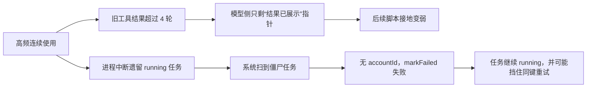

# 高频用户 sidecar 日志健康审计

> 任务：T-511  
> 日期：2026-07-24  
> 范围：用户提供的 `sidecar.log(19).enc`，只读、脱敏分析；未保存明文日志，未输出 Cookie、密钥或用户正文。  
> 结论口径：区分「已证实」「高概率风险」「观察项」，不把缺少 runner 证据的推测写成事实。

## 一句话结论

这 2 小时 16 分钟内，21 个对话回合有 20 个正常结束，未见模型鉴权、HTTP 4xx/5xx、上下文硬截断或 sidecar 崩溃；但发现一条会真实卡住后台任务的系统缺陷、两条会让高频用户逐渐丢创作上下文/预设知识的产品缺口，以及两条需要发布与真机复验的风险信号。



## 日志概况

- 会话范围：`2026-07-24T11:32:00Z` 至 `13:48:23Z`。
- 日志共 187 行，其中 121 行为 stderr；120 行来自同一异常簇的重复堆栈，另 1 行是课程种子目录缺失。
- 对话：21 回合，20 completed、1 aborted；中位耗时 9.58 秒，P90 44.57 秒，最大 69.33 秒。
- 工具调用：16 次；最慢单次为 `material.gather` 36.50 秒。
- 上下文投影：最高 `9444→8598` 估算 token；最大清除 5 个旧工具结果；`truncated` 始终为 0。
- 21 回合投影前估算输入累计 127,803 token，投影后仍约 117,178 token，只减少约 10,625。

## 发现一：僵尸 AI 任务清理确定失效

**状态：已证实；用户影响高。**

日志中 3 个固定 taskId 从启动开始，每隔 30 分钟再次尝试清理，共出现 5 轮、15 次：

```text
[scheduler] 僵尸 ai_task … 标 failed 失败:
AccountRequiredError: ai.markFailed requires a selected account (ctx.accountId missing)
```

代码链路存在确定的不对称：

1. scheduler 使用无 `accountId` 的系统上下文；
2. `listRunningTasksSystem` 能跨账号列出 running 任务；
3. 随后却调用用户态 `aiService.markFailed`；
4. `markFailed` 进入 `repoFor`，强制要求 `accountId`，所以每条都失败。

这些任务不会自行退出 running。代码注释已经说明，running 僵尸会命中同幂等键的 in-flight 闸，导致用户重试时仍拿到旧任务。前端可能持续转圈、轮询超时或无法重新发起同类工作。

修复不能简单放宽所有用户态 `markFailed` 的账号门。安全边界应是：系统查询同时返回任务真实 `accountId`，逐条构造有归属的上下文再终结；或新增窄口径、带 user/task 归属校验和审计事件的 system mark-failed 操作。

## 发现二：长对话会在远未接近上下文上限时清掉旧工具证据

**状态：已证实；高频创作连续性影响中高。**

该会话最大上下文估算只有 9,444 token，远低于默认 100,000 窗口，也从未触发整轮截断；但 `cleared` 从 1 增至 5。原因是系统不是等接近窗口才清理，而是无条件只保留最近 4 个对话轮次的 tool result，较早结果替换为：

```text
[结果已展示给用户,如需重读请再调工具]
```

因此 UI 和数据库没有丢数据，但模型已经看不到原始素材内容。对“先搜素材 → 讨论多轮 → 立论点 → 写脚本”的高频工作流，早期搜索证据可能在真正写稿前被清走。

本次日志里，11:39 的素材搜集到 11:46 写脚本之间经过多轮对话，写脚本前已经出现 `cleared=2`。再叠加 T-509 已确认的 `extraBrief` 异步 runner 断链，后续脚本很可能拿不到对话中搜到但尚未落入项目素材/产物的原始证据。这不是存储数据丢失，而是模型上下文连续性丢失。

## 发现三：真实用户拿不到约定的 22 节课程预设

**状态：已证实；知识库开箱体验影响中。**

启动时记录：

```text
[seed] win-video-tutor 课程源不存在于 /Users/<用户>/.claude/skills/win-video-tutor/knowledge
```

生产组合根会为每个 active 账号执行课程 seed，但默认源仍是用户 Home 下的开发者技能目录。普通 CreatorOS 用户不会安装这个 Claude/Codex 技能，因此尚未 seed 的账号会静默得到 0 条课程，知识库或观点地图可能与“开箱有 22 节真课程”的代码注释和测试口径不一致。

正确边界是把课程作为应用资源随包分发并从 runtime resource 读取，或者正式取消生产预设并同步产品口径；不能继续依赖用户机器上的 `~/.claude/skills`。

## 发现四：同一回合可能重复执行昂贵的素材搜集

**状态：高概率风险，日志不足以确认两次 query 完全相同。**

13:39 这轮先读取项目素材/产物，随后连续执行两次 `material.gather`：

- 36.50 秒；
- 23.81 秒；
- 整轮耗时 69.33 秒。

`topic.enrich` 已按规范化参数做同回合 Promise 去重，但 `material.gather` 没有对应去重。日志又不记录脱敏 query hash，所以无法判断两次是合理的不同检索，还是模型重复调用了相同/近似查询。

对高频用户，这会放大等待时间、联网搜索次数和模型费用。建议按规范化 query + 项目上下文做“单回合相同参数共用 Promise”，并只记录 query hash/结果数/grounding，不记录原查询正文。

## 发现五：`chat-tool ok` 对异步工具只代表“分派成功”，不是任务成功

**状态：已证实；可观测性影响中。**

日志里的：

```text
script.draft ok durationMs=18
planning.thesis ok durationMs=18
review.script ok durationMs=14
```

只是 `defineChatTool` 等待 `execute` 返回后的通用日志。这三类 `execute` 都只创建后台任务并立即返回 taskId，真实生成随后由进程内 fire-and-forget runner 执行。因此 `ok` 不能证明脚本、论点树或审核已经生成成功。

当前日志没有 taskId 关联、runner terminal status、真实模型 finishReason/usage/结果数量。它不仅妨碍 T-509 这类问题定位，也会让上述僵尸任务看起来像“工具成功过”。应建立 `chat-tool dispatch → ai_task taskId → runner started → terminal` 的脱敏关联日志。

## 观察项：macOS 自签名校验异常

**状态：需对原发布物复验；当前会话没有直接功能故障证据。**

启动记录：

```text
签名自校验: 已签名 valid=false team_id=<none>
```

代码把存在 `Signature=` 痕迹但 `codesign --verify --strict` 失败的二进制归为 `Signed { valid:false }`，当前只写日志、不阻断，且期望 Team ID 仍为 `None`。它可能只是内测/ad-hoc 构建形态，也可能意味着打包后文件被改动或正式签名链不完整。由于应用已正常启动，本日志不能证明它造成了本次业务故障；但正式发布物应在分发前后各跑一次 `codesign --verify --strict --deep`、Team ID 与 notarization 实物校验。

## 未发现或可视为低风险

- 未见模型鉴权失败、HTTP 4xx/5xx、429、超时或 sidecar crash。
- 1 次 139ms 的 `aborted` 更像用户停止、切页或新请求取消；单次不足以判为故障。
- Next.js sidecar 启动正常，`Ready in 0ms`。
- 日志虽然被僵尸堆栈污染，但加密日志每次启动只保留当前和上一会话，不会无限累积；主要问题是信噪比和任务状态，而不是无界磁盘增长。

## 建议的修复边界

一次收口应同时处理：

1. 修复 system sweep 的账号归属闭环，并补“双账号僵尸任务可终结、不可跨号误杀”测试；
2. 把关键创作证据从短命 tool result 提升为显式 context manifest/项目素材引用，写稿前自动重读，不能只调大保留轮数；
3. 将课程资源随包分发或删除该生产 seed 契约；
4. 为昂贵工具增加单回合同参去重及脱敏 query hash；
5. 为异步任务补齐 taskId、runner terminal、finishReason、usage、结果数量日志；
6. 对实际分发的 macOS artifact 做签名与公证实物审计。
