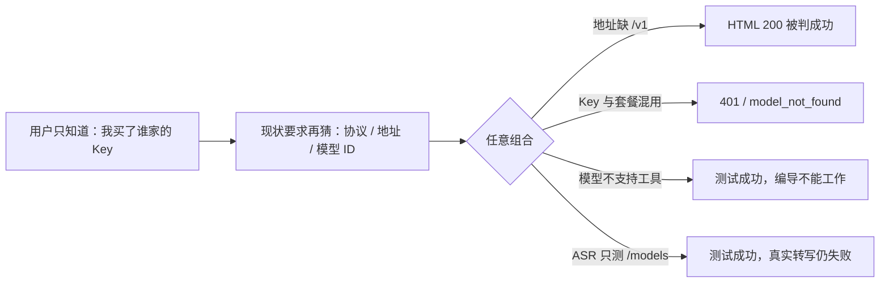

# CreatorOS 模型配置全量审计

> 日期：2026-07-24  
> 任务：T-501  
> 范围：CreatorOS 桌面 APP 的模型配置、连接测试与真实消费链；不以 localhost 网页作为产品口径。  
> 隐私：本审计不读取、不输出任何用户 API Key。

## 一句话结论

当前问题不是“教程不够长”，而是产品把供应商、Key 来源/套餐、协议、Base URL、模型 ID 和能力类型六个不同概念同时交给普通用户自由组合；连接测试又只验证 HTTP 2xx，导致“配置打勾、编导不工作”。需要把配置改为由 **Key 来源与用途驱动的受约束向导**，并以与真实业务一致的能力探针验收。

## 用户看到的因果图



## 1. 仓内事实

| 事实 | 证据 | 判断 |
|---|---|---|
| 文本预设只是一次性填充，所有原始字段仍可自由修改 | `frontend/src/features/settings/model-provider-presets.ts:1-14,51-154`；`frontend/src/features/settings/settings-interactive-region.tsx:2223-2477` | 有效组合没有被约束 |
| 所有文本模型候选被刻意置空，用户只能手输模型 ID | `frontend/src/features/settings/model-provider-presets.ts:34-37` | 避免了陈旧列表，却把拼写、渠道和能力判断全部转嫁给小白 |
| Google 出现在 provider 建议中，但没有正式预设 | `frontend/src/features/settings/settings-interactive-region.tsx:2064-2073`；反证：`model-provider-presets.ts` 无 `google` | “看似支持”与“已适配”混淆 |
| 测试只读取已保存配置 | `frontend/src/features/settings/settings-interactive-region.tsx:2137-2142,2181-2197` | 用户必须先保存错误配置才能测试 |
| 文本连接测试只看 `res.ok`，不校验 Content-Type、JSON/SSE 和非空正文 | `frontend/src/server/settings-model-test-wrap.ts:134-216` | 营销 HTML 200 会被误判为模型成功 |
| 文本测试为非流式、1 token、无工具；真实编导是流式且带工具和长上下文 | `frontend/src/server/settings-model-test-wrap.ts:133-203`；`docs/research/2026-07-24-relay-test-pass-chat-empty-diagnosis.md` | 测试成功不代表能用于编导 |
| ASR 测试只 GET `/v1/models`，且可能在已有 `/v1` 的 Base URL 后再拼一次 `/v1` | `frontend/src/server/settings-model-test-wrap.ts:275-312` | 不能证明真实音频转写可用，并有 `/v1/v1/models` 风险 |
| 图片测试会真实生成；视频只做鉴权；各能力“成功”的含义不同 | `frontend/src/server/settings-model-test-wrap.ts:218-273,356-520` | 单一“测试连接”标签会误导 |
| 文本运行由 `apiFormat` 决定，不由 provider 标签决定 | `ai-worker/src/runtime/provider-factory.ts:6-18,42-74` | provider 文本框对普通用户没有决策价值 |
| 图片内置 MiniMax 与 OpenAI-compatible；视频只内置 MiniMax；ASR 内置 SiliconFlow/OpenAI/Groq/本地 Whisper | `frontend/src/server/persistence-client.ts:8898-8924` | UI 必须按已注册 adapter 给出真实支持范围 |
| 当前配置手册已有三步说明和两个示意图，但内容是静态示例 | `frontend/src/features/settings/model-configuration-manual.tsx:73-197` | 应升级为上下文教程，不应重复再造一个孤立弹窗 |

## 2. 文本供应商/产品线审计

| 当前入口 | 审计结论 | 需要的产品处理 |
|---|---|---|
| Anthropic 官方 | 官方 Messages 协议路径成立 | 普通模式只让用户选模型、填 Key；协议与地址锁定 |
| MiniMax | 当前 Anthropic base 合法；但按量 Key、Token Plan Key 独立，且另有 OpenAI-compatible `/v1` | 拆 Key 来源/套餐；默认推荐 Anthropic；动态取模型或用带日期的兜底目录 |
| DeepSeek | Chat base 合法；模型上下线快 | 不硬编码长期模型；优先模型发现并标最近刷新时间 |
| 智谱 GLM | Anthropic-compatible base 合法 | 锁定正确协议；模型列表按账户可用项选择 |
| Kimi | 当前预设 `api.moonshot.cn/anthropic` 已与开放平台官方口径不一致 | 至少拆“Kimi 开放平台”和“Kimi Code”；开放平台用 OpenAI Chat；Code 的 Key/base/model 不得混用 |
| 通义千问/百炼 | 当前按量 OpenAI-compatible base 只覆盖一种产品；Token Plan、Coding Plan、区域/工作空间存在独立 Key 与地址 | 先问 Key 来自哪个产品/区域，再自动给地址和模型；禁止把不同计划 Key 混填 |
| StepFun | 标准 `/v1` 合法；Step Plan 是独立 base/产品 | 拆标准 API 与 Step Plan |
| 硅基流动 | OpenAI-compatible base 合法，模型多且变动快 | 动态模型列表按能力过滤；ASR 与聊天模型不可混在同一候选 |
| 魔搭 ModelScope | OpenAI-compatible base 合法，模型多 | 动态模型列表；没有列表时才允许手填并显示黄色未验证 |
| 火山方舟 | `/api/v3` 合法；模型名可能是 `ep-*` 接入点 | 教程必须解释“模型 ID/接入点”；不能给固定模型名冒充通用 |
| OpenRouter | Chat base 合法；Responses 尚不应作为默认路径 | 默认 Chat；模型目录来自平台；按工具能力过滤 |
| OpenAI 官方 | Responses 作为默认文本路径可行 | 主编导仍需真实验证流式和工具调用 |
| Google Gemini | 官方 OpenAI compatibility 存在但仍标 beta；当前 APP 只有建议文本，无正式预设 | 要么新增“实验性”正式预设并通过能力测试，要么从建议中移除，禁止半支持 |
| 自定义/中转站 | 当前完全自由，且 2xx 即成功 | 单独向导：候选路径探测、展示最终 endpoint、验证 JSON/SSE/正文/工具，不静默改地址 |

官方证据：

- MiniMax Key/Token Plan 与多模态能力：<https://platform.minimaxi.com/docs/api-reference/api-overview>
- MiniMax Anthropic-compatible：<https://platform.minimaxi.com/docs/guides/text-generation>
- Kimi Open Platform：<https://platform.kimi.com/docs/api/overview>
- Kimi FAQ（区域、Base URL、model_not_found）：<https://platform.kimi.com/docs/guide/faq>
- 通义千问产品与 OpenAI compatibility：<https://help.aliyun.com/zh/model-studio/what-is-model-studio>
- 通义千问 Token Plan：<https://help.aliyun.com/zh/model-studio/token-plan-quickstart>
- StepFun OpenAI compatibility：<https://platform.stepfun.com/docs/zh/guides/developer/openai>
- Google Gemini OpenAI compatibility（beta）：<https://ai.google.dev/gemini-api/docs/openai>
- OpenRouter quickstart：<https://openrouter.ai/docs/quickstart>

## 3. 能力审计

| 能力 | 当前真实 adapter | 当前测试 | 缺口与正确验收 |
|---|---|---|---|
| 主编导文本 | Anthropic / OpenAI Chat / OpenAI Responses | 非流式 1 token、无工具 | 必须依次验证合法响应、非空正文、流式 delta、工具调用；只有全部通过才标“可用于编导” |
| 文案审核/备用文本 | 同文本协议 | 同主文本最小探针 | 需按该能力实际所需的结构化输出/流式要求分级，不沿用一个笼统绿勾 |
| 图片生成 | MiniMax / OpenAI-compatible Images | 真实最小生图 | 明示会产生少量费用；先做不计费鉴权，再由用户确认是否真生成 |
| 视频生成 | MiniMax 异步任务 | 只做鉴权/端点 | 状态只能叫“密钥与地址可达”，不能叫“视频模型可用”；真实生成测试需二次确认费用 |
| ASR | SiliconFlow / OpenAI / Groq / 本地 Whisper | 云端只 GET `/models` | 云端用 APP 内置短音频做真实转写；本地 Whisper验证模型可用/下载状态；显示本地或云端模式 |
| Embedding | OpenAI-compatible | 真实最小 embedding | 校验向量非空、维度有效，不只看 2xx |
| Vision | OpenAI-compatible Chat Vision | 文本式探针或复用 chat | 用内置 1×1/小图验证图像输入确实被接受 |
| Web Search | RSS/browser/Bocha/Tavily/SerpAPI | 各自不同 | 不属于“模型”，应从模型配置页拆为“联网与数据源”，避免概念污染 |

ASR 官方证据：

- SiliconFlow：`POST /v1/audio/transcriptions`，模型为 SenseVoice/TeleSpeech 等：<https://docs.siliconflow.cn/cn/api-reference/audio/create-audio-transcriptions>
- Groq：`POST /openai/v1/audio/transcriptions`，支持 Whisper 系列：<https://console.groq.com/docs/speech-to-text>
- OpenAI：`POST /v1/audio/transcriptions`：<https://platform.openai.com/docs/api-reference/audio>

图片/视频官方证据：

- MiniMax 图片：<https://platform.minimaxi.com/docs/api-reference/image-generation-i2i>
- MiniMax 视频异步流程：<https://platform.minimaxi.com/docs/guides/video-generation>

## 4. 已复现的生产故障

### 4.1 Kimi 预设错误

当前 Kimi 预设使用 Anthropic 协议和已不匹配开放平台的地址。用户手动切到 OpenAI Chat 才连接成功。详见：

- `docs/research/2026-07-24-kimi-app-model-config-diagnosis.md`

### 4.2 中转站“测试成功、编导空回复”

Base URL 缺 `/v1` 时，`/chat/completions` 和 `/responses` 命中营销网页并返回 `text/html` 200；测试只看 2xx，因此误判成功。补 `/v1` 后才得到真实 `model_not_found`。详见：

- `docs/research/2026-07-24-relay-test-pass-chat-empty-diagnosis.md`

## 5. 根因归类

1. **概念暴露错误**：用户买的是某平台某套餐的 Key，APP 却先问 wire protocol。
2. **自由度位置错误**：高级自由组合是中转站/专家需求，却成为所有人的默认界面。
3. **模型目录策略错误**：从“陈旧硬编码”直接跳到“全部手填”，缺少动态目录 + 有日期兜底。
4. **测试契约过弱**：2xx、鉴权或 `/models` 被统一展示为“连接成功”。
5. **教程与真实配置脱节**：手册无法读取用户当前平台、能力和错误，也无法一键带回正确表单。
6. **能力边界混乱**：文本、ASR、图片、视频、Embedding、搜索共用相似卡片，但 adapter 和成功定义完全不同。

## 6. 审计后的产品决策建议

- 默认使用“小白模式”：选用途 → 选 Key 来源/产品 → 粘 Key → APP 自动填协议/地址并获取可用模型。
- 自定义中转站单独进入“高级接入”，不与官方平台混用。
- 主编导的绿色终态只叫“可用于编导”，必须通过非空、流式和工具调用；基础网络通只能是中间步骤。
- 测试直接使用未保存草稿；通过后一次保存。高级用户可以“仍然保存”，但必须保留黄色风险状态。
- 教程由同一 provider registry 生成：官方 Key 入口、产品/套餐区别、字段说明、常见错误和当前状态不会再各写一份漂移。
- 搜索/RSS/browser 从“模型”分组移到“联网与数据源”；本地 Whisper 在 ASR 卡中作为显式选项，不再靠“留空”隐式启用。
- 预设、运行时、模型发现、测试与教程共享一个能力目录，避免同一厂商在五处写五套地址。

## 7. PLAN RAT：三协议流式/工具调用可行性

日期：2026-07-24。脚本：

```text
ai-worker/scripts/research/model-stream-tool-rat.mts
```

执行：

```bash
cd ai-worker
node --experimental-strip-types scripts/research/model-stream-tool-rat.mts
```

该 RAT 使用仓库当前安装的 `ai@7.0.4`、`@ai-sdk/anthropic@4.0.1`、
`@ai-sdk/openai@4.0.2`、`@ai-sdk/openai-compatible@3.0.1`，通过各 provider
官方的 injected `fetch` seam 提供 0 网络、0 Key、0 费用 fixture。对
Anthropic Messages、OpenAI Chat、OpenAI Responses 各执行四种样本：

| 样本 | 三协议结果 | 产品判定 |
|---|---|---|
| 合法 text SSE | 均解析出 `pong` 和至少 1 个 `text-delta` | `content` + `stream` 通过 |
| 合法强制 tool-call SSE | 均解析出 1 个 `tool-call` 和合法参数 | `tools` 通过 |
| `text/html` 200 | Anthropic SDK 给 error；Chat/Responses 可能安静结束且 0 内容 | 必须在 SDK 外先检查 Content-Type；不能依赖 SDK 报错 |
| 空 SSE 200 | 可能报流错误，也可能安静结束；三者均 0 文本、0 工具 | 必须由 APP 自己执行“至少一个有效 delta/tool”终态门 |

终端结果：12/12 个预期分类通过，进程 exit 0。

结论：

1. 三协议可以统一产出领域步骤 `content/stream/tools`，无需为 UI 制造三套状态；
2. wire fixture 必须分协议维护，不能用同一份 SSE 冒充；
3. SDK 不能替代 CreatorOS 的成功判定，尤其 OpenAI Chat/Responses 对 HTML/空流可能不抛错；
4. 主编导“可用”必须同时要求合法 Content-Type、非空 delta、强制工具调用解析成功。

## 8. CC-Switch / New API 代码交叉审计

本轮不是照抄第三方模型名称，而是用两个真实实现反查 CreatorOS 的兼容边界：

- CC-Switch：`farion1231/cc-switch@878c26f31e012ba32b9772bd080bd4fa9e7d495e`；
  重点检查 `src/config/*ProviderPresets.ts`、`src/config/codingPlanProviders.ts`、
  `src-tauri/src/services/model_fetch.rs`、`src-tauri/src/model_capabilities.rs`；
- 本地中转站：`/Users/zyongzhu/Workbase/Thirdspace-api@511465e459041175bbaea2e987c33581cc51e752`，
  它基于 `QuantumNous/new-api`；重点检查 `constant/channel.go`、
  `constant/endpoint_type.go`、`relay/constant/relay_mode.go` 与 `service/relayconvert/`。

交叉审计得到四个结论：

1. **同品牌必须拆产品线**：Kimi 开放平台/Kimi Coding、智谱标准/Coding/团队版、
   MiniMax 标准/Coding、通义标准/Token 或 Coding Plan、火山标准/Coding 的 Key、地址或协议
   可能不同，不能只做一个品牌下拉；
2. **中转站必须按实际端点能力识别**：New API 系中转可同时暴露 OpenAI Chat、
   OpenAI Responses、Anthropic、Gemini、Embedding、图片、音频、视频等端点，
   “这是一个中转站”本身不能决定运行协议；
3. **模型目录应动态发现**：CC-Switch 会尝试 `/v1/models`、`/models`，并允许覆盖模型列表
   URL；CreatorOS 可以借鉴探测策略，但必须显示最终请求地址、来源和刷新时间，不静默猜测；
4. **不能照抄静态模型 ID**：第三方目录包含快速变化甚至前瞻性的型号；目录只用于发现候选
   provider/product，最终模型 ID 来自用户账户的动态列表或有日期的官方 overlay，并经过
   CreatorOS 自己的能力探针。

### 8.1 默认收录层级

| 层级 | Provider / 产品线 | CreatorOS 处理 |
|---|---|---|
| 默认官方向导 | OpenAI、Anthropic Claude、Google Gemini（官方 OpenAI compatibility）、DeepSeek、Kimi 开放平台/Kimi Coding、MiniMax 标准/Coding（国内/国际）、智谱 GLM 标准/Coding/团队版（国内/国际）、通义百炼标准/Token 或 Coding Plan（国内/国际）、火山方舟标准/Coding、硅基流动、ModelScope、StepFun 标准/Step Plan、OpenRouter、xAI Grok、Mistral、百度千帆 v2 | 只有当前 runtime 已有原生 adapter 或经 Chat/Responses/Anthropic compatibility 证明可运行的产品线才默认显示；每个产品线独立地址、协议、Key 来源和 `verifiedAt` |
| 中转/兼容向导 | New API / One API、中转站、任意 OpenAI-compatible、任意 Anthropic-compatible、高级自定义网关 | 先探测候选协议与模型列表，再执行非空流式和工具能力探针；不因 `/models` 或 HTTP 2xx 就判可用 |
| 高级或实验性 | Azure OpenAI、AWS Bedrock、Google Vertex AI、Ollama、LM Studio、腾讯混元/百度原生旧协议、Cohere 原生等 | 当前简单 `Key + Base URL` 契约不足以可靠覆盖 deployment/query/auth、云签名、OAuth/service account 或无 Key 本地运行；补齐专用 adapter/凭据契约前不得冒充默认支持 |
| 非文本能力目录 | Kling、即梦、Vidu、Sora、Replicate，以及供应商的图片/视频/ASR/Embedding 产品 | 按图片、视频、ASR、Embedding 等 capability 卡收录，不混进主编导文本模型列表 |

其中 Google Gemini 当前只承诺其官方 OpenAI compatibility 路径；不宣称已支持 Gemini native。
Azure OpenAI 虽然主流，但需要 `deployment + api-version + api-key` 等专用字段；Bedrock/Vertex
需要不同凭据体系；Ollama/LM Studio 需要无 Key和本地进程/资源体验。这三类若要进入默认向导，
必须先扩展运行 contract，不允许只加一个看起来可选但不能可靠工作的名称。
