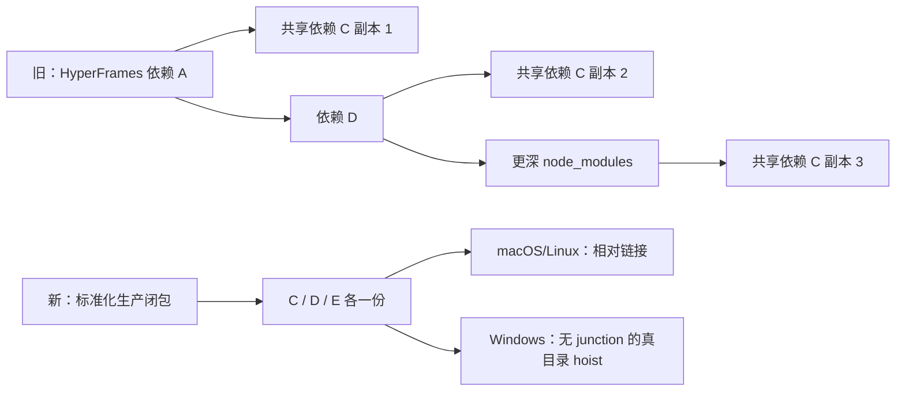

# T-487 Runtime 去重、构建计时与缓存证据

> 日期：2026-07-24  
> 状态：本地 cheap gate 已完成；未触发 CreatorOS 正式打包或付费 GitHub Actions。  
> 关联 SPEC：`docs/superpowers/specs/2026-07-23-desktop-packaging-first-launch-design.md`

## 大白话结论

旧实现不是单纯“压缩包太大”，而是把 HyperFrames 的共享依赖沿依赖路径反复复制。结果是
同一份库在不同深度出现很多次，构建要复制、压缩和解压大量小文件。

本轮把依赖处理改成了“每个生产依赖只放一份”：

- macOS/Linux 保留 pnpm 的相对链接，闭包中的每个 entry 线性复制一次；
- Windows 不保留会指向 CI 构建机盘符的 junction，改成真目录 hoist，共享依赖仍只复制一次；
- Playwright 顶层路径只保留解析链接，不再和 `.pnpm` 真身双份实拷；
- Node sidecar 删除永远不会加载的 `onnxruntime-web` WASM 副本；
- 内容完全相同的 ONNX 动态库 ABI 别名改成相对链接；
- HyperFrames CLI、Playwright 解析、Xenova + ONNX 原生加载都保留硬自检。



## 可重复的基线与结果

同一份本地 sidecar、同一台 macOS arm64 机器，使用
`frontend/scripts/desktop/runtime-inventory.mjs` 对所有文件做 SHA-256 盘点：

| 指标 | 修改前 | 修改后 | 变化 |
|---|---:|---:|---:|
| 文件数 | 44,082 | 26,427 | **-40.05%** |
| 展开字节 | 1,212,154,565 | 1,089,969,700 | **-10.08%** |
| 可识别重复字节 | 183,232,981 | 21,140,787 | **-88.46%** |
| 重复率 | 15.12% | 1.94% | -13.18 个百分点 |

SPEC cheap gate：

- 文件数下降至少 30%：PASS；
- 重复字节下降至少 80%：PASS。

修改后仍然约 1.09 GB，不应伪装成“小应用”：Chromium 约 361 MB、Node 生产运行时约
471 MB、本地 AI 约 108 MB、应用代码约 104 MB、ffmpeg 约 46 MB。这些是离线浏览器、视频和
本地 AI 的真实能力，后续优化重点是分层缓存和安装体验，不是偷偷删功能。

## 本轮工程变更

1. `runtime-inventory.mjs`
   - 输出文件数、symlink、字节、能力 owner 和重复 SHA-256 分组；
   - 支持 baseline/candidate 纯函数比较与 30%/80% gate。
2. `build-sidecar.mjs`
   - 新增线性 pnpm closure 与 Windows hoist closure；
   - HyperFrames 不再整棵 `dereference` 递归复制；
   - Playwright、ONNX/WASM 做有自检保护的定点去重；
   - 增加 `RENDER_ONLY` / `XENOVA_ONLY` / `PLAYWRIGHT_ONLY` 免费局部验证入口。
3. `build-timing.mjs`
   - 每个重步骤完成后立即原子写计时报告；
   - 即使后续构建失败，也保留已消耗阶段的时间证据。
4. `.github/workflows/desktop-release.yml`
   - 按 OS、arch、实际 Node/V8/modules ABI、verdict 公钥内容摘要、lockfile、
     前后端/worker/contract 源码和 packager 输入生成 exact Runtime Image cache key；
   - cache hit 后由缓存里的 Node 自报同一 ABI 指纹，并核对已烘焙公钥；任一不符就删除
     命中目录并重建，不能组合出“旧 Node + 新字节码”；
   - cache miss 时先构建并立即保存 clean runtime；
   - release 阶段复用 clean runtime，不再重复跑 Next build 和生产闭包组装；
   - 不提供宽泛 `restore-keys`，避免拿相似但 ABI/源码不一致的旧 runtime。
5. Windows 安装期物化
   - `tauri.windows.conf.json` 使用官方 `installerHooks`，安装模式改为无需管理员权限的
     `currentUser`；官方目录页仍允许用户选择 D/E 盘；
   - NSIS `POSTINSTALL` 不调用用户环境里的 tar/7-Zip/OpenSSL，而是调用 CreatorOS
     主程序的窄 CLI，复用 Rust `flate2`/`tar` 与构建期 SHA-256；
   - 同盘 `.staging` 解压、关键结构和入口哈希通过后，才原子切换
     `runtime-current.txt`；成功后只保留 current；
   - stock Tauri 模板的 `POSTINSTALL` 已发生在 exe/注册表/快捷方式写入之后，失败时
     `Abort` 不能事务回滚。因此安装期物化失败改为只清 staging、保留 tar，让首次启动走
     已校验的兼容解压；不再伪称“安装失败没有半成品”；
   - 当前壳只有当前版本的入口哈希与完整性清单，无法诚实验证旧版本 runtime，所以移除
     无效的 `runtime-previous.txt`。SPEC 的跨版本 `lastGood` 目标仍未完成，须等每 runtime
     签名 manifest 或 custom NSIS updater RAT；
   - Windows 首启优先直读 `$INSTDIR/runtime-images/<runtimeId>/sidecar`，不再复制到
     AppData；旧 tar→AppData 路径暂保留为兼容兜底。
6. 重复压缩消除
   - clean Runtime cache 只保存展开目录，不提前压约 1 GB tar；
   - 混淆、字节码、诱饵与法律声明全部完成后，由 Tauri `beforeBuild` 唯一压一次；
   - 避免 cache miss/cache hit 都白做一次大 tar 压缩，也确保包内 tar 真包含最终变换。

## 已执行验证

```text
Vitest desktop packaging suites：11 files / 96 tests PASS
Node collect-user-installers：4 tests PASS
Rust desktop library（含 Windows runtime 指针/路径/切换/清理）：112 tests PASS
HyperFrames CLI --help：PASS
Playwright @playwright/test resolve + browsers.json：PASS
Xenova require + pipeline + ONNX/sharp native load：PASS
Workflow YAML parse：PASS
build-sidecar/package/release Node 语法检查：PASS
```

## 仍未关闭的 Windows 风险

代码层已实现 Windows 安装期物化和首启直读，但**没有把 macOS 上的静态/单元测试冒充成
Windows 真机安装通过**。

正式 workflow 已加 RAT-PKG-02 原生门：本轮 `setup.exe` 必须静默安装到
`RUNNER_TEMP/CreatorOS RAT02 Space`（Windows runner 通常位于 D 盘），并验证 current 指针、
`frontend/server.js`、成功后 tar 删除；随后必须真实运行官方 `uninstall.exe /S`，确认
runtime 与安装目录清理，之后才允许上传产物。该门尚未实际触发，所以：

- 仍保留旧 tar→AppData 首启兼容兜底；
- 任务保持进行中，不宣称零白屏已完成；
- 不在本轮擅自触发付费 GitHub Actions；
- 首次原生 workflow 只覆盖新装/带空格路径/主动卸载；
- 磁盘不足、用户取消、真实 v1→v2 updater 与签名 `lastGood` 仍是未关闭 Gate，不能由
  本轮单安装包冒烟代替。
