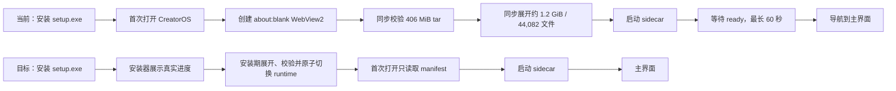

# Windows 首次启动长时间白屏复盘与业界方案（T-493）

> 日期：2026-07-24
> 结论：**最新安装包没有完成“零白屏首启”修复。** 既有改动修复了 splash 脚本竞态等局部问题，但完整 runtime 的校验与解压仍在应用首次启动的同步关键路径上。

## 一句话说明

现在的做法等于把约 4.4 万个文件压成一个大包，让安装器很快结束，再由用户第一次打开 CreatorOS 时解压。安装阶段变快了，但耗时转移给了首启；而首启页面本身又依赖 WebView2，主线程还在同步解压，所以用户仍可能先看到长时间空白窗口。

## 仓内直接证据

1. Windows 安装包资源仍只有 `sidecar.tar.gz`：`frontend/src-tauri/tauri.windows.conf.json:7-13`。
2. 本地同链样本为 406 MiB，展开约 1.2 GiB、44,082 个文件。
3. 首次打开会先整包 SHA-256 校验，再用 Rust `tar::Archive::unpack` 全量展开：`frontend/src-tauri/src/lib.rs:886-915`。
4. 这段逻辑由 Tauri `.setup(...)` 同步调用：`frontend/src-tauri/src/lib.rs:1019-1116`。代码注释声称“只搬真正阻塞的 tar 解压”，但当前实现并没有把 `resolve_sidecar_dir` / `extract_sidecar_tarball` 搬出 setup 同步路径，注释与实现已经漂移。
5. 所谓 splash 是一个 `about:blank` WebView2 加初始化脚本：`frontend/src-tauri/src/lib.rs:1030-1046`。状态更新也是 `window.eval` 的 best-effort 调用：`frontend/src-tauri/src/lib.rs:837-850`。当 setup 仍被磁盘校验/解压占住时，不能把它视为可靠的首帧保证。
6. runtime 完成后才启动 sidecar；随后仍有最长 60 秒 ready 等待：`frontend/src-tauri/src/lib.rs:1594-1630`。

因此，用户看到的“白屏很久”至少由两个叠加问题构成：

- **主要耗时**：首启校验并展开大型 runtime，尤其是大量小文件落盘；
- **空白表现**：用 WebView2 自己承担首屏，且其创建/绘制与同步 setup 工作竞争，状态页并非可靠的独立原生 UI。

## 官方做法对照

### 1. 重活不应放在应用启动关键路径

Microsoft 的 Windows 应用生命周期指南要求启动构造和 `OnLaunched` 在几秒内完成；大量磁盘读取或长任务应移出启动阶段，必要时使用扩展启动页承接等待：
[UWP application lifecycle](https://learn.microsoft.com/en-us/windows/uwp/launch-resume/app-lifecycle)

对应 CreatorOS：完整 runtime 解压不应继续发生在 `CreatorOS.exe` 第一次启动时。

### 2. Windows 首屏不要由 WebView2 承担

Microsoft 的 WebView2 性能指南明确建议：简单启动页/对话框使用轻量 XAML 或 Win32 UI，不要用 WebView2；WebView2 应在真正展示网页内容时才初始化。同时建议使用 Evergreen Runtime、避免重复 WebView 实例，并把 UDF 留在本地磁盘：
[Performance best practices for WebView2 apps](https://learn.microsoft.com/en-us/microsoft-edge/webview2/concepts/performance)

对应 CreatorOS：当前 `about:blank + initialization_script` 适合作为跨平台临时兜底，不应作为 Windows “绝不白屏”的最终方案。

### 3. 安装期工作应放进 NSIS hook 或自定义 template

Tauri 官方 Windows 安装文档支持：

- NSIS `installerHooks` 扩展安装步骤；
- hook 不够时通过 `tauri.bundle.windows.nsis.template` 替换安装模板；
- `-setup.exe` 是标准 NSIS 用户安装包；
- WebView2 默认/固定版/跳过等分发模式需要显式选择。

来源：[Tauri Windows Installer](https://v2.tauri.app/distribute/windows-installer/)

对应 CreatorOS：先用 Windows 原生 fixture 验证 stock NSIS hook 能否完成解压进度、取消、空间检查和失败清理；如果不能满足真实进度与回滚，再用自定义 template。不能再回退为首启解压。

### 4. Tauri splash 只能掩护重活，不能消灭重活

Tauri 的 splash 示例采用“显示 splash、主窗口先隐藏、setup 完成后再切换”的模式，并使用独立的本地 `splashscreen.html`，而不是先把主窗口暴露为 `about:blank`：
[Tauri Splashscreen](https://v2.tauri.app/learn/splashscreen/)

这能改善短期可见性，但对本项目数分钟的 runtime 解压只属于止血；根治仍是安装期物化。

## 建议的落地口径

### 根治方案

1. Windows 安装器继续只携带少量大 payload，避免 NSIS 构建阶段直接处理数万文件。
2. 在安装阶段把 payload 展开到 `$INSTDIR/runtime-images/.staging`，展示真实 bytes/files、已用时间与当前层。
3. 校验通过后原子切换 `current`；失败或取消清理 staging，保留 `lastGood`。
4. 应用首启只做 manifest/入口 O(1) 校验、启动 sidecar、health/handshake；完整 runtime 解压次数必须为 0。
5. Windows 使用轻量原生启动壳；主 WebView2 隐藏到初始化完成，sidecar ready 后一次性显示。
6. 记录以下里程碑：`process_start`、`runtime_ready`、`sidecar_spawned`、`sidecar_listening`、`webview_initialized`、`navigation_completed`、`first_interactive`。

### 短期止血（不能作为验收终点）

1. 把同步 runtime 准备移出 Tauri setup/UI 线程；
2. 用独立、打包内置的静态 splash 页面，主窗口先隐藏；
3. splash 展示真实进度和失败原因，不只显示无限转圈；
4. sidecar 超时后显示可复制错误与日志位置，不导航到空白/拒绝连接页。

## 验收线

- 干净 Windows 10/11 首次点击到主界面可交互 P95 ≤5 秒；
- 首次启动完整 runtime 解压次数 = 0；
- 静态白屏超过 1 秒次数 = 0；
- 安装准备状态至少每秒更新一次；
- 磁盘不足、取消、校验失败后 staging 残留 = 0；
- 冷启动日志能区分 runtime、sidecar、WebView2、页面加载四段耗时。

## 当前裁决

- **不是 WebView2 单点故障，也不是再改一次 splash 文案就能解决。**
- 当前最主要的结构性根因是“把安装期工作推迟到首启”，其次是“让 WebView2 承担首屏”。
- 既有 [T-487 打包/首启 SPEC](../superpowers/specs/2026-07-23-desktop-packaging-first-launch-design.md) 的目标方向是正确的；这次真机反馈证明该任务不能继续被理解为可选缩包优化，而是 Windows 可发布体验的阻断项。
