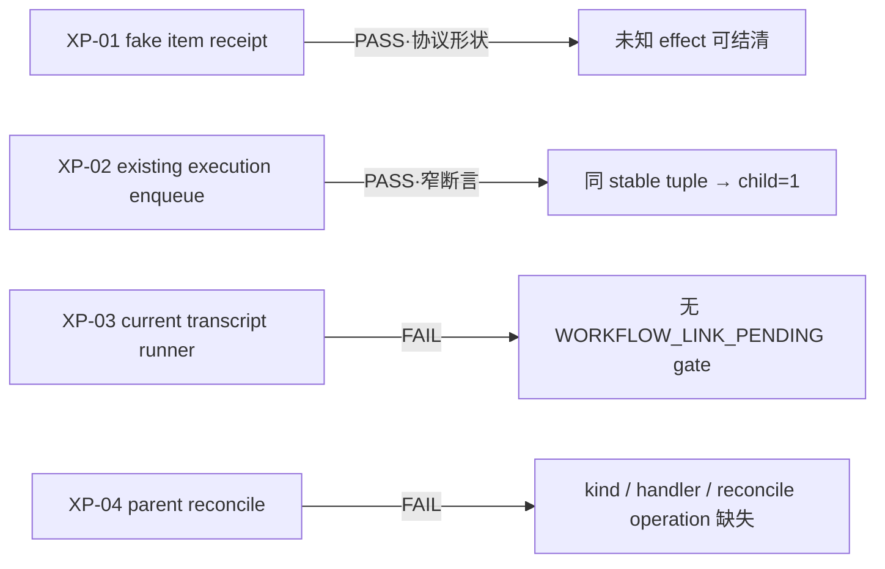

# T-510 跨端口崩溃窗口 RAT

> 日期：2026-07-25（PDT）  
> 范围：`RAT-MO-XP-01..04`，另补 canonical loser 与 cancel/intent CAS 原语快照  
> 环境：Node `v22.22.2`；仓内 `@electric-sql/pglite@0.2.17`；现有
> `PersistentTaskService` / `IntelligenceService` / transcript runner  
> 边界：未改生产代码，未 build、commit、改任务状态或运行 Gate；不是 PostgreSQL、双引擎、
> 发布或生产 conformance 证据。

## 1. 一句话结论

四项结果为：

| RAT | 结论 | 实际证明 / 失败点 |
| --- | --- | --- |
| `RAT-MO-XP-01` | **PASS — protocol only** | 两个真实 `SIGKILL` 窗口均由 fake receipt port 查回唯一 item；未知期间 workflow 非终态，结清后才 cancelled；item=1、ASR=0。生产 intelligence receipt port 仍不存在。 |
| `RAT-MO-XP-02` | **PASS — narrow** | 复用现有 `PersistentTaskService.enqueue`，child ensure 后真实 `SIGKILL`；重启用完整相同 tuple 取回同一 `taskId`，child=1，再 link workflow。未证明 intelligence transcript receipt 的原子归属。 |
| `RAT-MO-XP-03` | **FAIL** | child 可在 link 前被现有 worker claim，网络确为 0；但得到的是 `OwnershipError: Transcript task not found`，没有 `WORKFLOW_LINK_PENDING`，task 留在 `running` 直到 lease recovery。 |
| `RAT-MO-XP-04` | **FAIL / NOT CONSTRUCTIBLE** | 现有 execution contract/service 没有 parent `kind/ownerType="copilot_media_workflow"`，没有 parent handler，也没有 `reconcileCopilotMediaWorkflowRuntimeTasks()`。 |

因此，四项已不再是 `not-run`，但结果是 **2 个窄 PASS + 2 个 FAIL**。这不能关闭
`PLAN-R1-B-01`，更不能冒充 Product/Contract/BUILD Gate PASS。



## 2. 当场命令与不可变证据

主命令：

```bash
backend/node_modules/.bin/tsx /private/tmp/t510-cross-port-rat.mts
```

成功生成：

```text
run root:    /private/tmp/t510-cross-port-rat-run-nAcrkh
result:      /private/tmp/t510-cross-port-rat-run-nAcrkh/result.json
harness:     /private/tmp/t510-cross-port-rat.mts
harness sha: 7352728fccb079649cb1a84cad62a66576aadd09033df3d15a8a59a2b587cfc8
result sha:  7ab99619601b1fab357bcd401fe61e753e14dbde681f943ce3be74370b1925f9
local time:  2026-07-25 19:23 PDT
```

校验命令：

```bash
shasum -a 256 \
  /private/tmp/t510-cross-port-rat.mts \
  /private/tmp/t510-cross-port-rat-run-nAcrkh/result.json
```

输出：

```text
7352728fccb079649cb1a84cad62a66576aadd09033df3d15a8a59a2b587cfc8  /private/tmp/t510-cross-port-rat.mts
7ab99619601b1fab357bcd401fe61e753e14dbde681f943ce3be74370b1925f9  /private/tmp/t510-cross-port-rat-run-nAcrkh/result.json
```

第一次 harness 运行发现 XP-01 子进程会因无活跃 handle 以 exit code 13 自然退出，不能算 kill
证据；修订 harness 以活动 timer 卡在 barrier 后重跑。本文只引用第二次重跑中
`exitSignal="SIGKILL"` 的结果，不把第一次结果计入证据。

## 3. Harness 与 fixture

所有临时数据库均位于上述 `/private/tmp/t510-cross-port-rat-run-nAcrkh`，生产数据库未打开。
完整可执行代码保存在上述 harness 路径；核心 fixture 如下。

### 3.1 canonical / workflow fixture

```sql
CREATE TABLE workflows (
  id TEXT PRIMARY KEY,
  revision INTEGER NOT NULL,
  state TEXT NOT NULL,
  cancel_requested_at TEXT,
  transcript_intent_state TEXT NOT NULL
);
CREATE TABLE bindings (
  canonical_key TEXT PRIMARY KEY,
  workflow_id TEXT NOT NULL UNIQUE
);
CREATE TABLE workflow_events (
  id TEXT PRIMARY KEY,
  workflow_id TEXT NOT NULL
);
```

claim transaction 先写 candidate workflow/event，再执行
`INSERT binding ... ON CONFLICT DO NOTHING RETURNING`；返回空时抛
`CanonicalClaimLost`，让 candidate transaction 整体回滚。

### 3.2 XP-01 fake intelligence receipt port

fake port 使用与 workflow store 分离的 file-PGlite，模拟跨 service commit：

```sql
CREATE TABLE items (
  id TEXT PRIMARY KEY,
  user_id TEXT NOT NULL,
  account_id TEXT NOT NULL,
  external_work_id TEXT NOT NULL,
  UNIQUE(user_id, account_id, external_work_id)
);
CREATE TABLE item_effect_receipts (
  user_id TEXT NOT NULL,
  account_id TEXT NOT NULL,
  effect_key TEXT NOT NULL,
  request_fingerprint TEXT NOT NULL,
  item_id TEXT NOT NULL,
  state TEXT NOT NULL,
  committed_at TEXT NOT NULL,
  PRIMARY KEY(user_id, account_id, effect_key)
);
```

item 与 receipt 在 fake intelligence DB 的同一 transaction 提交。workflow 先写
`itemEffectState=requested`；cancel 在 receipt 未知时只能写 `cancelRequestedAt` 并保持
`item_reconciling`。reconcile 只有查到同 account/effectKey/fingerprint 的 committed receipt 后，
才写 `itemId` 并进入 `cancelled`。

### 3.3 XP-02 existing execution tuple

实际调用仓库现有 `PersistentTaskService.enqueue`：

```json
{
  "kind": "transcribe",
  "ownerType": "item",
  "ownerId": "item-xp02",
  "idempotencyKey": "media-transcript:wf-xp02:aweme-xp02",
  "payload": {
    "itemId": "item-xp02",
    "workflowId": "wf-xp02"
  },
  "priority": 20,
  "maxAttempts": 3,
  "costEstimate": null
}
```

该 service 以 `userId/accountId/kind/idempotencyKey` 找 existing row，并逐项比较
`ownerType/ownerId/payload/priority/maxAttempts/costEstimate`；不是只比较模糊 key。

### 3.4 XP-03 current-port fixture

为避免发明不存在的生产 operation，本项直接运行当前
`runIntelligenceTranscriptTask`。在 child execution row 已存在、但
`intelligence_item_transcripts.execution_task_id` 尚未 link 时放行 claim；fake transcript 网络
port 只计数，不接外网。随后通过现有 lease recovery 和
`IntelligenceService.enqueueTranscripts` 补当前 domain receipt，再让同一 child 继续。

## 4. 分项结果

### 4.1 `RAT-MO-XP-01` — PASS（protocol only）

#### kill 点 A：item port 已提交、尚未 return

```json
{
  "barrier": "BARRIER:XP01_PORT_COMMITTED_BEFORE_RETURN",
  "kill": {"exitCode": null, "exitSignal": "SIGKILL"},
  "beforeReconcile": {
    "state": "item_reconciling",
    "finished_at": null,
    "cancel_requested_at": "2026-07-25T12:00:00.000Z"
  },
  "receipt": {
    "state": "committed",
    "item_id": "item-xp01-before-return"
  },
  "settled": {
    "state": "cancelled",
    "item_effect_state": "confirmed",
    "transcript_intent_state": "cancelled",
    "asrCalls": 0
  },
  "itemCount": 1
}
```

#### kill 点 B：port 已 return、workflow checkpoint 尚未写

```json
{
  "barrier": "BARRIER:XP01_PORT_RETURNED_BEFORE_CHECKPOINT",
  "kill": {"exitCode": null, "exitSignal": "SIGKILL"},
  "beforeReconcile": {
    "state": "item_reconciling",
    "finished_at": null
  },
  "receipt": {
    "state": "committed",
    "item_id": "item-xp01-after-return"
  },
  "settled": {
    "state": "cancelled",
    "item_effect_state": "confirmed",
    "transcript_intent_state": "cancelled",
    "asrCalls": 0
  },
  "itemCount": 1
}
```

两个窗口在强制一次 `unknown` 观察时均保持 `item_reconciling + finishedAt=null`；下一次真实查询
得到 committed receipt 后才 terminal。

**判定边界**：这证明 PLAN 所写 fake-port 协议形状可行，不证明当前 intelligence port 已具备它。
当前 schema/service 仍没有具名 `ItemEffectReceiptV1`、`operation_effect_key`、三态 query 或
source/item/snapshot/receipt 原子 UoW；`CONTRACT-R1-B-01` 仍成立。

### 4.2 `RAT-MO-XP-02` — PASS（narrow）

```json
{
  "barrier": "BARRIER:XP02_CHILD_ENSURED:{\"taskId\":\"execution-task-xp02\"}",
  "kill": {"exitCode": null, "exitSignal": "SIGKILL"},
  "firstTaskId": "execution-task-xp02",
  "recoveredTaskId": "execution-task-xp02",
  "taskCount": 1
}
```

重启后用完全相同 tuple 调现有 service，返回同一 task，再写 workflow link。窄断言
“ensure commit → kill → query/re-ensure → child=1”成立。

**判定边界**：当前 execution adapter 只保证 task row 幂等；它不创建
`intelligence_item_transcripts` receipt。这个 PASS 不推翻独立评审关于 child owner port 的
`CONTRACT-R1-B-02`。

### 4.3 `RAT-MO-XP-03` — FAIL

实际 early claim：

```json
{
  "taskId": "execution-task-xp03-1",
  "error": {
    "name": "OwnershipError",
    "message": "Transcript task not found"
  },
  "taskStatus": "running",
  "networkCalls": 0,
  "workflowLinkPendingObserved": false
}
```

lease 过期后，现有 recovery 的确 `requeued=1`。再由现有
`enqueueTranscripts` 补 domain receipt 时，同一 child 被复用（count=1），第二次运行成功且网络总调用
为 1。但这不满足 PLAN 必须断言：

- 没有 `WORKFLOW_LINK_PENDING`；
- 没有在下载/ASR 前读取 workflow link/provider-start CAS；
- 第一次 catch 再调用 `finishTranscript` 时仍找不到 receipt，task 留在 `running`，只能等 lease expiry；
- 如果 domain receipt 已存在、只是 workflow link 缺失，当前 runner 完全不知道 workflow，仍会直接进
  transcript port。

确切缺失 operation/字段：

```text
beginAsrProviderSideEffect(workflowId, transcriptTaskId, expectedRevision)
WORKFLOW_LINK_PENDING retryable outcome
execution task / intelligence transcript receipt 上可查询的 workflowId/link 状态
```

代码证据：

- `backend/src/modules/intelligence/transcript-runner.ts:61-126`
- `backend/src/modules/intelligence/intelligence.service.ts:2306-2338`
- `backend/src/modules/intelligence/intelligence.service.ts:3586-3662`

### 4.4 `RAT-MO-XP-04` — FAIL / NOT CONSTRUCTIBLE

PLAN 要求 canonical workflow commit 后由 composition-root one-shot reconcile 补唯一 parent runtime
task。但当前端口缺少：

| 缺口 | 当前证据 |
| --- | --- |
| parent kind `copilot_media_workflow` | `PersistentTaskKind` 只有 `source_sync/share_import/transcribe/topic_preview/script_candidate/migration` |
| parent ownerType `copilot_media_workflow` | `PersistentTaskOwnerType` 与 `ExecutionTaskResourceV2.ownerType` 均无此值 |
| 固定 parent handler | backend 无 `copilot_media_workflow` handler 注册 |
| one-shot reconcile operation | 无 `reconcileCopilotMediaWorkflowRuntimeTasks` |

代码证据：

- `backend/src/modules/execution/persistent-task.service.ts:24-37`
- `contract/src/resources/intelligence.ts:76-83,345-358`
- `frontend/src/server/persistence-client.ts` 中不存在目标 reconcile operation

不能拿 `share_import` 或其他已有 kind 冒充 parent；也不能在临时 harness 自造生产 handler 后把它写成
现有端口 PASS。因此本项诚实记为 `FAIL / NOT CONSTRUCTIBLE`。

## 5. 补充原语结果（不替代 XP-01..04）

### canonical claim loser committed writes = 0

```json
{
  "claims": [
    {"role": "winner", "candidateId": "wf-claim-a"},
    {
      "role": "loser",
      "candidateId": "wf-claim-b",
      "winnerId": "wf-claim-a"
    }
  ],
  "counts": {"workflows": 1, "bindings": 1, "events": 1},
  "loserCommittedWrites": 0
}
```

这证明 candidate workflow/event 与 binding 同 transaction、conflict 抛错回滚时，loser 的已提交写入
为 0。它仍只是单 PGlite 连接的协议探针，不是 PostgreSQL 双连接并发 Gate。

### cancel / intent CAS

```json
{
  "cancelFirst": {"cancelRows": 1, "intentRows": 0},
  "intentFirst": {"intentRows": 1, "staleCancelRows": 0}
}
```

同 revision 上只有一个条件更新成功；cancel 先提交会阻断 intent。该结果验证数据库原语，不证明尚未
实现的完整 media service / event append / provider gate。

## 6. 对 PLAN / CONTRACT 的回灌

1. PLAN 的四项状态应从全量 `not-run` 更新为：
   `XP-01 PASS(protocol-only) / XP-02 PASS(narrow) / XP-03 FAIL / XP-04 FAIL-not-constructible`。
2. `PLAN-R1-B-01` 不能关闭：四项没有全绿，现有端口无法承载 early-claim gate 与 parent reconcile。
3. CONTRACT 必须先补：
   - intelligence-owned、原子且可查询的 item effect receipt；
   - intelligence-owned `ensureTranscriptTaskForWorkflow` 一类真实 owner port，使 execution task 与
     transcript receipt 可重放地产生；
   - child 下载/ASR 前的 workflow link/provider-start gate 与 retryable
     `WORKFLOW_LINK_PENDING`；
   - execution parent kind/owner、固定 handler registry 与 composition-root one-shot reconcile。
4. 即使以上文本修订完成，仍需新的当场 PGlite + PostgreSQL / 真实进程 conformance 证据；本文不把
   未来实现写成 PASS。

## 7. 未运行与已知限制

- 未连接真实 PostgreSQL，未做 PGlite/PostgreSQL 双引擎对照；
- 未运行真实抖音 resolver、真实 ASR、下载或付费 provider；
- 未修改/验证生产 media workflow（当前本来不存在）；
- 未运行 Product Gate、Contract Gate、reconcile、boundary、全仓测试或 build；
- 仓库声明 Node `>=25 <26`，本机实际 Node 为 `v22.22.2`；因此证据只限本次 PGlite/服务探针；
- `/private/tmp` 工件可能被系统清理，本文保留了命令、hash、fixture、关键状态和真实结论。
