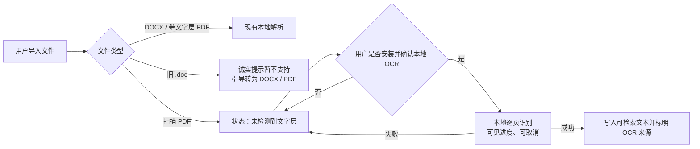

# T-525 旧 `.doc` 与扫描 PDF 可选解析 RAT

> 日期：2026-07-26
> 阶段：RESEARCH / PLAN
> 结论：本任务不进入 BUILD；现有 `unsupported` / `no_text` 失败语义继续保持。

## 一句话结论

- **扫描 PDF**：技术上可做成独立、签名、按需安装的本地 OCR 组件，但必须由用户明确安装并对
  单个文件确认；当前仓库不直接引入 OCRmyPDF、Python、Ghostscript 或云端 OCR。
- **旧 `.doc`**：LibreOffice 真机转换可行，但实测程序体积约 410 MiB，且不能依赖用户自行安装
  Office、LibreOffice 或系统命令；在出现满足双平台安全与包体预算的受控转换器之前，继续显示
  `unsupported`，引导用户转换为 DOCX 或 PDF。

## 现状审计

- `backend/src/modules/ai-runtime/material-extract-runner.ts` 当前只识别 `pdf`、`docx`、
  `plaintext` 和 `unsupported`；旧 `.doc` 会诚实落为 `unsupported`。
- `frontend/src/server/persistence-client.ts` 只给现有 runner 注入 `mammoth` 和 `pdf-parse`。
- `frontend/package.json` 当前使用 `mammoth@^1.12.0`、`pdf-parse@^2.4.5`；本机安装目录分别约
  2.3 MiB、21 MiB。
- 单文件上传已有 20 MiB 上限。空文字层 PDF 当前会落入抽取失败；后续实现应把它区分为
  `no_text`，不能把“没有文字层”误报成通用损坏。

## 真机 RAT 证据

以下结果只证明技术可行性，不等同于双平台发布物验收。

| 场景 | 真实样本 / 环境 | 结果 |
|---|---|---|
| 旧 `.doc` | 使用 LibreOfficeDev 26.8 将含中文、英文和数字的文本转成 Word 97 OLE2 `.doc`，再无头转回文本 | 内容保留；冷启动转换约 0.93 秒；LibreOffice 程序体积约 410 MiB，超过可选解析组件预算 |
| 扫描 PDF | 仓库真实 6 页中文 PDF `output/pdf/CreatorOS-代理协作手册.pdf`，第一页 200 DPI 栅格化，Tesseract 5.5.2 `chi_sim+eng` | 栅格化约 2.21 秒，OCR 约 1.14 秒；规范化字符错误率约 1.35% |
| OCR 运行体积 | 本机 Tesseract 二进制约 33 MiB；`eng` 约 3.9 MiB、`chi_sim` 约 2.4 MiB、`osd` 约 10 MiB | 最小语言组合具备轻量化空间；不能把本机完整 676 MiB tessdata 目录直接打包 |

该 OCR 样本是排版清晰的生成文档，不能代表照片、低清扫描、竖排、旋转、手写或复杂表格的识别率。

## 候选方案裁决

### 旧 `.doc`

| 候选 | 裁决 | 原因 |
|---|---|---|
| LibreOffice | 不进入产品依赖 | 真机可用，但完整程序约 410 MiB；依赖用户自行安装也违反任务边界 |
| Apache POI HWPF | 不采用 | 需要 Java 运行时；官方也将 HWPF 描述为功能覆盖有限，不适合作为桌面产品的受控轻量底座 |
| 系统 Office / shell 命令 | 禁止 | 双平台行为不可控，容易产生 PATH 注入、版本漂移和“开发机能用、用户机不能用” |
| 云转换服务 | 禁止默认使用 | 用户知识文件不应在未建立独立数据契约、授权和隐私说明时上传 |

因此，旧 `.doc` 继续 `unsupported`。UI 应明确说明“旧版 Word `.doc` 暂不支持，请另存为
`.docx` 或 PDF 后导入”，不能显示可点击但无效的“解析”按钮。

### 扫描 PDF

未来若进入 CONTRACT / BUILD，首选组合为：

- PDFium：仅用于受控栅格化，关闭 V8、XFA 和网络能力；
- Tesseract 5：本地 OCR；
- `tessdata_fast` 的 `chi_sim`、`eng` 和必要的方向检测模型；
- macOS / Windows 分平台签名的独立可选组件，不随 CreatorOS 主安装包强制下载。

不直接采用 OCRmyPDF：它还需要 Python、PDF 栅格器、字体/排版等依赖；其官方安全文档也明确
建议对不可信 PDF 使用隔离环境。CreatorOS 只需要“栅格化 + OCR 文本”，不需要整套 PDF
重写管线。

参考的一手资料：

- [Tesseract 命令行与多语言用法](https://tesseract-ocr.github.io/tessdoc/Command-Line-Usage.html)
- [Tesseract 输入格式说明（PDF 需先转换）](https://tesseract-ocr.github.io/tessdoc/InputFormats.html)
- [Tesseract / tessdata Apache 2.0 许可](https://github.com/tesseract-ocr/tesseract/blob/main/LICENSE)
- [OCRmyPDF 安装依赖](https://ocrmypdf.readthedocs.io/en/latest/installation.html)
- [OCRmyPDF 不可信 PDF 安全警告](https://ocrmypdf.readthedocs.io/en/stable/pdfsecurity.html)
- [Apache POI HWPF 官方说明](https://poi.apache.org/components/document/index.html)
- [PDFium BSD 许可](https://pdfium.googlesource.com/pdfium/%2B/refs/heads/chromium/2028/LICENSE)

## 产品交互与状态

1. 普通 PDF 沿用现有本地文字层解析。
2. 没有可用文字层时，资产状态为 `no_text`，显示“未检测到文字层”，不写成“解析成功”。
3. 只有用户主动点击“在本机识别文字”时，才展示组件体积、仅本机处理、预计耗时、准确率限制。
4. 组件安装必须再次确认；安装完成后仍需对当前文件确认，禁止后台自动 OCR 全库。
5. OCR 显示页数进度和取消入口。失败或取消后资产仍为 `no_text`，原文件不被改写。
6. 成功后才把文本经现有 Knowledge service 写入，并在元数据记录：
   `extractionMethod=ocr`、引擎及版本、语言、页数、警告和可用置信信息。
7. OCR 运行任务复用现有持久化 `ai_task` 生命周期，不在资产表里另造第二套任务状态。

## 安全和资源边界

- 可选组件必须来自固定签名工件并校验哈希；使用绝对二进制路径和净化后的环境，不查找系统 PATH。
- 每个任务使用新临时目录；禁止 shell 字符串拼接；结束、取消和崩溃恢复时都清理临时页图。
- 默认上限：20 MiB 输入、50 页、200 DPI、单文件 120 秒、并发 1；超过上限要求用户缩小文件，
  不偷偷降质后声称成功。
- 加密、需要密码、签名保护、损坏 PDF 分别给出真实错误；不自动绕过保护。
- OCR 组件不得联网，不上传原文件、页图或识别结果，不写入诊断日志正文。
- 初步预算：下载压缩包不超过 80 MiB、安装后不超过 180 MiB；macOS 与 Windows 都必须用真实
  签名产物复测，未达标不能上线。

## 进入 BUILD 前的 Gate

- 至少 20 份来源与授权可说明的旧 `.doc` 语料完成安全/损坏/宏边界 RAT；达不到时继续不支持。
- OCR 语料覆盖清晰、噪声、旋转、中英混排、照片、加密、损坏以及 1 页、50 页、超限文件。
- 参考机器 200 DPI 下：清晰印刷体字符错误率中位数不高于 8%，单页耗时 P95 不高于 3 秒。
- macOS 与 Windows 的下载体积、安装目录、签名、校验、升级、卸载残留和离线运行均有实物证据。
- 证明在没有系统 LibreOffice、Office、Python、Java、Ghostscript 和 PATH 命令时仍能诚实降级。
- 独立规格评审与用户再次确认通过后，才允许改变当前 `unsupported/no_text` 行为。

本任务到此只完成技术选择和产品边界，不创建新实现任务，也不把 RAT 写成已经交付。
