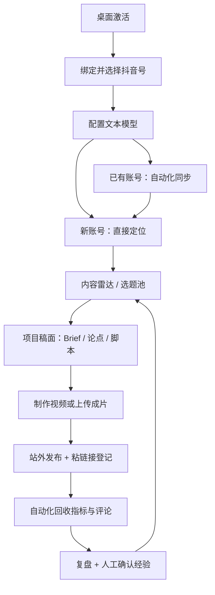

# CreatorOS 新用户 0→1 功能盘点调研

> 日期：2026-07-26
> 任务：T-528
> 类型：代码事实盘点 / 用户旅程核查
> 对外教程：[CreatorOS 新用户 0→1 标杆使用路线](../CreatorOS-新用户0到1标杆路线.md)

## 1. 调研目标

本调研回答三个问题：

1. 一个全新用户当前能否从安装激活走到真实复盘；
2. 侧栏和项目工作面中的主要能力，哪些是真接线、哪些依赖配置、哪些仍是占位或发布阻断；
3. 对外教程应该怎样描述，才能不把候选写入、自动发布、定位回流等能力讲错。

本轮不把“代码文件存在”直接等同于“真机可用”。判断分为：

- **主路径已接线**：入口、读写和失败态均有代码证据；
- **需配置/真机**：代码存在，但依赖模型、浏览器、抖音登录态或桌面环境；
- **部分实现**：主路径可用，存在明确范围缺口；
- **发布阻断**：可能造成错误数据、原子性缺口或对外承诺不成立；
- **遗留/占位**：保留代码或展示，但没有真实消费链。

## 2. 调研方法与证据

八份分域原始盘点：

- [A：安装激活与账号](walkthrough-chapters/A-identity-activation-accounts.md)
- [B：首页与定位](walkthrough-chapters/B-dashboard-positioning.md)
- [C：内容雷达与选题](walkthrough-chapters/C-intelligence-topics.md)
- [D：项目、Brief 与脚本](walkthrough-chapters/D-project-brief-script.md)
- [E：视频制作、发布与日历](walkthrough-chapters/E-production-publishing-calendar.md)
- [F：知识库、素材与搜索](walkthrough-chapters/F-knowledge-assets-search.md)
- [G：自动化、复盘与经验](walkthrough-chapters/G-automations-review-learnings.md)
- [H：Copilot、设置与反馈](walkthrough-chapters/H-copilot-settings-feedback.md)

每份原始盘点都以路由、组件、service/runner 和契约调用点为证据，并把没有完成真机验证的断言标为“未验证”。本归档只汇总结论，不替代原始 `file:line` 证据。

## 3. 0→1 主链结论

结论：

- 主链在代码上可以串通；
- 真发布不在系统内完成，必须站外发布后登记；
- AI 产物普遍走人工确认门；
- 真实闭环是 `LEARN → TOPIC/SCRIPT`；
- `LEARN → POS` 没有直接接线，不能写进宣传口径；
- 桌面激活、扫码、抖音采集恢复和视频渲染仍需真机证明。

## 4. 十四个功能域盘点

| # | 功能域 | 用户入口 | 当前判定 | 关键事实 |
|---|---|---|---|---|
| 1 | 安装与激活 | 自动进入 `/activate` | 需真机 | 桌面端 IPC 校验并重启；Web/dev 豁免；真实码链仍需服务端真机验证 |
| 2 | 账号与首页引导 | `/accounts`、首页 Onboarding | 主路径已接线，需真机扫码 | 单机免登录；抖音号是工作区隔离单位；首页有真实 6 步引导 |
| 3 | 定位中心 | `/positioning` | 主路径已接线 | AI 访谈或手动创建；定位和五类规则版本化，并注入下游生成 |
| 4 | 内容雷达 | `/intelligence` | 部分实现 | 五类来源先验证后保存；逐字稿手动；部分左栏项不是完整过滤 |
| 5 | 选题池 | `/topics` | 部分实现，存在发布阻断 | 候选带来源与证据；AI 不直接灌库；promotion 非单事务 |
| 6 | 项目与脚本 | `/projects/<id>` | 主路径已接线 | 一个项目一张稿；Brief、论点、脚本版本、审核、盲预测、发布包同页 |
| 7 | 视频制作 | `/projects/<id>/production` | 代码主链完整，需环境 | 受控制作，不是 NLE；四决策过确认门；需模型、ffmpeg、Chromium |
| 8 | 发布与日历 | `/publishing`、`/calendar` | 部分实现，自动发布阻断 | 唯一真实发布写路径是稿面粘链接登记；日历只做排期 |
| 9 | 知识库 | `/knowledge` | 主路径已接线 | 蒸馏、关联、评论回流都只产候选；人工采纳后入库 |
| 10 | 素材与搜索 | `/assets`、`/search` | 主路径已接线，过滤有限 | 两阶段真实上传；跨域搜索真实；大库跨页筛选可能漏项 |
| 11 | 自动化采集 | `/automations` | 主路径已接线，可靠性依赖外部环境 | 真 Playwright 采集；有进度、终态、重连和限流；扫码恢复需真机 |
| 12 | 复盘与经验 | `/projects/<id>/review` | 主路径已接线，指标覆盖有限 | 预测、真实指标、评论、经验同页；仅 validated 经验进入下游 |
| 13 | Copilot | 侧栏浮层、稿面右栏 | 主链真实，依赖模型配置 | 流式、工具、HITL、会话隔离均接线；工具结果走候选卡 |
| 14 | 设置与反馈 | `/settings`、侧栏反馈入口 | 设置已接真；反馈待任务收口 | 密钥只写不回；多模态用户可配；反馈为本地整理+外链，不自动发送 |

## 5. 关键数据与权限边界

### 5.1 按账号隔离

以下内容按当前抖音号隔离：

- 定位；
- 内容雷达来源；
- 选题；
- 项目；
- 知识库；
- 素材；
- 自动化任务；
- 发布记录；
- 复盘与经验。

模型配置和部分本机偏好属于用户级共享配置。切换账号会刷新整个工作区，不是只切一张列表。

### 5.2 AI 候选与实体写入

当前主链遵守“AI 不直接写领域实体”：

- AI 定位 → 用户采纳；
- AI 选题 → 候选入池；
- AI 脚本 → 用户写入稿面；
- AI 改写 → 用户逐条应用；
- AI 知识蒸馏 → 用户选择原子；
- AI 复盘 → 候选经验，用户验证；
- AI 视频决策 → 用户确认后渲染。

`autoSend` 只代表自动发送触发话术，不代表自动采纳结果。

### 5.3 真实与空态

已核实的诚实空态包括：

- 零账号首页指标显示“—”，不伪造 0；
- 发布中心读失败不回退 fixture；
- 复盘没有指标时只收窄指标区，不吞掉整页；
- 自动化把“无新数据”“需重连”“失败”分开；
- 模型未配置时显示未配置，不回退伪造模型；
- 存储容量未知时不绘制假百分比。

## 6. 发布阻断与事实差异

### 6.1 选题立项不是单事务

`promoteCandidate` 当前执行：

1. 创建 project；
2. 标记 candidate promoted；
3. 创建 topic promotion。

三次写入背靠背执行，依赖唯一索引降低重复，但中途失败仍可能产生孤儿 project。对外教程必须把它标为当前风险。

### 6.2 没有自动真发布

后端的 `MockPublisher` 只生成假 external id，且没有前端入口。真实路径只有：

1. 用户在抖音端发布；
2. 回稿面粘贴真实链接；
3. CreatorOS 登记 publication；
4. 自动化回收指标。

“发布中心”不能被描述成自动发布控制台。

### 6.3 经验不直接改定位

validated learnings 会进入选题、脚本、策划、校准和 Copilot，但定位 runner 不消费 `learningsBrief`。正确说法是：

- `LEARN → TOPIC/SCRIPT` 真闭合；
- 定位方向通过校准建议旁路调整；
- 不存在“系统自动更新账号定位”。

### 6.4 内容雷达和素材筛选有限

- 内容雷达左栏部分来源/分类是信息聚焦，不是完整归属过滤；
- 素材中心的 `type/q` 过滤主要作用于当前已读页，大库跨页可能漏；
- 全局搜索对没有详情页的实体回落到中心列表。

### 6.5 遗留死路由

`/api/knowledge/classify` 已被 Copilot 蒸馏主路径替代，当前无 live 前端调用者。它属于事实性遗留，不能作为用户主路径宣传。

## 7. 真机与外部依赖验证清单

| 验证项 | 当前证据 | 仍需证明 |
|---|---|---|
| 桌面激活 | Rust IPC、授权心跳和跳转代码存在 | 真实激活码 + 服务端端到端 |
| 抖音扫码绑定 | headed Chromium、cookie 检测和账号 upsert 存在 | macOS/Windows 真扫码与风控场景 |
| 收藏/对标同步 | 来源验证、run/watch、结构化终态存在 | 重登录、验证码、限流后的真实恢复 |
| 视频渲染 | 四决策、execution task、成片采纳代码存在 | 用户模型 + ffmpeg + Chromium 真成片 |
| 指标回流 | 自动化 runner、publication 登记、复盘装配存在 | 真实发布作品的完整指标与评论回流 |
| 反馈渠道 | 本地整理、脱敏、open-url/reveal-logs 代码存在 | T-518 独立提交后做桌面交互冒烟 |

## 8. 面向新用户的推荐顺序

最终教程采用以下顺序，而不是按侧栏逐页介绍：

1. 激活；
2. 绑号；
3. 配模型；
4. 选择 fresh/existing；
5. existing 先同步；
6. 定位；
7. 内容雷达与选题；
8. 项目稿面；
9. 视频制作；
10. 站外发布并登记；
11. 自动化回流；
12. 复盘和经验；
13. 用知识库、素材和搜索补强下一轮。

理由：这条顺序和首页 Onboarding、数据前置依赖以及真实飞轮一致，能避免新用户先看到大量空页面。

## 9. 调研结论

CreatorOS 当前已经具备完成第一条真实内容闭环的代码主链，但它是“用户确认型编导系统”，不是“全自动发布系统”。最可信的产品表达是：

- 用定位约束选题和写稿；
- 用真实信源产生候选；
- 用项目稿面持续版本化；
- 用人工确认守住 AI 写入边界；
- 用站外发布登记和自动化采集回收真实表现；
- 用经过验证的经验改善下一轮选题和脚本。

上线前仍需优先补齐：真机链路验证、选题 promotion 原子性、反馈入口独立收口，以及自动发布能力的诚实边界。
