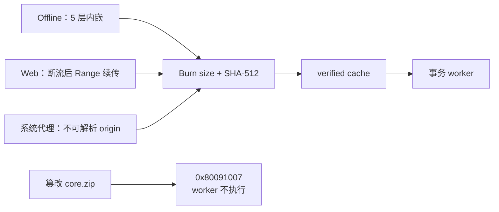

# T-565 原生 Windows Burn / 事务 / 路径边界 RAT 证据

> 日期：2026-07-27
> 环境：GitHub-hosted `windows-latest`，Windows 11 / NTFS
> Burn/事务/路径最终成功 run：[30269208805](https://github.com/zzyong24/Thirdspace-creator/actions/runs/30269208805)
> production closure 最终成功 run：[30276584646](https://github.com/zzyong24/Thirdspace-creator/actions/runs/30276584646)
> closure 成功 commit：`889a34c9f9743d86be53a605dc2a786a1b6b82cb`
> 边界：这是 PLAN 阶段可行性证据，不是生产安装器，也没有创建 Release 或分发安装包。

## 1. 结论

- `RAT-565-03 PASS`：同一组 5 层 payload 已分别由 Offline bundle 内嵌取得、Web bundle
  联网取得；Web 在半包断流后以 HTTP Range 续传；相关 bundle 对未变化层零 HTTP 复用
  Burn cache；不可解析 origin 仅通过 Windows 系统代理成功；篡改层被 SHA-512 拒绝，worker
  未执行。
- `RAT-565-04 PASS`：`materialized`、`smoke-passed`、`current-written`、
  `entry-written` 四个 durable boundary 强杀后，恢复结果只会选择一致且健康的旧 set 或
  新 set；撕裂 journal 从合法 backup 恢复，主/备份都损坏时 fail-closed。
- `RAT-565-05 PASS`：路径穿越、绝对路径、ADS、Windows 保留名、大小写碰撞、ZIP symlink、
  staging junction、预置 hardlink 全部被拒绝，root 外 sentinel 未改变。
- `RAT-565-06 PASS`：真实 CreatorOS production closure 在原生 Windows 上物化为
  3,009 个普通文件、core 985 个文件、通用 `node_modules` 目录 0、symlink/reparse 0；
  Next/PGlite/Pi/Playwright+Chromium/Xenova/ONNX/sharp/HyperFrames/ffmpeg 全消费链通过，
  并以真实 stdin 管道完成页面启动和 Windows 停机哨兵优雅退出。



## 2. 发布隔离

工作流新增布尔输入 `windows_runtime_rat`。该输入为真时：

- `plan`：skipped；
- 正式 `build`：skipped；
- `draft-release`：skipped；
- 只有 `windows-runtime-rat` 执行；
- artifact 仅含日志与 JSON 证据，保留 14 天，不含可分发 setup。

最终成功 run 的三个正式发布 job 均为 skipped。用户授权记录见 `DEC-PKG565-002`。

## 3. Burn acquisition / trust 证据

RAT 使用 WiX 5.0.2 验证 Burn 机制。选择 v5 仅用于非生产 spike，避免 agent 代用户接受
WiX 6/7 的新商业资助/EULA 条件；生产版本许可证选择仍是显式 Gate。

### 3.1 Offline 与 Web 同源

5 个层：`shell.zip`、`core.zip`、`browser.zip`、`media.zip`、`local-ai.zip`。
Offline 与 Web worker 结果逐层比较 SHA-512，完全相同。Offline 日志对每层记录
`Verified acquired payload`，随后才执行 `RuntimeRat.exe`。

### 3.2 断流与续传

HTTP fixture 在 `local-ai.zip` 首次 GET 写到一半后主动断开：

```text
13:15:44 local-ai.zip GET Range=
13:15:44 local-ai.zip INTERRUPTED
13:15:47 local-ai.zip GET Range=bytes=786432-
```

Burn 日志先记录下载失败，再由 BA 请求 retry；第二次请求从 786432 byte 继续，随后 5 层
全部 `Verified acquired payload`，worker 才创建 `burn-web-result.json`。

### 3.3 cache reuse

第二个相关 Web bundle 使用相同 `CacheId` 和相同 payload digest。执行前后 HTTP 请求计数
均为 12；Burn 日志对入口和 5 层全部记录 `Verified existing payload`，没有访问 origin。

### 3.4 Windows 系统代理

下载地址使用没有 DNS 记录的 `creatoros-rat.test`，测试不设置 `HTTP_PROXY`。RAT 临时写入：

- HKCU Internet Settings `ProxyEnable/ProxyServer`；
- WinHTTP proxy；

并在 `finally` 中恢复。环回代理日志对 5 层各记录 HEAD + GET；Burn 日志显示从
`http://creatoros-rat.test:45655/...` 下载并逐层 verified，最后 exit `0x0`。如果 Burn
绕过系统代理，域名无法解析，此用例不可能通过。

### 3.5 篡改拒绝

bundle 在原始 `core.zip` 上绑定预期 SHA-512 后，server 追加篡改字节。Burn 连续三次得到：

```text
Error 0x80091007: Hash mismatch
Failed to verify hash of payload
Deleting file
```

最终 engine：

```text
i007: Exit code: 0x80091007, restarting: No
```

`tamper-result.json` 不存在，即失败发生在 worker 执行前。

## 4. Win32 事务恢复证据

RAT worker 的 journal 使用：

- temp + write-through + `Flush(true)`；
- 原子 replace，并保留 `.bak`；
- 单调 `sequence`；
- SHA-256 checksum；
- 受限 `oldSetId/newSetId/step`。

每个边界都由独立子进程 `Environment.FailFast`，父进程随后恢复并验证 `current` 与入口
`entry.json` 一致且目标 set 有 `smoke.ok`：

| 强杀边界 | 恢复选择 |
|---|---|
| materialized | set-old |
| smoke-passed | set-old |
| current-written | set-new |
| entry-written | set-new |

额外用例：

- main journal 被截断、backup 合法：选择最高合法 sequence 并完成恢复；
- main/backup 都无合法 checksum：抛错且 `current` 保持旧 set，不猜测、不删除。

## 5. Windows 路径与 reparse 证据

严格 extractor 先全量验证 archive，再以 `CreateNew + FileShare.None` 写新 staging：

- 拒绝 `..`、rooted path、反斜杠、ADS colon；
- 拒绝 `CON/PRN/AUX/NUL/COM1..9/LPT1..9`；
- Unicode normalize 后用 ordinal-ignore-case 检测冲突；
- 拒绝 ZIP Unix symlink mode；
- 每层写入前检查 ancestor `ReparsePoint`；
- 预置 hardlink 因 `CreateNew` 失败。

junction/hardlink 都指向 staging 外 sentinel；套件结束后 sentinel 内容仍是 `unchanged`。

## 6. production closure 与完整消费链

最终 Windows closure run `30276584646` 从真实 Next 16 standalone 与 CreatorOS 动态依赖生成
五层 runtime，而不是测试 fixture：

| 层 | 普通文件 | bytes | symlink/reparse |
|---|---:|---:|---:|
| core | 985 | 210,917,489 | 0 |
| browser | 1,910 | 739,115,239 | 0 |
| media | 2 | 162,105,856 | 0 |
| local-ai | 110 | 53,945,778 | 0 |
| 合计 | 3,009 | 1,166,085,198 | 0 |

额外硬断言：

- 安装树中可供通用 Node resolution 的 `node_modules` 目录：0；
- runtime/core 文件预算：3,009 / 985，分别低于 5,000 / 1,000；
- 构建前删除 Next 运行时不消费的 source map 2,589 个；
- Next bootstrap 收为 4 个文件，并修复 8 个 runtime dynamic-require context；
- sharp 0.32 的 4 个 Windows libvips DLL 按其安装脚本语义复制到
  `build/Release`，真实图像编码通过；
- PGlite 默认数据库查询、Zod v3/v4、OpenTelemetry、S3 client、Xenova/ONNX/sharp、
  Pi bundle、HyperFrames CLI、ffmpeg/ffprobe、打包 Chromium 全部通过；
- HyperFrames 实际生成 3,277-byte MP4；
- Next 主页面实际返回 63,303-byte HTML；
- Windows sidecar 保持父进程 stdin 后启动，并以
  `__CREATOROS_SHUTDOWN__` 停机哨兵在 10 秒内优雅退出；
- 全消费链耗时 29,675 ms。此数值是 CI 冒烟时间，不冒充 setup 物化或用户冷启动指标。

本 run 的 `plan`、正式 `build`、`draft-release` 和另一组 runtime RAT 均为 skipped；
artifact 仅含 `layer-summary.json`、`ncc-core-summary.json`、
`runtime-smoke-results.json`，不含安装包。证据 artifact：
[8657255531](https://github.com/zzyong24/Thirdspace-creator/actions/runs/30276584646/artifacts/8657255531)。

## 7. 迭代审计

失败 run 没有删除，避免只保留最后一次绿色结果：

| run | 发现 | 修正 |
|---|---|---|
| 30267508410 | Burn cache path 尾反斜杠破坏 Windows argv quoting | worker 从自身 verified cache 目录取 sibling payload |
| 30267724647 | Web bundle 复用 Offline cache，未触发 HTTP | 独立 CacheId，并增加零 HTTP cache 断言 |
| 30267972407 | WiX 外置 payload 优先于 DownloadUrl | 构建 Web bundle 后移除构建期外置副本 |
| 30268266546 | fixture 给 HEAD 写 body，server 崩溃 | HEAD 只返回 headers |
| 30268527254 | Burn 提权后外层 stub 先返回 0 | 等待 engine `i007` 终止行再判结果 |
| 30268834544 | Burn/事务/路径全绿，尚缺系统代理 | 加不可解析 origin + Windows 系统代理 |
| 30269208805 | 全部目标用例通过 | 作为 RAT-565-03～05 最终证据 |
| 30273744434 | ncc 把 Next source map JSON 当 JS 编译 | 构建临时树删除 2,589 个非运行时 source map |
| 30275061701 | 文件预算/物化通过，sharp 缺 libvips DLL | 显式重放 sharp Windows DLL copy 语义 |
| 30275833529 | 所有能力通过，RAT 以 stdin=ignore 触发正确孤儿退出 | RAT 改为真实父子 stdin 管道并测试停机哨兵 |
| 30276584646 | production closure、全消费链、生命周期全绿 | 作为 RAT-565-06 最终证据 |

## 8. 可复现入口

- workflow：`.github/workflows/desktop-release.yml`
- PowerShell harness：`tools/windows-runtime-rat/run.ps1`
- Win32 fixture：`tools/windows-runtime-rat/RuntimeRat/Program.cs`
- 分支：`codex/t565-windows-rat`
- 触发：

```bash
gh workflow run desktop-release.yml \
  --ref codex/t565-windows-rat \
  -f only=windows \
  -f windows_runtime_rat=true
```

production closure：

```bash
gh workflow run desktop-release.yml \
  --ref codex/t565-windows-rat \
  -f windows_closure_rat=true
```
