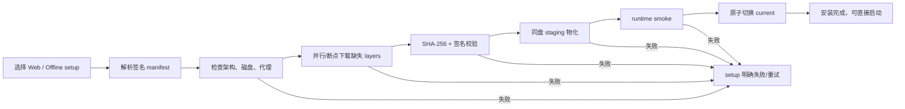

# CreatorOS Windows Runtime 交付业界方案与选型建议（T-565）

> 日期：2026-07-27
> 状态：PLAN 前置调研；尚未成为已批准架构
> 用户硬要求：setup 阶段完成所有必需 runtime 准备；首启完整 runtime 解压次数为 0；setup
> 失败不得伪装成功；同时实质减少小文件，而不是只把等待从首启搬回安装器。

## 1. 结论

推荐采用“双安装器 + 签名分层 Runtime Image + JS 少文件化”的组合，而不是继续把一个完整
`sidecar.tar.gz` 原样塞进 NSIS：

1. **默认 Web Installer**：小型签名 setup 在安装阶段联网下载与本机架构匹配的、不可变版本
   Runtime Image；下载、校验、物化、健康检查全部成功后才显示安装完成。
2. **Offline Installer**：携带完全相同的 Runtime Image，供断网或企业环境使用；安装语义与
   Web Installer 一致，不能另留首启解压路径。
3. **Runtime 分层**：至少分为 `core`、`browser`、`media`、`local-ai`；升级只下载变化层。
4. **JS/依赖少文件化**：优先把服务端 JS bundle 成少量文件；无法 bundle 的动态模块才进入
   allowlist 散文件区。原生 `.node/.dll/.wasm`、Chromium、ffmpeg 保持真实文件。
5. **安装事务**：下载到 cache → 校验签名/hash → 解到同盘 staging → runtime smoke →
   原子切换 `current`；任一步失败，setup 明确失败并保留上一版，绝不启动 AppData 兼容解压。

联网下载只解决安装包体积与分层更新，**不会自动解决小文件安装时间**。少文件化和安装器事务
必须同时做。

## 2. CreatorOS 当前事实

当前本地 Runtime 样本：

| 指标 | 当前值 |
|---|---:|
| `sidecar.tar.gz` | 381 MiB |
| 展开 runtime | 约 1.1 GiB |
| 普通文件 | 26,381 |
| 全部条目 | 31,410 |
| `sidecar/node_modules` 文件 | 24,756 |
| `.js` | 9,996 |
| `.ts` | 5,051 |
| `.map` | 3,907 |
| `.mjs` | 1,238 |
| `.md` | 673 |
| `.h` + `.cc` | 675 |

字节大户和文件数大户不是同一个问题：

- Chromium 约 345 MiB，但只有约 352 个文件；
- `node_modules` 约 509 MiB，却贡献约 2.5 万个文件；
- Windows 慢的主要矛盾是 `node_modules` 的大量 create/write/metadata/Defender 扫描，而不是
  单纯 381 MiB 下载或 gzip 解码。

当前 `Next output: standalone` 已使用 Output File Tracing，但仓内又为 Playwright、Pi、
Xenova/ONNX、HyperFrames 等动态依赖手工补入完整闭包，因此重新产生了大量包源码、类型、
source map、文档与编译源文件。

## 3. 业界采用的四种模式

### 3.1 应用代码归档后直接运行

Electron 的标准做法是把 JS 应用放入 `app.asar`。Electron 对 Node `fs/require` 做了虚拟文件系统
适配，运行时可以直接从一个归档读取，不需要把全部 JS 解开。官方明确说明 ASAR 用于改善
Windows 大量小文件读取与长路径问题；原生模块和必须拿到真实路径的二进制通过
`app.asar.unpacked` 单独交付。

来源：

- https://www.electronjs.org/docs/latest/tutorial/asar-archives
- https://www.electronjs.org/docs/latest/tutorial/application-distribution/

对 CreatorOS 的意义：

- **借鉴模式，不直接照搬格式**。CreatorOS 是 Tauri + 普通 Node sidecar，Node 没有 Electron
  的 ASAR `fs/require` 补丁；
- 可采用“绝大部分 JS bundle/归档，原生模块与外部程序 unpack”的同一边界；
- 不建议自研一套全局虚拟文件系统劫持 Node `fs`，维护风险高。

### 3.2 JS 服务端单文件化

Node 官方 SEA 能把一个已 bundle 的入口注入 Node 可执行文件，并可嵌入 assets；但 injected
main 的普通 `require()` 默认只能加载内建模块，文件系统依赖和 native addon 仍需显式处理。
官方也建议先把应用 bundle 成单一 JS。

来源：

- https://nodejs.org/download/release/latest-v22.x/docs/api/single-executable-applications.html

对 CreatorOS 的意义：

- SEA、ncc、esbuild 适合作为 **RAT**，目标不是第一天把 1.1 GiB 全塞进一个 exe，而是先把
  Next 服务端与可静态分析的 JS 依赖从上万个文件压到几十/几百个；
- `.node/.dll/.wasm`、Chromium、ffmpeg、动态深导入模块留作外部 allowlist；
- Next 动态路由、`serverExternalPackages`、Pi 深导入、worker `createRequire` 必须逐条做
  真调用 smoke，不能只测能启动。

### 3.3 小型 Web Installer 在线拉取 Runtime

Microsoft WebView2 的官方分发就是典型双轨：

- 在线用户使用约 2 MiB bootstrapper，安装时下载匹配架构的 Evergreen Runtime；
- 离线用户使用完整 Standalone Installer；
- runtime 安装完成后由应用直接使用，不在应用首启临时解压。

来源：

- https://learn.microsoft.com/en-us/microsoft-edge/webview2/concepts/evergreen-vs-fixed-version
- https://learn.microsoft.com/en-us/microsoft-edge/webview2/concepts/distribution

WiX Burn 是更适合 CreatorOS 的 Windows bootstrapper 候选：

- 既能把 payload 内嵌到单个 setup，也能通过 `DownloadUrl` 使用远程 payload；
- package 默认 `Vital=yes`，失败时会停止/回滚，而不是继续伪装安装成功；
- 提供 acquisition/cache/verify/progress 等安装引擎事件；
- 可以按 x64/arm64 条件选择包，并缓存已下载 payload。

来源：

- https://docs.firegiant.com/wix/tools/burn/
- https://docs.firegiant.com/wix/schema/wxs/exepackage/
- https://docs.firegiant.com/wix/tools/wixexe/

对 CreatorOS 的意义：

- 不建议继续用一段 NSIS `POSTINSTALL` hook 承担下载器、事务器、回滚器和升级器的全部职责；
- 可保留 Tauri 生成的 shell MSI/EXE，但在外层使用 Burn 编排 shell + Runtime packages；
- Web Installer 与 Offline Installer 由同一 manifest/pack 生成，避免两套安装逻辑漂移。

### 3.4 MSIX / App Installer / 可选包

Microsoft 的 MSIX/App Installer 支持 Web 安装、自动更新、optional packages、related sets，
Store 场景还支持按 content group 的 streaming install。所有 MSIX 必须签名。

来源：

- https://learn.microsoft.com/en-us/windows/msix/overview
- https://learn.microsoft.com/en-us/windows/msix/app-installer/app-installer-root
- https://learn.microsoft.com/en-us/windows/msix/package/optional-packages
- https://learn.microsoft.com/en-us/windows/msix/package/streaming-install

对 CreatorOS 的意义：

- 长期适合企业分发、干净卸载和 OS 托管更新；
- 但包身份、签名证书、容器/写路径、sidecar 子进程、现有 updater 与非 Store 分发都要重验；
- 不应作为当前白屏修复的最短落地路径，可作为后续替代 Burn/NSIS 的长期 RAT。

## 4. 方案比较

| 方案 | 首启解压 | 小文件问题 | 在线/离线 | 更新 | CreatorOS 风险 | 建议 |
|---|---|---|---|---|---|---|
| 继续内嵌 tar，setup 解开 | 0（做对时） | 未解决，安装仍可能 20–30 分钟 | 离线好 | 每次整包 | 低改造、体验仍差 | 仅作过渡兜底 |
| Web Installer 只下载原 tar | 0（做对时） | **未解决** | 双轨可做 | 可换 URL | 看起来先进，实际仍慢 | 不单独采用 |
| Web Installer + 分层 pack | 0 | 仍需配合少文件化 | 最适合双轨 | 只下载变化层 | 安装器改造中等 | 推荐底座 |
| JS bundle/SEA + 原生文件 allowlist | 0 | **直接解决主要矛盾** | 与安装器无关 | core 更新显著变小 | 动态加载兼容需 RAT | 推荐并行验证 |
| Electron/ASAR | 0 | 解决 | 双轨皆可 | 成熟 | 等于换壳，当前代价过高 | 只借鉴边界 |
| MSIX optional packages | 0 | 安装由 OS 管，但文件仍存在 | Web/Store 强 | 强 | 迁移与签名约束高 | 长期候选 |

## 5. 推荐目标结构

```text
CreatorOS-WebSetup.exe                 # 小、签名，只含安装引擎与 manifest
CreatorOS-OfflineSetup.exe             # 同一引擎 + 下列全部 packs

runtime-manifest.json                  # 版本、架构、层、URL、size、sha256、签名
runtime-core-win-x64-<hash>.pack        # Node/服务端 bundle/少量静态资源
runtime-browser-win-x64-<hash>.pack     # Chromium
runtime-media-win-x64-<hash>.pack       # ffmpeg/HyperFrames 必需资源
runtime-local-ai-win-x64-<hash>.pack    # ONNX/模型运行时
```

安装事务：



## 6. 少文件化的具体顺序

1. 先建立 runtime inventory 与动态加载 allowlist；产物中每个散文件域必须有 owner/消费者。
2. 在不改运行机制前，按包级规则清理确定不参与运行的 `*.map`、类型声明、测试、文档、示例、
   C/C++ 编译源和异平台产物；不能全局盲删，必须用四主链 smoke 证明。
3. 移除生产 runtime 对 `@playwright/test` 等测试入口的依赖，生产只使用 `playwright`。
4. 对 Next server 与普通 backend/AI JS 做 esbuild/ncc bundle RAT；动态模块 externalize。
5. 对 Pi、Xenova/ONNX、PGlite、sharp、Playwright、HyperFrames 分别跑真实冷门路径 smoke，
   将必须真实文件化的最小闭包写入 allowlist。
6. SEA 只在单 JS bundle 成立后评估；不要先用 SEA 再把整个 `node_modules` 作为外部目录带回去。

目标建议：

- runtime 普通文件数由 26,381 降到 **≤5,000**，并继续以实测 P95 校准；
- `core` 层散文件优先降到 **≤1,000**；
- 安装完成前 runtime smoke 通过；
- 首启完整解压次数恒为 0；
- setup 失败后 `current` 不变、staging 可清理、错误与日志可见；
- Web Installer 断网、代理、下载中断可重试/续传；
- Offline Installer 在完全断网机器上行为等价。

## 7. 不建议做的事

- 不再保留“安装器失败但显示完成，首启自动修复”的 fail-forward；
- 不把在线下载误当作减少小文件；
- 不直接把 2.6 万文件换成 zip/zstd 后继续整棵展开；
- 不为追求单文件盲目删除动态依赖或本地 AI/浏览器能力；
- 不自研全局 Node 虚拟文件系统；
- 不在没有 Authenticode、签名 manifest、不可变版本 URL 与 hash 校验时上线 Web Installer；
- 不使用会被覆盖的 `latest/runtime.pack` URL；manifest 必须指向 content-addressed immutable URL。

## 8. 下一 Gate

本调研只给出候选方向。由于它改变安装器、在线/离线边界、更新、签名和回滚标准，BUILD 前必须：

1. 修订 T-487 SPEC 或建立替代 SPEC；
2. 明确 Web Installer 是否作为默认、Offline Installer 是否继续公开；
3. 对 `esbuild/ncc/SEA` 做真实 runtime RAT；
4. 对 WiX Burn remote payload、代理、断点、失败回滚做 Windows 原生 RAT；
5. 独立规格评审通过；
6. 由用户确认最终架构后再实现。
