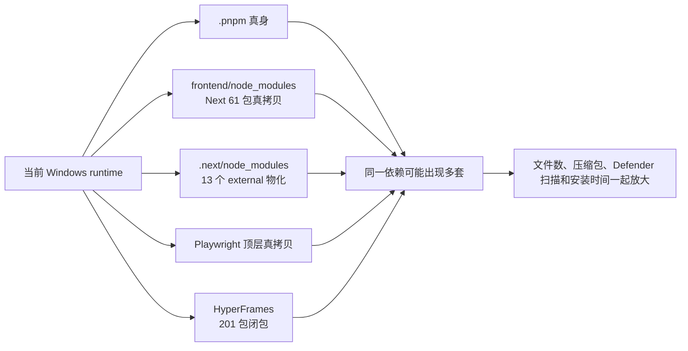

# T-565 Windows Runtime 不必要内容与重复物化审计

> 日期：2026-07-27
> 阶段：PLAN 证据，不代表 T-565 已通过评审或进入 BUILD
> 目标：回答“Windows 包里是不是还有不必要的东西”，并区分可直接剪除、应通过 bundle
> 消除的重复、以及体积大但当前仍必需的能力。

## 1. 结论

有，而且当前最大问题不是某一个 README，而是 **Windows 为绕开 pnpm junction 后产生的多套
依赖真拷贝**。

优先级如下：

1. **确定可删**：source map、TypeScript 声明、README/docs、test/fixture/example，以及
   `.DS_Store`；本地同构 runtime 已实删并真运行验证，合计 10,001 个条目、113,094,608 bytes。
2. **确定存在结构重复**：Windows 额外物化 Next 61 包闭包、Playwright 顶层副本，并在
   `.next/node_modules` 再物化 13 个 external；原 `.pnpm` 真身没有被统一替代。
3. **高度可疑、必须用 bundle/RAT 收口**：HyperFrames 当前携带 201 包闭包；S3 虽显式传入
   credentials，runtime 中仍出现 node/SSO/web-identity/process 等 AWS credential provider
   子树。
4. **大但不是小文件主因**：Chromium 约 341 MiB；Windows ffmpeg + ffprobe 约
   154.6 MiB。它们当前有真实生产消费者，不能直接删，但适合拆为独立可复用 layer。

所以“用户机不要看到开发态 node_modules”的方向是对的；但本项目不能只执行一次
`rm -rf node_modules`，必须先把 JS/JSON 生产闭包 bundle 成少量文件，并给 native addon、
WASM、浏览器和媒体二进制保留显式 allowlist。



## 2. 证据边界

本审计使用三类证据：

- 最新成功 Windows 发布 run `30251165852` 的原生日志与 setup artifact 元数据；
- 生成该 runtime cache 的 Windows run `30245576722` 构建日志；
- 当前同提交依赖结构的 macOS arm64 sidecar inventory 与 prune RAT。

Windows setup 没有在 CI 中输出完整 tree inventory，因此本文不伪造 Windows 精确文件总数。
macOS inventory 只用于识别“整包复制必然带入”的文件类型；Windows 独有物化数量只采用
Windows 日志和构建代码已经明确记录的数字。

## 3. 最新 Windows 产物事实

### 3.1 外层没有重复塞两份安装包

成功 run `30251165852` 的 artifact：

- artifact 名：`desktop-windows-x86_64`
- artifact 总大小：1,079,349,587 bytes
- ZIP 内只有一个文件：`CreatorOS_0.2.0_x64-setup.exe`
- setup 大小：1,079,329,762 bytes

artifact ZIP 仅比 setup 小约 20 KiB，说明 setup 内已经包含近乎不可再次压缩的 payload。
问题不在 artifact 外层重复上传，而在 setup 内的 `sidecar.tar.gz` 及其展开内容。

### 3.2 高速 CI 安装也已经很慢

同一个 setup 在 GitHub `windows-latest` runner：

- `sidecar.tar.gz` 打包：09:07:28 → 09:14:46，约 7 分 18 秒；
- 静默安装：09:24:14 → 09:35:20，约 11 分 06 秒；
- runtime cache 压缩后仍为 654,675,880 bytes（约 624 MiB）。

因此普通用户机器在 Defender 实时扫描下达到约 30 分钟是可信结果，不是单纯 WebView
渲染慢。

## 4. 确定可删除

在当前 sidecar 副本上执行确定性 prune，并用随包 Node/二进制做完整 runtime smoke：

| 类别 | 条目数 | 字节 |
|---|---:|---:|
| `*.map` source map | 3,907 | 76,404,009 |
| `*.d.ts/*.d.mts/*.d.cts` | 4,898 | 26,685,188 |
| README/docs | 421 | 2,502,551 |
| test/fixture/example | 775 | 7,502,860 |
| **合计** | **10,001** | **113,094,608** |

普通文件从 26,381 降到 16,381（-37.91%）。随后真实运行通过：

- Next 主页面 HTTP 200；
- PGlite query；
- Pi 深导入；
- Playwright + 随包 Chromium；
- Xenova/ONNX/sharp；
- HyperFrames CLI；
- ffmpeg/ffprobe。

此外 `frontend/public/.DS_Store` 会被 `build-sidecar.mjs` 原样复制到 Windows runtime，属于
确定无用的 macOS 元数据，应加入构建期拒绝清单。

详细命令与 smoke 证据见
`docs/research/2026-07-27-windows-runtime-prune-rat-evidence.md`。

## 5. 确定存在的 Windows 结构重复

### 5.1 Next 闭包同时保留 `.pnpm` 与顶层真拷贝

Windows run `30245576722` 明确输出：

```text
[T-426 W] 扁平 hoist next 闭包 61 包(+1 次版本嵌套;替坏 junction 为真身,零链)
```

构建代码把 61 个包的 body 实拷到 `frontend/node_modules`，但没有把 standalone 已带入的
`node_modules/.pnpm` 统一重建为单一生产闭包。代码自身的历史实测注释记录该 Next 闭包约
349 MiB。即使其中部分 `.pnpm` 条目是 tracing 子集，这仍是需要 inventory 逐 hash 证明并
消除的双布局，而不是可以继续长期交付的最终形态。

正确方向：用 esbuild/ncc/Next bundle 产出少量 JS/JSON bundle；只给必须靠真实路径解析的包
建立一个外置 allowlist。不要同时交付 pnpm virtual store 和 Windows hoist 树。

### 5.2 Playwright 在 Windows 明确双份

`bundlePlaywright()` 会：

1. 用完整包覆盖 `.pnpm` 中的 `@playwright/test`、`playwright`、`playwright-core`；
2. Windows 分支再把三个完整包实拷到 `frontend/node_modules`。

同一 Windows 构建日志同时出现三次“实拷”和“覆盖 `.pnpm` 残缺版 3 处”，所以双份不是推测。
本地源包体积约为：

- `@playwright/test`：64 KiB；
- `playwright`：4.8 MiB；
- `playwright-core`：12 MiB。

生产代码目前多处动态导入 `@playwright/test`。应改为生产依赖 `playwright`，测试代码继续用
`@playwright/test`；随后 bundle/外置一次，而不是保留测试 runner 命名和两套完整包。
不过单独删 `@playwright/test` 只省很小体积，真正收益来自消灭双布局。

### 5.3 `.next/node_modules` 又物化一套 external

同一 Windows run 输出：

```text
[T-440] .next/node_modules 物化:嵌套 13 个 + 实拷 0 个
```

后续 native 检查在以下三处同时发现 ONNX runtime：

- `frontend/.next/node_modules/@xenova/.../onnxruntime-node`
- `frontend/node_modules/@xenova/.../onnxruntime-node`
- `node_modules/.pnpm/.../onnxruntime-node`

这证明部分 native/AI 依赖存在三种布局。不能只靠文件名删除；要让 bundler manifest 把
external 真身固定为一个位置，其余引用全部指向该位置。

### 5.4 HyperFrames 携带 201 包闭包

Windows run 输出：

```text
[Windows] hyperframes@0.7.54_...:hoist 201 包(+2 次版本嵌套,零 junction)
```

CreatorOS 实际入口是 `hyperframes/dist/cli.js`。构建代码自己记录该文件约 9.3 MiB 且为
bundled CLI，但为了保险仍携带 201 包闭包。最终打 tar 前，`T-441` 又发现大量指向构建机的
包外依赖，额外“嵌套物化 80、物化 150MB”，并跳过 138 个重依赖链。

这说明当前闭包边界并不可信：一边带了 201 包，另一边仍有 138 条依赖链被判断为可以删掉。
应为 HyperFrames 建立真实“生成模板 + 启 Chromium + 导出视频”的消费 smoke，再按运行时
访问清单生成最小闭包；不能继续用整个依赖图，也不能仅凭 `--help` 盲删。

## 6. 高度可疑但不能直接删

### 6.1 AWS credential provider 子树

CreatorOS 的 S3 adapter 给 `S3Client` 显式传入：

```ts
credentials: {
  accessKeyId: cfg.accessKeyId,
  secretAccessKey: cfg.secretAccessKey,
}
```

但 Windows 最终打 tar 日志仍列出：

- `credential-provider-node`
- `credential-provider-sso`
- `credential-provider-web-identity`
- `credential-provider-process`
- `token-providers`
- 多套 `@aws-sdk/core`、`@smithy/core`

对当前显式 credentials 路径，它们大概率不会执行；但 AWS SDK 内部存在条件加载，不能按目录
手删。应把 S3 adapter 单独 bundle/tree-shake，并用 MinIO/S3-compatible 的 presign、PUT、
GET、HEAD 真 smoke 证明闭包，再移除默认 credential chain。

### 6.2 全包复制带入的 package metadata

当前 `cpSync(packageBody)` 会把 package 内所有 JS/JSON、声明、source map、文档和测试一起
复制。第一轮 prune 已证明 10,001 个条目可安全删除，但剩余 16,381 个文件仍远高于 T-565
目标 5,000。第二轮必须是生产 bundle，而不是继续扩大文件扩展名黑名单。

## 7. 大但当前不能当垃圾删

| 内容 | Windows/本地证据 | 判断 |
|---|---:|---|
| Chromium | 构建日志约 341 MiB | 网页采集、截图、视频渲染真使用；文件约数百个，不是小文件主因。拆 `browser` layer，可选按能力安装需新产品决策。 |
| ffmpeg | Windows 77.4 MiB，1 个 exe | 抖音抽音、转码、视频渲染使用；不是小文件主因。 |
| ffprobe | Windows 77.2 MiB，1 个 exe | 真媒体时长/尺寸、视频渲染探针使用；不是小文件主因。可研究共享 DLL/单一媒体工具分发，但不能直接删。 |
| Xenova/ONNX/sharp | 本地 owner inventory 约 108.4 MiB | 本地转写使用；应只保留 win32/x64，现有构建已做部分异平台剪枝。 |
| Node runtime | 一个 sidecar exe | 必需；“单文件 executable”可以减少 JS 文件，但仍需验证 native addon、动态 import 和资源寻址。 |

## 8. 当前 setup 还有一个诚实性问题

`installer-hooks.nsh` 的 `POSTINSTALL` 在 runtime 展开失败后不让安装失败，而是保留
`sidecar.tar.gz`，提示首次启动自动修复：

```text
安装期展开失败……首次启动将自动修复。
```

这正是“安装看似完成、首启继续解压/白屏”的入口。T-565 已明确要求改为 fail-closed；在正式
方案通过前，这一行为仍存在，不能把“正常情况下安装期解压”描述成问题已经解决。

## 9. 建议执行顺序

1. 构建期先落地已通过 RAT 的 10,001 条目 prune，并新增 `.DS_Store`/异平台文件 Gate；
2. 产出 Windows runtime inventory：路径、bytes、owner、content hash、重复组、普通文件数；
3. 把 Next/server 与普通 JS/JSON bundle 化，删除 `.pnpm + frontend/node_modules +
   .next/node_modules` 三套并存；
4. 对 Playwright、HyperFrames、AWS、Xenova 分别做真实消费者 closure；
5. Chromium、media、local-ai 作为独立签名 layer，不和 core 每次一起重发；
6. Windows setup 物化并 smoke 成功后才提交 `current`；失败必须非零退出，正式启动路径禁止
   全量解压兜底。

验收不能只看安装包 MB，至少同时看：

- runtime 普通文件数 ≤5,000；
- `core` 普通文件数 ≤1,000；
- content-hash 重复 bytes；
- 默认 Defender 下 setup 物化 ≤3 分钟；
- 安装后首次启动零 archive 读取、≤5 秒进入可交互主页面；
- Next/PGlite/Playwright/HyperFrames/S3/Xenova/ffmpeg 全消费链 smoke。
