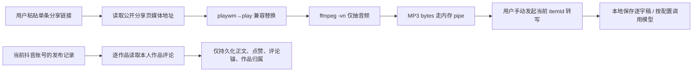

# 抖音 `playwm→play`、Chromium 自动化标记与采集范围真机验证

> 验证日期：2026-07-28
> 对应任务：T-597
> 验证作品：用户提供的抖音作品 `7666032121756093746`
> 目的：复核 T-596 中对“去水印下载、伪装人类、批量转写、评论批量采集”的技术描述。
> 边界：本报告是技术事实与初步合规风险校准，不是正式法律意见。

## 一句话结论

用户的四项质疑基本成立：

1. `playwm→play` 对这条真实作品是**让 ffmpeg 能取得媒体流并只抽音频**的必要兼容处理；当前命令有 `-vn`、输出到 `pipe:1`，没有保存或向用户提供视频。把它直接描述成“产品提供去水印视频下载”不准确。
2. `--disable-blink-features=AutomationControlled` 在公开页和登录态创作者中心的 A/B 中，唯一可见影响是把 `navigator.webdriver` 从 `true` 变成 `false`；页面、登录态、验证码状态和正文哈希完全一致。没有证据表明它绕过了签名、验证码或访问控制。
3. 雷达普通分享只建档，不自动转写；手动转写只把当前 `itemId` 入队，不是自动批量转写。
4. 评论批量入口遍历的是当前账号数据库中的抖音发布记录；解析阶段虽短暂读取评论者昵称、ID、IP 标签，但持久化只保存评论正文、点赞数、稳定评论锚和作品归属，没有保存昵称、IP 标签。

这会下调 T-596 对上述四项的技术严重性，但不把整体风险降为零。当前更现实的风险是：抖音协议明确限制自动化接入与信息收集；评论正文和第三方作品逐字稿仍涉及数据最小化、保存期限、外部模型披露及内容权利问题。刑法第 285 条方面，本次验证没有发现破解签名、突破验证码、窃取凭证或控制系统的事实。

## 实际链路



## 验证一：`playwm→play` 是否影响音频提取

### 方法

1. 请求该作品的 `iesdouyin.com/share/video/...` 公开分享页。
2. 从页面 `_ROUTER_DATA` 读取同一个 `play_addr.url_list[0]`。
3. A 组保留原始 `/aweme/v1/playwm/`；B 组只把路径替换为 `/aweme/v1/play/`。
4. 两组使用相同 ffmpeg 参数，限取 8 秒，只抽音频：

```text
ffmpeg ... -i <url> -vn -ar 16000 -ac 1 -b:a 64k -f mp3 pipe:1
```

没有创建视频文件，也没有把视频下载能力暴露给产品用户。

### 结果

| 组别 | 输入路径 | ffmpeg 退出状态 | 音频字节 | 结果 |
|---|---|---:|---:|---|
| A | `/aweme/v1/playwm/` | 183 | 0 | 失败：最终媒体响应无法解析 |
| B | `/aweme/v1/play/` | 0 | 65,004 | 成功取得 8 秒 MP3 音频 |

两个初始地址都先返回 `302` 到抖音 VOD 域名；但在本次真实样本中，原始 `playwm` 链路最终不能被 ffmpeg 作为媒体解析，替换后的 `play` 链路可以。

### 判断

- 对这条作品，删掉替换会直接破坏转写功能。
- 当前代码把该步骤注释为“去水印”，容易让审计者误解为视频下载产品。更准确的功能描述是“规范化可播放媒体地址，供 ASR 只抽音频”。
- 这次单样本不能证明所有作品都需要替换，也不能证明平台授权了该访问；它只证明该代码不是一个无作用的“下载增强”步骤。

代码证据：

- `frontend/src/server/ingestion/douyin-cdp.ts:464-532`：解析分享页地址并替换路径。
- `frontend/src/server/ingestion/douyin-cdp.ts:647-689`：`-vn`、MP3、`pipe:1`，只抽音频且不落盘。

## 验证二：Chromium 参数是否突破平台控制

### 方法

使用同一 Playwright Chromium、相同 UA、视口和等待时间，只改变是否传入：

```text
--disable-blink-features=AutomationControlled
```

进行了两轮 A/B：

1. 无登录资料访问该作品公开页；
2. 把最近使用的 CreatorOS 抖音浏览器资料复制成两个隔离临时副本，分别访问创作者中心“作品管理”页。测试没有输出 Cookie 内容，结束后删除临时副本，未改动原登录资料。

### 结果

| 场景 | 参数 | `navigator.webdriver` | HTTP / 页面 | 登录 / 验证码 | 正文对比 |
|---|---|---:|---|---|---|
| 公开作品页 | 无 | `true` | 200，同一最终 URL | 无登录提示、无验证码 | 82 字符，哈希相同 |
| 公开作品页 | 有 | `false` | 200，同一最终 URL | 无登录提示、无验证码 | 82 字符，哈希相同 |
| 登录态作品管理 | 无 | `true` | 200，“抖音创作者中心” | 已登录、无验证码 | 4,383 字符，哈希 `9c3e707a94d7bdbd` |
| 登录态作品管理 | 有 | `false` | 200，“抖音创作者中心” | 已登录、无验证码 | 4,383 字符，哈希 `9c3e707a94d7bdbd` |

### 判断

- 参数确实隐藏了标准 `navigator.webdriver` 自动化标记，不能说它“完全没有伪装作用”。
- 但本次公开页和真实登录态 A/B 都没有显示它改变访问结果、绕过验证或获得额外数据。
- 因此，把该参数等同于“破解签名、绕验证码、突破安全措施”没有技术证据。
- 平台协议对自动化工具的限制并不以是否使用该参数为前提，所以即使移除参数，平台协议与账号处置风险仍然存在；反之，保留参数也不自动上升为刑事侵入。

代码证据：`frontend/src/server/ingestion/douyin-cdp.ts:998-1023`。

## 验证三：是不是自动批量转写

代码链路显示：

- 手动按钮调用 `enqueueTranscript({ itemId: detail.item.id })`，只入队当前作品，并明确提示“系统不会自动转写其他作品”（`frontend/src/features/intelligence/intelligence-workbench.tsx:1217-1231`）。
- UI 明确显示“不会自动转写”“手动转写”（同文件 `:2394-2414`）。
- 普通分享链接只建档公开数据，不自动转写（同文件 `:2683-2687`）。
- 后端只有显式 `transcribeAfterImport=true` 才续接单条作品转写（`backend/src/modules/intelligence/intelligence.service.ts:3041-3053,3079-3094,3264-3271`）。

回归测试：

- `frontend/src/features/intelligence/intelligence-workbench.test.tsx`
- `frontend/src/server/intelligence/share-import-runner.test.ts`
- `backend/src/modules/intelligence/shared-item-import.test.ts`

相关测试全部通过。结论是：**当前雷达默认是用户逐条决定、逐条处理，不是后台自动扫全库转写。**

## 验证四：评论是不是任意他人作品批量采集

批量入口的作品范围来自：

```text
publishingService.getRecentPublicationsWithTitle(ctx, { limit: 500 })
  → 过滤 platform === "douyin" 且存在 externalId
```

`ctx` 带当前账号归属，浏览器资料也使用当前账号目录。因此默认批量路径是“当前用户账号已登记的抖音发布作品”，不是全网搜索任意作品（`frontend/src/server/persistence-client.ts:6569-6609`）。

数据字段方面：

- 解析阶段会短暂读到评论 ID、正文、点赞、回复、评论者 ID/昵称和 IP 标签（`frontend/src/server/ingestion/douyin-cdp.ts:307-358`）。
- 落库只传 `rawText`、`publicationId`、`likeCount` 和 `externalId`；没有传 `userName` 或 `ipLabel`（同文件 `:3423-3502`，`frontend/src/server/persistence-client.ts:6485-6526`）。

评论与限流相关测试：

- `frontend/src/server/ingestion/douyin-cdp.test.ts`
- `frontend/src/server/ingestion/douyin-throttle-integration.test.ts`
- `backend/src/modules/publishing/publishing.service.test.ts`

相关测试全部通过。需要保留的合规提醒是：评论者仍是第三方自然人，评论正文和稳定评论 ID 仍应设置用途、保存期限、删除能力和外部模型披露边界。

## 回归汇总

| 分组 | 测试文件 | 测试数 | 结果 |
|---|---:|---:|---|
| 雷达手动转写 / 分享导入 | 2 | 36 | 通过 |
| 抖音采集 / 评论限流 | 2 | 127 | 通过 |
| 后端分享导入 / 本人发布记录 | 2 | 36 | 通过 |
| 合计 | 6 | 199 | 全部通过 |

## 对 T-596 风险结论的校准

| 事项 | 原先容易造成的印象 | 本次证据后的准确表述 |
|---|---|---|
| `playwm→play` | 产品提供去水印视频下载 | 单条转写内部的媒体地址兼容；只抽音频、不保存视频 |
| Chromium 参数 | 伪装真人并突破风控 | 隐藏 `webdriver` 标记；两轮 A/B 未改变页面或验证码结果 |
| 雷达逐字稿 | 自动批量抓取、批量转写 | 普通分享不转写；用户手动对当前单条作品发起 |
| 完整逐字稿 | 保存本身即高风险 | 本地保存且逐条发起时风险较低；第三方内容权利、保存期和云模型传输仍需管理 |
| 评论批量采集 | 抓全网他人评论 | 抓当前账号本人发布作品下的评论；评论者信息处理仍需最小化 |

### 法律风险的更准确排序

1. **平台协议 / 账号风险：中高。** 抖音现行用户协议明确限制用自动化程序或第三方工具接入、收集或处理平台信息；这一风险不依赖是否破解签名。[“抖音”用户服务协议](https://www.douyin.com/agreements/?id=6773906068725565448)
2. **个人信息与内容权利风险：低到中，按数据对象变化。** 本人作品与本地处理较低；第三方评论正文、第三方完整逐字稿、长期保存和传给外部模型会升高。公开个人信息也只能在合理范围处理。[《个人信息保护法》第十三条、第二十七条至第三十条](https://www.npc.gov.cn/npc/c2/c30834/202108/t20210820_313088.html)
3. **刑法第 285 条风险：当前证据下低，但不是抽象意义上的零。** 本次没有发现突破登录/验证码、破解签名、取得身份认证信息或控制系统。两高司法解释所强调的“避开或者突破安全保护措施、未经授权或超越授权获取数据”应结合真实技术事实、对象、规模和后果判断，不能仅凭“285 条”或“用了 Playwright”下结论。[两高计算机信息系统犯罪司法解释](https://gongbao.court.gov.cn/Details/c6acdcf295a8ce63eb34a2444e67a8.html)

## 不让产品“废掉”的建议

不建议把产品退化成“所有文案都让客户手粘”。更合适的是保留核心体验，同时增加可证明的边界：

1. 保留单条链接建档和用户逐条手动转写；在按钮旁说明“将读取该公开作品音频并生成逐字稿”，留下操作日志。
2. 保留本人作品评论采集；明确显示“仅同步当前账号本人发布作品”，继续不落昵称和 IP，并为正文/评论锚增加保存期限与一键删除。
3. 把“是否发送到云端模型”做成清楚可见的设置；本地 ASR 可作为更低披露模式。
4. 第三方账号主页、收藏夹和定时批量元数据采集单独分级，不要与本人账号能力共用一个授权说明。
5. 将 `playwm→play` 的代码命名和注释改成“ASR 媒体地址规范化”，避免产品事实被误读；这只改说明，不改变功能。
6. Chromium 参数可以做灰度开关继续观察。当前样本显示移除后页面不受影响，但不能凭一次 A/B 就直接删除；先积累不同账号、不同页面和验证码场景的对照数据。

## 验证限制

- `playwm→play` 只验证了用户提供的一个真实作品。
- Chromium A/B 覆盖公开作品页和一个真实登录态创作者中心资料，但没有触发验证码、429、403，也没有调用额外内部接口。
- 页面 A/B 证明“本次结果相同”，不能证明平台永远不会基于其他指纹或服务端策略作差异处理。
- 测试证明了当前代码和回归契约，不代替抖音的书面接口授权或正式律师意见。
