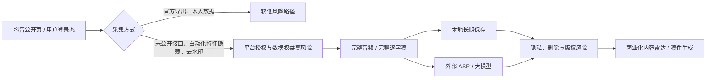

# “F12 扒视频”与 CreatorOS 抖音采集链路法律风险审计

> 审计日期：2026-07-28
> 对应任务：T-596
> 视频：么会良-刑事律师《F12 扒个视频，285 条管得着吗？》
> 抖音作品 ID：`7666032121756093746`
> 说明：本文是基于当前代码与公开资料的初步技术合规分析，不是正式法律意见。商业发布前应由熟悉中国网络与数据案件的律师复核，并取得平台书面授权。

> **2026-07-28 复核更正：** T-597 已用该真实作品和隔离的真实登录态完成 A/B。结果证明：`playwm→play` 是本样本只抽音频成功所必需，当前实现 `-vn` 且不保存/提供视频；Chromium 参数只改变 `navigator.webdriver`，未改变公开页或创作者中心页面、登录态、验证码与正文；雷达普通分享不自动转写，手动转写只入队当前作品；评论批量范围来自当前账号本人发布记录。下文中把这些能力概括为“去水印下载、伪装人类、批量转写、抓任意他人评论”的部分不再作为准确事实，具体以 [T-597 真机验证报告](2026-07-28-douyin-playwm-automation-ab-validation.md) 为准。平台协议、第三方内容/评论处理与外部模型披露风险仍需单独评价。

## 一句话结论

**视频讲清了“结果相同不等于技术性质相同”，但它把刑法第 285 条的判断过度收窄成了“有没有破解签名”。CreatorOS 当前实现也不只是 F12 读取浏览器已经收到的 URL：它包含登录态未公开接口、模拟客户端参数、隐藏自动化特征、去水印直链、批量转写、长期保存和外部模型处理。**

所以，当前版本不宜按“只是撕掉 UI 贴纸”继续商业化上线：

- 抖音协议/账号处置风险：**高，且是已经发生的规则冲突**；
- 数据权益与不正当竞争风险：**高**；
- 个人信息与网络数据治理风险：**高**；
- 著作权风险：**中高**；
- 刑法第 285 条风险：**目前中低，但有明确升级条件，并非零**；
- 刑法第 286 条所涉系统干扰风险：**目前低，但限流可被配置为 0、多账号放量后会升高**。

在拿到平台授权前，建议把可交付边界收缩为：**本人账号的官方导出/本人作品处理；第三方公开链接只存 URL 和必要元数据；没有权利证明时，不下载、不去水印、不做完整逐字稿、不把完整内容交给外部模型。**

## 视频到底说了什么

视频把两种链路作了区分：

1. 判例中的工具通过远程服务取得签名值、解析加密参数、组装请求，从而突破服务端校验；
2. 普通浏览器扩展只监听 Network 面板中已经由服务器正常返回给浏览器的完整 URL，再触发浏览器保存。

视频认为，前者是“偷签名、破锁”，后者只是“读取已授权传到客户端的数据、撕掉灰色下载按钮这张贴纸”，不能仅因最终都保存了视频，就把二者同等评价为刑法第 285 条意义上的侵入工具。

这个技术区分是有价值的。最高法公开案例也把“绕过登录验证、反爬措施，超过授权范围取得受限数据”视为重要事实；两高司法解释在认定专门侵入工具时同样关注规避或突破安全保护措施。[最高法：爬虫越界案例](https://www.court.gov.cn/zixun/xiangqing/459621.html)；[两高计算机信息系统犯罪司法解释](https://www.court.gov.cn/zixun/xiangqing/7494.html)

但视频的法律结论说得太满：

- 返回 `200 OK` 只能证明服务器响应了请求，不能自动证明平台或数据主体授权了后续的批量复制、商用、转交模型或再分发；
- “公开可见”不等于“可以用自动化工具无限采集和商业利用”；
- 即使尚不足以构成第 285 条，仍可能产生平台违约、账号封禁、停止侵害、不正当竞争、个人信息和著作权责任；
- 第 285 条的风险不仅看某一行代码是否“自己算签名”，还要看数据是否公开、账号授权范围、是否规避风控、是否在平台明确阻断后继续突破、规模、用途、获利和损害。

最高检公开研究也认为，普通公开数据采集通常不当然入罪，但非公开数据、超权限取得，以及高频大规模访问造成系统妨害，需要分别评价。[最高检：网络爬虫行为的刑事规制](https://www.spp.gov.cn/spp/llyj/202202/t20220215_544538.shtml)

## 我们的实际技术链路

### 1. 与视频中“F12 取直链”最接近的部分

`frontend/src/server/ingestion/douyin-cdp.ts:464-532` 从分享页的 `_ROUTER_DATA` 读取 `play_addr` 或 `download_addr`，并在 `:524-525` 明确执行 `playwm → play` 去水印；`:571-608` 匿名请求 `iesdouyin` 分享页。随后 `backend/src/modules/ai-runtime/transcribe-runner.ts:85-103` 用直链抽取完整音频并转写。

单纯读取公开分享页已经下发的地址，确实比破解签名、伪造 token 或突破验证码更远离第 285 条的典型事实。但是，“去水印 + 完整音频复制 + 商业处理”已经超出视频所强调的单纯客户端保存，主要会转化为平台协议与版权问题。

### 2. 比 F12 更激进的登录态内部接口

代码并非只读页面中自然出现的请求：

- `douyin-cdp.ts:1780-1788` 硬编码 `/aweme/v1/web/search/item/`，并模拟设备、浏览器版本等客户端参数；
- `:1900-1908`、`:2196-2256`、`:2331-2397`、`:3539-3690` 在持久化登录态页面内使用 `credentials: "include"` 调用搜索、作品详情和收藏夹接口；
- `:998-1023` 使用持久化浏览器资料，并加入 `--disable-blink-features=AutomationControlled`；
- `:1410-1422` 自动翻取他人账号公开作品，`:2518-2749` 自动翻评论，`:3505-3918` 自动翻收藏夹。

这些代码没有显示破解加密算法或伪造签名，遇到验证码也会停止，因此还不能直接等同于视频里的判例工具。但“未公开接口 + 登录态凭证 + 模拟参数 + 隐藏自动化特征”会明显削弱“只是浏览器原生保存”的抗辩，也更容易被解释为超出普通用户界面的自动化访问。

### 3. 采集后并没有只在内存里短暂使用

- 评论解析阶段可取得评论者 ID、昵称和 IP 标签（`douyin-cdp.ts:307-358`）；落库时没有保存昵称和 IP 标签，这一点是正面的，但仍保存完整评论正文和稳定评论 ID（`:3429-3503`；`backend/src/schema/candidate.ts:76-100`）。
- 对标账号与收藏夹会保存第三方作者信息和完整逐字稿（`backend/src/schema/benchmark.ts:18-63`；`backend/src/schema/favorites.ts:22-58`）。
- 内容雷达保存作者 ID、姓名和完整逐字稿；快照虽然有 `retentionUntil` 字段，常见写入却为 `null`（`backend/src/schema/intelligence.ts:71-127,209-224`；`backend/src/modules/intelligence/intelligence.service.ts:1317-1318,3235-3236`）。
- 即便选择 `permanent` 删除来源，当前实现仍先归档并保留不可变证据，真正物理清理依赖尚未落地的保留期任务（`intelligence.service.ts:2510-2547`）。
- 首次选题拆解会把完整逐字稿交给用户配置的模型（`frontend/src/server/persistence-client.ts:5815-5885`），项目稿件生成也会拼入完整来源逐字稿（`:5267-5295`）。ASR 可走云端或本地 Whisper（`backend/src/modules/ai-runtime/transcribe-runner.ts:299-319`）。

这意味着我们的实质不是“一次个人下载”，而是“采集—存储—分析—生成—商业产品交付”的完整处理链。

## 分项风险

| 风险 | 当前等级 | 为什么 |
|---|---:|---|
| 抖音协议与账号处置 | **高** | 现行协议明确禁止自动化工具接入、收集或处理内容，并明确禁止爬虫、模拟下载、深度链接、下载、统计分析、商用及向第三方提供。是否构成犯罪不影响平台据此封号或主张违约。[抖音用户服务协议第 2.4、5.1、5.3、7.1 条](https://www.douyin.com/agreements/?id=6773906068725565448) |
| 数据权益/不正当竞争 | **高** | CreatorOS 把平台数据持续转化为内容雷达、选题和稿件的商业价值，且存在规避自动化识别、内部接口和去水印。2025 年修订的反不正当竞争法对利用技术手段规避或破坏技术管理措施、获取和使用数据并扰乱竞争秩序设有专门规则。[反不正当竞争法（2025 修订）](https://www.npc.gov.cn/npc/c2/c30834/202506/t20250627_446247.html) |
| 个人信息与网络数据 | **高** | 用户 ID、昵称、评论正文和可识别作者信息可能构成个人信息；公开个人信息也只能在合理范围内处理。当前缺少面向用户的处理规则、刚性保存期、完整删除和外部模型披露控制。网络数据安全管理条例还要求自动化采集工具评估影响，不得侵入或干扰，并要求说明目的、方式、种类和保存期限。[个人信息保护法](https://www.cac.gov.cn/2021-08/20/c_1631050028355286.htm)；[网络数据安全管理条例](https://www.cac.gov.cn/2024-09/30/c_1729384452307680.htm) |
| 著作权 | **中高** | 完整下载音视频、生成完整逐字稿并用于商业内容生成，可能涉及复制、改编和信息网络传播相关权利。事实、观点和法律规则本身不当然受保护，但完整表达、案例编排和视频音画不能因“公开可看”就自由复制。[著作权法](https://www.npc.gov.cn/c2/c30834/202011/t20201119_308796.html) |
| 刑法第 285 条 | **中低，条件性升高** | 当前代码未见破解签名、窃取密码、突破验证码或控制/修改系统，且有不少数据是本人数据或公开数据，这些都降低风险。但登录态内部接口、自动化特征隐藏、平台明确阻断后若继续突破、获取非公开数据、超授权规模化商业提供，会显著升高风险。[刑法修正案（七）关于第 285 条](https://www.npc.gov.cn/zgrdw/npc/lfzt/rlys/2009-06/09/content_1882888.htm)；[两高司法解释](https://www.court.gov.cn/zixun/xiangqing/7494.html) |
| 系统干扰/第 286 条方向 | **低，放量后升高** | 当前单通道并发为 1，默认 4 秒或 9 秒间隔，验证码/429 会停止或退避（`frontend/src/server/ingestion/douyin-throttle-config.ts:1-58`）。但环境变量允许把间隔配为 `0`（`:70-76`），本人作品默认最多 40 页、评论也可多页，多账号累积后仍可能造成高频访问。 |

### 已经存在的保护措施

这些措施确实降低风险，应保留：

- 验证码命中返回空，不自动破解；
- 单通道并发为 1，存在抖动、冷却和指数退避；
- 评论者昵称和 IP 标签没有进入持久化表；
- AI 提示明确禁止复制原作者标题、句子、案例和叙事顺序（`ai-worker/src/prompt/templates/intelligence-topic-decompose.ts:27-59`）；
- 稿件采纳前有连续 30 字硬门和语义相似度门（`backend/src/modules/intelligence/project-script-candidate.service.ts:91-135,198-243`）；
- 本人创作者中心 XLSX 导出是用户手动登录后的平台界面操作，比第三方内容抓取风险低。

不过这些措施只能降低系统负载与下游抄袭风险，不能补足平台授权、第三方内容复制、个人信息处理依据或外部模型披露。

## 建议的上线边界

### 可保留

1. 用户本人账号、本人作品；
2. 创作者中心已有的官方导出功能；
3. 用户主动上传且确认拥有权利的音视频；
4. 本地 Whisper 处理本人或已获授权内容；
5. 第三方公开链接仅保存 URL、标题、公开计数和最小必要来源标识。

### 取得书面授权或完成专项法律评审前应关闭

1. 第三方作品的匿名去水印直链与完整音频抽取；
2. 登录态硬编码内部接口和模拟浏览器参数；
3. `--disable-blink-features=AutomationControlled`；
4. 自动批量拉取他人主页、评论、收藏夹并生成完整逐字稿；
5. 把第三方完整音频或完整逐字稿发送给云端 ASR/大模型；
6. 以内容雷达、热词、分类、搜索、商业稿件生成等方式使用未经平台授权的数据。

## 必须补的产品与工程控制

1. **权利声明 Gate**：每个来源必须选择“本人作品 / 已获许可 / 仅引用公开链接”，并记录证明、用途和期限。没有权利证明，不允许下载和完整转写。
2. **能力分级开关**：将“公开元数据”“本人官方导出”“第三方完整内容”分成不同权限；第三方完整内容默认不可用，不能只藏在设置里。
3. **移除规避性实现**：删除去水印替换、自动化特征隐藏、硬编码模拟客户端参数；平台出现验证码、403、429、登录限制或接口变化时立即停止，不开发绕过。
4. **限流硬底线**：生产环境的最小间隔不能配置为 0；增加每账号、每来源、每日总量和全局 kill switch。
5. **最小化与删除**：评论默认去标识化，不保存稳定评论 ID；所有第三方逐字稿必须设置非空保存期；“永久删除”要物理级联删除逐字稿、快照、变换结果和模型派生物，不能只归档。
6. **外部模型透明化**：调用前明确显示供应商、数据是否离开设备、供应商保存策略；第三方内容默认本地处理，云端只发送经过最小化的结构摘要或必要短摘录。
7. **版权控制前移**：保留现有相似度硬门，并把它覆盖到所有下游稿件；同时设置引用长度、来源标注、许可状态和禁止整段复现。相似度门不能代替上游授权。
8. **商业发布 Gate**：在取得抖音书面接口/数据使用授权、完成隐私规则与数据处理清单、通过中国律师专项复核前，不把上述自动采集能力交付给客户。

## 最终判断

如果 CreatorOS 只做“用户本人登录后，从创作者中心导出本人数据并在本地处理”，视频里的“没有破锁”论证对降低刑事风险有帮助。

但当前实现已经越过这条边界。它同时具备第三方内容自动采集、登录态内部接口、去水印、完整转写、长期存储和商业生成用途。**因此不能以视频为依据给当前方案出具“没有法律风险”或“285 条管不着”的结论。**

更准确的说法是：

> 当前尚未看到最典型的“破解签名、突破验证码、窃取非公开数据”刑事链路，所以第 285 条不是最迫近的风险；但平台协议、数据权益、个人信息和版权风险已经足以要求暂停第三方完整内容采集。若未来继续绕过平台拦截、取得非公开数据、放大规模或对外售卖专用工具，刑事风险会快速上升。
