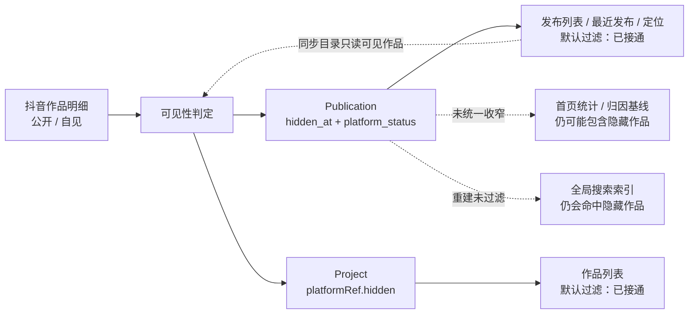

# CreatorOS 已隐藏作品过滤能力审计

> 日期：2026-07-28  
> 任务：T-591  
> 范围：作品/发布列表、首页与发布统计、搜索、定位、AI 上下文、选题归因、采集重活与隐藏状态恢复。  
> 本轮性质：只读审计与根因登记，不修改业务实现。

## 一句话结论

**目前是“主列表能过滤，但没有形成全产品统一口径”。**

- `/projects` 与 Publishing 的默认仓储查询确实在服务端过滤已隐藏作品，不只是前端把行藏起来。
- 账号定位已经在 T-578 改成只读取 canonical 可见发布，当前这条链是安全的。
- 首页账号级统计、播放趋势和选题归因账号基线仍可能把隐藏作品的历史快照算进去。
- 全局搜索启动重建会把隐藏项目、隐藏发布重新写进索引，搜索读侧本身没有可见性条件。
- “显示已隐藏”入口存在实现断点：项目页默认拿不到隐藏计数，发布中心即使带 `hidden=1`，父级项目查询仍先把隐藏项目过滤掉。
- 隐藏状态有 Project 与 Publication 两份承载，分三次 best-effort 更新；而下一轮明细同步又只从“默认可见发布”建匹配目录，作品一旦隐藏后可能无法靠后续同步恢复公开。

## 大白话数据流



这张图里的核心问题不是“没有隐藏字段”，而是**同一条可见性事实被复制到两处，消费方又各自选择是否过滤**。

## 1. 隐藏状态真相与写入链

### 当前承载

1. `publications.hidden_at`
   - 非空表示平台侧已隐藏/仅自己可见。
2. `publications.platform_status`
   - `NULL` 兼容旧数据；`已通过` 视为可见；非空且非 `已通过` 在 Publishing canonical 过滤器中不可见。
3. `projects.platform_ref.hidden`
   - 导入项目列表使用的镜像字段。

Publishing 已有明确的 canonical 判据：

```text
hidden_at IS NULL
AND (platform_status IS NULL OR platform_status = '已通过')
```

代码证据：

- `backend/src/modules/publishing/publishing.repository.ts:166`
- `backend/src/modules/publishing/publishing.repository.ts:295`
- `backend/src/modules/projects/projects.repository.ts:311`

### 写入与一致性风险

`self.detail` 对一条匹配作品依次执行：

1. 更新 `publication.hidden_at`；
2. 更新 `publication.platform_status`；
3. 更新 `project.platformRef.hidden`。

三步不在同一事务中，外层按 best-effort 吞掉异常。任何中间失败都可能形成：

- 发布列表认为已隐藏，但项目列表仍显示；
- 项目列表已隐藏，但 Publication 统计/定位仍认为可见；
- 两个页面对同一作品给出不同结论。

代码证据：`frontend/src/server/persistence-client.ts:6864`。

另一个恢复断点更直接：`self.detail` 在匹配导出明细前，通过默认的 `getRecentPublicationsWithTitle` 建目录；这个读默认已经过滤隐藏作品。因此作品首次被标隐藏后，下一轮可能根本不再进入目录，也就没有机会把 `hidden_at` 和 `platformRef.hidden` 清回公开。

代码证据：`frontend/src/server/persistence-client.ts:6795`。

## 2. 能力矩阵

| 消费面 | 当前默认行为 | 服务端过滤 | 显式查看隐藏 | 审计结论 |
|---|---|---:|---:|---|
| 作品列表 `/projects` | `projects.list` 默认过滤 `platformRef.hidden=true` | 是 | 有 `?hidden=1`，但默认返回集的隐藏数为 0，按钮通常不出现 | **过滤有效，入口断裂** |
| 作品列表状态 Tab/指标排序 | 都在默认已过滤行集上计算 | 是（继承列表） | 同上 | **默认口径正确** |
| 发布列表 `/publishing` | Publication 查询默认走 canonical 双闸过滤 | 是 | `hidden=1` 只传给子 Publication；父 `projects.list` 仍默认过滤隐藏项目 | **默认正确，查看隐藏基本不可达** |
| 发布中心右侧总播放/总互动/趋势/热门 | 从本次组装出的发布行聚合 | 间接（继承默认列表） | 若未来真的包含隐藏行，右侧会把全部 `railInputs` 聚合，不随客户端“隐藏行”开关变化 | **默认正确，显式模式口径不一致** |
| 内容日历 | 复用发布中心默认组装 | 间接 | 无 | **默认过滤** |
| 首页最近发布 | `getRecentPublicationsWithTitle` 默认 canonical 过滤 | 是 | 无 | **正确** |
| 首页总播放/点赞/分享/完播/趋势 | `resolveImportedPublicationIds` 先取全部 imported 项目与全部发布 ID，再聚合快照 | 否 | 无 | **缺口：隐藏作品污染账号统计** |
| 单作品/单项目历史指标 | 按 ID 读取历史快照，不检查 hidden | 否 | 直接深链可查 | **保留历史事实，可接受；不能拿来做账号级汇总** |
| 定位生成作品画像 | T-578 通过 `visibility:'visible'` 的 Publishing 窄读，再按真实 `publishedAt` 排序 | 是 | 无 | **正确，已有回归** |
| Copilot `context.projects` / `context.publications` | Project 与 Publication 的默认列表读都过滤 | 是 | 无 | **默认过滤** |
| Copilot 单项目 `context.metrics` / 复盘 | 用户明确给 projectId 后读取该项目历史指标 | 否 | 深链/显式对象 | **历史对象仍可分析；不等于账号汇总** |
| 选题归因候选作品 | 最近发布默认已过滤，且循环再次判断 `hiddenAt` | 是 | 无 | **候选正确** |
| 选题归因账号基线 | 直接 `getDashboardRollup(ctx)` 全账号快照 | 否 | 无 | **缺口：相对分层基线被隐藏作品污染** |
| 评论采集、逐字稿、重建、封面回填 | 最近发布默认过滤；重活另有 `isPublicationRunnableForHeavyWork` | 是 | 无 | **已知隐藏作品不跑重活** |
| 全局搜索/搜索分面 | 只按 user/account 与关键词查 `search_documents` | 否 | 无 | **缺口：索引里有就会命中** |
| 启动搜索索引重建 | 直接全表读取 projects/publications 后全部重播 | 否 | 无 | **缺口：每次启动会重新写入隐藏作品** |

## 3. 重点证据

### 3.1 主列表确实是服务端过滤

Publishing 两个常用读：

- `listPublicationsByOutput`
- `listPublicationsForUser`

默认都会加入 canonical 可见性 SQL；只有调用者显式传 `includeHidden=true` 才放开。证据：

- `backend/src/modules/publishing/publishing.repository.ts:295`
- `backend/src/modules/publishing/publishing.repository.ts:318`

Project 列表默认加入：

```sql
coalesce((platform_ref->>'hidden')::boolean, false) = false
```

证据：`backend/src/modules/projects/projects.repository.ts:311`。

### 3.2 项目页“显示已隐藏”入口为什么会消失

项目页默认请求不传 `hidden=true`，服务端先过滤；页面再从已经过滤后的 `vm.rows` 计算 `hiddenCount`。按钮又只在 `hiddenCount > 0 || showHidden` 时渲染。

因此正常访问 `/projects` 时：

```text
服务端先删隐藏行 → hiddenCount = 0 → “显示已隐藏作品”按钮不渲染
```

证据：

- `frontend/src/features/projects/projects-page.tsx:125`
- `frontend/src/features/projects/projects-page.tsx:146`
- `frontend/src/features/projects/projects-toolbar.tsx:73`

现有页面测试用手工注入的完整 ViewModel 测按钮，没有覆盖真实服务端先过滤后的链路。

### 3.3 发布中心为什么带 `hidden=1` 仍不完整

发布中心组装先执行父级 `projects.list`，这里没有把 `opts.includeHidden` 传进去；随后才对每个 output 的 Publication 查询传 `hidden=true`。隐藏导入作品的 Project 已在第一步消失，后面根本遍历不到。

证据：

- `frontend/src/features/publishing-center/publishing-center-data.ts:327`
- `frontend/src/features/publishing-center/publishing-center-data.ts:362`

### 3.4 首页统计为什么仍会算隐藏作品

`resolveImportedPublicationIds` 使用：

```text
listImportedProjectIds → listPublicationIdsByProject
```

两条窄读都不带可见性条件；得到的 ID 集直接交给：

- `getDashboardRollup`
- `getDailyPlayTrend`

所以隐藏作品的最新快照仍参与总播放、点赞、分享、完播率与趋势。

证据：

- `frontend/src/server/persistence-client.ts:2482`
- `backend/src/modules/publishing/publishing.repository.ts:358`
- `frontend/src/server/persistence-client.ts:8413`
- `frontend/src/server/persistence-client.ts:8493`

选题归因的账号基线也直接调用全量 `getDashboardRollup(ctx)`，存在同样问题：

- `frontend/src/server/persistence-client.ts:7160`

### 3.5 全局搜索为什么会漏

搜索读只检查 user/account 与关键词，不知道 `hidden_at` 或 `platformRef.hidden`。启动时又直接全表读取 Projects/Publications，全部交给搜索索引重建。

证据：

- `backend/src/modules/search/search.repository.ts:150`
- `frontend/src/server/persistence-client.ts:8821`

隐藏状态同步也没有调用 `searchService.removeDocument`；所以无论旧索引还是启动重建，隐藏作品都可能继续被搜索到。

### 3.6 定位已经修好

T-578 新增了定位专用作品投影，明确调用：

```ts
listPublicationsByOutputIds(..., { visibility: "visible" })
```

并只保留有真实 `publishedAt` 的 `published` 行，再按发布时间倒序。

证据：

- `frontend/src/server/persistence-client.ts:3162`
- `frontend/src/server/recent-projects-context.ts:130`
- 完成提交：`1b51791a`

## 4. 测试覆盖结论

已有覆盖：

- Publishing canonical visible 过滤 `hiddenAt/platformStatus`；
- Project hidden 标记同步；
- 项目/发布页面在“已拿到包含隐藏行的 ViewModel”时做客户端过滤；
- 定位不包含隐藏旧作品；
- 重活跳过已知隐藏作品。

缺失覆盖：

1. 首页 rollup 与趋势排除隐藏 publication；
2. 选题归因账号基线排除隐藏 publication；
3. 全局搜索与搜索分面不命中隐藏项目/发布；
4. 启动索引重建跳过隐藏源行；
5. 真实 Server Component 路径下，“显示已隐藏”入口从默认 URL 可达；
6. 发布中心 `hidden=1` 同时放开父 Project 与子 Publication；
7. 作品从“自见”恢复“公开”后，三份标记都被清除；
8. 三步同步中任一步失败后的自动对账。

本轮实际复跑：

- Backend：Publishing、Projects、Chat/定位相关 3 个测试文件，189 条通过；
- Frontend：项目页、发布中心交互、定位投影、明细可见性、重活过滤 5 个测试文件，66 条通过。

这些通过项证明现有局部过滤没有回归，但不能替代上面 8 条尚不存在的跨层验收。

## 5. 本机真实规模证据

同日线上反馈排查与 T-578 任务记录确认：

- 作品明细共 34 条；
- 28 条已隐藏；
- 仅 6 条可见。

来源：

- `docs/research/2026-07-28-production-feedback-triage.md`
- `BACKLOG.md` 的 T-578

这意味着统计缺口不是边角情况：如果隐藏作品保留历史高播放快照，28 条旧作品足以显著改变首页总量、趋势和选题归因的相对基线。

## 6. 已登记根因任务

| 任务 | 根因 | 期望结果 |
|---|---|---|
| T-592 | 账号级聚合只按 account/ID，不按 canonical 可见性 | 首页与归因基线只统计可见作品 |
| T-593 | 隐藏计数来自已过滤结果；发布中心父查询未放开 | 用户能从正常入口查看隐藏作品，列表与统计同口径 |
| T-594 | 搜索索引没有可见性投影与状态变更 fan-out | 隐藏作品不进搜索，恢复后可重新索引 |
| T-595 | Project/Publication 三步双写且恢复目录先过滤隐藏 | 可隐藏、可恢复、可对账，不再双真值漂移 |

## 7. 修复顺序建议

1. **先做 T-595**：先保证隐藏事实本身可靠、可恢复。
2. **再做 T-592**：用 canonical visible publication IDs 收口所有账号级统计。
3. **再做 T-594**：搜索派生索引跟随 canonical 状态。
4. **最后做 T-593**：把查看隐藏入口与显式模式的列表/统计体验接完整。

在这四项完成前，产品对外应使用的准确口径是：

> CreatorOS 已能在作品列表、发布列表、定位和重活处理里过滤已知隐藏作品；但首页统计、选题归因基线、全局搜索、查看隐藏入口与恢复同步还没有统一收口，不能宣称“全系统已过滤隐藏作品”。
