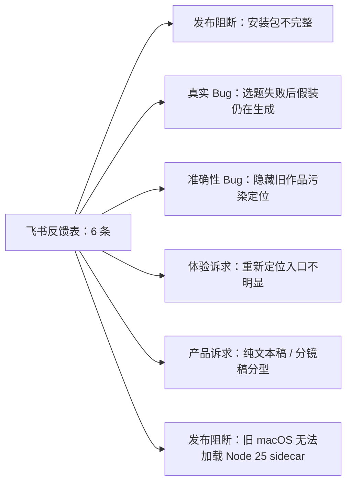

# CreatorOS 线上反馈首轮汇总（2026-07-28）

## 1. 范围与事实边界

- 来源：飞书 Base「CreatorOS 官方问题反馈」。
- 数据表：`问题反馈`（`tblIPu0er91yGTwL`）。
- 指定视图：`Grid View`（`vewb4HsOUz`）。
- 视图配置：无筛选、无排序，9 个字段全部可见。
- 读取范围：单次读取上限 200 条，返回 `has_more=false`；首轮复核共 5 条；
  2026-07-28 16:03 新增 1 条内部用户启动失败反馈，当前共 6 条。
- 写入动作：首轮将 5 条记录置为「处理中」；本轮按真实进度再次回写：
  安装反馈和账号定位优化为「待处理」，其余 3 条已完成代码、等待发布验证，保持「处理中」。
  单独通过微信收到的安装失败日志已新建反馈记录并上传原始 `.enc` 密文附件。
- 隐私：联系方式只保留在飞书原记录中，本报告不复制；日志只在开发者本机解密，不向飞书回传明文。



## 2. 汇总结论

### 2.1 安装后无法启动：安装包资源不完整

- 用户原话：安装不上。
- 原始日志：228B，合法 `CRLOG\x01` 加密信封，SHA-256 为
  `5616bce186d84002fb62585e43341abe0c1eabf561411f8aceec4ecb08f1d0d6`。
- 完整解密结果只有一行：

  ```text
  [2026-07-28T05:09:57.590Z] [shell] runtime 解析失败: bundle 资源缺 sidecar.tar.gz(打包不完整)
  ```

- 结论：不是激活码、网络或模型配置问题；安装后的应用资源里没有可启动 sidecar 所需的
  `sidecar.tar.gz`，所以 sidecar 尚未启动就失败。
- 仍缺证据：用户系统、CreatorOS 版本、下载页面/文件名、是否经过二次转存或解包。
- 代码侧现状：macOS 最终 `.app` 自检和 Windows setup 清单/真安装门理论上都会拦截缺 tarball
  的新包。因此现阶段更像旧包、错误附件、二次转存残包或门卫未覆盖的分发路径；在补齐系统、
  版本和来源前，不能武断并入 Windows 白屏任务。
- 用户决策：2026-07-28 明确要求本轮忽略该安装反馈，暂停继续定位；飞书回退为「待处理」，
  不把暂停误写成已修复。
- 任务：`T-577`。

### 2.2 账号定位识别旧隐藏作品：取数口径错误

- 用户反馈：定位会识别已经隐藏的 2025 年作品，反而不能准确体现最新发布作品。
- 日志证据：
  - 抖音创作者身份读取成功；
  - 作品明细共 34 条；
  - 28 条被判定为隐藏，仅 6 条可见；
  - 定位生成操作本身完成。
- 代码证据：
  - `listRecentProjectsWithPublicationFacts` 从全部 project 取数，没有排除
    `platform_ref.hidden` / publication `hidden_at`；
  - 先按 project `updatedAt/createdAt` 排序，再补 publication `publishedAt`；
  - `formatWorksBrief` 将整页标题全部注入定位模型，不区分可见与隐藏。
- 根因：隐藏旧作品仍会进入定位画像；明细同步又可能刷新旧 project 的 `updatedAt`，使“最近被同步”
  被误当成“最近发布”。28 条隐藏旧作品在数量上压过 6 条可见作品，足以把定位方向带偏。
- 修复边界：只向定位注入当前账号的可见真实作品，并以 canonical `publishedAt` 排序；补隐藏作品、
  旧作品最近更新、最新可见作品三组回归。
- 任务：`T-578`。

### 2.3 雷达生成选题一直显示生成中：失败终态丢失

- 用户反馈：macOS 0.2.0，雷达点击生成选题后一直显示生成。
- 日志证据：出现模型对 `responseFormat` 不支持的警告；附件没有覆盖用户 12:06 提交时刻的完整
  生成终态，因此不能把该警告写成唯一底层失败原因。
- 代码证据：
  - `runIntelligenceTopicPreviewTask` 失败时只把 persistent task 标成 `failed/blocked`；
  - 对应 `intelligenceTransforms` 仍保持 `status=candidate`、`outputSnapshot=null`；
  - 详情接口没有把 task 的 terminal/error 投影给前端；
  - 前端仅凭 `outputSnapshot=null` 显示“候选仍在后台生成”。
- 根因：不论底层因模型、协议、配置还是输入失败，UI 都拿不到真实失败终态，因而永久显示假运行。
- 修复边界：transform/详情投影必须带真实任务终态和安全错误；失败后停止生成态并提供真实重试入口，
  同一幂等键不能把旧失败永久复用。
- 已完成：详情接口已投影任务终态与安全错误；前端只在排队/运行时显示生成中，失败、受阻或
  已取消时显示原因和「重新生成」。热点宝采集另增加最长 15 秒的页面控件等待，并从同轮多个
  官方榜单响应中选择满足 48 小时时间窗的有效结果，避免最后一条过渡空响应把真实成功误报为
  `RESPONSE_SHAPE_CHANGED`。前后端全量测试通过，待随下个版本发布验证。
- 任务：`T-579`。

### 2.4 希望“重新定位”：复用“新建定位版本”

- 用户反馈：第一次定位方向不对，修改麻烦，希望提供“重新定位”。
- 用户确认：无需新增重复入口；定位中心现有「新建定位版本」即可承接重新定位。
- 已完成：点击后先弹窗说明会清空本次表单并重新开始；确认后打开空白定位草稿，取消则不改变
  当前页面。已保存的历史定位不会被删除。交互回归测试通过，待随下个版本发布验证。
- 任务：`T-580`。

### 2.5 希望区分纯文本稿和分镜脚本：复用现有双视图

- 用户反馈：出文案时希望区分纯文本和分镜脚本。
- 用户确认：不需要生成两套互相漂移的产物，只需在口播脚本区一键切换阅读/编辑视图。
- 已完成：把原有「编辑 / 结构」两个小按钮明确命名为「纯文本稿 / 分镜脚本」；两种视图继续
  共享同一份脚本真值，不重复生成或复制数据。组件回归测试通过，待随下个版本发布验证。
- 任务：`T-581`。

### 2.6 内部用户 macOS 启动失败：安装口径与 sidecar 运行时不兼容

- 最新反馈：2026-07-28 16:03，内部用户，启动应用即提示本地服务未能完成启动；附件为
  `logs.zip`，包含 6 份加密日志。
- 日志证据：0.1.0 与 0.2.0 的 `creatoros-server` 都在真正启动前被 macOS `dyld` 终止；
  缺失符号为 `__libcpp_verbose_abort`，随后进程以 `SIGABRT` 退出。没有进入端口监听、数据库迁移
  或业务服务阶段，所以不是端口占用、数据损坏或激活状态导致。
- 构建证据：
  - `build-sidecar.mjs` 直接复制打包机的 `process.execPath` 作为 `creatoros-server`；
  - 发布流水线固定使用 Node 25；
  - [Node 官方构建说明](https://github.com/nodejs/node/blob/main/BUILDING.md#platform-list)
    明确 macOS 二进制最低支持 macOS 13.5；
  - `tauri.conf.json` 仍把安装包最低系统声明为 macOS 10.15。
- 根因：外壳允许旧系统安装，但其中的 Node 25 sidecar 不支持该系统，形成“可以安装、服务必崩”
  的虚假兼容范围。
- 待决策：补齐用户具体 macOS 版本后，在“把产品最低系统诚实提升为 13.5 并在安装前拦截”
  与“建设一套兼容旧系统的独立运行时”之间选择；后者会影响 Node 版本、原生依赖和发布验收，
  不能作为普通补丁暗中实施。
- 任务：`T-586`。

## 3. 跟进状态

| 任务 | 当前结论 | 飞书状态 |
|---|---|---|
| T-577 安装包不完整 | 用户要求本轮忽略，暂停跟进，未声称修复 | 待处理 |
| T-578 隐藏作品污染定位 | 已登记优化任务，本轮按要求不实现 | 待处理 |
| T-579 选题永久生成中 | 状态投影与失败重试已修，待发版验证 | 处理中 |
| T-580 重新定位入口 | 确认后打开空白定位草稿已完成，待发版验证 | 处理中 |
| T-581 纯文本/分镜切换 | 现有双视图按钮改造已完成，待发版验证 | 处理中 |
| T-586 macOS 本地服务启动失败 | Node 25 与安装包最低系统口径冲突，待兼容策略决策 | 处理中 |

## 4. 下一步

1. `T-579`、`T-580`、`T-581` 和热点宝采集修复进入下一版安装包；发布后用真实账号复验，
   再把对应飞书记录改为「已解决」并邮件反馈用户。
2. `T-578` 只保留为后续优化任务；本轮不扩大实现范围。
3. `T-577` 按用户决定暂停；重新启动跟进时再补平台、版本、下载来源和安装文件名。
4. 后续新反馈继续从同一 Base 全量读取；只有真实修复、发布和回归证据齐备后，才把记录改成
   「已解决」。
