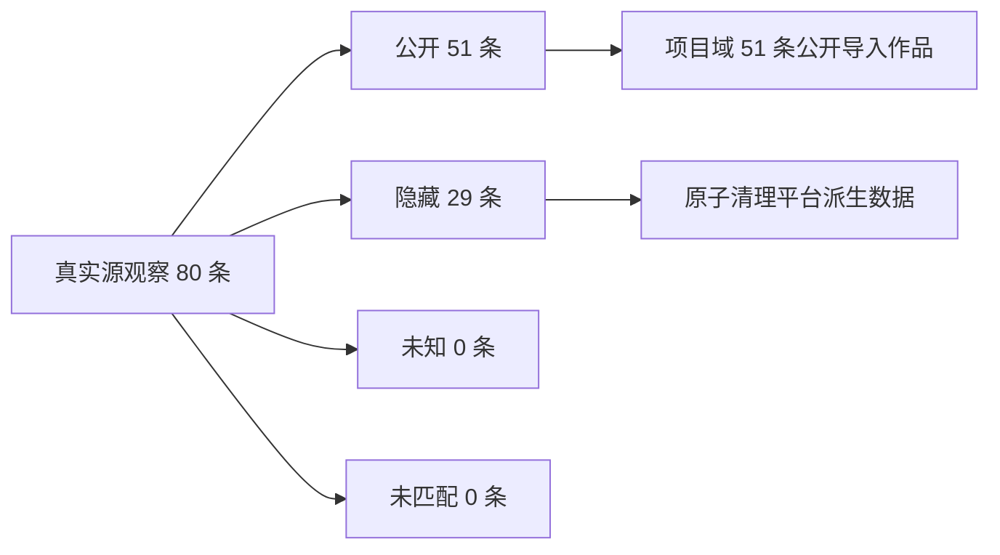

# T-595 仅公开作品入库验收记录

> 验收时间：2026-07-28
> 账号证据：本机已绑定真实抖音账号（报告不记录昵称、Cookie、`sec_uid` 或作品正文）
> 对应 SPEC：[仅公开作品入库边界](../superpowers/specs/2026-07-28-visible-only-ingestion-boundary.md)

## 大白话结论

新版采集已在本机真实账号跑通。采集器先在内存里把抖音作品与创作者中心明细对齐，再只把
明确公开的作品写入 CreatorOS；明确隐藏的存量作品已退出平台派生数据域。项目页不再提供
“显示已隐藏”入口，旧 `hidden=1` 也不能把隐藏作品带回来。项目、发布、定位、统计、搜索、
封面、逐字稿和重建都直接消费这个归一化作品域，不再各自维护 hidden 过滤。

## 真实运行证据

| 项目 | 结果 |
|---|---:|
| 源侧明细观察数 | 80 |
| 明确公开并进入写集合 | 51 |
| 明确隐藏并进入清理集合 | 29 |
| 状态未知跳过 | 0 |
| 明细未匹配 | 0 |
| 公开作品明细快照写入 | 51 |
| 项目页可见项目 | 52（51 个公开导入项目 + 1 个用户手工项目） |
| “显示已隐藏”入口 | 不存在 |
| 发布中心“显示已隐藏”入口 | 不存在 |

真实运行日志只记录汇总计数。一次既有封面回填对分享页解析失败，按原有 best-effort 语义
单作品降级，不影响前面的可见性决议、隐藏清理、公开作品及指标写入。

## 自动化与代码门卫

- 前端全量：269 个测试文件通过，2651 条用例通过，1 条既有 todo。
- 后端本任务相关回归：采集、调度、项目级联和 transport 共 94 条通过；项目服务 50 条、
  项目仓储 22 条、抖音绑定/采集 39 条通过。
- 移除下游二次过滤后的定向回归：前端 67 条、后端 165 条通过。
- 事务回滚：分别在指标、归因、搜索、publication 删除阶段强制失败，均验证整笔回滚。
- 前端、后端类型检查通过。
- 普通生产构建与带真实 verdict 公钥的桌面 sidecar 构建通过。
- 后端高并发全量跑在本机资源竞争下出现多组跨模块 5–13 秒超时，已主动停止以免继续拖慢
  电脑；本任务 5 个核心文件 165 条单进程通过，高并发阶段暴露的 11 个文件再以单 worker
  复跑 30 条全部通过。另 2 条旧测试原先要求扫码后绕过闸门直接刷新，已随产品契约更新为
  “无 canonical collector 时禁止落库”，39 条文件级回归通过。

## 验收口径

- 明确公开：允许新建/更新项目、发布、指标和后续派生物。
- 明确隐藏：自动导入项目整体删除；手工项目只删除对应平台 publication 子树和平台派生物。
- 无法判定：不新增、不清理，不把未知冒充公开。
- 恢复公开：源扫描不使用本地已知作品提前停止，下次可重新发现并采入。
- 旧隐藏字段仅暂留作存量归一与升级兼容，不参与下游查询、聚合、重活或 UI 过滤；首次真实
  对账已完成。
