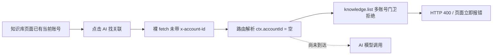

# “AI 找关联”点击后直接报错诊断

> 任务：T-611
> 诊断时间：2026-07-29 08:39 PDT
> 结论性质：真机日志 + 当前代码 + 本机数据库只读副本交叉验证

## 结论

这次报错发生在 AI 调用之前，不是模型余额、模型延迟或模型输出格式问题。

“AI 找关联”按钮仍使用裸 `fetch("/api/knowledge/relate")`，没有携带当前选中账号的
`x-account-id`。路由只从这个请求头解析账号上下文，于是得到的 `ctx.accountId` 为空。
路由随后先调用 `knowledge.list` 自读知识原子，后端的多账号隔离门卫立即抛出
`AccountRequiredError`。路由把它统一包装成 HTTP 400，前端再显示“AI 找关联失败，请重试”，
所以用户看到的是点击后立即报错，AI 实际上根本没有开始执行。



## 真机证据

当前加密 sidecar 日志在用户本次点击对应的 `2026-07-29T15:38:44.311Z`
（本地时间 08:38:44 PDT）记录：

```text
[api/knowledge/relate] failed:
AccountRequiredError: knowledge.list requires a selected account
(ctx.accountId missing)
```

相同错误还在 08:08:09、08:08:14 两次触发，错误位置一致。对应时段没有
`knowledge.relate` 模型调用记录，说明失败发生在读取输入数据阶段，而非 AI 阶段。

## 代码证据

1. `frontend/src/features/knowledge/knowledge-graph-view.tsx`
   的 `handlePropose` 直接调用裸 `fetch`，只设置 `method: "POST"`，没有账号请求头。
2. `frontend/src/lib/http-transport.ts` 的统一 contract transport 会读取
   `creatoros:current-account`，同步当前账号 cookie，并自动注入 `x-account-id`；
   “AI 找关联”没有走这条统一通道。
3. `frontend/src/app/api/knowledge/relate/route.ts` 只读取
   `req.headers.get("x-account-id")` 来构造 `RequestContext`，然后立即调用
   `createServerClient(ctx).listKnowledge(...)`。
4. `backend/src/modules/knowledge/knowledge.service.ts` 明确要求
   `requireAccountId(ctx.accountId, "knowledge.list")`，账号为空时拒绝读取。

## 数据证据

对运行中 PGlite 数据目录做只读副本后查询：

- `acct-cddd0a61-3252`：38 条 active 知识；
- `acct-cddd0a61-21`：22 条 active 知识；
- 当前知识关系：0 条。

因此不是“知识库为空”或“没有可关联内容”。数据按账号真实存在，只是这一个按钮的请求没有告诉
后端该读哪个账号。

## 为什么以前的测试没挡住

- 图谱交互测试把 `fetch` 整体 mock 成成功响应，只验证候选展示和采纳，没有断言
  `x-account-id` 请求头。
- `/api/knowledge/relate` 当前没有路由测试。
- 时间线上，图谱按钮的裸 `fetch` 早于知识域严格账号隔离；严格隔离上线后，路由虽然开始
  “读取请求头”，但按钮侧没有同步补上“发送请求头”，形成半条接线。

## 影响范围与修复方向

- 已确认：`AI 找关联` 必现失败；失败前没有写库，不会造成知识或关系数据损坏。
- 同形风险：`评论回流` 也使用裸 `fetch("/api/knowledge/comment-sift")`，该路由同样读取
  `x-account-id` 并访问账号级知识/评论数据，应与本问题一起回归。
- 正确收口应复用一个统一的 CreatorOS API 请求头入口，集中附加当前账号、桌面握手和同源凭据，
  避免每个 AI escape-hatch 路由各自手写；同时补按钮请求头测试、路由账号上下文测试和真机
  “当前账号 → 候选 → 采纳 → 刷新”回环。
