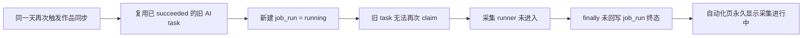

# 自动化任务长期显示“采集进行中”真机诊断

- 任务：T-615
- 时间：2026-07-29
- 范围：当前运行中的 CreatorOS 桌面包、加密 sidecar 日志、本机 PGlite 快照、自动化调度与采集代码
- 结论：已复现两种不同现象；其中一条是确定的“僵尸运行记录”，另一条是仍在真实抓取但进度上报存在盲区。

## 大白话结论

当前账号的“我的作品数据同步”不是还在采集，而是今天较早手动运行过一次后，9:00 定时触发又复用了同一天那条已经成功的 AI 任务。系统随后新建了一条 `running` 的 `job_run`，但旧 AI 任务已经结束，无法再次领取执行，因此真正负责在 `finally` 里写成功/失败的采集 runner 根本没有进入。持久自动化任务虽然马上报错“自动化运行结束状态为 running”，却没有反向结束这条 `job_run`。前端只看最新 `job_run.status`，所以一直显示“采集进行中…”。

同时，当前还有一条真实的“我的作品评论同步”在跑：共 51 个作品，AI 任务仍为 `running`，采集 Chromium 也仍存在。它先在抓取函数内部逐作品采完全部内容，函数返回后才逐条落库并更新 `processed`，因此这段时间界面一直停在 `0/51`，看起来也像卡死。



## 真机证据

### 1. 确定的僵尸运行记录

本机数据库在 2026-07-29 16:21 UTC 的快照：

| 字段 | 值 |
|---|---|
| `job_run.id` | `run-72d9ea09-1123` |
| 作业 | 我的作品数据同步 |
| `job_run.status` | `running` |
| `job_run.started_at` | `2026-07-29T16:00:00.189Z` |
| 关联 `ai_task.id` | `ai-task-b8c648b8-86` |
| 关联 `ai_task.status` | `succeeded` |
| `ai_task.completed_at` | `2026-07-29T06:21:26.788Z` |

即：新 `job_run` 在 AI 任务成功结束近 10 小时后才创建，二者不可能代表同一次真实执行。

对应持久执行任务 `execution-task-72d9ea09-1121` 已在 `16:00:00.206Z` 失败，错误为：

```text
自动化运行结束状态为 running
```

因此不是持久执行任务还没结束，而是业务投影 `job_run` 没有跟着收口。

### 2. 同一天旧任务被复用

`triggerScheduledJob` 使用 `jobId + UTC 自然日` 作为 `inputData.idempotencyKey`，但没有为这次计划触发传新的 `attemptId`。`aiService.createTask` 对缺省 `attemptId` 会从完整输入稳定计算 legacy attempt，所以同一天、同作业、同 target 会得到同一个 AI 任务，即使该任务已经是终态。

随后调度器仍无条件创建新的 `job_run(status=running)` 并把旧 task id 写进去：

- `backend/src/modules/ai-runtime/scheduled-collection-scheduler.ts:172-193`

### 3. 终态回写被绕过

组合根通过 `runClaimedTaskExecution` 执行采集。终态 task 无法再次 claim 时返回 `claimed: false`，包装器直接返回：

- `frontend/src/server/persistence-client.ts:3122-3131`

负责把 `job_run` 写成 `succeeded/failed/needs_reconnect` 的代码在 `runScheduledCollection` 的 `finally` 中：

- `backend/src/modules/ai-runtime/scheduled-collection-runner.ts:291-313`

由于采集 runner 根本没有进入，这个 `finally` 不会运行。

### 4. 自动清理只在启动时执行

`job_run` 的 30 分钟超时清扫只在 CreatorOS 启动时调用，没有运行期周期清扫：

- `frontend/src/server/persistence-client.ts:7987-8005`

当前 CreatorOS 已连续运行约 7 小时，所以这条僵尸记录不会在本次进程中自动结束；只有重启后才可能被启动清扫标成失败。

### 5. 前端完全相信 `job_run.status`

前端把最近一次运行的 `status === "running"` 直接显示为“采集进行中…”：

- `frontend/src/features/automations/automations-island.tsx:278-286`
- `frontend/src/features/automations/automations-island.tsx:421-427`

因此持久执行任务已经失败也不会改变当前行的显示。

## 当前另一条真实长任务

在同一快照中，“我的作品评论同步”状态如下：

| 字段 | 值 |
|---|---|
| `job_run.id` | `run-72d9ea09-1411` |
| `job_run.status` | `running` |
| `ai_task.status` | `running` |
| 进度 | `0/51` |
| 开始时间 | `2026-07-29T16:16:28.609Z` |

采集 Chromium 进程仍在，说明它与上面的僵尸记录不同，当前确实处于评论抓取阶段。

但评论批处理只有在 `fetchDouyinCommentsForWorks(...)` 把整批作品抓完并返回后，才在后续落库循环里逐作品调用 `report`：

- `frontend/src/server/persistence-client.ts:6690-6721`
- `frontend/src/server/ingestion/douyin-cdp.ts:2728-2767`

单作品至少包含页面导航、首屏等待和连续无新增轮次；51 个作品串行时合法耗时可达数分钟甚至更长。因此 `0/51` 不能证明采集器已死，但它证明实时进度的插装位置不对。

## 顺带发现的自动化异常

两条账号级“内容雷达自动同步”每 15 分钟都立即失败，错误统一为：

```text
[SKILL_TASK_MAPPING_MISSING] taskType "scheduled.intelligence.sync" 未登记有效 Skill 映射
```

这不是“采集进行中”的直接原因，但说明统一自动化改造后新增的 `scheduled.intelligence.sync` 没接进有效 Skill 映射，当前内容雷达定时同步实际没有执行。

## 建议修复边界

1. 计划触发必须有“本次触发 attempt”身份；只对同一计划分钟/同一执行中的请求去重，不能复用同一天已经终态的 AI task。
2. 新建 `job_run` 前校验 `createTask` 返回状态；若返回终态，禁止创建新的 `running` run。
3. 自动化 handler 无论在哪一层发现执行失败，都必须幂等地收口对应 `job_run`；不能只把 `execution_task` 标失败。
4. 为 `job_run` 增加运行期周期清扫，启动清扫只作为崩溃恢复兜底。
5. 评论抓取把进度回调下沉到逐作品循环，抓完一个作品立即上报，不要等整批返回。
6. 为 `scheduled.intelligence.sync` 补齐有效 Skill 映射或明确声明其为无 Skill 的确定性任务，保持与统一自动化契约一致。

本轮按用户请求只做诊断，未修改运行中数据库、未停止当前评论采集、未变更产品代码。

## 后续修复落实（T-616）

用户确认修复后，已在源码中完成以下收口：

1. 每个计划分钟生成独立且稳定的 `attemptId`；相同计划重放仍去重，不同计划不再复用
   已终态 AI task。
2. `createTask` 若意外返回终态，直接拒绝创建新的 `running job_run`。
3. 自动化 handler 外层增加幂等失败终态闸；runner 未进入时也会把仍为 `running` 的
   `job_run` 收口为 `failed`，已经终态的 run 不会被覆盖。
4. 30 分钟僵尸清扫并入唯一 automation-driver 分钟 tick，并先保护仍有活跃 AI task
   的合法长任务；没有新增第二套定时器。
5. 评论同步改为每完成一个作品立即落库并上报 `M/N`，不再整批完成后从 `0/N` 跳变。
6. `scheduled.intelligence.sync` 明确登记为无 Skill 的确定性聚合作业；
   `scheduled.self.metrics` 补齐它实际委托的 `topic.attribution` Skill 快照。
7. 同一 job 已有真实运行时，新的重叠 tick 作为成功跳过处理，不再制造一条误导性的
   failed execution task。

本轮没有修改运行中数据库，也没有打包；当前已启动的旧桌面包仍运行旧代码，以上修复会在
下次源码构建/启动后生效。
