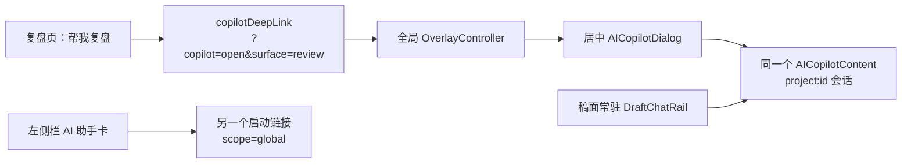

# T-608 复盘页 Copilot 重复容器诊断

## 结论

截图里并没有新建第二套 Copilot 后端或第二条项目会话；它是同一个
`AICopilotContent` 被全局 `OverlayController` 装进居中弹窗。

真正的问题是前端同时保留了三种语义不同、外观却容易被理解成同一入口的容器：

1. 左侧栏“AI 助手”只是一个启动卡片，不是已经展开的对话；
2. 稿面右栏才有真正常驻的 `DraftChatRail`；
3. 复盘页“帮我复盘”仍走旧 `?copilot=open` 深链，因此强制打开居中弹窗。

所以用户看到的是“页面已经有 Copilot，操作又弹出一个 Copilot”的产品重复感。代码虽然复用
同一个内容组件和 `project:<id>` 会话桶，但视觉容器没有统一。

## 代码证据

- `review-analyze-island.tsx:25-30` 与
  `analytics-review-interactive-region.tsx:604-608,628-632` 都把“帮我复盘”写成
  `copilotDeepLink("review", "review.analyze", project)`。
- `copilot-deeplink.ts:45-56` 无条件写入 `copilot=open`。
- `overlay-controller.tsx:134,238-270` 看到该参数后固定渲染居中、带遮罩的 modal。
- `shell-router.tsx:428-436` 在所有 Creator 页面根部常驻挂载这套全局弹窗。
- `sidebar.tsx:474-500` 的“AI 助手”卡只有文案和一个 `Link`；它不是 Copilot 内容本身，而且
  链接使用 `scope=global`。
- 全仓只有 `draft-chat-rail.tsx:38-54` 以内嵌模式挂载常驻 `AICopilotContent`；复盘页没有挂载
  该 rail。
- `chat-scope.ts:19-23` 却把“复盘页右栏（同一 rail）”列为既定入口，和真实组件树不一致，
  说明产品设计已收敛到单一项目会话，但复盘页面实现没有完成容器迁移。

## 为什么截图里还能看到旧对话

“帮我复盘”携带 `selection.kind=project` 与项目 id。`resolveChatScope` 会将它归入
`project:<id>`，因此弹窗恢复的是该项目既有会话；截图中的 `@当前项目` 和旧消息正是这条复用
链的证据。它不是新会话，只是同一会话换了一个弹窗壳。

左侧栏入口使用 `scope=global`，属于全局助手会话，和项目复盘会话本来就不是一个桶。

## 正确收口方向

项目稿面与项目复盘必须只保留一个项目级 Copilot 容器：

- 复盘页挂载与稿面共用的项目常驻 rail；
- “帮我复盘”改为向该 rail 发送 `review.analyze + project selection` 请求并聚焦输入区；
- 项目页不得再设置 `copilot=open`，因此不出现全局居中弹窗；
- 左侧栏卡明确降级为“打开全局助手”的启动入口，避免让用户误以为它就是当前项目 Copilot；
- 全局 modal 只作为没有常驻 rail 的普通页面兜底，或后续统一退役为同一抽屉容器。

本报告只诊断，不修改产品交互；采用哪一种全局兜底形态仍需用户确认。
