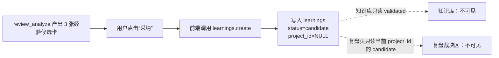

# 复盘经验“采纳后知识库没有”的真机根因

> 任务：T-609
> 日期：2026-07-29
> 范围：只读诊断，不改用户数据、不改产品行为

## 结论

不是知识库刷新慢，也不是经验丢了。

这次 `review_analyze` 在 2026-07-29 14:56 真实产出了 3 条经验卡。用户点击卡片上的“采纳”后，前端调用的却是通用 `learnings.create`：它只把经验保存成 `candidate`，并没有执行 `candidate → validated` 的采纳状态转换。

知识库页面只投影 `validated` 经验，因此这些行不会出现。与此同时，该写入没有携带当前 `projectId`，复盘页的裁决区又只读取“当前项目 + candidate”，所以这些行也不会出现在复盘页等待二次裁决。结果就是：数据已经写进 `learnings`，但两个正常 UI 入口都读不到。



## 真机证据

### 1. 本次复盘产物真实存在

本机数据库中的会话 `project:project-a60d948e-712` 记录了本轮工具调用：

- 工具：`review_analyze`
- 结果：`kind=review.learnings`
- 产物：3 条经验候选
- 助手提示：“这三条在卡片上可以逐条点『存为经验』落进经验库”

### 2. 点击后确实写库，但状态错误

本机数据库快照中，当前账号在 14:56 新增 4 行：

- 3 个唯一标题；
- 其中第 1 条重复写入 2 次；
- 4 行全部为 `validation_status=candidate`；
- 4 行全部为 `project_id=NULL`；
- 本次新增且满足知识库条件（`validated`）的数量：`0`；
- 本次新增且满足当前复盘页裁决条件（当前项目 + `candidate`）的数量：`0`。

所以“采纳后没有”不是视觉错觉，而是读写条件确定性错位。

### 3. 代码与运行包行为一致

`frontend/src/features/copilot/chat-result-cards.tsx` 的“采纳”按钮只调用：

```ts
client.createLearning({
  body: { title: l.title, insight: l.insight },
});
```

成功后 UI 却显示“✓ 已沉淀”。这里没有 `evaluateLearning(... validated)`，也没有传当前项目。

`backend/src/modules/learnings/learnings.transport.ts` 的 `learnings.create` 只接收 `title/insight`，因此即使上层想补 `projectId` 或 `learningType`，当前 transport 也会丢掉。

`frontend/src/features/knowledge/knowledge-data.ts` 明确只查询并保留 `validationStatus=validated`。

`frontend/src/features/review/review-workspace-data.ts` 明确只查询 `projectId=当前项目` 且 `validationStatus=candidate`。

已安装运行包 `0.2.1-beta.3` 中也能检出同一套“采纳 / 已沉淀”和 `validated` 过滤逻辑，不是工作区源码与真机版本不一致。

## 为什么还多出一条重复经验

“采纳成功”状态只保存在卡片组件的本地 React state。调用成功后紧接着 `router.refresh()`；刷新/重建消息卡后，本地 adopted 状态可能丢失，按钮重新出现。`learnings.create` 本身没有稳定幂等键或内容去重，所以同一张卡可再次写入。

真机数据中第一条经验分别在 14:56:11 和 14:56:37 写入，标题与正文相同，已经坐实该风险。

## 正确收口

复盘结果卡已经是 AI 候选，用户点击“采纳”就是人工确认，不应该再进入第二次不可见的候选状态。应收口为一个原子、幂等的“采纳复盘经验”动作：

1. 输入携带 `projectId`、来源会话/工具调用和候选序号；
2. 一次写入即得到 `validated` Learning；
3. 用稳定来源键防止重复点击产生重复行；
4. 返回真实持久化状态后再显示“已沉淀”；
5. 知识库继续只显示 `validated`，无需放宽数据质量门；
6. 对现有 4 条孤儿 candidate 做一次人工确认后修复：重复项合并，3 个唯一项转为 `validated` 并补来源项目。

## 次要可观测性缺口

当前 `logs/sidecar.log` 最后更新时间停在 2026-07-18，而 2026-07-29 的 `next-server` 标准输出仍连接到桌面壳 pipe，没有进入持久日志文件。因此本次以数据库中的 `ai_messages.parts`、`learnings` 和知识库真实 RSC 读结果还原事件。主根因已被数据闭环坐实，但后续还应补上 dispatch 成功写入的安全结构化审计，避免只能依赖数据库反查。
