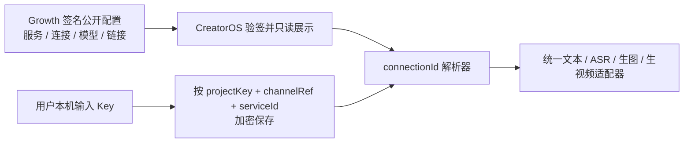

# CreatorOS 渠道模型收敛与激活后白标调研

> 更新提示（2026-08-04）：关于“智溯AI”专属应用名/图标、授权商品、渠道锁定与 DIY
> 出包流程，请以
> [CreatorOS 白标运行时与专属安装包责任边界](./2026-08-04-white-label-runtime-vs-package-boundary.md)
> 为准。当前客户端更新检查已经固定走 CreatorOS 官方更新源，专属 OEM 包必须另行隔离更新通道。

日期：2026-08-01  
关联任务：T-649  
结论性质：跨 Growth / Activation Manager / CreatorOS 的产品与契约调研；尚未进入实现。

## 一句话结论

1. Growth 将新渠道的模型模板收敛为文本、ASR、生图、生视频四类后，CreatorOS 客户端也应该同步收敛设置页；但只隐藏普通用户不需要配置的卡片，不能删除底层 capability，也不能拒绝历史渠道配置。
2. 单一安装包可以在激活成功后动态替换应用内品牌名、Logo、主题色、窗口标题和用户可见文案。
3. macOS 的 Applications/Finder 图标与应用包名称、Windows 的安装器/开始菜单/可执行文件身份属于构建和签名产物，不能在激活后安全、完整地替换。要求这些系统表面也完全换标时，必须为渠道单独构建、签名和发布安装包。
4. 推荐采用“一个稳定的 CreatorOS 系统身份 + 激活后应用内白标”的主方案；全系统白标作为单独的企业渠道包能力，不混进普通激活码流程。

## 1. Growth 模型配置改动是否需要客户端同步

需要，但客户端只改呈现，不改兼容层。

Growth 当前工作区已把新建渠道的默认模型模板由九类收敛为四类：

- `default`：文本创作与对话
- `transcribe.audio`：ASR 语音转文字
- `image.generate`：生图
- `video.generate`：生视频

不再出现在新模板里的 `chat.fallback`、`script.review`、`asset.classify`、
`knowledge.search.embed`、`web.search` 仍保留在协议和校验器中，用于兼容历史渠道配置与内部能力。

CreatorOS 本地工作区已经按这个方向改了设置页：普通用户只看到上述四类配置，其他能力卡不再展示；底层 resolver、数据库行和历史配置仍保留。这个方向正确，不能进一步把 capability 从协议或运行时删除。

当前状态需要注意：Growth 的这组变更仍是 `main` 工作区中的未提交改动，并未进入 `origin/main`；CreatorOS 对应设置页改动也仍在当前未提交工作区中。因此“产品语义已经对齐”，但还不能把它描述为两个仓库已经发布完成。

## 2. 当前白标能力为什么只换了一部分

现有 `channel-runtime-v2` 是 closed schema，只允许六个业务字段：

- `brandName`
- `purchaseUrl`
- `renewalUrl`
- `channelSupportUrl`
- `bugFeedbackUrl`
- `downloadUrl`

CreatorOS 登录后的主布局只读取 `brandName` 注入侧边栏，所以目前本质上只是“侧边栏品牌名替换”，不是完整白标。

同时，客户端中仍有 47 个 TypeScript/TSX 文件包含硬编码的 `CreatorOS` 或 `Creator OS`，覆盖激活页、引导、更新、制作、知识库、导出报告和错误提示等。Tauri 安装包配置也固定写死：

- `productName = CreatorOS`
- `mainBinaryName = CreatorOS`
- `identifier = cloud.aitongban.creatoros`
- `icon = icon.icns / icon.ico / PNG`

因此，仅在激活码中增加品牌名，不可能自然地把整个软件换成渠道品牌。

## 3. 哪些内容可以在激活后换，哪些不能

| 表面 | 单包激活后动态换 | 说明 |
|---|---:|---|
| 侧边栏、登录后页头 Logo 与品牌名 | 可以 | 由签名渠道配置驱动，重启后读取本地可信缓存 |
| 主题色、欢迎语、帮助入口、购买/续费入口 | 可以 | 都属于 WebView 内应用界面 |
| 激活成功后的窗口标题 | 可以 | Tauri 提供运行时 `set_title` |
| macOS 运行期间 Dock 图标 | 部分可以 | AppKit 允许临时修改 Dock tile；退出后恢复，Finder/Applications 图标不变 |
| Windows 当前窗口/任务栏图标 | 部分可以 | 可设置窗口图标或 AppUserModel 属性，但安装器、开始菜单和应用身份并不会完整改变 |
| macOS `.app` 名称、Finder 图标、About/签名身份 | 不可以 | 名称和图标来自已签名 bundle 的 Info.plist 与资源；安装后修改会破坏签名完整性 |
| Windows 安装器名、可执行文件名、开始菜单项、卸载列表 | 不可以 | 属于构建/安装阶段的包元数据和应用身份 |
| bundle identifier、更新器产品身份、签名/公证 | 不可以 | 必须在构建和发布阶段确定 |

依据：Tauri 把 `productName`、`identifier` 与 `bundle.icon` 定义为打包配置，同时只为窗口暴露运行时标题和图标接口；Apple 将应用显示名、图标和 bundle identifier 定义在 bundle 元数据中，并会密封 bundle 资源；Windows 使用 AppUserModelID 将进程、窗口和快捷方式关联成系统应用身份。

官方资料：

- [Tauri 配置：productName、identifier、bundle](https://v2.tauri.app/reference/config/)
- [Tauri Window：set_title / set_icon](https://docs.rs/tauri/latest/tauri/window/struct.Window.html)
- [Apple：临时修改 Dock 图标 applicationIconImage](https://developer.apple.com/documentation/appkit/nsapplication/applicationiconimage)
- [Apple：CFBundleDisplayName](https://developer.apple.com/documentation/bundleresources/information-property-list/cfbundledisplayname)
- [Apple：CFBundleIconFile](https://developer.apple.com/documentation/bundleresources/information-property-list/cfbundleiconfile)
- [Apple：CFBundleIdentifier](https://developer.apple.com/documentation/bundleresources/information-property-list/cfbundleidentifier)
- [Apple：Code Signing Tasks](https://developer.apple.com/library/archive/documentation/Security/Conceptual/CodeSigningGuide/Procedures/Procedures.html)
- [Microsoft：System.AppUserModel.ID](https://learn.microsoft.com/en-us/windows/win32/properties/props-system-appusermodel-id)

## 4. 推荐的单包白标流程

激活前客户端还不知道用户属于哪个渠道，也不能信任一个未验证的 Logo，所以激活页应使用统一的中性品牌。激活成功后再一次性切换完整应用内品牌，避免先显示伪造品牌再校验授权。


激活过程中不要再额外启动一个“改程序文件”的程序。正确做法是把品牌配置当作授权后的可信运行时配置，由应用自己加载并渲染。这样不会修改已签名安装包，也不会因为升级覆盖、系统缓存或杀毒软件而失效。

## 5. 建议新增的品牌契约

现有六字段 closed schema 不应偷偷塞字段。完整白标需要升级为新版本契约，例如 `channel-runtime-v3`，由 Growth 作为唯一编辑端，Activation Manager 签名同步，CreatorOS 验签消费。

建议最小字段：

```json
{
  "branding": {
    "displayName": "渠道品牌名",
    "logoLightUrl": "https://.../logo-light.png",
    "logoLightSha256": "sha256:...",
    "logoDarkUrl": "https://.../logo-dark.png",
    "logoDarkSha256": "sha256:...",
    "accentColor": "#6D4AFF"
  }
}
```

约束建议：

- Logo 第一版只接受 PNG/WebP，不接受 SVG，避免脚本、外链资源和解析差异。
- 必须 HTTPS；下载后校验 SHA-256、真实 MIME、像素尺寸和文件大小。
- 建议单张不超过 1 MB，边长 64–1024 像素；校验失败回退默认 CreatorOS 资源。
- 缓存键必须包含 `projectKey + channelRef + snapshotVersion`，防止渠道串标。
- 配置和资源切换必须原子化；品牌名成功但 Logo 失败时整体回退默认品牌，避免“名字是 A、图标是 B”。
- 品牌资源不进入安装包目录，只进入应用数据目录的受控缓存；绝不修改 `.app`、`.exe` 或安装资源。

## 6. “所有 CreatorOS 都换掉”不应做全局字符串替换

需要先把字符串分成两类：

1. 用户品牌表面：侧边栏、激活成功页、欢迎语、帮助入口、导出页署名等，可以读取 `displayName`，或使用中性表达“本应用”。
2. 稳定技术身份：bundle id、协议名、日志标识、环境变量、磁盘目录、更新器产品键、诊断信息，必须保持 CreatorOS/creatoros，不应跟渠道变化。

实现时应建立统一 `ProductBrandProvider`，页面只能通过品牌 token 读取名称与 Logo，禁止继续散落硬编码。也不能机械替换日志路径或协议名称，否则会造成升级丢数据、更新器找不到旧版本和客服难以定位日志。

## 7. 如果要求系统级也完全换标

这是另一种产品：渠道专属安装包。

构建流水线读取渠道清单，在签名前生成渠道专属的 Tauri 配置、应用名、图标、bundle identifier/AppUserModelID、安装器元数据和更新通道，然后分别完成 macOS 签名/公证与 Windows 签名。每个渠道都是独立可安装、可升级的产物。

代价包括：

- 渠道数乘以 macOS/Windows 的构建、签名、公证和回归成本；
- 必须隔离更新通道，不能让 A 渠道升级成 B 渠道；
- bundle id / AppUserModelID 不同会被系统视为不同应用，数据迁移与并存策略要单独设计；
- 证书、隐私政策、About/版权归属和客服责任也需要明确。

因此建议把它作为高价企业渠道能力，而不是让每个普通激活码在安装后重写程序。

## 8. 推荐决策

推荐分两档：

- 默认渠道白标：继续使用同一个 CreatorOS 安装包；激活前显示中性官方外壳，激活后替换应用内 Logo、品牌名、主题和业务链接。系统里的应用名和安装图标保持 CreatorOS。
- 企业全白标：按渠道独立构建、签名、公证和发布；系统级名称与图标也可替换。

下一步若确认默认渠道白标，应先产出跨三仓 SPEC 与 `channel-runtime-v3` 契约，再分别改 Growth 编辑表单、Activation Manager 签名快照和 CreatorOS 品牌 Provider。不能只在 CreatorOS 前端加 Logo URL，也不能用激活后脚本修改安装包。

## 9. 2026-08-02 用户提供配置的当前版本实测评估

本次样例把白标链接和四类公开模型配置放在同一份 `growth-product-config-v1` 中，模型凭据都声明
为 `user_input`。产品方向合理，但**这份 JSON 现在只能被 Growth 校验和下发，CreatorOS 还不能
按它完成真实模型调用**。

原因不是缺 Key这么简单：Growth 的模型图是
`model.connectionId → connection.serviceId → service.credential`；当前 CreatorOS 渠道 resolver
却仍从单个 model 对象直接读取 `provider / baseURL / apiFormat / apiKey`。样例 model 对象只有
`connectionId / model / settings`，所以一旦渠道 authority 生效，真实调用会得到“渠道模型配置
不完整”，而不是自动去本地设置找对应服务的 Key。

同时要区分两种“没有模型配置”：

- 使用 Growth 现有渠道 runtime control，只配置六个白标/业务字段、不绑定产品配置包：支持。
  CreatorOS 会应用已有品牌名和链接，同时保持本地模型模式。
- 在 `growth-product-config-v1` 组合包里直接删除 `productConfig`：不支持。服务端 closed schema
  exact 要求 `contractVersion + channelService + productConfig` 三项都存在。

## 10. 当前版本设置页应该怎样呈现

用户不应该再次选择供应商、接口格式和模型；这些是渠道已签名下发的公开事实。建议每个 service
只显示一张“模型账户”卡：

| 内容 | 用户权限 | 说明 |
|---|---:|---|
| 服务名、用途 | 只读 | 如 MiniMax 文本、小米 ASR、Dudu 生图、OmniHi 视频 |
| 模型名、接口地址、协议 | 只读 | 来源是已验签渠道配置，避免用户填出互相矛盾的组合 |
| API Key | 可编辑 | 密码框；保存后只显示“已配置”，允许替换但不回显明文 |
| 测试连接 | 可点击 | 精确测试这一服务，不拿文本模型测试 ASR/图片/视频 |
| 开通、购买、充值、帮助 | 可点击 | 读取该 service 的 `credential.links`；没有就不显示 |

同一个 `serviceId` 只存一把 Key，并可供该服务下多个 connection/model 复用。当前样例定义了四个
相互独立的 service，因此用户需要填四把 Key；若以后文本、图片和视频都走同一家中转服务，只需
把 connection 指向同一个 service，用户就只填一次。



只要渠道存在一份有效公开模型扩展，就应以它作为 provider/model 权威；某服务缺 Key时提示用户
补 Key，不能静默切回另一套本地模型。只有渠道根本没发布模型扩展时，设置页才开放完整本地自配。

## 11. 样例模型兼容矩阵

| 能力 | 样例配置 | 当前客户端状态 | 最小处理 |
|---|---|---|---|
| 文本 | MiniMax M3 + `anthropic_messages` | 不兼容该枚举；内部正式值是 `anthropic` | Growth 输出改为 `anthropic`，或客户端提供受控别名映射 |
| ASR | `xiaomi-mimo` / `mimo-v2.5-asr` | 已有真实 provider adapter | 补齐 connection/service/本地 Key解析后可用 |
| 生图 | provider=`openai-compatible` | 已有 OpenAI Images adapter，但 registry key 是 `openai` | 模板改为 `openai`，或显式注册受测别名 |
| 生视频 | provider=`omnihi` | 当前没有 OmniHi submit/poll/download adapter | 不能仅靠 JSON 开通；先实现并测试真实 adapter |

Growth 当前校验器验证的是图结构、字段和引用完整性，不等于 CreatorOS 已实现对应 provider。
因此后台“发布成功”不能作为客户端可调用的验收证据，至少需要四类逐服务连接测试。

## 12. 当前可测白标范围与跳转链接

当前样例中的 `brandName = XXX` 只会替换登录后侧边栏左上角文字。以下内容目前不会随激活码换：

- 侧边栏图标、Logo；
- 激活页、设置页及其他页面里硬编码的 CreatorOS；
- 窗口标题；
- `.app` / `.exe` 名称、Finder/Dock/开始菜单/安装器图标；
- bundle identifier、更新器身份和签名身份。

已有六个渠道字段的实际入口如下：

| 字段 | 当前入口/行为 |
|---|---|
| `purchaseUrl` | 设置 → 账户/激活卡 → 购买激活码 |
| `renewalUrl` | 设置 → 账户/激活卡 → 续费 |
| `channelSupportUrl` | 设置 → 商业售后；激活到期页 → 联系服务方 |
| `bugFeedbackUrl` | 全局帮助与反馈；自动提交取该 URL 的 origin，手动兜底打开完整 URL |
| `downloadUrl` | 设置 → 渠道下载；不会替换内置更新器的官方更新源 |
| `brandName` | 登录后侧边栏左上角文字 |

样例把五个业务 URL 全部指向 `https://growth.aitongban.cloud/admin/configurations`。这在技术上能
打开，但它是后台配置页，不应交付普通用户：购买、续费、客服、反馈和下载应该分别换成公开、
可访问的用户页面。服务级 `portalUrl / purchaseUrl / rechargeUrl / helpUrl` 已写入样例，但当前
CreatorOS 设置页还没有解析和展示，所以暂时不会形成可点击入口。

## 13. 当前版本最小落地顺序

1. T-645 先补齐 `connectionId → connection → service → 本地加密 Key` 的 resolver，并把设置页
   收敛为“渠道字段只读、用户只填 Key、逐服务测试”。
2. 同步消费 `credential.links`，让用户能开通、购买、充值和查帮助；所有链接缺失时诚实隐藏。
3. 先把 Growth 样例中的文本协议值和生图 provider key改成客户端正式值；OmniHi 在 adapter
   完成前不要作为“已支持”发布。
4. T-649 当前只验证侧边栏品牌名和六个链接；Logo、主题、窗口标题与完整应用内换标需要新的
   `channel-runtime-v3` SPEC，不与这次 Key输入改造偷偷混做。
