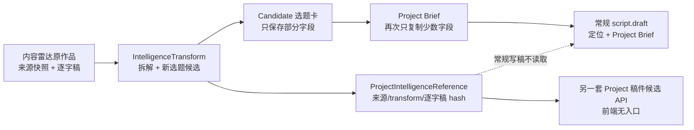

# 内容雷达 → 选题卡 → Project → 写稿链路审计

> 对应任务：T-642  
> 日期：2026-08-01  
> 性质：现状摸排与产品/契约方案，尚未授权进入实现。

## 结论

用户看到的“选题卡空、对标文案和改写策略没有下传、写稿最后只剩定位”不是一个按钮或一次模型调用的偶发问题，而是当前实现存在两套彼此未汇合的创作链：

1. 内容雷达链把逐字稿、来源快照、拆解和定位版本保存在 `IntelligenceTransform`，Project 创建后又能写 `ProjectIntelligenceReference`；
2. 用户实际使用的常规整稿入口走 `script.draft → CreativeContext`，只读取定位、项目 Brief、策划产物和旧 `benchmarkRef`，不读取 `ProjectIntelligenceReference`；
3. 仓库另有 `projects.scripts.generateCandidate / acceptCandidate`，能读取上述 reference、逐字稿和策略并做相似性检查，但没有 Project 脚本页前端调用，因此是不可到达的旁路；
4. 内容雷达确认选题时只把拆解结果的一小部分投影进 `candidate.card`，Project 立项又只复制其中四个字段。即使模型成功，最终的 Project 选题卡也天然是半空的。

所以应修的不是“再往 prompt 塞一段文本”，而是把两条链合为一条可追溯的编导创作链，并明确每类信息的角色、版本和 UI 位置。

## 当前真实数据流与丢失点

### 断点 1：完整拆解只活在 transform

内容雷达生成结果包含 `hook / structureSteps / coreClaims / reusablePattern / factRisks / title / angle / differentiation / sourceSummary`。确认写入选题池时，服务只把以下内容投影进候选卡：

- `oneLiner ← title`
- `hook`
- `contentStructure ← structureSteps`
- `materialBasis ← sourceSummary`
- `riskNote ← factRisks`
- `proposal ← differentiation`

`coreClaims` 和 `reusablePattern` 没有进入选题卡；“改写策略”也没有独立结构，只被压成一句 `proposal`。目标观众、观众痛点、核心冲突、内容形式等完整选题卡字段从未生成。

### 断点 2：Candidate → Project 再丢一次

立项只复制 `targetAudience / proposal / format / oneLiner` 到 Project Brief。内容雷达候选本来就没有生成 `targetAudience` 和 `format`，因此 Project 的目标观众、内容形式为空，UI 会显示“选题待补”。

来源链接、拆解结构、事实风险、差异化理由也不进入用户可见的 Project 选题卡。

### 断点 3：新内容雷达链和旧 benchmark 复刻链不是一条链

旧 `benchmark-teardown-runner` 会写 `candidate.card.teardown`，立项时复制成 `project.briefDetail.benchmarkRef`，然后 `CreativeContext` 才会将其注入常规 `script.draft`。

新内容雷达走的是 `IntelligenceTransform + ProjectIntelligenceReference`，确认候选时没有写 `card.teardown`，常规 `CreativeContext` 也不读 Project intelligence reference，因此旧链的“对标参照回流写稿”并未覆盖新内容雷达。

### 断点 4：真正读 reference 的稿件能力没有产品入口

`projects.scripts.generateCandidate` 能读取：

- 来源作品和链接；
- 确认时的 transform 拆解；
- 哈希校验后的逐字稿；
- 调用方传入的 strategy；
- 采纳前的连续复用与语义相似性风险。

但前端没有调用该 operation。用户点击“生成脚本”仍走另一套 `script.draft`。此外这套旁路还要求调用方重新提交 `strategy`，没有把已确认 transform 中的差异化/可迁移结构作为默认策略；生成时甚至以来源作品标题作为 `topicTitle`，而不是 Project 已采纳的新选题。

### 断点 5：静默降级造成低质量

当前 `CreativeContext` 对 Project Brief、对标参照等读取采用 best-effort：读不到就变成空字符串，脚本任务仍继续。对于普通手动项目这是合理降级；但对于“来自内容雷达”的 Project，reference/策略缺失代表创作依据断链，不应该静默退化成只按定位生成。

## 编导视角的正确转换路径

编导不会把一篇对标文案直接改几个词，也不会只拿账号定位凭空写稿。合理链路应分成五层，每层回答一个不同的问题：

1. **原片证据：它到底讲了什么？**  
   保留来源链接、不可变快照、逐字稿和公开指标。它是证据，不是我方文案。
2. **拆解卡：它为什么有效？**  
   拆钩子机制、目标受众/痛点、核心主张、论证/叙事结构、证据类型、情绪和节奏、事实风险。
3. **改编策略：我们借什么、换什么、绝不抄什么？**  
   明确保留的机制，替换的受众/场景/观点/案例/表达，必须补充的我方证据，以及禁止复用的原句、标题和叙事顺序。
4. **选题母稿：这条属于我们的内容要讲什么？**  
   形成完整选题卡：目标观众、触发场景/痛点、内容承诺、核心观点、冲突、Hook 方向、结构骨架、证据计划、形式/时长、差异化、风险。
5. **Project 创作任务书：本次制作按什么版本执行？**  
   用户采纳选题后，把选题母稿、改编策略和来源证据引用冻结成 Project 的创作依据。后续论点树、素材搜索、结构和整稿都读这一份；定位只负责校准人设、边界和表达，不取代选题内容。

信息优先级应固定为：

1. 用户在 Project 中确认的创作任务书；
2. 选题卡的核心观点、受众、场景和结构；
3. 对标拆解与改编策略；
4. 用户一手素材和可核验事实；
5. 账号定位与表达规则；
6. 历史经验/知识库作为增强。

## 建议的数据与契约收敛

不建议再新造第三套任务系统。以现有 `script.draft` 为唯一用户可见的整稿生成主链，把内容雷达证据合入同一个 `CreativeContext` 与同一个采纳门。

### 1. Transform：不可变的“来源拆解 + 选题候选”

将 `outputSnapshot` 明确分为：

- `sourceDecomposition`：钩子机制、受众/痛点、主张、结构、证据类型、节奏、事实风险；
- `adaptationStrategy`：keep / replace / add / avoid；
- `topicBriefCandidate`：完整选题卡候选；
- `provenance`：source snapshot、transcript hash、positioning version、模型与模板版本。

用户确认后该 transform 不再改变。

### 2. Candidate：用户确认后的完整选题母稿

`candidate.card` 需要真实保存完整 `topicBriefCandidate`，同时带只读来源反链和改编策略摘要。不能再用 `proposal` 一句话兼任全部改编策略。

### 3. Project：冻结当次采纳的创作任务书

Candidate 立项时一次完成：

- 全量映射目标观众、痛点/场景、核心观点、内容目标、形式、Hook、结构、证据计划与风险；
- 写 `ProjectIntelligenceReference`，固定 transform、source snapshot、transcript hash 和 positioning version；
- 保存 Project 可编辑的 `adaptationStrategy` 副本。用户在 Project 修改策略只影响本项目，不回写来源 transform；每次生成记录所用策略版本。

### 4. Script：统一读取，禁止内容雷达项目静默降级

给 `CreativeContext` 增加 `projectIntelligenceBrief`，由 Project reference service 一次装配：

- 本项目采纳的新选题，而不是来源原标题；
- 只读来源拆解；
- 本项目改编策略；
- 必须核验的事实；
- 来源链接与哈希；
- 禁止照搬约束。

常规 `script.draft` 必须读取它。来自内容雷达的 Project 若 reference 或策略断裂，生成按钮应明确受阻并提示修复，不能继续只按定位写泛稿。普通手动 Project 没有 reference 时继续按正常链路生成。

现有独立 `projects.scripts.generateCandidate / acceptCandidate` 应收敛进同一生成/采纳内核：相似性检查和 provenance 写入可以复用，但前端不再维护另一套稿件任务体验。

## 产品呈现

### 内容雷达详情

“生成选题候选”完成后按编导顺序展示三块，而不是只展示四个文本框：

1. **对标拆解（只读）**：为什么有效、Hook、结构、核心主张、事实风险；
2. **改编策略（可调整）**：保留什么 / 换成什么 / 补什么 / 禁止照搬什么；
3. **我的选题卡（可编辑）**：观众、场景/痛点、内容承诺、核心观点、冲突、Hook、结构、证据、形式。

确认按钮改为“采纳为选题”，并明确“会携带 1 条来源、1 份拆解和当前改编策略”。

### 选题中心

- 候选卡显示“来自内容雷达 · 1 条对标 · 已有改编策略”；
- 详情页默认展示完整选题卡；“来源与改编依据”折叠展开；
- “创建项目”前显示将带入的观众、核心观点、结构、来源和策略，缺关键字段时先补齐，不创建半空 Project。

### Project 稿面

在选题卡下增加常驻的“本次创作依据”摘要：

`定位 vN · 选题已确认 · 对标 1 条 · 改编策略已确认 · 一手素材 N 份`

展开后分为：

- 选题母稿（可编辑）；
- 对标拆解（只读，可打开原视频）；
- 改编策略（本项目可编辑）；
- 事实待核验；
- 本次生成所用版本。

点击“生成脚本”后展示真实步骤：读取选题母稿 → 读取对标拆解 → 应用改编策略 → 合并素材/事实 → 按定位校准 → 生成与相似性检查。结果卡必须显示使用的来源、策略版本、事实风险和相似性风险。

## 验收主线

1. 一条已有完整逐字稿的内容雷达作品生成后，候选预览的拆解、策略和完整选题卡均非空。
2. 采纳后选题中心刷新/重启仍能读回同一来源、策略和完整选题卡。
3. 从该选题创建 Project，Project 选题卡不再缺目标观众、内容形式和核心观点，且能打开原视频、查看只读拆解。
4. 常规“生成脚本”日志/任务快照能证明读取了 Project 选题、transform、strategy、source snapshot 和 transcript hash；不能只证明读取定位。
5. 生成稿体现选题的具体受众、观点、结构和改编策略；把定位拿掉仍保留该选题的内容骨架，把对标依据拿掉则必须受阻而非静默泛化。
6. 来源逐字稿或 transform 不完整时内容雷达 Project 禁止生成；普通手动 Project 不受影响。
7. 候选稿高相似时不能采纳；低/中风险采纳后 artifact version 能反查生成时的来源、策略和版本。
8. 只有一条用户可见的整稿生成链、任务状态和采纳入口；不存在“后台有能力但页面永远调不到”的旁路。

## 下一步 Gate

该方案改变数据投影、Project 创作依据归属、CreativeContext 契约与稿件采纳门，属于跨层产品/服务契约变化。进入实现前应把本审计收敛为 T-642 SPEC，完成独立评审并请用户确认以下产品决定：

1. 常规 `script.draft` 作为唯一整稿入口，独立 Project 稿件候选 API 收敛为内部共享内核；
2. 内容雷达来源拆解只读，Project 改编策略可编辑且按生成版本留痕；
3. 内容雷达 Project 缺来源证据或策略时禁止静默降级生成。
