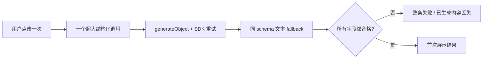

# T-646 结构化 AI 工具性能与可靠性审计

> 日期：2026-08-01  
> 触发：内容雷达一次复杂 JSON 调用耗时 68–77 秒后以 `output_invalid` 整体失败；用户要求同类工具统一排查，并明确创作内容不需要 100% 准确才允许输出。  
> 决策：DEC-AI-025。  
> 方法：静态检查生产 `runStructuredNode` / `generateObject` 调用、模板输出 schema、runner 的失败语义与消费端副作用；不把测试、注释或纯工具循环误算成生产调用。

## 1. 根因不是单纯“模型慢”

当前共享结构化节点先调用 `generateObject`，失败后再调用 `generateText` 并用同一个 schema 校验；
调用方还可能配置 `maxRetries`。当上层 runner 再重试整条任务时，实际模型调用会成倍增加。
内容雷达又把来源拆解、完整选题、四段策略和 100 字以上长稿放在同一个 JSON 中，因此任何一个
字段缺失、截断或格式偏差都会让已经生成的内容全部不可见。

要解决的是四个叠加问题：

1. 一次调用承担过多创作目标；
2. 长正文被迫遵守复杂 JSON；
3. 内容可见性和正式采纳门槛绑死；
4. SDK、fallback、runner 和用户重试可能重复做同一段工作。

## 2. 分级规则

### A 类：创作型——先展示，后补齐

适用：脚本、选题、策划、改编、多平台文案、来源拆解、素材摘要、封面 brief。

- 拆成用户能理解、能独立保存的阶段；完成一段就展示一段。
- 长正文走纯文本/流式输出，只做非空、上限和安全检查。
- schema 只保留后续程序真正要读取的字段；非关键缺项显示“待补”，不丢整份结果。
- 正式采纳/发布前再做确定性完整性检查。
- 失败只重试当前阶段，默认一次主调用，禁止整链自动重跑。

### B 类：判断/控制型——严格，但逐项失败

适用：评分、审核、归因、素材匹配、知识关联/分类、评论筛选、趋势数值抽取、相似性风险。

- 这些结果会决定过滤、阻断、归类或自动写入，不能把不完整输出当有效结论。
- 保留严格 schema；消除重复重试，记录字段级验证原因。
- 批量场景单项失败就跳过该项并留待下轮，不拖垮整批。
- 没判出来必须是 unknown/未判定，不能用默认值伪装成功。

### C 类：轻量提取型——保持单次，小 schema

适用：小枚举、简单 triage、单字段纠错。只要 schema 小、输入有界且没有长正文，可继续一次
结构化调用；仍需统一调用次数和错误日志。

## 3. 生产调用盘点与建议

| 能力/模板 | 当前用途与风险 | 分类 | 建议 |
|---|---|---:|---|
| `intelligence.topic-decompose` / `...from-decomposition` | 拆解+选题+策略+长稿同一 JSON，已实测 68–77 秒整体失败 | A / 最高 | T-642 立即拆成三阶段检查点，长稿纯文本 |
| `script.draft` | 整稿同时输出分镜数组；弱模型、长稿易截断，默认可重试 | A / 高 | 正文先流式保存为候选，再单独补分镜结构；旧数组路径兼容 |
| `topic.generate` | 一次生成多条候选，任一污染可能拖累整组 | A / 高 | 允许返回已解析的有效条目，最少 1 条即可展示；坏条目逐条丢弃并提示数量 |
| `topic.enrich` | 一次补整张选题卡；对话与后台还有两种解析路径 | A / 高 | 共用最小卡片 schema；已有字段立即展示，采纳前提示必填缺项 |
| `research.gather` | 四类研究结果一次结构化；检索已完成也可能因综合失败全部不可见 | A / 高 | 按事实/案例/观点/引用分组保存，允许空组；来源证据先展示 |
| `planning.thesis` / `planning.outline` / `planning.contract` | 三个任务已分开，但每步仍全量强校验 | A / 中 | 复用前一步检查点；非关键节点缺失可编辑，下一步只读已确认版本 |
| `platform.adapt` | 多平台稿一次返回，单个平台格式异常可拖垮全部 | A / 高 | 每个平台独立生成/保存/重试；先显示成功平台 |
| `reconstruct.project` | research+planning 一次生成并物化两个产物 | A / 高 | 分成研究摘要与策划草案两个检查点；物化只消费对应完成段 |
| `benchmark.teardown` | 对标拆解，单条失败会留待后续但结果仍为大对象 | A / 中 | 拆解字段允许局部显示；事实风险继续严格 |
| `positioning.generate` | 生成完整定位提案，用户本来就要编辑确认 | A / 中 | 允许部分提案预览；确认时才校验必需定位字段 |
| `review.insights` / `knowledge.distill` | 产多条经验；当前一条坏数据可能让整批失败 | A+B / 高 | 逐条解析、去空与去重；有效经验先显示，用户采纳后再写知识库 |
| `material-summary` / `transcript.postprocess` | 单段长文本包在 JSON 单字段中 | A/C / 中 | 改成纯文本输出；确定性清洗在服务端完成 |
| `cover.generate` brief | 先产封面提示词/构图 brief，再调用图片模型 | A / 中 | brief 可部分展示和编辑；图片调用失败不重复生成 brief |
| `video-decisions` | 四个结构化调用串行，时间边界决定实际剪辑 | A+B / 高 | 每个决策独立检查点；创意描述可宽松，时间码/assetId 严格 |
| `script.review` | 规则命中会影响审核结论 | B / 高 | 保持严格；规则逐条运行、单条失败 unknown，不重跑已完成规则 |
| `calibration.score` / `calibration.diagnose` | 分数和诊断会影响校准 | B / 高 | 分数严格且可解释；诊断文字可先展示，数值失败不伪造 0 |
| `material.match` | 影响素材入选 | B / 中 | 严格 ID/分数；批量逐项失败，不阻断其他素材 |
| `knowledge.relate` / `knowledge.classify` | 影响知识图谱和分类落库 | B / 中 | 严格 ID/枚举；无法判断即不写关联，保留待处理 |
| `topic.attribution` / `topic.preference` | 自动归因/偏好沉淀 | B / 中 | 继续 fail-closed；单条跳过，下轮幂等重试 |
| `comment.qa-sift` / `favorites.triage` | 批量筛选 | B/C / 中 | 每条独立结果；坏条目不拖垮整批，不默认“通过” |
| `trend.extract` | 数值/趋势信号进入排序 | B/C / 中 | 无法提取为 null；禁止臆造热度，减少重复调用 |

## 4. 统一底座只做什么

不在共享 `runStructuredNode` 里全局放松 schema。底座只负责：

1. 默认禁止重试叠加：明确记录 `sdkAttempts / fallbackAttempts / runnerAttempt`；
2. 日志记录 template、阶段、耗时、停止原因和 schema 问题路径，但不记录用户正文；
3. 支持调用方选择 `strict`、`partial-list`、`text` 三种明确模式，默认仍是 `strict`；
4. 允许调用方关闭文本 fallback；不让每个 runner 隐式再做一遍；
5. 提供取消和超时信号，超时后不能在后台继续幽灵调用。

分段状态、局部数据和重试起点属于各业务 service，不塞进通用 AI worker，也不让 AI 直接写库。

## 5. 治理顺序

1. **T-642 内容雷达**：已有真实故障，先拆三阶段并补 UI 检查点。
2. **脚本/选题/研究**：用户高频、长文本、直接影响“很慢”的体感。
3. **多平台改编/项目重建/视频决策**：串行或一对多，失败放大明显。
4. **经验沉淀与素材摘要**：改逐条容错/纯文本，避免批量全灭。
5. **判断型工具**：统一调用计数、unknown 和逐项跳过，不降低业务门槛。

每一类都必须先有 runner/消费端红测，再改变输出语义。T-646 不授权一次性重写所有模板，也不
允许用全局 optional schema 换取表面成功率。

## 6. 验收指标

- 创作型首个可见结果时间（TTFV）有独立日志，不再只记整任务总耗时。
- 局部失败后刷新仍能看到已完成阶段；重试调用数等于未完成阶段数。
- 不存在“模型已输出大部分内容，但因一个非关键字段缺失而页面全空”。
- 判断型工具的 invalid 输出不会落业务结论，批量中其他有效项不受影响。
- 日志能定位 schema 失败字段和调用次数，但不泄露逐字稿、提示词、密钥或用户正文。

## 7. 本轮已落地

- 共享 `runStructuredNode` 默认重试由 2 改为 0：默认失败路径从最多 3 次结构化尝试 + 3 次
  文本 fallback，收敛为 1 次结构化尝试 + 1 次文本协议降级。显式 completion policy 不受影响。
- 内容雷达拆成三阶段；拆解与选题走小 schema，改写稿走纯文本；每阶段写现有 transform JSON
  检查点并在 UI 渐进显示。
- 选题卡允许非关键字段缺失后先显示，完全空对象仍失败；采纳服务继续要求完整字段和匹配的
  改写稿 provenance。
- 后续阶段失败写入局部状态，刷新后保留前段结果；改写阶段失败重试可复用同逐字稿、同定位的
  拆解和选题，正常“重新生成一版”不会误复用已成功候选。
- 2026-08-01 实机复现确认：`intelligence-item-94de5ba4-1483` 已有 `done` 状态、3453 字逐字稿，
  连续两次选题卡任务均在 27–29 秒后停在 `decomposition / output_invalid`；选题与改写阶段没有启动。
  因此本次故障不是网络、定位或转写缺失，而是模型已返回内容但未通过第一阶段对象解析。
- 第一阶段新增业务局部的确定性归一化：兼容常见包装层、字段别名、单值/数组与长度偏差；完全空
  输出仍然失败。`runStructuredNode` 会优先复用 `NoObjectGeneratedError.text` 中已经生成的 JSON，
  本地校验成功后不再发第二次模型调用；JSON 提取改为字符串感知的配对扫描，避免 reasoning 文本
  前后花括号把真实对象粘坏。该归一化只在内容雷达来源拆解启用，判断/控制型工具继续严格校验。

其余 A/B/C 类工具仍按第 5 节顺序继续治理；本轮没有用全局 optional schema 冒充全部完成。
