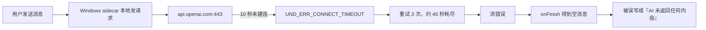

# T-647 用户 Creator Copilot 不返回内容日志诊断

> 日期：2026-08-01  
> 范围：用户提供的两份加密 sidecar 日志与当前 CreatorOS 请求/错误呈现代码。只读、脱敏分析；不保存原始提示词、API Key 或明文日志。

## 结论

截图中的主要故障不是 `gpt-5.6-sol` 模型自身不回答，也不是 API Key 被模型方拒绝，而是用户 Windows 机器上的 CreatorOS sidecar 无法在 10 秒内建立到 `api.openai.com:443` 的连接。请求尚未拿到任何 HTTP 状态码或响应头，重试 3 次后约 46 秒耗尽。

同一模型在开发者电脑正常，不构成反证：模型相同，但请求是由各自电脑本地 sidecar 发出，网络出口、代理接管方式与区域可达性不同。用户日志还证明其国内模型链路可以工作：切换到 MiniMax 后，后续有 3 个 Copilot 回合完成，最后两回合明确为 `MiniMax-M3`，分别约 2.6 秒和 2.0 秒。

另有一个 CreatorOS 呈现缺陷放大了误判：流发生网络错误后，`onFinish` 仍可能拿到无文本/无工具部件的空消息，当前代码把所有这种情况都持久化成“AI 未返回任何内容，可能是代理空流/模型名/密钥限流”。因此截图文案没有展示真实的连接超时，还会在每次失败后重复写入历史。

## 输入证据

| 文件 | SHA-256 | 解密结果 |
| --- | --- | --- |
| `sidecar-2026-07-30.log.zip` | `33a23d222d54233b8747611c25d9b16433e504591f298a7860e4656f282f6aa4` | 16 行；一次未激活启动后正常退出，与本故障无关 |
| `sidecar-2026-07-30-1.log.zip` | `edeeab4d17064d78ab69b5e7a455eb6ef912c06b567fc074e4fa86eef29fdc33` | 2,532 行；覆盖 2026-07-30 至 2026-08-01 的真实运行链 |

明文仅在权限 `0600` 的临时目录中分析，任务结束后删除。

## 主故障证据

2026-07-31 10:03、10:04、10:11、10:18、10:19 UTC 共 5 个 Copilot 回合出现同一模式：

- `chat-context` 正常组装，上下文约 2,484～2,757 token，没有截断。
- 每轮记录 `llm retry attempt=1/2/3 reason=sdk_retryable`。
- 每轮最终为 `outcome=retry_exhausted`，耗时 46,240～46,915ms。
- 底层错误均为 `Connect Timeout Error (attempted address: api.openai.com:443, timeout: 10000ms)`。
- 实际请求为 `https://api.openai.com/v1/responses`，模型为 `gpt-5.6-sol`。
- `statusCode`、`responseHeaders`、`responseBody` 全是 `undefined`，底层代码为 `UND_ERR_CONNECT_TIMEOUT`。

这说明失败发生在 HTTP 响应之前；因此可以排除“模型输出为空”“模型名错误后返回 404”“API Key 返回 401”“余额或限流返回 429”作为这 5 个截图回合的直接根因。

用户在设置页再次测试官方 OpenAI 时，2026-08-01 06:11～06:12 UTC 连续 7 次仍是同一连接超时，说明不是一次短暂抖动。

## 配置切换过程中的其他故障

这些不是截图最初 5 个回合的直接根因，但说明用户在尝试替换配置时又遇到了不同问题：

1. MiniMax Anthropic 兼容接口曾返回 HTTP 401，明确要求正确的 `X-Api-Key`；这是当时密钥/协议配置问题，不是网络问题。
2. `gpt-5.6-sol` 在若干 `openai_chat` / `openai_responses` 测试中出现 7 次 `empty-stream`；这代表某个兼容 endpoint 完成请求但没有产生可解析文本，不能与官方 OpenAI 连接超时混为一谈。
3. Embedding 测试返回 HTTP 401、Token 无效。
4. 图片接口返回 HTTP 403：`Image generation is not enabled for this group`，属于该 Key/分组没有生图权限。
5. 2026-08-01 07:20 UTC 的 `topic.generate` 先遇到 HTTP 200 但 JSON 不合法，随后两次 HTTP 524，整轮 303 秒后恢复；属于兼容服务结构化输出/网关超时问题。

## 为什么界面文案误导

当前 [`frontend/src/app/api/chat/route.ts`](../../frontend/src/app/api/chat/route.ts) 有两个独立回调：

- `onError` 会把未知网络异常变成“模型调用失败，请稍后重试”。
- `onFinish` 只看最终消息有没有文本或工具部件；只要为空且不是用户主动中断，就无条件落库“AI 未返回任何内容”的提示。

连接超时后，错误流也可能进入空的 `onFinish`，于是用户历史里留下的是后一条通用空流提示，而不是前一条真实网络错误。当前 [`frontend/src/lib/ai-error-humanize.ts`](../../frontend/src/lib/ai-error-humanize.ts) 也没有 `network_unreachable` / `connect_timeout` 分类。

## 根因分级

| 级别 | 结论 | 置信度 |
| --- | --- | --- |
| 直接根因 | 用户 Windows sidecar 到 `api.openai.com:443` 无法建立连接 | 高，日志直接证据 |
| 环境差异 | 用户网络出口/代理接管与开发者电脑不同；若用户只开了浏览器或 Windows 系统代理，Node sidecar 未必被接管 | 中，代码未显式安装 Undici proxy dispatcher，但缺用户代理现场信息 |
| 产品缺陷 | 网络错误被 `onFinish` 的空回复兜底覆盖并持久化为误导文案 | 高，日志与代码闭环 |
| 非根因 | 上下文过长、模型 Key 被 OpenAI 拒绝、模型名由 OpenAI 返回无效 | 高，日志反证 |

## 用户现在可采取的动作

- 立即可用：改用日志中已成功的 `MiniMax-M3` 文本模型。
- 如果必须使用 OpenAI：需要从用户那台 Windows 机器验证 CreatorOS sidecar 进程本身能访问 `api.openai.com:443`；浏览器能打开不等于 Node sidecar 走同一代理。长期应走 CreatorOS 统一模型网关，而不是让每台客户端直接连接海外模型域名。
- 不建议继续反复更换 OpenAI Key：本次主故障没有收到 401，换 Key 无法修复连接超时。

## 后续修复建议（未在本次诊断中实施）

1. 给网络错误增加稳定分类：DNS、连接超时、TLS、连接重置分别输出可执行的人话。
2. `onError` 已发生时禁止 `onFinish` 再落“空回复”信封；空回复只用于真正 HTTP 成功且流完成、但零文本零工具的情况。
3. 设置页模型测试显示目标 host、耗时与错误类别，但不显示 Key 或原始提示词。
4. 正式渠道版将模型请求统一收口到 CreatorOS Gateway，减少终端网络、代理和区域差异。

