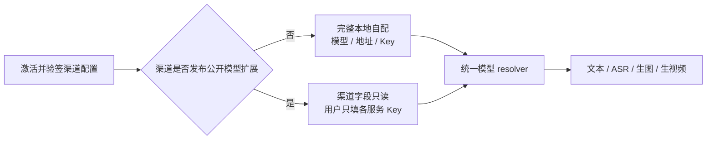
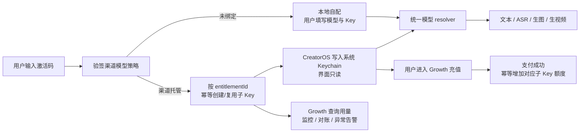

# 激活码映射中转站子 Key 的最小兼容设计

> 日期：2026-08-02  
> 任务：T-653  
> 状态：长期双模式方向保留，但当前版本明确后置托管子 Key。先落“渠道下发公开配置、用户在本机填写 Key”；等中转站的建 Key、充值、额度、用量、停用和对账协议固定后，再形成托管方案的跨仓 SPEC 与独立评审。

## 2026-08-02 当前版本裁决

当前不进入 `activation_provisioned` 实现，也不做激活回调。渠道若要统一模型与接口，发布
`credential.source=user_input` 的公开配置；CreatorOS 只让用户按服务填写 Key，并把 Key加密
保存在本机。渠道完全不发布模型扩展时，用户继续完整配置本地文本、ASR、生图和生视频。



这一阶段不否定后文的长期托管方案；它只是把触发条件改为“中转站正式协议已确定”。

## 一句话结论

只保留一套模型 resolver，通过当前授权的签名策略选择两种凭据来源：渠道未绑定模型服务时使用
`local_user_configured`，用户可完整编辑本地模型；渠道绑定中转站时使用
`activation_provisioned`，Growth 下发公开模型信息，每个有效授权通过独立接口取得受限子 Key，
客户端不得编辑或回退到本地 Key。两种模式共用同一套文本、ASR、生图和生视频调用 adapter。

## 双模式裁决矩阵

| 当前授权事实 | 配置权威 | 设置页 | 运行时凭据 | 托管失败时 |
| --- | --- | --- | --- | --- |
| 渠道未发布模型绑定 | CreatorOS 本地 | 文本、ASR、生图、生视频均可编辑 | 用户自己填写并保存的 Key | 给出本地配置错误，可由用户修改 |
| 渠道签名配置为 `activation_provisioned` | Growth + 中转站 | 只读展示“渠道已提供”、用量、状态和“去 Growth 充值”，不出现模型/Key 编辑框 | entitlement 对应、由 Growth 充值履约的受限子 Key | 明确显示开通/余额/服务故障，禁止静默使用本地 Key |

`credential.source=user_input` 在当前版本是正式使用方式：渠道给出公开连接和模型、用户只补
Key。等 T-653 恢复并完成迁移设计后，再决定新渠道是否默认切到托管模式；在此之前不能把它
描述成已经退出主线。

## 为什么不能把子 Key 直接放进渠道配置

当前渠道配置按 `projectKey + channelRef` 共享，同一渠道的多个激活码会取得同一份配置。如果把
子 Key 放进这个快照，会让同渠道所有用户共用一把 Key，也会把长期凭据带入版本历史、审计和
普通配置缓存。

因此必须拆成两条数据：

1. **公开配置**：Growth 按渠道下发模型名、连接地址、协议与 capability 映射；
2. **授权凭据**：按稳定 `entitlementId + serviceId` 创建和读取受限子 Key。

激活码只是领取/绑定授权的秘密，不作为长期数据库主键。稳定映射必须使用授权产生的
`entitlementId`，防止激活码轮换、补发或换机后重复创建子 Key。

## 推荐的最小链路



## 三端职责

### Growth

- 渠道管理增加明确开关：“用户自行配置”或“渠道提供模型服务”；默认是用户自行配置；
- 自配模式不发布模型 authority extension，不创建子 Key；
- 托管模式保存渠道公开模型配置、Growth 充值入口、充值套餐和可选的风险上限策略；
- 母 Key 只进入服务端 secret manager，不进入产品 JSON、数据库明文字段、日志或客户端；
- 通过 provider adapter 调用中转站的创建子 Key、增加/设置额度、停用、状态和用量查询 API；
- Growth 是充值订单、支付结果和额度履约状态的权威；中转站是实际余额、扣费和调用用量的执行真相；
- 按 `projectKey + entitlementId + serviceId` 幂等保存 `externalSubKeyId`、状态、已发放额度和用量快照；
- 若中转站只在创建时返回一次子 Key，密文使用 KMS/secret manager 加密，数据库只保存密文引用；
- 用户在 Growth 选择充值套餐并付款；支付成功后以 Growth 订单 ID 作为履约幂等键，向精确的 `externalSubKeyId` 增加额度；
- 支付成功但中转站暂时失败时保持 `paid_pending_fulfillment`，由事务 outbox 重试，禁止显示充值成功额度却未到账；
- Growth 定期用中转站余额/用量回读与自身订单履约做对账，发现差异进入异常队列；
- 授权续期维持映射，撤权、退款或风控触发冻结/撤销，凭据泄露时执行轮换。已消费额度的退款规则须在正式 SPEC 中单独固定。

### Activation Manager

- 只负责验证激活码、机器绑定和产生稳定 `entitlementId`；
- 给 CreatorOS 签发短时凭据拉取 ticket；
- 把签名后的模型 authority mode 返回给客户端；同一授权状态只能得到一个确定模式；
- 不保存母 Key，不成为模型额度与中转站配置权威。

### CreatorOS

- 没有渠道模型 authority 时继续使用现有本地配置和本地 Key；
- 托管模式继续拉取渠道公开 `services/connections/models`；
- 识别 `credential.source=activation_provisioned` 后不再展示 Key 输入框；
- 使用短时 ticket 拉取当前 entitlement 对应的子 Key，写入 macOS Keychain / Windows Credential Vault；
- 运行时以 `model.connectionId → connection.serviceId → 本机受管子 Key` 组装真实调用；
- 设置页只显示“渠道已提供模型服务、当前用量/余额状态、去 Growth 充值、刷新凭据”，不回显 Key；充值 URL 只携带短时授权上下文，禁止携带子 Key；
- 凭据过期、撤权或额度耗尽时给出明确状态，不静默回退其他用户 Key。
- 进入托管模式前已有的本地配置只变为 inactive，不删除；以后渠道解除托管并经签名快照确认后可恢复使用。

## 最小契约变化

授权投影先给出唯一模式；公开模型配置只在托管模式存在：

```json
{
  "modelAccess": {
    "mode": "local_user_configured"
  }
}
```

或：

```json
{
  "modelAccess": {
    "mode": "activation_provisioned"
  },
  "services": [
    {
      "id": "managed-relay",
      "name": "渠道模型服务",
      "credential": {
        "type": "api_key",
        "source": "activation_provisioned",
        "allowMultiple": false
      }
    }
  ]
}
```

新增独立凭据接口，返回内容至少绑定：

- `projectKey`
- `entitlementId`
- `serviceId`
- `credentialVersion`
- `expiresAt` / `rotatedAt`
- 加密或一次性交付的子 Key

幂等创建键建议为
`projectKey:entitlementId:serviceId:generation`。网络重试必须返回同一代凭据，不得重复创建并消耗
中转站子账户配额。

## 两种调用方式

### A. 客户端直连中转站（推荐作为最小实现）

CreatorOS 把受限子 Key 存入系统 Keychain，直接调用中转站。优点是改动少、延迟低、不需要自建
模型转发带宽；风险是桌面端的长期子 Key 最终可能被高级用户提取。由于每把 Key 都能单独限额、
停用和观察用量，泄露半径可控。

### B. CreatorOS 只持短期令牌，模型请求经过官方网关

客户端永远看不到中转站子 Key，官方网关根据 entitlement 选择子 Key并转发。安全和轮换最好，
但需要承担所有模型流量、流式转发、限流、可用性、日志脱敏和成本，实施与运维明显更重。

## 推荐裁决

采用双模式 + A：**普通渠道保持完全本地自配；托管渠道中，一份 entitlement 对应一把可撤销、
可轮换的中转站子 Key，客户端直连；用户统一在 Growth 购买额度，Growth 收到支付成功后幂等给
该子 Key 充值。中转站负责真实余额和扣费，Growth 负责订单、履约、entitlement 映射、用量对账、
异常告警与撤权。**

authority 必须 fail-closed：托管渠道拉取子 Key失败时不能启用本地 Key；普通渠道也不能因为本地
用户恰好配置过某个中转站就被误判为托管。模式切换只接受更新后的签名渠道快照。

后续只有在确认“子 Key 绝不能进入桌面端”时，才切换到 B。公开模型配置、entitlement 映射和
额度数据模型无需重做，只替换凭据交付与请求出口。
