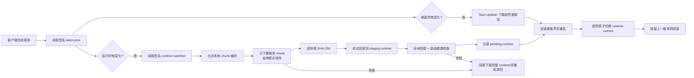

# CreatorOS 桌面端增量下载器调研

> 任务：T-675
>
> 日期：2026-08-03
>
> 范围：只调研与形成技术建议，不直接修改发布链或客户端更新行为。

## 一、先说结论

CreatorOS 不应直接对 `.dmg`、`.app.tar.gz` 或 `setup.exe` 做传统二进制补丁。当前最合适的路线是：

1. **完整安装包继续保留**：新用户仍下载一次完整安装包，离线运行环境随包可用。
2. **更新包改成轻壳**：日常更新只通过 Tauri updater 下载约 10MB 级桌面壳，不再重复携带约 377MB 的 `sidecar.tar.gz`。
3. **大运行时单独增量更新**：把 Node、Chromium、ffmpeg、依赖与应用服务代码打成一个可验证的运行时版本，并按内容定义分块；客户端只下载本机缺失的块。
4. **失败永远回退完整包**：增量清单、分块下载、组装或健康检查任一失败，都不破坏当前可用版本，并允许改下完整运行时或完整安装包。

这不是“把安装包切成几段”这么简单，而是把软件拆成两类更新对象：

- 约 10MB 的桌面壳：用成熟的 Tauri updater 整包替换；
- 约 1.1GB 展开后的运行时：用内容寻址分块复用并原子切换。

## 二、CreatorOS 当前真实情况

### 2.1 当前更新链

当前代码已经具备 Tauri updater 的大部分基础设施：

- `tauri-plugin-updater` 已安装；
- `createUpdaterArtifacts: true` 已开启；
- 发布脚本会生成平台更新包、`.sig` 和标准 `latest.json`；
- 官网已经托管 `updates/latest.json`；
- Tauri 更新公钥仍在客户端。

但客户端现在没有调用 `check()/downloadAndInstall()`，而是：

1. 读取官网公开 `latest.json`；
2. 只比较版本号和显示更新说明；
3. 有新版时跳到官网；
4. 用户手动下载完整安装包并重装。

所以当前是“有版本检查，没有应用内下载器”。恢复 Tauri updater 可以解决自动下载、进度、签名校验和安装，但**官方 updater 默认下载完整更新产物，不提供真正的跨版本差分**。Tauri 官方文档列出的 macOS 更新产物是完整 `.app.tar.gz`，Windows 是完整 NSIS/MSI 安装器，并由客户端下载后安装。[Tauri Updater 官方文档](https://v2.tauri.app/plugin/updater/)

### 2.2 包体测量

本机当前 macOS 构建实测：

| 对象 | 体积 |
| --- | ---: |
| `CreatorOS.app.tar.gz` 更新包 | 409MB |
| `CreatorOS_0.2.1-beta.3_aarch64.dmg` | 383MB |
| `sidecar.tar.gz` | 377MB |
| `.app` 内除 `sidecar.tar.gz` 外的全部文件 | 约 10MB |
| 展开后的 sidecar | 约 1.1GB |

包体几乎全部来自 sidecar。大项包括 Chromium、Node、ffmpeg/ffprobe、原生依赖、`node_modules` 与 Next.js 服务。

### 2.3 两代运行时复用率

使用仓库中两代 `sidecar.tar.gz` 解压后逐文件 SHA-256 对比：

| 指标 | 结果 |
| --- | ---: |
| 旧版文件数 | 26,385 |
| 新版文件数 | 26,371 |
| 内容完全相同文件 | 25,780 |
| 内容变化文件 | 492 |
| 新增文件 | 99 |
| 删除文件 | 113 |
| 新版展开字节 | 1,114,363,195 |
| 可直接复用字节 | 1,032,054,672 |
| **字节复用率** | **92.61%** |

这说明 CreatorOS 的增量收益非常高，但前提是对**解压前的逻辑内容**做复用；如果直接比较 gzip、DMG 或 NSIS 压缩结果，少量文件变化也可能让后续压缩字节整体位移，差分收益会大幅下降。

## 三、四种路线比较

| 路线 | 用户体验 | 下载量 | 工程风险 | 结论 |
| --- | --- | --- | --- | --- |
| 恢复 Tauri 官方 updater，继续整包 | 一键更新 | 每次约 400MB | 低 | 可先恢复自动更新，但不能称为增量 |
| 对 `.app.tar.gz` / `setup.exe` 做 bsdiff | 一键更新 | 不稳定 | 高 | 不推荐；压缩雪崩、每个来源版本都要单独补丁 |
| macOS Sparkle Delta + Windows MSIX | 原生自动更新 | 真差分 | 很高 | 不推荐当前采用；两套发布栈，Windows 还需迁 MSIX 与可信代码签名 |
| **Tauri 轻壳 + sidecar 内容寻址分块** | 一键更新、可续传 | 普通更新约 10MB；运行时按变化下载 | 中 | **推荐** |

补充：

- Sparkle 能为 macOS 生成按旧版本到新版本的 `.delta`，失败时自动回退完整更新，但它只解决 macOS。[Sparkle Delta Updates](https://sparkle-project.org/documentation/delta-updates/)
- Windows 的 MSIX 使用 `AppxBlockMap.xml` 对每个文件的 64KB 块做 SHA-256，系统只下载变化块，机制成熟；但它要求迁移现有 NSIS 安装体系，并需要受信任的 Windows 代码签名证书，不是对现有 Tauri NSIS 包加一个开关。[Microsoft MSIX 差分更新](https://learn.microsoft.com/en-us/windows/msix/desktop/managing-your-msix-deployment-update)、[Windows 分发路径](https://learn.microsoft.com/en-us/windows/apps/package-and-deploy/choose-distribution-path)

## 四、推荐架构



### 4.1 发布物拆分

每个平台每次发布生成三类产物：

1. **Full Installer**
   - macOS `.dmg`、Windows NSIS `setup.exe`；
   - 包含完整 runtime；
   - 用于新安装、人工修复和增量失败兜底。

2. **Thin Shell Updater**
   - macOS `.app.tar.gz`、Windows updater `setup.exe`；
   - 不包含 `sidecar.tar.gz`；
   - 继续由 Tauri minisign 签名并通过官方 updater 安装；
   - 普通 UI/壳逻辑更新只需下载这一份。

3. **Runtime Pack**
   - 一个签名的 `runtime-manifest.json`；
   - 一组以 SHA-256 命名、不可变缓存的压缩 chunk；
   - 一个完整 runtime fallback 包。

### 4.2 为什么用内容定义分块

固定按压缩包每 4MB 切块会被文件插入和 tar 偏移放大。建议：

- 先生成**确定性、未整体压缩的 tar 流**，保留 symlink、权限和路径；
- 对 tar 流使用 FastCDC 一类内容定义分块，平均块约 4MB；
- 每块独立用 zstd 压缩；
- chunk URL 使用内容哈希，例如 `/updates/chunks/<sha256>.zst`；
- manifest 记录 chunk 顺序、压缩/原始大小、哈希和最终文件树哈希。

这样前面插入一个文件不会让后面所有块失效；同一块可跨多个版本复用，CDN 也可永久缓存。

当前 `tar -czf` 会携带构建时间、用户和文件顺序，必须先改为可复现归档：固定排序、mtime、uid/gid、mode 归一化。否则相同源码也可能生成不同 chunk。

### 4.3 客户端落点

下载和安装逻辑应写在 Rust/Tauri 层，而不是 React 页面：

- Rust 负责 HTTPS 下载、Range 续传、哈希、签名、磁盘空间检查、staging、解压和原子切换；
- 前端只订阅状态并展示“检查中 / 下载大小 / 进度 / 已暂停 / 可重试 / 等待重启”；
- 更新状态写到 `appDataDir/updates/`，不进入业务数据库；
- 用户项目、数据库、模型 Key、抖音/Web 登录态完全不参与更新目录清理。

目录建议：

```text
<appDataDir>/updates/
  chunks/<sha256>.zst
  manifests/<runtime-id>.json
  pending-runtime.json
  download-state.json

<runtimeRoot>/
  runtime-images/<runtime-id>/sidecar/
  runtime-current.txt
  runtime-previous.txt
```

Windows 已经存在 `runtime-images/<id>`、`runtime-current.txt`、staging 和原子切换，能直接复用大部分机制。macOS 目前按 app version 解压到 `appDataDir/runtime/<version>`，需要收敛成同一套 runtime ID + current/previous 指针。

### 4.4 清单与签名

建议在当前 `latest.json` 上增加明确但互不混淆的两层：

```json
{
  "version": "0.3.1",
  "notes": "...",
  "platforms": {
    "darwin-aarch64": {
      "signature": "<tauri updater signature>",
      "url": "https://.../CreatorOS-shell.app.tar.gz",
      "runtimeManifestUrl": "https://.../runtime/darwin-aarch64/<runtime-id>.json",
      "runtimeManifestSignature": "<ed25519 signature>",
      "fullInstallerUrl": "https://.../CreatorOS-full.dmg"
    }
  }
}
```

安全边界：

- Tauri updater 签名继续验证轻壳；
- runtime manifest 使用独立 Ed25519 key，客户端内置公钥；
- 每个 chunk 验证 SHA-256；
- 解压时拒绝绝对路径、`..`、越界 symlink 和重复路径；
- staging 全树通过入口哈希、抽样完整性和真实 sidecar 启动探针后才能切换；
- 签名、哈希或健康检查失败，不得覆盖 current 指针；
- 至少保留 previous runtime 和完整安装包，提供可恢复路径。

## 五、发布与 CDN 要求

- `latest.json`、runtime manifest：短缓存或 `no-cache`，每次读回签名验证；
- chunk：`Cache-Control: public, max-age=31536000, immutable`；
- 服务器支持 HTTP Range、ETag 和正确的 `Content-Length`；
- chunk 上传必须“先文件、后 manifest”，避免客户端看到尚未齐备的新版本；
- 保留至少最近两个 runtime manifest 与其引用 chunk；
- GC 只能删除没有被任何保留 manifest 引用的 chunk；
- 发布必须在 macOS/Windows 真机验证：中断续传、磁盘不足、坏块、旧版本跨级更新、安装中断、健康检查失败、回滚。

现有 Nginx `/updates/` 可以承载这些静态文件，基础 Range 能力也具备；不需要先建设复杂更新服务。只有灰度、强制更新、渠道差异或版本回滚策略复杂后，才需要动态 update server。

## 六、落地顺序建议

这是一条完整路线，不是把确认范围拆成残缺版本；实现时仍应在同一任务里把兜底与回滚做完：

1. 先让构建同时产出 full installer 与不含 sidecar 的 thin updater，并证明两者来源一致；
2. 把现有 runtime 归档改成确定性 tar + 签名 manifest + content-defined chunks；
3. 在 Rust 中加入 resumable chunk downloader、staging 重建、健康检查和 current/previous 原子切换；
4. 恢复 Tauri updater 的应用内下载/安装，并在安装壳前确保目标 runtime 已完整 staging；
5. 首次安装、普通壳更新、runtime 更新、跨多版本更新、失败回退全部跑双平台真机 E2E；
6. 最后才把官网“去下载”切成应用内“下载更新并重启”。

## 七、预期收益与需要实测的数字

基于当前包体，普通只改产品代码的版本：

- 当前：约 409MB；
- 轻壳更新：预计 10–20MB 级；
- 理论下载下降：约 95% 以上。

发生运行时变化时，现有两代样本的字节复用率为 92.61%，但真正网络节省取决于可复现打包、分块边界和独立压缩效果。实现前应做一个离线 PoC，用最近 3 个真实版本测：

- chunk 命中率；
- 实际下载字节；
- manifest/chunk 数量；
- 组装耗时与峰值磁盘；
- 增量失败回退完整包的成功率。

建议把验收线定为：普通壳更新小于 25MB；最近相邻 runtime 版本下载量低于完整 runtime 的 25%；任何失败都保持旧版本可启动。

## 八、最终建议

**采用“Tauri 轻壳整包 + sidecar 内容寻址增量”方案。**

原因不是追求技术复杂度，而是 CreatorOS 的包体结构非常极端：377MB 的运行时长期重复跟着约 10MB 的壳一起下载；同时真实两代运行时有 92.61% 字节没变。把运行时从壳中解耦，既能获得最大收益，也能复用现有 Windows runtime 指针、staging、完整性校验和回滚基础。

不建议现在迁 Electron、Sparkle 或 MSIX，也不建议直接对压缩安装器做 bsdiff。前者会引入两套平台更新栈，后者的收益与可靠性都不稳定。
