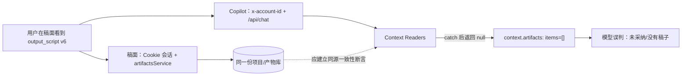

# Copilot 工具层断点审计（2026-08-04）

> 对应任务：T-691
>
> 范围：只读审计，不在本报告中修改运行实现。
>
> 检索证据：已用 CodeGraph `0.9.4` 强制重建全仓索引，并用 `rg` 与源码逐项复核动态装配。

## 一句话结论

这不是模型“不够聪明”，而是 Copilot 能看到的工具世界和用户页面看到的真实项目世界不一致：已有工具只覆盖了若干孤立切片，部分工具契约互相矛盾，页面与聊天还可能使用不同的账号投影；更严重的是底层读取异常会被吞掉并伪装成“真的没有数据”，模型只能基于错误前提继续解释。

## 已确认断点

| 断点 | 代码证据 | 用户影响 | 判定 |
|---|---|---|---|
| 当前项目绑定后静态移除 `context.projects` | `backend/src/modules/ai-runtime/chat-runner.ts` 在 `chatContext.projectId` 存在时过滤该工具 | 用户说“参考前几期作品”时，Agent 无法发现历史项目 ID | 已确认 |
| 提示词要求 `context.publications` 传 `projectId`，但 schema 只有 `limit/offset` | `chat-runner.ts` 当前项目提示块；`chat-tools.ts` 的 publication params | 模型照提示调用会参数校验失败；也无法稳定查单项目发布记录/封面 | 已确认 |
| `context.project.detail` 名称宣称“全档”，实际只有 brief、阶段、发布摘要、产物索引、指标摘要 | `chat-tools.ts` 的 `ContextProjectDetailToolResult` | 缺脚本正文、分镜、项目素材、封面、审核报告、复盘等生命周期内容 | 已确认 |
| 审核报告只能由前端卡片轮询读取 | `review.script` 只回 `taskId`；`chat-review-report-card.tsx` 另取 `scriptReviews.getLatest` | 下一轮对话无法读命中项，不能按用户指令修改审核发现 | 已确认 |
| 审核建议只支持用户逐条点击“应用”，没有受控批量应用命令 | 审核卡前端交互与工具描述 | “把刚才审核有问题的地方都改了”无法完成 | 已确认 |
| 项目素材只有账号级 `context.materials` 标题检索 | Context 工具注册与依赖端口 | Agent 不知道某个项目真实绑定、采用和缺失的素材 | 已确认 |
| 发布记录为账号级清单，返回行没有稳定 `projectId` 过滤契约 | `ContextPublicationsToolResult` 与读取端口 | “读取这个项目的封面/发布/平台链接”只能模糊按标题猜 | 已确认 |
| Context 读取层广泛 `catch { return null; }` | `frontend/src/server/persistence-client.ts` 的 `listProjectArtifacts`、`getArtifactText` 等 | 权限、数据库、账号不一致和真正空数据被压成同一个 `found:false/items:[]` | 已确认 |

## 截图故障：为什么页面有 v6，Copilot 却说空

截图左侧明确显示“口播脚本 v6”及分镜节点；稿面加载与保存走 `artifactsService.listProjectArtifacts`、`getVersion`、`createArtifactVersion`。因此“脚本从未落库”与页面证据冲突。

Copilot 的 `/api/chat` 请求从浏览器 `localStorage` 读取当前 `accountId` 并发送 `x-account-id`；页面服务端会话则从 Cookie 解析账号。当前实现没有在两条读链之间建立同一个 `userId/accountId/projectId/currentVersionId` 的一致性断言，再叠加 Context 的异常吞噬，最符合现象的链路是：

1. 页面在账号 A 下读取到 `output_script v6`；
2. Copilot 使用缺失、过期或不同的账号投影读取同一个 `projectId`；
3. 产物查询返回空或抛错；
4. 读取层把错误转换成 `null`，工具再转换成 `items: []`；
5. 模型据此编出“候选未采纳”的解释。

“账号投影不一致”是高可信根因候选，但在修复前仍须用同一请求 trace 的结构化日志证明，不能把推断冒充最终事实。SPEC 因此要求同时修复错误语义并加入跨层一致性观测。

## 工具覆盖矩阵

| 用户意图 | 当前能力 | 缺口 |
|---|---|---|
| 读取当前项目稿面 | `context.artifacts` + `context.artifact.text` | 页面/聊天同源一致性不可靠；错误被伪装为空 |
| 读取当前项目完整生命周期 | 多个孤立工具 | 没有单项目聚合入口与完整度声明 |
| 读取单项目发布与封面 | 账号级 `context.publications` | 无 `projectId` 过滤；封面不能稳定回到项目 |
| 读取单项目素材/B-roll | 账号级 `context.materials` | 无项目绑定与采用关系 |
| 读取指标与留存 | `context.metrics(projectId?)` | 可用，但未与稿面/封面/发布组成同项目快照 |
| 读取审核命中项 | 前端能读，Agent 不能读 | 缺 `context.review.report` |
| 按审核建议改稿 | 前端逐条应用 | 缺显式授权、可回滚的确定性批量命令 |
| 参考前 3 期作品 | `context.projects` 本可列项目 | 项目态被静态禁用；无检索/发布时间过滤 |
| 基于前几期封面生成新封面 | 可生成封面 | 找不到前几期项目的封面、脚本、指标组合证据 |

## 设计判断

- 不需要靠 Pi 或换一个更强模型解决。现有 Agent Loop 已能连续调工具；输入世界不完整时，任何 Loop 都只会更勤快地重复错误。
- 不新增第二套 Context。T-691 应扩充既有 T-099 Context 读层和确定性 backend service port。
- AI 继续不直接写库。读取审核报告是只读；应用审核建议必须由用户明确指令触发 backend service，追加一个新稿面版本，并返回可回滚的前版本 ID。
- 大对象不应一次全部塞给模型。生命周期入口返回索引、摘要、完整度与下一步读取指针；脚本等长正文继续窗口化读取。

## 统一修复范围

详见 [T-691 SPEC](../superpowers/specs/2026-08-04-copilot-project-lifecycle-tool-closure.md)。本轮不拆成零碎 bug：同源一致性、单项目全生命周期、历史项目检索、审核报告读取/应用、提示词-schema 一致性必须同一任务验收。
