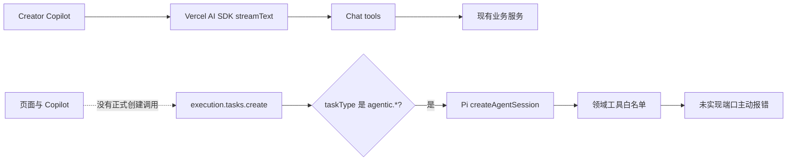

# CreatorOS Pi Agent 生产链核查

> 任务：T-688
>
> 日期：2026-08-04
>
> 范围：只读核查，不修改运行实现。

## 结论

Pi Agent **不是完全没接**，但也**没有接完，更没有成为 CreatorOS 当前主 Agent Runtime**。

准确状态是：

- Pi SDK、适配器、循环护栏、模型配置映射、executor 注册和桌面打包都已经实现；
- 真实业务工具端口没有接入，三个 Pi executor 当前全部绑定主动抛 `NotImplemented` 的占位端口；
- 全仓没有页面、Copilot 工具或正式业务流程创建 `agentic.research / agentic.collect / agentic.material` 任务；
- 日常 Creator Copilot 走 Vercel AI SDK `streamText + tools + stepCountIs`，不是 Pi；
- Pi 会话仍是 `SessionManager.inMemory()`，记忆、跨会话续跑、偏好捕捉、Skill 进化和 MCP 均未落地。

因此，从用户可用能力看，Pi 当前基本等于没有用上；从代码资产看，它是一套完成度较高但被悬空的实验性执行引擎。

## 当前真实链路



## 已经完成的部分

### 1. SDK 与引擎适配器真实存在

`backend/package.json` 已安装：

- `@earendil-works/pi-ai@0.80.7`
- `@earendil-works/pi-coding-agent@0.80.7`

`backend/src/modules/execution/agentic/pi-engine.ts` 已真实调用 `createAgentSession()`，并实现：

- 用户模型配置到 Pi provider 的映射；
- OpenAI Chat、OpenAI Responses、Anthropic 协议映射；
- 自定义领域工具桥接；
- 禁用 Pi 自带 `read/bash/edit/write` 等编码工具；
- 步数、Token、Abort、干跑和副作用防重放护栏；
- Pi 不可用时退确定性 executor。

这不是只有接口或注释的空壳，单测也覆盖了 faux provider 下的循环行为。

### 2. 三类 executor 已注册

`frontend/src/server/persistence-client.ts` 注册了：

- `agentic.research`
- `agentic.collect`
- `agentic.material`

对应契约也已进入 `contract/src/resources/execution.ts`，理论上可以通过 `execution.tasks.create` 创建。

### 3. 桌面包会携带 Pi

`frontend/scripts/desktop/build-sidecar.mjs` 有专门的 `bundlePiEngine()`，负责把 Pi 及必要依赖闭包实拷进 Sidecar。除非构建时显式设置 `CREATOROS_SKIP_PI=1`，否则正式桌面包会带上它。

## 没有完成的部分

### 1. 领域工具没有接线

当前三类 executor 使用的真实端口全部是占位实现：

- 调研：`web.search / web.read / knowledge.write`
- 采集：`collect.plan / collect.run`
- 素材：`material.search / material.organize`

这些端口在被调用时统一抛出：

```text
自主循环端口「xxx」尚未接线(未实现),暂不可用。
```

也就是说，即使手动创建 Pi 任务，Agent 一旦调用业务工具也无法完成真实工作。

### 2. 没有生产调用者

排除测试和注册代码后，没有发现任何页面、Copilot tool 或业务 service 创建上述三类 `agentic.*` execution task。

现有 `ExecutionTaskCard` 只能展示、轮询、采纳、丢弃或重试一个已经存在的 execution task，它本身不会发起 Pi Agent 任务。当前正式创建 execution task 的主要场景是视频渲染。

### 3. Copilot 没有切到 Pi

当前 Copilot 请求从 `/api/chat` 进入 `backend/src/modules/ai-runtime/chat-runner.ts`，真实执行为：

```text
streamText({ tools, prepareStep, stopWhen: stepCountIs(maxSteps) })
```

所以 Copilot 已经有一个有限步数的工具循环，但这是 Vercel AI SDK 的 tool loop，不是 Pi `createAgentSession()`。

这也解释了为什么系统后来形成大量 `forcedTool`、`prepareStep`、最后一步禁工具、重试恢复和特定工具分支：主产品链继续沿 Vercel AI SDK 演进，Pi 支线没有汇流回来。

### 4. Pi 的持续 Agent 能力未完成

历史设计中的下列任务仍在暂停池：

- T-315：记忆读取工具；
- T-316：会话持久化与项目隔离；
- T-317：跨会话偏好捕捉；
- T-318：对话式 Skill/记忆进化；
- T-319：MCP client；
- T-320：对话式剪辑相关能力。

代码也印证了这一点：Pi 当前使用 `SessionManager.inMemory()`；仓库没有安装或调用 `pi-mcp-adapter`。

## 当初停在哪里

历史任务 T-313 的状态已经写得很准确：

1. Pi 引擎代码、测试和 Sidecar 打包基本完成；
2. 真实 MiniMax 网络循环 `gate-M2` 未完成；
3. T-340 原计划把 `agentic.research` 三个真实端口接上，但没有开工；
4. “Pi 全面接管抓取、自动化、剪辑”的 T-324 因改动太大、临近发布、风险不成比例而冻结；
5. 后续产品开发继续在 Vercel AI SDK chat runtime 上累积，Pi 逐渐成为旁路。

## 最终判断

| 问题 | 判断 |
| --- | --- |
| Pi 依赖装了吗？ | 是 |
| Pi `createAgentSession()` 接了吗？ | 是 |
| Pi 进桌面包了吗？ | 默认会进 |
| Pi 有真实业务工具吗？ | 没有，当前端口主动报未实现 |
| Pi 有正式业务调用者吗？ | 没有找到 |
| Copilot 走 Pi 吗？ | 不走，走 Vercel AI SDK `streamText` |
| Pi 有持久记忆/MCP/会话续跑吗？ | 没有 |
| 用户现在实际用上 Pi 了吗？ | 基本没有 |

所以用户的判断是对的：**我们曾经认真接过 Pi 的发动机，但没有把传动轴接到业务车轮上。**
