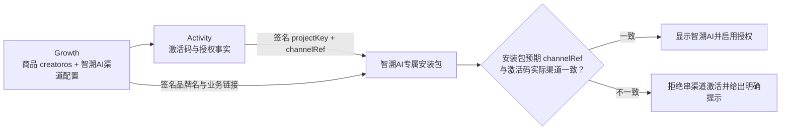

# CreatorOS 白标运行时与专属安装包责任边界

日期：2026-08-04  
关联任务：T-692  
样例渠道：智溯AI  
结论性质：现状核验与出包方案；本任务不修改生产代码、不生成安装包。

> 文件、字段与构建步骤已经继续细化到
> [智溯AI白标包：文件级改造与出包矩阵](./2026-08-04-zhisu-ai-package-file-change-matrix.md)。

## 一句话结论

智溯AI如果只要求软件内部显示渠道品牌和渠道链接，Growth 下发配置即可；如果要求 macOS/Windows
安装后的应用名、Finder/Dock/开始菜单图标、安装器和卸载项都叫“智溯AI”，最稳妥的方式是生成
一个渠道专属安装包。

**授权商品不需要跟着拆分。** 所有白标包仍使用同一个授权商品
`projectKey=creatoros`，Activity 继续负责激活码、设备绑定、期限、撤权和签名；渠道身份由
`channelRef` 区分。新增的是安装包身份，不是第二个授权商品。

## 1. 三种身份必须分开

| 身份 | 本例的值 | 谁负责 | 能否随渠道改变 |
|---|---|---|---:|
| 授权商品身份 | `projectKey=creatoros` | Growth 登记、Activity 授权 | 否 |
| 渠道身份 | 智溯AI对应的精确 `channelRef` | Growth 配置、Activity 签入授权事实 | 是 |
| 桌面安装包身份 | `packageRef=zhisu-ai`、独立 bundle id | CreatorOS 构建发布 | 是 |



这里最重要的是最后一道校验：智溯AI安装包必须在构建时固化“预期渠道”。否则用户拿其他渠道的
激活码也能激活这个外壳，运行时品牌与外壳品牌可能互相打架。

### “Activity 激活密钥”如何配合

- 如果指软件激活码：Activity 仍按 `creatoros + channelRef + machine binding` 验证和签发授权，
  白标包名和图标不会改变授权商品。
- 如果指渠道托管模型所需的激活态子 Key：它同样挂在现有商品和渠道授权下发，不应因为更换桌面
  图标而复制一套商品。模型子 Key 与软件激活码是两种凭据，不能混存或互相替代。
- Growth 是商品、订单、渠道和公开配置权威；Activity 是激活凭据、设备、期限、撤权和签名权威。
  客户端不得自行推断或改写这两边的事实。

这与现有三仓契约一致：Activity 的授权事实包含 `projectKey + channelRef`，现有 CreatorOS
产品清单也固定为 `projectKey=creatoros`。

## 2. 这份智溯AI配置现在能承担什么

用户给出的配置：

```yaml
brandName: 智溯AI
purchaseUrl: https://zhisunet.com/buy/
renewalUrl: https://zhisunet.com/renew/
downloadUrl: https://zhisunet.com/download/
bugFeedbackUrl: https://zhisunet.com/feedback/
channelSupportUrl: https://zhisunet.com/support/
```

当前 `channel-runtime-v2` 精确支持上述六个字段，HTTPS 地址也符合约束。它们适合由 Growth 管理并
通过 Activity 已授权的渠道事实安全拉取。

| 内容 | 当前责任方 | 当前效果 |
|---|---|---|
| `brandName` | Growth 运行时配置 | 登录后侧边栏名称可替换 |
| 购买、续费、下载、反馈、售后链接 | Growth 运行时配置 | 设置页/反馈等已有入口可跳转 |
| 应用内 Logo、主题色 | 当前契约没有字段 | 不能仅靠这份配置替换 |
| 系统应用名、安装图标、安装器名 | 构建包 | Growth 运行时配置做不到 |

因此，这份配置本身是有效的，但它只解决“软件里面显示什么、业务按钮跳哪里”，不能解决操作系统
看到的应用身份。

## 3. 哪些由 Growth 承担，哪些必须打包

| 能力 | Growth / Activity | CreatorOS 运行时 | 渠道专属打包 |
|---|---:|---:|---:|
| 激活码、设备绑定、期限、撤权 | Activity | 验签与执行 | 不改变 |
| 激活码对应渠道 | Growth + Activity | 校验 `channelRef` | 固化预期渠道 |
| 品牌名与五个业务链接 | Growth 下发 | 读取并展示 | 可提供默认值 |
| 页面内 Logo、主题、欢迎语 | 建议未来 Growth v3 下发 | 统一 Brand Provider | 可提供离线兜底 |
| macOS `.app` 名称、Finder/Dock 图标 | 不承担 | 不能永久修改 | 必须 |
| Windows exe、安装器、开始菜单、卸载项图标 | 不承担 | 不能完整修改 | 必须 |
| bundle identifier / AppUserModelID | 不承担 | 不能运行时修改 | 必须 |
| 代码签名、公证、Windows 签名 | 不承担 | 不承担 | 必须 |
| 更新公钥、更新清单与渠道隔离 | 可提供发布映射/公开下载页 | 检查更新 | 必须在包中固定安全边界 |

macOS 会把应用资源纳入代码签名，签名后再替换图标会破坏签名；Tauri 的 `productName`、
`identifier` 和 bundle icon 也都是构建期配置。参考：

- [Tauri 配置参考](https://v2.tauri.app/reference/config/)
- [Tauri Windows 安装器](https://v2.tauri.app/distribute/windows-installer/)
- [Apple CFBundleIdentifier](https://developer.apple.com/documentation/bundleresources/information-property-list/cfbundleidentifier)
- [Apple Code Signing Tasks](https://developer.apple.com/library/archive/documentation/Security/Conceptual/CodeSigningGuide/Procedures/Procedures.html)

## 4. 当前代码距离“稳定专属包”还差什么

当前基座仍把以下内容锁死为 CreatorOS：

- `frontend/src-tauri/tauri.conf.json`：`productName`、`mainBinaryName`、
  `identifier=cloud.aitongban.creatoros`、图标、更新公钥；
- `frontend/product-identity.json`：产品和安装身份写在同一个清单里；
- `frontend/src-tauri/build.rs`、构建脚本、CI 和发布验证：多处按 `CreatorOS.app`、
  `CreatorOS.exe` 和固定 identifier 查找产物；
- 桌面窗口标题和部分用户可见文案仍硬编码 `CreatorOS`；
- 当前自动更新检查固定走 CreatorOS 官方更新源，渠道 `downloadUrl` 只作为设置页下载入口。

这意味着现在直接改一份 Tauri JSON 和几张图标，虽然可能“打得出来”，但还不是可持续升级的
白标产品：发布校验、更新路由、签名产物查找和渠道隔离都可能出错。

### 推荐拆分两个清单

稳定授权商品清单保持不变：

```json
{
  "productRef": "creatoros",
  "projectKey": "creatoros"
}
```

新增非秘密的渠道包清单，例如：

```yaml
schema: creatoros-white-label-package/v1
packageRef: zhisu-ai
expectedChannelRef: <Growth 中智溯AI的精确 channelRef>
displayName: 智溯AI
desktop:
  identifier: com.zhisunet.zhisuai
  binaryName: ZhisuAI
  macIcon: <绝对或仓库资产路径>/zhisu-ai-macos-text.icns
  windowsIcon: <绝对或仓库资产路径>/zhisu-ai-windows-text.ico
  windowsUpgradeCode: <首次出包时生成并永久固定的 GUID>
runtimeDefaults:
  purchaseUrl: https://zhisunet.com/buy/
  renewalUrl: https://zhisunet.com/renew/
  downloadUrl: https://zhisunet.com/download/
  bugFeedbackUrl: https://zhisunet.com/feedback/
  channelSupportUrl: https://zhisunet.com/support/
update:
  namespace: zhisu-ai
  manifestUrl: <智溯AI专属更新清单>
```

`identifier` 和 Windows `UpgradeCode` 一旦发给用户就必须稳定，不能每次出包随机生成。以上
`com.zhisunet.zhisuai` 只是建议值，正式落地前需要渠道确认域名归属和最终 identifier。

## 5. 独立安装包还是覆盖 CreatorOS

推荐独立安装包身份，而不是继续用 `cloud.aitongban.creatoros`：

- 智溯AI可以和 CreatorOS 并存，安装、升级、卸载不会互相覆盖；
- 操作系统缓存的图标、快捷方式和通知身份不会串；
- 更新通道可以独立，不会把智溯AI升级回 CreatorOS；
- 数据目录天然隔离，避免两个壳同时写同一份 PGlite 数据。

代价是旧 CreatorOS 数据不会自动出现在智溯AI里。第一版建议“独立数据 + 可选一次性导入”，不要让
两个应用实时共享同一个数据库目录。

## 6. 图标素材检查

提供的目录中已有：

- macOS `.icns`、完整 `.iconset`、16–1024 PNG 和 SVG；
- Windows `.ico`、16/24/32/48/64/128/256/512/1024 PNG 和 SVG。

从文件结构看，足以进入出包流水线。当前图标包含“智溯AI”小字，在 16/24/32 像素下识别度偏低，
正式出包前建议增加一轮小尺寸真机验收；最好补一版只保留图形符号的 16–48 像素资源。这个不阻碍
先打测试包，但应作为发布 Gate。

## 7. 后续 DIY 出包 Skill 应怎样设计

建议等底层包身份参数化完成后，再创建 `creatoros-white-label-packager` Skill。Skill 不做全局字符串
替换，也不直接修改 main 工作区的公共图标；它只编排受控流程：

1. 读取并校验渠道包清单、HTTPS 链接、图标尺寸和固定 identifier；
2. 从 Growth 回读 `creatoros + channelRef` 配置，核对品牌和链接；
3. 生成临时 Tauri override（Tauri CLI 支持 `build --config` 合并配置）；
4. 构建渠道壳，并嵌入 `expectedChannelRef`；
5. 分平台签名，按用户要求决定是否公证；
6. 真机安装后使用该渠道激活码，验证名称、图标、链接、授权、数据目录和更新通道；
7. 输出安装包及含 SHA-256、版本、渠道、签名/公证状态的 manifest；
8. 到“发布/上传”前停止，等待用户明确确认。

证书私钥、Apple 公证密码、Windows 证书、更新签名私钥和模型密钥只允许通过系统钥匙串或环境变量
引用，绝不写入渠道 YAML、Skill 或安装包。

## 8. 推荐落地顺序

1. 先确认智溯AI在 Growth 中的精确 `channelRef` 和最终桌面 identifier。
2. 写跨层 SPEC，把 `projectKey` 与 `package identity` 从当前单一产品清单中解耦。
3. 参数化 Tauri、Rust 窗口标题、构建脚本、CI 产物查找、签名证明和安装器元数据。
4. 给专属包加入 `expectedChannelRef` 校验与清晰的渠道不匹配错误。
5. 先在 macOS/Windows 各打一份未发布测试包，验证激活和系统表面。
6. 建立智溯AI独立更新清单后，才允许正式交付。
7. 流程稳定两次以上，再把它固化为 Skill，避免把尚未稳定的人工步骤自动化。

## 9. 本次样例的最终判断

- Growth 配置：字段齐全、HTTPS 合法，可以继续使用。
- Activity 授权商品：继续使用 `creatoros`，没有问题。
- 激活码：必须属于智溯AI的 `channelRef`；专属包需要校验它。
- 应用内品牌：当前只完成部分文本/链接消费，完整 Logo 和全局名称仍需统一品牌 Provider。
- 系统应用名与图标：应走专属包，不应激活后修改已签名文件。
- 立即出正式包：暂不建议；先完成包身份参数化、渠道锁定和独立更新通道。
- 未来 Skill：可行，但应建立在上述底座完成之后。
