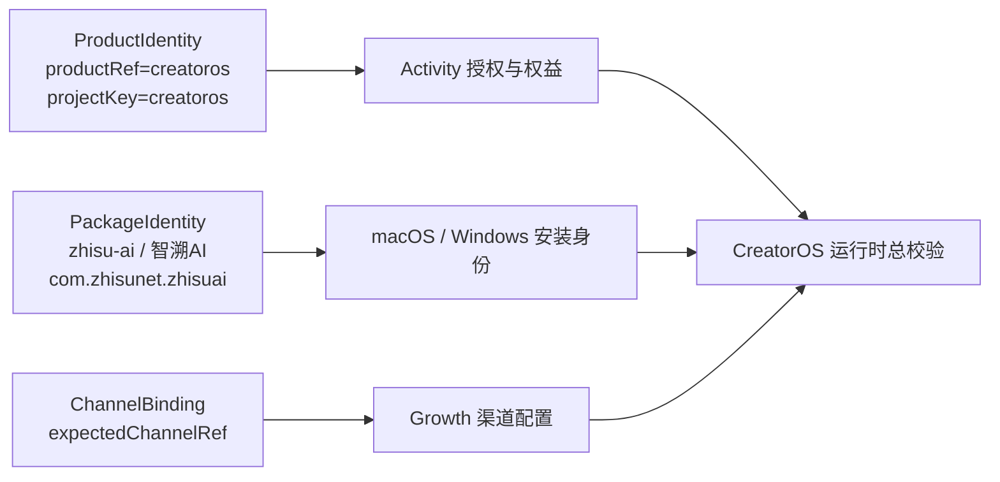

# 智溯AI白标包：文件级改造与出包矩阵

日期：2026-08-04
关联任务：T-693
上游：[T-692 白标运行时与专属安装包责任边界](./2026-08-04-white-label-runtime-vs-package-boundary.md)
结论性质：可以直接转成跨层 SPEC 的实施清单；本任务不修改生产代码、不生成安装包。

## 0. 最终判断

智溯AI应该使用“同一授权商品、独立桌面包”的模式：

- 授权商品继续固定为 `projectKey=creatoros`；
- Growth/Activity 继续通过激活码签出智溯AI的精确 `channelRef`；
- 新增独立的 `packageRef=zhisu-ai`、应用名、bundle id、图标和更新命名空间；
- 专属包在线激活、在线心跳和离线快照放行都必须核对 `expectedChannelRef`；
- Growth 下发的购买、续费、下载、反馈、售后链接继续运行时读取，不复制进页面代码；
- 内部协议名、数据库 schema、`@creatoros/*` 包名和 `CREATOROS_*` 环境变量不改。

这不是给 CreatorOS 全局换名，而是同一 CreatorOS 产品能力生成一个渠道专属桌面外壳。

## 1. 建议的包级输入

建议新增一个非秘密、可审计的渠道包清单，例如：

`frontend/branding/packages/zhisu-ai/package.json`

```json
{
  "schema": "creatoros-desktop-package/v1",
  "packageRef": "zhisu-ai",
  "productRef": "creatoros",
  "projectKey": "creatoros",
  "expectedChannelRef": "<Growth 中智溯AI的精确 channelRef>",
  "displayName": "智溯AI",
  "binaryName": "ZhisuAI",
  "appIdentifier": "com.zhisunet.zhisuai",
  "keychainService": "com.zhisunet.zhisuai.desktop",
  "windowsUpgradeCode": "<首次生成后永久固定的 GUID>",
  "publisher": "<正式发布主体>",
  "icons": {
    "macos": "assets/zhisu-ai-macos-text.icns",
    "windows": "assets/zhisu-ai-windows-text.ico",
    "png32": "assets/zhisu-ai-windows-text-32.png",
    "png128": "assets/zhisu-ai-macos-text-128.png",
    "png256": "assets/zhisu-ai-macos-text-256.png"
  },
  "update": {
    "manifestUrl": "<待建立的智溯AI专属 latest.json>",
    "downloadPageUrl": "https://zhisunet.com/download/",
    "namespace": "zhisu-ai"
  }
}
```

清单中不放激活码、模型 Key、Apple 密码、签名私钥或 updater 私钥。图标文件应进入受版本管理的
渠道资产目录并固定 SHA-256，不能每次从微信临时目录直接取，否则以后无法复现同一个安装包。

以下两个值正式实现前必须由业务确认：

1. Growth 中智溯AI的真实 `channelRef`；
2. `com.zhisunet.zhisuai` 是否作为长期不变的桌面 identifier。

## 2. 当前最需要解开的错误耦合

当前 `frontend/product-identity.json` 同时装了：

```json
{
  "productRef": "creatoros",
  "projectKey": "creatoros",
  "appIdentifier": "cloud.aitongban.creatoros"
}
```

其中前两项是授权商品身份，最后一项是桌面包身份。白标后前两项必须不变，最后一项必须可变，
所以不能继续把三者当成一个 exact canonical 对象。

推荐拆成两份权威：



可以升级现有 ProductManifest，也可以保留原商品 manifest 后新增 PackageManifest；无论选哪种，
release attestation 必须同时记录“授权商品身份”和“实际桌面包身份”，不能继续声称所有包的
`appIdentifier` 都是 `cloud.aitongban.creatoros`。

## 3. 文件级改造矩阵

### 3.1 新增包清单解析器

| 文件 | 当前状态 | 要改成什么 |
|---|---|---|
| `frontend/product-identity.json` | 商品与桌面 identifier 混在一起 | 保留/升级为只表达 `creatoros` 商品身份，不接收渠道覆盖 |
| 新增 `frontend/branding/packages/<packageRef>/package.json` | 不存在 | 保存包名、bundle id、图标、预期渠道、更新命名空间 |
| 新增 `frontend/scripts/desktop/package-flavor.mjs` | 不存在 | closed schema 校验、路径归一、图标 SHA、identifier、固定 UpgradeCode、渠道绑定 |
| 新增对应单测 | 不存在 | 拒绝缺字段、路径越界、秘密字段、非 HTTPS 更新源、变化的 UpgradeCode |

解析器输出两种对象：

- `ProductIdentity`：永远是 `creatoros`，供 Activity/Growth 权益链使用；
- `PackageIdentity`：随包变化，供 Tauri、窗口、数据目录、签名证明和 CI 使用。

### 3.2 Tauri 与操作系统身份

| 文件 | 具体字段/位置 | 打包时处理 |
|---|---|---|
| `frontend/src-tauri/tauri.conf.json` | `productName`、`mainBinaryName`、`identifier`、`bundle.icon` | 保持官方默认值；打渠道包时生成临时 override，不直接覆盖主配置 |
| `frontend/src-tauri/tauri.windows.conf.json` | NSIS 配置 | 保留公共安装逻辑；补渠道固定的安装身份配置，若启用 MSI则显式传固定 `upgradeCode` |
| `frontend/src-tauri/windows/installer-hooks.nsh` | 三处“CreatorOS 离线运行环境” | 改为引用 Tauri/NSIS 的产品名宏，不能写死官方品牌 |
| `frontend/src-tauri/Cargo.toml` | package name、description、authors | Rust crate/package 名可保留内部 `creatoros-desktop`；用户可见 publisher/描述由 bundle override 提供 |

Tauri CLI 已确认支持：

```text
tauri build --config <JSON 或配置文件>
```

多个配置按顺序合并，冲突字段以后者覆盖，官方说明也把它用于 build flavors。因此包脚本应生成
临时配置，例如：

```json
{
  "productName": "智溯AI",
  "mainBinaryName": "ZhisuAI",
  "identifier": "com.zhisunet.zhisuai",
  "bundle": {
    "icon": ["<staging>/32.png", "<staging>/128.png", "<staging>/icon.icns", "<staging>/icon.ico"]
  }
}
```

临时配置和 staging 图标放在 `frontend/src-tauri/target/package-flavors/zhisu-ai/`，构建结束可删除；
不得为了出一个渠道包反复改写公共 `tauri.conf.json` 和 `src-tauri/icons/`。

### 3.3 Rust 壳与包身份

| 文件 | 当前硬编码 | 应做的改造 |
|---|---|---|
| `frontend/src-tauri/build.rs` | exact 要求 `appIdentifier=cloud.aitongban.creatoros` | 分别校验 ProductIdentity 与 PackageIdentity；编译进 displayName/appIdentifier/expectedChannelRef/keychainService |
| `frontend/src-tauri/src/product_identity.rs` | 单一 ProductManifest；测试写死官方 identifier | 拆出 `product_identity` 与 `package_identity` 只读入口；release 禁止运行环境覆盖 |
| `frontend/src-tauri/src/lib.rs` | `.title("CreatorOS")` | 使用编译期 `package_identity.displayName` |
| `frontend/src-tauri/src/lib.rs` | `KEYCHAIN_SERVICE="com.creatoros.desktop"` | 使用包级 keychain service，防不同应用共享/覆盖 master key |
| `frontend/src-tauri/src/entitlement_claim.rs` | entitlement journal service 写死官方名 | 按包隔离 journal service；权益请求中的 `client=creatoros` 保持不变 |
| `frontend/src-tauri/src/license.rs` | macOS defaults 域和非 macOS `.creatoros-seen` | 改用包级稳定 namespace，防两个应用互相污染防回拨点 |
| `frontend/src-tauri/src/lib.rs` | appDataDir 由 Tauri identifier 导出 | 不另写路径；独立 identifier 会自然得到独立 DB、日志、登录态和 runtime 目录 |

以下 Rust 内部技术名无需改：

- `CREATOROS_*` 环境变量；
- `creatoros-server` sidecar 名；
- `creatoros://license-decision` 内部事件；
- 命令参数 `--creatoros-install-runtime`；
- 日志诊断前缀 `[CreatorOS]`（可继续作为工程产品来源标识）。

它们不是用户看到的品牌，修改会扩大回归面，且不能提高白标体验。

### 3.4 Activity 激活与渠道锁定

| 文件 | 当前链路 | 必须新增的校验 |
|---|---|---|
| `frontend/src-tauri/src/license.rs` `run_license_chain` | 强验签后取得 `body.channel_ref`，但任何合法渠道都可继续放行 | 若包配置了 `expectedChannelRef`，签名响应缺失或不一致时返回“此激活码不适用于当前渠道安装包” |
| 同文件在线 `status` 心跳 | 可接受 Activity 后续改绑的新渠道 | 每次心跳继续核对；渠道被改绑后不得维持旧包授权 |
| 同文件 `derive_local_verdict` | 只看快照 `allowed` | 离线启动也核对快照 `channel_ref`，否则复制其他渠道 `.license` 仍可能放行 |
| 同文件 channel runtime resolver | 已校验 `projectKey + signed channelRef` | 继续保留；不得让包清单直接替代 Activity 签名事实 |

正确码与错误码都必须走真实测试：

- 智溯AI包 + 智溯AI渠道码：放行；
- 智溯AI包 + 官方码/其他代理码：拒绝，且不覆盖已有可信快照；
- 智溯AI包离线读取其他渠道快照：拒绝；
- `projectKey` 永远仍为 `creatoros`。

### 3.5 应用内名称与运行时链接

| 文件 | 当前表现 | 改造建议 |
|---|---|---|
| `frontend/src/app/layout.tsx` | metadata title 写死 CreatorOS | 从壳传入的可信包身份读取 displayName |
| `frontend/src/app/activate/page.tsx`、`entitlement-claim-panel.tsx` | 激活前文案写死 CreatorOS | 接收 PackageBrand，激活前也显示智溯AI |
| `frontend/src/components/shell/sidebar.tsx` | 已支持 Growth `brandName`，回退 CreatorOS | 官方包继续允许运行时品牌；专属包回退并锁定 package displayName |
| `frontend/src/app/(creator)/layout.tsx` | 只注入 `brandName + bugFeedbackUrl` | 扩展统一 ProductBrandProvider，避免页面各自读取品牌 |
| 设置页、反馈页中的 CreatorOS 文案 | 部分写死 | 用户可见名称使用 ProductBrandProvider；技术路径与日志名保持原值 |

为了避免每个渠道都重建巨大的 Next/sidecar 运行时，建议 Rust 壳把**编译期可信包身份**作为子进程
环境注入 sidecar，例如只读 `CREATOROS_PACKAGE_DISPLAY_NAME` 和 `CREATOROS_PACKAGE_REF`。Next 服务端
读取后通过 Provider 下发给客户端。这样公共业务 runtime 可以复用，真正需要每个渠道重编的主要是
小体积 Rust/Tauri 外壳和安装器。

Growth 的六个字段仍按当前路径消费：

- `contract/src/local-platform.ts`：本地可信投影 contract；
- `frontend/src-tauri/src/license.rs`：验签、净化、加密缓存；
- `frontend/src/server/activation/channel-runtime.server.ts`：服务端读取；
- `frontend/src/app/(creator)/settings/page.tsx`：购买/续费/售后/下载链接；
- `frontend/src/components/shell/issue-feedback-dialog.tsx`：反馈入口。

不建议把这五个 URL 再写入 package manifest 作为运行时兜底。出包前可以回读 Growth 做一致性检查，
但安装后仍只信 Activity 授权所绑定渠道的签名 runtime，便于渠道以后安全更新链接。

### 3.6 更新链

当前实际 UI 更新路径在：

`frontend/src/lib/desktop-updater.ts`

它固定读取 CreatorOS 官方 `updates/latest.json`，并把下载入口固定为 CreatorOS 官网；不会使用
Growth 的 `downloadUrl`。所以如果不改，智溯AI会提示用户去 CreatorOS 官网下载，白标链会断。

需要改为包级编译配置：

- 官方包继续使用官方 manifest；
- 智溯AI包使用智溯AI专属 manifest URL；
- 下载页可使用固定的 `https://zhisunet.com/download/`，或读取当前已验签渠道 runtime；
- updater manifest 中只能出现本 packageRef、identifier 和平台对应的安装包；
- 不允许智溯AI manifest 指向 CreatorOS 或其他渠道安装包。

相关文件：

| 文件 | 要改什么 |
|---|---|
| `frontend/src/lib/desktop-updater.ts` | 取消官方常量唯一化，改读可信包身份；仍禁止采纳任意远端开放重定向 |
| `frontend/scripts/desktop/release.mjs` | `CREATOROS_UPDATE_BASE_URL` 升级为包级 namespace；latest.json 和产物名带 packageRef |
| `frontend/src-tauri/tauri.conf.json` | updater 公钥可继续全产品共用，也可按包配置；一旦发布不可随意替换 |
| `docs/RELEASING.md` | 当前描述与真实 T-459 官方源行为有漂移，需统一为包级更新事实 |

智溯AI当前只提供了下载页面，没有提供机器可读的 `latest.json` 地址。测试包可以关闭 updater 产物；
正式交付前必须补齐更新 manifest 及托管位置，或者明确采用“检查版本后仅打开渠道下载页”的方案。

### 3.7 构建、签名与证明脚本

| 文件 | 当前写死点 | 参数化方式 |
|---|---|---|
| `frontend/scripts/desktop/package.mjs` | 查找 `CreatorOS.app/CreatorOS` | 接收 `--package-manifest`，所有产物定位走 PackageIdentity |
| `frontend/scripts/desktop/product-identity.mjs` | exact 官方 appIdentifier、CreatorOS 二进制和证明文件名 | 商品校验仍 exact `creatoros`；包级名称/identifier/expectedChannelRef 写入 attestation |
| `frontend/scripts/desktop/release-manifest.mjs` | `creatoros-release-manifest.json` | 文件可保持内部名，内容必须增加 package identity；或按 packageRef 命名 |
| `frontend/scripts/desktop/collect-user-installers.mjs` | 只按扩展名匹配，主体可复用 | 增加期望文件名前缀与 packageRef 校验，禁止误收其他渠道包 |
| `frontend/scripts/desktop/codesign.mjs` | 可发现任意 `.app/.exe` | 只允许签本轮 manifest 记录的精确产物 |
| `frontend/scripts/desktop/notarize.mjs` | 可发现任意 `.dmg` | 只提交本轮精确 DMG，并把 package identity 写入结果 |
| `frontend/scripts/desktop/build-sidecar.mjs` | sidecar/内部 bundle id 多处 CreatorOS | 大部分保持内部技术名；只把可信 PackageBrand 注入 common runtime |

正式 macOS Gate 必须检查**DMG 内部实际应用**的签名和 identifier，不能只验证 bundle 目录里旁边的
`.app`：

1. `hdiutil verify`；
2. 挂载 DMG；
3. `codesign --verify --deep --strict` 挂载后的 `智溯AI.app`；
4. `spctl --assess`；
5. `plutil` 读取真实 `CFBundleIdentifier/CFBundleName`；
6. 若要求正式分发，再核对公证 ticket。

### 3.8 GitHub Actions 与真安装验证

`.github/workflows/desktop-release.yml` 当前写死：

- `CreatorOS.app`、`CreatorOS.exe`；
- `cloud.aitongban.creatoros`；
- 安装目录 `CreatorOS RAT...`；
- artifact 名 `creatoros-windows-*`；
- release 标题 `CreatorOS 用户安装包`；
- 多处 stdout 日志匹配 `[CreatorOS]`。

建议新增 workflow input：

```yaml
package_ref: official | zhisu-ai
```

工作流先加载 package manifest，再输出 `display_name/binary_name/app_identifier/artifact_prefix`，后续
所有查找和验证都使用这些输出。日志技术前缀 `[CreatorOS]` 可以保持不变；安装路径、exe/app 路径、
release 标题和 artifact 名必须参数化。

Windows 真机 Gate 至少检查：

- NSIS 安装成功且只有一个 `ZhisuAI.exe`；
- 开始菜单、卸载项和版本信息显示智溯AI；
- 安装后首次启动进入本地主页面；
- appDataDir 对应 `com.zhisunet.zhisuai`，不写官方 CreatorOS 数据目录；
- 正确渠道码可激活，错误渠道码拒绝；
- 主动卸载不删除另一个包的数据；
- 若签名，`signtool verify` 通过。

## 4. 打包时的实际顺序

未来稳定命令建议是：

```bash
pnpm -C frontend desktop:package -- \
  --package-manifest branding/packages/zhisu-ai/package.json
```

脚本内部按这个顺序执行：

1. **读取清单**：验证包名、identifier、expectedChannelRef、图标、固定哈希和更新配置。
2. **回读 Growth**：确认 `projectKey=creatoros` 下存在该 channelRef，`brandName=智溯AI`，五个
   URL 与用户给定配置一致；这里只做 preflight，不把 Growth 数据复制成第二权威。
3. **准备公共 runtime**：构建/复用当前 CreatorOS sidecar；内部 `creatoros-server` 不换名。
4. **生成 flavor staging**：复制已验哈希图标、生成 Tauri override、生成编译期 PackageIdentity。
5. **编译壳**：始终注入 `CREATOROS_LICENSE_PROJECT_KEY=creatoros`，同时编译
   `expectedChannelRef=<智溯AI渠道>`。
6. **Tauri bundle**：生成 `智溯AI.app/DMG` 或 `ZhisuAI.exe/setup.exe`。
7. **静态检查**：核对产品名、identifier、图标、二进制内嵌 ProductIdentity + PackageIdentity、
   包内无密钥、无官方更新地址串入智溯AI UI。
8. **签名/公证**：本地测试包按用户要求可跳过；正式包必须使用真实证书并记录状态。
9. **真安装**：干净机器/目录启动，验证数据隔离、正确/错误渠道激活、业务链接和更新入口。
10. **产物证明**：输出版本、平台、packageRef、channelRef digest、identifier、SHA-256、签名、
    公证和测试结果。
11. **停止在发布前**：不自动上传、不改 Growth 下载地址，等待用户确认。

## 5. 哪些坚决不改

为避免把一个白标需求变成全系统重命名，以下保持原样：

- Activity 商品 `creatoros` 及既有激活码协议；
- Growth 商品与渠道配置数据模型；
- backend/contract/ai-worker 的模块名和数据库表；
- workspace 包名 `@creatoros/*`；
- sidecar 技术进程名、日志协议名、内部环境变量；
- Activity/Growth 的签名公钥和授权校验强度；
- AI、采集、转写、项目等业务逻辑。

## 6. 智溯AI本次可直接复用的资产

用户提供目录：

`/Users/zyongzhu/Library/Containers/com.tencent.xinWeChat/Data/Documents/xwechat_files/wxid_uap57xiin7pn21_cb34/msg/file/2026-08/zhisu-ai-text-app-icons-windows-macos`

已核验：

- `zhisu-ai-macos-text.icns` 是合法 macOS icon；
- `zhisu-ai-windows-text.ico` 是合法多尺寸 Windows icon，含 16/24/32 等层；
- PNG/iconset 尺寸基本齐全。

出包 Skill 第一次运行时应执行“导入资产”动作，把它们复制进渠道资产目录并生成 hash manifest。
16–32px 下品牌文字偏小，测试包可以先用，正式发布前建议做一次 Dock、任务栏、开始菜单小图标验收。

## 7. 转成实现任务前的最终确认点

只需要确认四件事，即可把本清单转成一个完整跨层 SPEC：

1. 智溯AI精确 `channelRef`；
2. 长期 identifier 是否采用 `com.zhisunet.zhisuai`；
3. 首版是否允许只做本地未签测试包，正式签名/公证后置；
4. 智溯AI更新采用“独立 latest.json”还是“仅打开 Growth 下发的下载页”。

其中第 1、2 项一旦正式发布不可随意改变；第 3、4 项只影响交付方式，不改变 Activity 授权商品。
