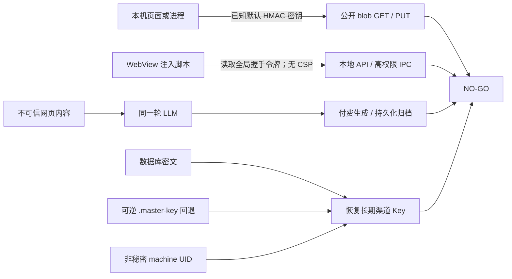

# CreatorOS V1.0 候选上线前独立工程审计

- 审计日期：2026-08-08（America/Los_Angeles）
- 审计对象：`codex/v1.0-candidate`
- 审计源码快照：`8d6f5257b8d1332101ce47c6cfb0bf6a6757b0cd`
- 审计角色：独立上线前工程审计；不继承实现会话结论
- 允许范围：V1 candidate；**不允许 tag、release 或生产放量**
- 最终结论：**NO-GO**

## 1. 一句话结论

这个候选版本现在不能发布。问题不只是“测试还没全绿”：本机公开 blob 接口的签名密钥可由源码推导、WebView 没有 CSP 且握手令牌暴露给页面脚本、SSRF 校验发生在请求之后并在 DNS 失败时放行、LLM 同一工具域同时拥有不可信网页读取与付费/持久化副作用、所谓 Keyring-only 的长期凭据实际上可由数据库和本机回退文件恢复。以上任一项都足以判定 **NO-GO**。

同时，当前完整 E2E 为 32/54 通过、22 失败；lint、编排器测试、完整后端测试和视觉回归也仍有红项；当前 SHA 没有正式 macOS 签名、公证、staple、Gatekeeper 和真启动产物证据。

## 2. 二值审计结论

| 审计维度 | 结论 | 主要原因 |
| --- | --- | --- |
| Loopback / WebView 安全边界 | **NO-GO** | blob 默认密钥可伪造；CSP 为 `null`；握手令牌暴露给页面 JS |
| 路径 containment / SSRF | **NO-GO** | 文件路径只做词法 containment；SSRF 在请求发出后检查重定向且 DNS 失败放行 |
| LLM 工具副作用 | **NO-GO** | 不可信网页读取与付费、持久化工具同域，缺少确定性用户确认 |
| Secrets / ticket v3 / machineId / Keyring | **NO-GO** | ticket v3 与 bundle 校验基本成立，但长期 Key 不是 Keyring-only，machineId 进入客户端边界 |
| Growth bundle / credits / ASR lease | **NO-GO** | bundle 与 credits fragment 正向边界通过；ASR 已收费 lease 丢失关联与补偿信息 |
| 数据完整性与幂等 | **NO-GO** | adoption 在资产落库后才记幂等日志，崩溃窗口可重复创建 |
| 子进程隔离 | **NO-GO** | Rust、Tauri shell 与部分 Node 子进程继承父进程完整环境 |
| 构建只读 | **GO（单项）** | 隔离数据根生产构建通过且临时数据根保持空；不抵消其他红项 |
| CI / 门禁健康 | **NO-GO** | lint、完整测试、编排器测试、E2E、视觉门禁均有红项；CI lint 还是软失败 |
| macOS 正式分发 | **NO-GO** | 工作流定义较完整，但当前 SHA 没有签名、公证、staple、Gatekeeper、真启动证据 |
| Windows 分发 | **NO-GO** | 当前未做 Authenticode；只能明确排除在本次可分发范围外 |
| 可观测性 / 次日诊断 | **NO-GO** | 缺完整 GenAI 调用链与根级崩溃落盘，无法可靠解释“昨天为什么输出异常” |

## 3. Blocker

### B-01：公开 blob HMAC 可用源码内默认密钥伪造

**证据**

- `backend/src/modules/assets/blob-security.ts:20-32` 定义并在环境变量缺失时使用固定值 `creatoros-dev-blob-secret-v1-do-not-use-in-production`。
- 全仓检索 `CREATOROS_BLOB_SECRET` 未发现正式启动或打包流程注入随机生产密钥。
- `frontend/src/proxy.ts:20-31` 将 blob 路由加入公开白名单，且 `frontend/src/proxy.ts:103-107` 的 matcher 排除了 blob 路由。
- `frontend/src/app/api/v1/blob/[...key]/route.ts:36-45` 在无 session cookie 时回退到本机 canonical user；注释把 HMAC 当作真正门禁。
- `frontend/src/app/api/v1/blob/[...key]/route.ts:56-93` 仅在 token、过期时间和路径检查后执行 GET/PUT。
- `backend/src/modules/assets/localfs-object-storage.ts:111-122` 使用同一默认密钥签发 URL。

**非破坏性证明**

用 Node.js 对任意安全测试 key `audit/forged.txt` 和未来过期时间按源码算法计算，得到合法长度 64 的 HMAC；没有调用 HTTP 路由，也没有写文件。证明攻击者不需要读取运行时秘密即可离线构造签名。

**影响**

能访问 loopback 的本机恶意进程或网页，可伪造 blob GET/PUT，绕过握手与用户会话，读取或覆盖媒体根内数据。这是安全边界失效。

**上线门**

- 正式包启动时必须生成/注入随机秘密，打包环境缺失时 fail closed，禁止任何固定回退。
- token 至少绑定当前用户、root、key、HTTP method 和短过期时间。
- 增加“源码默认值伪造失败、无 cookie 失败、重启旧 token 失效”的黑盒负测。
- 在以上门禁和签名包实测全部通过前，不得进入用户签字或发布流程。

### B-02：WebView CSP 为空，页面脚本可读取握手令牌并触达高权限面

**证据**

- `frontend/src-tauri/tauri.conf.json:11-15` 将 `app.security.csp` 配置为 `null`。
- `frontend/src-tauri/src/lib.rs:1699-1726` 生成握手 token 并注入 `window.__CREATOROS_HANDSHAKE_TOKEN__`。
- `frontend/src/lib/handshake-client.ts:13-19` 直接从该 JS 全局读取 token。
- `frontend/src/app/layout.tsx:26-45` 用内联脚本改写同源 `fetch`，自动附带 token。
- `frontend/src-tauri/capabilities/remote-sidecar.json:4-20` 给 loopback remote origin 暴露 updater、process、opener、license 等命令。

**非破坏性证明**

仅按源码组合数据流：任何成功进入页面上下文的脚本，都能读到全局 token，再调用同源本地 API；CSP 没有形成第二道限制。未注入脚本、未调用 IPC。

**影响**

一个 XSS、被污染的富文本/第三方脚本或开发残留即可从“页面内容问题”升级为本机 API/IPC 权限问题。

**上线门**

- 正式 WebView 使用非空、收敛的 CSP；内联脚本改为 nonce/hash 或移除。
- 对 `connect-src`、脚本、图片和 frame 使用最小来源集合；复核 remote capability 最小权限。
- 在打包后的真实 WebView 做 CSP 集成测试：注入脚本不得读取凭据或调用受保护 API/IPC。

### B-03：SSRF 校验在网络请求之后，且 DNS 失败时 fail open

**证据**

- `frontend/src/server/ingestion/url-guard.ts:16-27` 注释明确承认 redirect target 的 HTTP GET 已经发出，且 DNS rebinding 尚未解决。
- `frontend/src/server/ingestion/url-guard.ts:200-263` 解析主机；`frontend/src/server/ingestion/url-guard.ts:245-248` 在 DNS 解析异常时返回放行。
- `frontend/src/server/ingestion/url-guard.ts:265-305` 在请求完成后收集 redirect chain 再校验。

**非破坏性证明**

只审阅守卫的控制流和源码自述，没有对内网、云元数据地址或任何第三方目标发请求。控制流已足以证明“请求前逐跳校验”的上线标准未满足。

**影响**

恶意 URL 可通过重定向、DNS 失败或解析/连接时差触发对私网服务的 GET；即使之后报错，网络副作用已经发生。

**上线门**

- DNS 失败必须 fail closed。
- 禁止自动跟随重定向；每一跳在发起下一请求前校验 host、解析出的实际连接 IP 和协议。
- 加入私网/元数据 30x、DNS 失败、rebinding/TOCTOU、代理返回伪 IP 的回归测试。

### B-04：LLM 同时接触不可信网页与付费/持久化副作用工具

**证据**

- `backend/src/modules/ai-runtime/chat-tools.ts:3266-3372` 的 `web.read` 把网页内容送入模型；`backend/src/modules/ai-runtime/chat-tools.ts:3357-3360` 明确承认提示词防注入“缓解非根治”。
- `backend/src/modules/ai-runtime/chat-tools.ts:3540-3582` 的 `material.generate` 在模型工具调用时立即分派生成任务；后续是否采纳不等于事前确认费用。
- `backend/src/modules/ai-runtime/chat-tools.ts:3633-3730` 的抖音分享工具可持久化归档并触发转写。
- `backend/src/modules/ai-runtime/chat-tools.ts:4519-4531` 将 `web.read`、本地读取、生成、持久化工具置于同一 material 工具集合；`backend/src/modules/ai-runtime/chat-tools.ts:4555-4601` 将其暴露给多个 surface。
- `backend/src/modules/ai-runtime/chat-tool-gate.ts:339-350`、`378-382`、`473-491` 当前审批主要覆盖 `local.read`，且未知/不适用结果存在 fail-open 路径。
- `backend/src/modules/ai-runtime/chat-runner.ts:2623-2670` 把过滤后的整组工具交给同一 `streamText` 调用，只有被列入配置的少量工具触发审批。

**非破坏性证明**

只建立“非可信输入 → 同一模型上下文 → 付费/持久化工具”的源码可达图；没有调用模型、生成任务、归档或转写。

**影响**

网页提示注入可诱导模型触发费用、创建持久记录或启动外部处理，用户未形成确定性、可审计的授权。

**上线门**

- 不可信内容的抓取/摘要必须在没有付费和持久化工具的隔离调用中完成，或所有此类副作用在执行前要求明确用户确认。
- 审批组件异常或无法判定时 fail closed。
- 对“网页要求生成/归档/转写”的对抗测试必须证明确认前不会 dispatch、不会扣费、不会落库。

### B-05：长期渠道凭据不是 Keyring-only，文件回退可恢复主密钥

**证据**

- `frontend/src/server/activation/client-config.server.ts:269-326` 接收长期 token 并交给 `putManagedCredential`。
- `frontend/src/app/api/v1/local/client-config/route.ts:115-119` 调用 settings service。
- `backend/src/modules/settings/settings.repository.ts:503-529` 用主密钥加密凭据后写数据库。
- `backend/drizzle/0067_channel_model_credentials.sql:1-10` 明确定义 `encrypted_secret` 数据库列。
- `frontend/src-tauri/src/lib.rs:213-280` 解析/创建主密钥；`frontend/src-tauri/src/lib.rs:243-260` 可从文件回退恢复，`frontend/src-tauri/src/lib.rs:262-280` 还会同时写 Keychain 与可逆文件。
- `frontend/src-tauri/src/lib.rs:1936-1964` 把非秘密 machine UID 及主密钥路径/seed 传给 sidecar。
- `backend/src/secret-crypto.ts:184-258` 实现可逆的本机 seed 恢复算法。

**非破坏性证明**

只验证源码的数据流和可逆算法，没有读取真实应用数据库、用户 Keychain、`.master-key` 或任何真实凭据。

**影响**

取得数据库密文、`.master-key` 回退文件和非秘密 machine UID 的同用户进程，可恢复长期渠道 Key；这与“长期 Key 只进入系统 Keyring”的发布边界直接冲突。

**上线门**

- 长期凭据本体存为系统 Keychain generic password；数据库只保留不可逆引用和非敏感元数据。
- 正式包 Keychain 不可用时必须 fail closed，禁止双写任何可恢复主密钥文件。
- 提供旧数据库密文/回退文件的迁移、轮换和删除验证；迁移失败不得静默继续。
- 在干净 macOS 用户、Keychain 拒绝、重启、升级迁移场景完成黑盒测试。

### B-06：当前候选门禁为红，且 CI 把 lint 降级成软失败

**证据与实跑结果**

- `pnpm --filter creatoros-frontend lint`：退出码 1，**61 errors / 164 warnings**。
- `node --test orchestrator/process/*.test.mjs`：退出码 1，**122 项中 94 通过、28 失败**；主要缺少 `orchestrator/tools/init-*`、模板与 test-integrity 资产。
- `pnpm -r test`：完整工作区门禁退出码 1；contract 147、ai-worker 333、mcp 21 通过，backend 出现 6 个失败/超时，汇总 2759 通过、4 跳过。将失败文件单独重跑时 14/14 通过，说明至少存在负载/隔离不稳定，不能把完整红门禁改写为绿。
- 当前完整 Playwright E2E：**32/54 通过、22 失败**。剩余包含旧断言与当前确认 UI/真实 API 行为漂移，也包含“不可归档最后账号”约束导致的无账号夹具冲突；无论根因分类，候选门禁仍是红色。
- Playwright visual dashboard 实跑 1 失败，找不到 `[data-slot=today-queue]`；accessibility dashboard 1/1 通过；smoke 1/1 通过。
- `frontend/tests` 的 `--list` 能发现 E2E 54、visual 52、accessibility 16，证明不是“没有测试被启动”。
- `.github/workflows/verify.yml:50-55` 对 lint 使用 `continue-on-error: true`，无法形成硬门禁。
- `ARTIFACT_MANIFEST.yaml` 的 5-ship 仍为 `draft/not-run`；没有当前候选的最终 Gate 证据。

**非破坏性证明**

以上均为读取、lint、测试、枚举和隔离构建；未发布、未打 tag、未调用生产 API。测试红项按退出码和原始 runner 结果记录，没有用报告性文字替代实跑结果。

**影响**

当前不能证明候选满足既定行为、测试基础设施和可重复性要求。测试“有的是旧断言”本身也是待完成的契约同步工作，不是放行理由。

**上线门**

- 在干净 checkout、固定依赖、隔离数据根上，lint 必须 0 error；完整 workspace、orchestrator、E2E、visual、accessibility、boundary、semantic、orphan、reconcile 必须全部退出 0。
- 将 CI lint 改为硬失败；禁止测试步骤用后续成功命令掩盖前一个退出码。
- 当前 SHA 的 Verify 工作流必须成功，并保存可下载的原始日志和测试产物。

### B-07：当前 SHA 没有正式 macOS 产物级签名、公证、Gatekeeper 和真启动证据

**证据**

- `.github/workflows/desktop-release.yml:22-47` 只在手动触发或 tag 时运行正式桌面发布流程。
- 工作流定义本身包含证书/secret 准备（`:109-204`）、release build（`:413-454`）、codesign/notary/staple/Gatekeeper（`:581-621`）、真实安装后启动（`:671-721`），并在这些门通过后上传（`:723-731`）。
- GitHub Actions 历史中最近成功的相关运行是 2026-08-04 的 `main`、SHA `f141d1...`；审计 SHA `8d6f525...` 没有对应 Verify 或正式桌面工作流成功记录。
- 工作树同时存在未提交的测试与报告改动；它们不能作为不可变候选产物证据。

**非破坏性证明**

只读取 workflow 与 `gh run list` 历史，没有触发发布工作流、签名、公证、上传、tag 或 release。

**影响**

“工作流脚本看起来正确”不等于当前二进制已经通过 Apple 的真实信任链，也不能证明 DMG 中实际安装的 App 能由 LaunchServices 正常启动并到达主页面。

**上线门**

- 修完所有 Blocker 后，从不可变当前 SHA 手动运行正式 macOS workflow，但仍不得创建 tag/release。
- 保留 Developer ID 签名、notary ticket、staple、`spctl`、挂载 DMG 后复制安装、LaunchServices 真启动和主页面探针证据。
- 上传/交付前独立核对 DMG/App 摘要与被验证产物完全一致。

## 4. High

### H-01：文件 containment 只做词法判断，没有 realpath / no-follow 防护

**证据**：`backend/src/modules/assets/blob-security.ts:45-77` 用 `resolve`/`startsWith` 做 containment；`backend/src/modules/execution/sandbox.ts:79-93` 同样只做词法判断，`backend/src/modules/execution/sandbox.ts:233-245` 仅对最终路径 `lstat` 后再读，父目录 symlink 和检查后替换窗口仍存在。

**非破坏性证明**：只分析路径函数与文件打开顺序，没有创建 symlink、junction 或访问根外文件。

**影响**：具备本机文件操作能力的同用户进程可通过父目录 symlink 或 TOCTOU 逃逸允许根；blob 的可伪造门禁会放大该风险。

**上线门**：对允许根和所有已存在父级做 canonical `realpath`；逐组件拒绝 symlink/reparse point，并用原子 no-follow 打开语义；覆盖父级 symlink、Windows junction 和可实现的 swap-race 测试。

### H-02：子进程继承父进程完整环境，秘密隔离没有全链路生效

**证据**：`frontend/src-tauri/src/lib.rs:2126-2195` 的 macOS `std::process::Command` 只追加 env、未 `env_clear`；Windows plugin 链 `frontend/src-tauri/src/lib.rs:2314-2413` 同样未清空环境。锁定依赖 `tauri-plugin-shell 2.3.5` 的源码 `.../.cargo/registry/src/.../tauri-plugin-shell-2.3.5/src/process/mod.rs:161-179` 包装 `StdCommand::new`，而 `:203-230` 表明 `env_clear` 需要显式调用。`backend/src/modules/assets/localfs-object-storage.ts:79-86` 的 ffprobe 和 `ai-worker/src/runtime/multimodal-whisper-local.ts:235-243` 的 ffmpeg 也没有传 allowlist env。相对地，`backend/src/modules/video-editor/executor.ts:70-83,392-408` 已有 `buildChildEnv` 正确模式。

**非破坏性证明**：用无秘密 sentinel 启动普通 Node 子进程，观察到父进程 marker 被继承，而 allowlist 中没有该 marker；未读取或输出真实环境秘密。

**影响**：任何被调用二进制、脚本或依赖被替换/利用后，都可能读取云凭据、握手令牌、主密钥路径或调试 token。

**上线门**：Rust `Command` 与 Tauri shell 全部 `env_clear` 后显式 allowlist；Node 的 `spawn`/`execFile` 统一使用 `buildChildEnv`；子进程探针证明 sentinel secret 不可见且运行所需 PATH/locale 等仍可用。

### H-03：完整 machineId 被序列化进客户端，违反既定 Web 泄露边界

**证据**：`frontend/src/server/activation/client-config.server.ts:1521-1525` 声称 Web 永不取得 code/machineId/ticket；但 `frontend/src/app/(creator)/settings/page.tsx:289-308` 把 `status.machineId` 作为 props 传出，`frontend/src/features/settings/settings-page.tsx:121-145` 明确把状态定义为可序列化，`frontend/src/features/settings/settings-interactive-region.tsx:1158-1162,1313-1326` 在客户端组件使用完整值，且 `title={activation.machineId}` 暴露全部内容。

**非破坏性证明**：沿 RSC props 到客户端 DOM 的静态数据流核验；没有读取真实用户 machineId。

**影响**：machineId 虽不是秘密，但属于稳定设备标识；它进入 Flight payload/DOM 后扩大隐私、日志和 XSS 暴露面，并违背已经声明的边界。

**上线门**：客户端只接收不可逆、短期或截断的 support reference；完整 machineId 不得进入 RSC payload、DOM/title、日志和 query。增加 bundle/network payload 扫描测试。

### H-04：ASR charged lease 丢失 leaseRef，失败后静默本地回退且没有补偿闭环

**证据**：`frontend/src/server/activation/managed-credential-lease.server.ts:12-18` 的返回类型没有 `leaseRef`；`frontend/src/server/activation/managed-credential-lease.server.ts:177-228` 验证 leaseRef 与精确 `chargedUnits=25000`，但 `:222-228` 返回时丢弃 leaseRef。`frontend/src/server/activation/managed-asr.server.ts:75-96` 取得 lease 后只把 token 放进 spec，`:99-110` 对任意 provider 失败静默切到本地 Whisper，没有持久化 lease、收费结果、补偿或 reconcile 状态。

**非破坏性证明**：仅分析返回类型和错误控制流，没有申请真实 lease、扣减 credits 或调用 ASR。

**影响**：云端已经收费后若 provider、进程或持久化失败，用户可能被扣费却只看到本地回退结果，支持端也没有 leaseRef 可追踪或退款。

**上线门**：申请 lease 前持久化 intent/idempotency key；保留 leaseRef、charged units、provider outcome 和 fallback 原因；实现 reconcile/refund/usage 查询。故障注入需证明 crash、provider 失败与重试不会二次扣费且能完整追踪。

### H-05：执行 adoption 在首次写资产之后才记幂等日志，存在重复窗口

**证据**：`backend/src/modules/execution/execution.service.ts:228-289` 先创建资产，再写 adopted journal；`:246-252` 注释直接承认两步之间崩溃会在重试时重复创建一个资产。

**非破坏性证明**：只审计事务边界和源码注释，没有注入崩溃或创建测试资产。

**影响**：用户在重试、进程崩溃或超时恢复后可能得到重复资产，属于用户数据完整性问题。

**上线门**：首次资产写入携带稳定幂等键并做唯一 upsert，或改为同一事务/outbox；故障注入在 create 与 journal 之间中断，重试后必须仍只有一个资产。

### H-06：GenAI 与根级崩溃可观测性不足，无法完成次日诊断

**证据**：`backend/src/modules/ai-runtime/chat-runner.ts:2585-2592` 运行日志只有 outcome 和 duration，没有模型、token、组装后的 prompt、response、主/回退链与 trace。`backend/src/modules/ai-runtime/chat-runner.ts:2603-2615` 的 fallback 主要是 console event。`frontend/src/app/api/chat/route.ts:757-769,794-888` 会保存 assistant 文本、部分 tool parts、usage/model，这是正向但不等于完整调用链。前端只找到 `frontend/src/app/(creator)/error.tsx:24-29` 的局部 console error；没有根 `global-error.tsx`，也没有 `window.onerror` / `unhandledrejection` 落盘。

**非破坏性证明**：全仓检索日志写入点、错误边界和浏览器全局异常处理器；没有制造崩溃，也没有读取用户日志。

**影响**：用户第二天反馈“昨天 AI 输出异常”或发生 creator segment 之外白屏时，无法可靠还原模型、prompt、主/回退路径和根错误。

**上线门**：本地加密、可导出的 OTel/GenAI 对齐 trace 至少包含 model、duration、tokens、组装 prompt、response、main/fallback/error 分类、app version、OS 和 trace ID；做好敏感字段脱敏与保留策略。增加 root global error、`onerror`、`unhandledrejection` 落盘及真实崩溃回归。

### H-07：Windows 包未签名，必须维持不可分发边界

**证据**：`frontend/src-tauri/tauri.conf.json:43-47` 的 Windows `certificateThumbprint` 为 `null`。当前 desktop workflow 虽有 Windows 安装/启动验证，但没有 Authenticode 签名与时间戳验证。

**非破坏性证明**：只读取打包配置与 workflow，没有构建、安装或分发 Windows 包。

**影响**：若把当前 Windows artifact 对用户开放，会遇到身份不可验证、SmartScreen 信任和供应链归属问题。

**上线门**：本候选明确为 macOS-only，Windows 产物不得上传到用户可访问位置。未来 Windows 放量前完成 Authenticode/Azure signing、可信时间戳、`Get-AuthenticodeSignature` 对 setup 与安装后 exe 的验证，以及真安装、启动、升级、卸载和 SmartScreen 验证。

## 5. 已通过或部分成立的证据

这些结果值得保留，但不能抵消 Blocker：

- Loopback 默认拒绝逻辑存在于 `frontend/src/server/loopback-core.ts:38-87`，相关聚焦测试通过；公开 blob 的可伪造签名仍使总体边界失败。
- ticket v3 请求与响应使用精确 schema，见 `frontend/src/server/activation/client-config.server.ts:35-46,835-911,1421-1472`；ticket 保持服务端短生命周期的方向正确。
- Growth bundle 做 key ID、digest、Ed25519 和时间边界校验，见 `frontend/src/server/activation/client-config.server.ts:835-911`。
- Credits 跳转使用精确 Growth origin/path、禁止 query、敏感 ticket 放 fragment，并手动处理 redirect/no-store，见 `frontend/src/server/activation/ai-credit-link.server.ts:111-216`；本地 connect 路由有握手与安全日志，见 `frontend/src/app/api/v1/local/ai-credits/connect/route.ts:45-67`。
- ASR lease 已校验短 TTL、允许用途和精确 `chargedUnits=25000`；问题在后续关联、失败与补偿闭环。
- 隔离数据根的 production build 通过，临时数据根保持空，支持“构建只读”单项 GO；构建仍产生 23 条 warning。
- `pnpm --filter creatoros-frontend typecheck` 通过。
- 聚焦候选测试：frontend 13 files / 143 tests 通过；backend 4 files / 261 tests 通过。
- boundary gate 通过，基线 5 个违规且没有新增；semantic gate 通过；orphan gate 退出 0 但仍报告 100 条 warning；reconcile 退出 0、1 条 warning，并明确 5-ship 仍是 draft。
- `frontend/src-tauri/src/logging.rs:1-27,67-72` 已有本地加密、脱敏与轮转基础，适合扩展为可诊断链路。
- macOS workflow 的步骤顺序总体 fail closed：验证通过后才上传。缺口是当前候选 SHA 没有真实运行证据。

## 6. 本次实跑矩阵

| 检查 | 结果 |
| --- | --- |
| frontend typecheck | PASS |
| frontend lint | **FAIL：61 errors / 164 warnings** |
| workspace tests | **FAIL：完整 backend 出现 6 个失败/超时；失败文件单跑 14/14 PASS，判定不稳定但仍是红门禁** |
| orchestrator tests | **FAIL：94/122 PASS，28 FAIL** |
| focused frontend candidate tests | PASS：13 files / 143 tests |
| focused backend candidate tests | PASS：4 files / 261 tests |
| Playwright smoke | PASS：1/1，服务确实启动 |
| Playwright full E2E | **FAIL：32/54 PASS，22 FAIL** |
| visual dashboard | **FAIL：1 failed，缺 `[data-slot=today-queue]`** |
| accessibility dashboard | PASS：1/1 |
| test discovery | PASS：E2E 54 / visual 52 / a11y 16 可发现 |
| production build（隔离数据根） | PASS，23 warnings；临时数据根保持空 |
| boundary / semantic | PASS |
| orphan | PASS with 100 warnings |
| reconcile | PASS with 1 warning；5-ship 仍 draft |
| 当前 SHA CI | **FAIL：没有成功运行证据** |
| 当前 SHA macOS 正式产物验证 | **FAIL：未运行** |

说明：完整 E2E 的“旧断言/夹具与已确认产品行为漂移”需要修正测试契约或实现，但在完成前仍按红项判定。局部重跑成功不能覆盖完整门禁退出 1。

## 7. 根因聚类与建议 BACKLOG 任务

以下只是建议任务，不在本报告中编辑 `BACKLOG.md`，也不直接分配任务 ID：

1. **收紧 Loopback 与 WebView 的共同信任根**：移除 blob 默认密钥、绑定签名上下文、配置 CSP、最小化 remote capability、阻止 machineId 客户端序列化。验收以打包 WebView 黑盒负测为准。
2. **隔离不可信网络内容与模型副作用**：重做 SSRF 逐跳 preflight；把网页读取放入无副作用模型域；为付费、归档、转写建立 fail-closed 用户确认和对抗测试。
3. **完成系统 Keychain 与子进程秘密边界**：长期 Key 只存 Keychain，删除可逆主密钥回退；所有 Rust/Tauri/Node 子进程使用显式 env allowlist，并做 sentinel 泄露测试。
4. **补齐文件与外部副作用一致性**：realpath/no-follow containment；ASR lease intent、幂等、usage/refund/reconcile；execution adoption 首次写即幂等。
5. **恢复候选门禁可信度与产物来源**：清零 lint、orchestrator、workspace、E2E、visual 红项；CI lint 改硬失败；在干净 checkout 为不可变 SHA 生成完整 Gate 证据。已有 T-729/T-730 可吸收其覆盖范围，其他根因应另建任务而不是塞进测试修复。
6. **建立次日可诊断链路**：补齐加密 GenAI trace、main/fallback 分类、根级浏览器异常落盘、脱敏导出和真实故障演练。
7. **明确平台发布边界**：macOS 当前 SHA 必须完成签名/公证/staple/Gatekeeper/真启动；Windows 在 Authenticode 与真安装验证前维持不可分发。

## 8. 复审最低门槛

只有同时满足以下条件，才值得重新发起独立上线复审：

- B-01 至 B-07 全部关闭，并附源码、负测、实跑和产物证据；Blocker 数必须为 0。
- H-01 至 H-06 有已完成的修复与验收证据；H-07 若未完成，则必须以构建和托管权限证明 Windows artifact 对用户完全不可见。
- 当前不可变 SHA 在干净环境完成所有 Gate，原始退出码全部为 0；不得以局部重跑、accepted-risk 或“旧断言”替代完整绿灯。
- CI lint 为硬失败，当前 SHA Verify 成功。
- 正式 macOS candidate 对同一摘要完成 Developer ID、notary、staple、Gatekeeper、DMG 安装、LaunchServices 真启动和主页面验证。
- 独立审计者从源码、依赖源码、迁移、原始测试日志和最终产物重新验证；不得继承本轮实现会话的口头结论。

在复审给出 GO 之前，继续保持 **V1 candidate-only**：不得 tag、不得创建 release、不得上传生产渠道、不得向真实用户放量。
