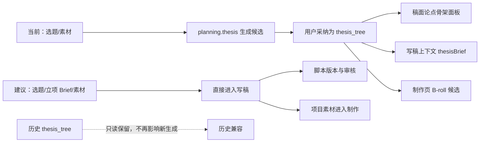

# 移除“论点骨架”的产品与技术影响调研

> 任务：`T-725`
> 日期：2026-08-08
> 范围：只读调研，不修改运行实现
> 结论：建议退役用户可见的“论点骨架”能力和新建链路，保留历史 `thesis_tree` 数据的只读兼容；不要只隐藏面板，也不要第一步物理删除历史类型。

## 一句话结论

“论点骨架”不是写稿硬前置，移除不会阻断选题、写稿、审核、发布和制作主链；但它已经接入 Copilot、AI 任务、写稿上下文和 B-roll 候选，不能只删稿面面板。正确收口方式是：**停止新建和新消费，保留旧数据兼容**。

## 现状判断

### 1. 它从一开始就不是必经门

原 SPEC 把“论点骨架”定义为引导式建议步骤，明确允许老手跳过并直接写稿。当前代码也把 `thesisBrief` 设为可选值：没有论点树时返回空字符串，读失败也不阻断节点；`script.draft` 只有在值非空时才注入。

因此它是质量增强层，不是业务正确性或数据安全所需的硬能力。

### 2. 当前独有价值已经缩小

写稿链目前已经直接读取：

- 当前定位与历史经验；
- 选题与项目立项 Brief；
- 用户上传的高优先级资料和项目素材；
- 内容雷达来源证据；
- 已确认的结构方案和内容合同（存在时）。

所以“先单独生成一棵论点树，再让写稿模型读取”的必要性较 2026-07-05 初次设计时明显下降。它仍能给论证型内容提供显式控制，但对多数项目会多出一次生成、一次采纳和一个编辑面板。

### 3. 当前还有一处与新语义边界不一致

`planning-runner.ts` 会用 token 重合度和 Dice 分数，从项目素材中替每个论点预挂素材。这属于用确定性字符串相似度做“论点与素材是否匹配”的语义选择，与当前“语义归 Skill/模型，代码只守真实 ID 和边界”的架构规则不一致。

如果保留论点能力，这部分也必须改为 Skill/模型选择；退役能力可以直接消除这条复杂度和潜在边界违规。

## 真实影响面

仓内精确关键词扫描直接命中 57 个 TS/TSX 文件，其中 24 个是测试文件。不是每个文件都要删除，但说明它不是单一组件。

| 层 | 当前作用 | 移除影响 | 建议处理 |
| --- | --- | --- | --- |
| 稿面 UI | “立论点”按钮、空态、可编辑骨架、素材挂载 | 页面更短，少一个理解成本和操作步骤 | 删除面板及两处“立论点”入口 |
| Copilot | `planning.thesis` 工具、强制工具路由、候选卡、采纳按钮 | 用户不再能单独生成论点树 | 从用户工具清单和卡片渲染中退役 |
| AI 运行时 | 独立 prompt、模型配置、runner、持久任务恢复 | 少一次模型调用和一类失败/重试状态 | 禁止创建新 `planning.thesis` 任务；旧任务安全终止或完成后不再采纳 |
| 写稿 | `CreativeContext.thesisBrief` 注入 `script.draft` | 新稿不再受论点树显式约束；主链仍有 Brief、定位、选题、素材和结构方案 | 停止新消费，不能隐藏 UI 后仍暗中读取旧树 |
| 策划 | 内容合同、结构方案可读取论点树 | 这两个可选节点少一份上游输入，但自身仍能按定位、选题和 Brief 工作 | 去除 thesis 依赖或继续优雅空值 |
| 制作/B-roll | `thesis_tree.nodes[].materialRefs` 是自动候选来源之一 | 来源徽标/优先级变化；通常不会丢素材，因为这些 ID 本来来自项目用料链，制作还会读取 `materialLinks` | 去除 thesis 来源，继续以脚本点名和项目素材为真值 |
| 重建项目 | 历史内容反推时会物化 `thesis_tree` | 若继续生成就会产生无人可见的隐藏产物 | 停止新物化，保留旧数据 |
| 数据与契约 | `thesis_tree` 是通用 artifact 枚举，版本存在通用 artifact 表 | 直接删枚举会让历史行、契约解析、项目工件列表出现兼容风险 | 第一轮保留枚举和历史行，标记 deprecated/read-only |
| 设置与文档 | “论点树”模型能力、Skill 说明、用户教程 | 会留下假入口和过时教学 | 同步移除配置入口、产品文案和教程步骤 |

## 三种做法比较

### 方案 A：只隐藏稿面面板

不建议。旧 `thesis_tree` 仍会暗中进入写稿和 B-roll，用户看不见、不能编辑，却会影响输出，形成隐藏状态。

### 方案 B：退役新能力，保留历史兼容

建议。

- 删除稿面面板、“立论点”按钮、Copilot 工具和独立模型配置；
- 停止创建新的 `planning.thesis` 任务和 `thesis_tree` 版本；
- 新写稿不再注入 `thesisBrief`；
- 制作页不再把论点树当独立素材来源，继续读取脚本点名和项目用料链；
- 历史 `thesis_tree` 行保留，不删除、不改写，避免老项目和审计记录丢失；
- 旧的已生成脚本版本保持不变，只有未来重新生成的脚本不再受论点树影响。

这是最符合“页面瘦身、减少步骤、数据不丢、无隐藏影响”的路线。

### 方案 C：物理删除全部类型与历史数据

不建议作为第一步。它需要数据迁移、契约枚举变更、历史项目兼容和任务清理，风险高但用户价值很低。只有完成一个发布周期的只读兼容并确认没有外部消费者后，才值得另行评估。

## 对用户体验和结果质量的影响

### 明显收益

- 少一个概念、一个面板、一次模型生成和一次采纳操作；
- 稿面从“素材 + 论点骨架 + 脚本”收敛为“素材 + 脚本”；
- 减少独立模型配置、异步任务失败和弱模型结构化输出失败；
- 避免论点树、结构方案、脚本三种相近结构同时存在造成重复判断；
- 删除当前词面相似度替素材做语义匹配的技术债。

### 可能损失

- 长篇知识内容、辩论型内容和强论证口播，少了一个用户可逐条控制“核心主张/证据/反驳”的界面；
- 重新生成脚本时，不再有用户已确认论点树作为强参考，输出的论证顺序可能变化；
- 论点节点挂载素材的来源徽标消失，但素材本身仍可通过项目用料链进入制作；
- 已习惯“先立论再写稿”的少量用户需要改为直接在 Brief、素材或 Copilot 对话中表达硬要求。

这些损失可以通过“项目 Brief + 当前素材 + 用户在 Copilot 中的明确要求 + 脚本局部改稿”覆盖，不需要保留独立论点产品面。

## 数据与迁移边界

第一轮不得删除历史 `thesis_tree` artifact 或版本。推荐规则：

1. 历史数据只读保留，继续可被导出/审计，但不在主界面展示。
2. 新任务不得再创建 `planning.thesis` 或追加 `thesis_tree` 版本。
3. 新的 `script.draft`、`planning.contract`、`planning.outline` 不读取历史论点树，避免不可见数据影响新结果。
4. 已经生成并保存的 `output_script` 不变化；只有用户以后重新生成才使用新链路。
5. 正在运行或等待采纳的论点任务，在升级时需要给出明确的“能力已退役”终态，不能永久转圈。
6. 至少经过一个发布周期并确认无外部消费者后，再决定是否清理枚举和代码；历史数据仍优先保留。

## 仍缺少的产品证据

仓内没有看到能直接回答“多少真实用户生成、采纳、编辑过论点树”的产品使用统计。本报告能证明技术依赖和可移除性，不能用代码命中数替代真实使用率。若要以使用率作为最终裁决，需只统计脱敏事件：`planning.thesis` 创建数、采纳数、面板编辑保存数，以及带 `thesisBrief` 的写稿数。

## 最终建议

采用方案 B：**退役用户可见能力和新写入/新消费，保留历史数据只读兼容**。

这不是“把论点换个地方藏起来”，而是真正从主流程中删除一个可选中间产物；写稿直接依赖定位、选题、项目 Brief、用户素材、内容雷达证据和用户明确指令。该方向会改变已确认的创作流程与合同，进入实现前需要用户确认，并更新原 T-127 SPEC、契约/工具清单、页面绑定与回归验收。
