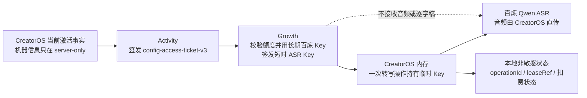

# 渠道 ASR 密钥故障根因与短时租约根治方案

> 任务：T-762
>
> 日期：2026-08-10
>
> 范围：只读复盘与方案设计；未修改 CreatorOS、Activity、Growth 业务代码或生产配置。

## 结论（大白话）

渠道 ASR 不应该在用户电脑上保存一把“渠道 ASR 密钥”。Growth 持有长期百炼 Key，每次转写前只给
CreatorOS 一枚约 60 秒的临时 Key；CreatorOS 用完即丢。昨天的真实渠道日志也证明：同一个安装包先在
“申请临时凭证”阶段失败，完成额度连接/配置刷新后，两次渠道转写分别在约 7.4 秒和 4.1 秒内成功。
所以昨天不是“永久 Key 丢了”，而是连接状态、短票据与临时租约的恢复链没有收口，同时日志只记了
`ManagedCredentialLeaseError`，没有记安全错误码，导致产品和支持侧都容易误判成密钥问题。

当前实现还存在两个结构性缺口，必须一起修：

1. 通用多模态解析器对 `per_request` ASR 仍会先访问本机受管密钥库；正常返回空值时不影响，但密钥库
   尚未初始化或异常时，会把本来不需要本机 Key 的 ASR 误伤成凭据错误。
2. 幂等键接近按作品永久固定。一次租约过期后，用户以后明确“重新转写”仍可能重放旧 key，Growth
   按合同返回 `ASR_LEASE_EXPIRED`，云端链路无法生成一笔新的、用户明确发起的转写操作。

## 昨天的真实证据

来源：本机智溯 AI 加密日志
`~/Library/Application Support/com.zhisunet.zhisuai/logs/sidecar-2026-08-09-11.log.enc`，使用开发者冷备
私钥只读解密；日志正文未写入仓库。

| 时间 | 事实 | 能证明什么 |
| --- | --- | --- |
| 16:37:59 | 创建 AI 额度连接会话（`flow=connect`） | 用户进入连接流程，不等于连接已经完成 |
| 17:03:40 | 音频抽取成功，1,821,227 bytes | 输入文件链路正常 |
| 17:03:44 | `resolve-model` 失败，`ManagedCredentialLeaseError` | 失败发生在 Activity ticket / Growth lease 阶段，不是 Qwen 转写阶段 |
| 17:10:27 | 渠道配置刷新为 `configured` | 授权/配置状态随后恢复 |
| 17:15:30–17:15:38 | `channel-managed` ASR 成功，7,452 ms | 同一安装包能取得临时凭证并直连 ASR |
| 17:17:28–17:17:32 | `channel-managed` ASR 再次成功，4,060 ms | 不是长期 ASR Key 缺失或适配器永久损坏 |

现有日志只在 `frontend/src/server/persistence-client.ts:6941-6945` 记录 `errorName`，没有记录脱敏的
`error.code`。因此本轮不能伪造“17:03 一定是未绑定额度”这一结论；最符合时序的候选是连接尚未完成，
但也可能是短票据或租约服务的瞬时拒绝。这个不可判定本身就是可观测性缺陷。

## 当前责任边界

- Activity：只证明当前机器与权益，签发 v3 短票据；不持有 Qwen Key，不决定 ASR 金额。
- Growth：长期 Qwen Key唯一属主；校验额度、限流、签发临时 Key、保存短时密文和扣费事实。
- CreatorOS：做文件先验、稳定幂等、直接发送音频、保存非敏感操作状态；不保存临时 Key。
- 系统密钥库：只保存 `omnihi-main` 这类 `persistent` 受管 Key；不得保存 `qwen-asr-main`。

阿里云官方说明临时 Key默认 60 秒、可设 1–1800 秒，且无法提前撤销；它会继承长期 Key的权限。
因此 Growth 必须继续使用只开放 ASR workspace/模型权限的长期 Key，并采用最短可行 TTL。官方当前
`qwen3-asr-flash` 限制仍为单次最多 5 分钟、10 MB，CreatorOS 必须在申请租约前校验。

## 必须根治的六个点

### 1. 凭据生命周期先分流，再碰密钥库

`backend/src/modules/ai-runtime/multimodal/resolve.ts:226-230` 当前对所有渠道多模态能力先调用
`getChannelModelCredential`，而 `channelMultimodalSpecFromRoute` 到
`backend/src/modules/ai-runtime/channel-model-config.ts:485-488` 才判断 `per_request` 并忽略该值。

修复约束：

- `persistent`：允许读取系统密钥库；读取失败按长期受管凭据错误处理。
- `per_request`：禁止调用任何本机 credential reader，直接生成“待租约”规格。
- 加负测：credential reader 设为“一调用就抛”，`qwen-asr-main/per_request` 仍必须成功解析；
  `omnihi-main/persistent` 则必须真实读取。

### 2. 把“一次转写操作”建成一等对象

当前 intent 使用 `aweme:<awemeId>` 或 `intelligence:<itemId>:aweme:<awemeId>`，实体 ID近似永久不变。
正确模型是：

- 用户或调度真正发起一次转写时，创建新的 `transcriptionOperationId`；
- 同一次操作的网络重试、页面重进、应用重启始终复用该 ID和同一 `Idempotency-Key`；
- 只有旧操作进入确定终态，且用户明确点击“重新转写”或新的调度事实到来，才创建新 operation；
- 新 operation 可能再次扣 25,000，必须在动作旁说清楚，不能后台悄悄续租。

这能同时解决“重试时重复扣费”和“旧 key 过期后永远无法重新云转写”两个相反风险。

### 3. 租约状态机必须区分请求到哪一步

建议固定状态：

`preflight → ticket_acquiring → lease_requesting → lease_issued → provider_calling → used`

失败分流：

- 票据尚未取得：肯定没有向 Growth 申请 lease，不能记 `lease_uncertain`。
- Growth 明确返回未绑定/额度不足/输入错误：`not_issued`，给真实动作。
- POST 已发出但响应丢失：`lease_unknown`，只能用同一 key 重放查询，禁止换 key。
- Growth 返回 `provider_unknown`：等待隔离结束，不自动再申请。
- 已签发但 Qwen 失败：保留 `leaseRef` 和扣费事实，允许明确改用本地 Whisper，不再领第二枚临时 Key。
- 已过期：本次 operation 终止；自动流程不得续租，用户明确发起的新 operation 才能再次收费。

当前 `prepareManagedTranscribeSpec` 把除四个明确拒绝码之外的大量错误都记为 `manual_review`，但并未区分
“票据阶段根本未 POST”和“POST 后响应未知”，需要由 lease client 返回带 `phase` 的安全错误。

### 4. 错误必须可行动，但不能暴露实现

日志只增加白名单字段：`operationRef`、`phase`、`safeCode`、`leaseRef`（若已有）、`outcome`；禁止 token、
ticket、machineId、音频 URL、provider 响应正文。

用户态只保留四类：

- “连接 AI 额度账户” → 打开 Growth `/credits/connect#code`；连接完成后回到原 operation，用同一 key继续。
- “AI 额度不足” → 打开 `/credits/launch#code` 充值。
- “云端语音转文字暂时不可用” → 明确选择本地转写，不自动二次扣费。
- “本次云端费用正在核对” → 显示可提供给支持的参考编号，不显示 provider/serviceId。

绝不能再提示渠道用户“填写 ASR Key”或“本机 ASR 密钥不可用”。

### 5. 临时 Key不要进入通用模型规格

当前实现把临时 token 复制进通用 `MultimodalSpec.token`，再传给适配器。虽然没有持久化，作用域仍偏大。
建议改成 `withManagedAsrLease(operation, callback)`：临时 Key只存在于闭包内，回调结束立即释放引用；
通用任务对象、候选、错误、步骤日志和缓存都拿不到它。JS 字符串无法可靠原地清零，因此减少复制和缩短
可达时间比“假装 zeroize”更诚实。

### 6. 跨仓验收必须覆盖恢复，不只测一次成功

真实 Gate需要一枚全新一次性测试连接码，并经用户确认后产生真实经济事实。至少证明：

1. Activity v3 ticket → Growth 双 service bundle → lease → CreatorOS 直连 Qwen → 非空逐字稿；
2. Growth 账本只扣一次 25,000，且 Growth 零音频、零逐字稿；
3. 响应丢失后同 operation 重试只重放原 lease，不重复扣费；
4. 应用在 `lease_requesting` 和 `lease_issued` 两处崩溃重启，均能恢复；
5. 未绑定、额度不足、expired、provider_unknown 各走正确用户动作，不出现“配置密钥”；
6. 用户明确重新转写会创建新 operation；后台自动重试不会创建新收费操作；
7. CreatorOS DB、系统密钥库、HTML、URL、日志、崩溃报告扫描不到临时 Key/ticket/machineId。

## 实施边界与顺序

这是安全/服务契约和计费语义变更，须用户确认后才能改代码。建议作为一个完整任务一次收口，不拆成
“先改文案、以后补状态机”：

1. 先更新 CreatorOS/Growth 跨仓合同，把 API-282 header 从旧文档的 v2 统一为当前 v3；
2. CreatorOS 实现 lifecycle 先分流、operation 状态机、阶段化安全错误和闭包式临时凭证；
3. Growth 增加按 `leaseRef/idempotency digest` 的安全状态查询/核对能力（若当前合同仍无该读面）；
4. 聚焦故障注入、秘密扫描、双平台本地测试；
5. 用户提供全新一次性测试码后跑真实跨仓联调；在此之前只能写“实现完成、真实联调待验”。

## 本轮裁决

- 昨天的渠道包不需要补发或内置一把 ASR Key。
- 不应该让用户在设置中配置渠道 ASR Key。
- 不能把一次成功转写当成闭环已经根治；当前恢复、可观测性和 operation 幂等仍有缺口。
- 本轮未修改代码。待用户认可上述边界后，再建立实现任务并按完整闭环交付。
