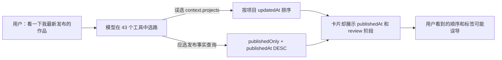

# CreatorOS AI 工具意图、数据语义与展示一致性审计

> 日期：2026-08-11
> 对应任务：T-769
> 范围：AI 对话工具声明、模型可见范围、工具选路、查询过滤/排序/分页、结果契约及前端卡片展示
> 变更边界：本轮只审计，不修改业务代码或视觉

## 一句话结论

当前问题不是单个工具“不支持倒序”，而是三个环节没有使用同一套语义：模型可能从多个近义工具中选错；工具内部的过滤、排序和分页口径不统一；前端又展示了另一套字段。结果就是用户说得很清楚，系统也可能返回“看起来合理、事实却不对”的内容。



## 审计范围与现状

- 当前 AI 对话共注册约 43 个工具，其中 18 个为 `context.*` 数据读取工具。
- 18 个上下文工具均有前端结果卡片，但“工具成功、工具部分失败、确实没有数据”尚未统一成同一种结果契约。
- 全局 AI 助手在缺少明确页面作用域时会把全部工具交给模型选择，近义工具之间主要依靠自然语言说明区分。
- 当前只有抖音分享、封面参考和显式功能深链等少量场景存在确定性路由；一般自然语言请求仍主要依赖模型自行选工具。

代码证据：

- `backend/src/modules/ai-runtime/chat-tools.ts:4613-4618`：全局/未知页面没有收窄工具集。
- `backend/src/modules/ai-runtime/chat-runner.ts:1042-1052`：没有页面工具范围时使用全部工具。
- `backend/src/modules/ai-runtime/chat-context.ts:126-148`：未知页面回落到通用对话作用域。
- `backend/src/modules/ai-runtime/chat-runner.ts:1069-1082,2398-2405`：现有确定性路由只覆盖少数特殊意图。

## 已确认问题

### 1. “最新发布的作品”会在三个近义工具之间摇摆（高）

`context.projects` 的说明包含“最新一条作品”，`context.publications` 又包含“最近发布了什么”，同时还有语义更准确的 `context.projects.search`。模型面对同一表达可能选中不同工具。

- `context.projects` 实际按项目 `updatedAt/createdAt` 排序并先分页，再补充 `publishedAt`：`frontend/src/server/recent-projects-context.ts:72-83,124-134`。
- 前端卡片展示的是 `publishedAt`，同时把项目阶段 `review` 原样摆在作品旁：`frontend/src/features/copilot/chat-context-cards.tsx:145-170`。
- `context.projects.search` 才默认使用 `publishedOnly=true`、`orderBy=publishedAt`、`direction=desc`：`backend/src/modules/ai-runtime/chat-tools.ts:4001-4028`。
- 当前没有“看一下我最新发布的作品”这类自然语言到工具与参数的回归用例；现有测试主要验证执行接线和默认参数：`backend/src/modules/ai-runtime/chat-tools.test.ts:1845-1851,1989-2006,2457-2506`。

这正好解释了本次用户看到的结果：序号按项目最近编辑排序，但卡片显示的是发布日期，因此 3 月 13 日到 3 月 23 日看起来像“最新作品”被正序列出；`review` 也是项目阶段，不是发布状态。

### 2. 即便选中 `context.publications`，也不保证只返回已发布作品（高）

发布仓储查询没有强制 `publishedAt` 非空或真实发布状态，而是按 `coalesce(publishedAt, createdAt) DESC` 排序。因此刚创建但尚未发布的记录可能排在真实发布作品前面。

- `backend/src/modules/publishing/publishing.repository.ts:309-323`

正确口径应是：先限定真实发布事实，再按 `publishedAt DESC` 排序，最后分页。不得用创建时间补位冒充发布时间。

### 3. “最新视频的评论”目前其实是账号级评论列表（高）

工具说明声称支持“我最新视频的评论”，但实现只查询账号级 `comment` 信号，没有先定位最新已发布作品，也没有把 `publicationId` 返回给模型或卡片。

- 工具说明：`backend/src/modules/ai-runtime/chat-tools.ts:4040-4042`
- 实际查询与字段裁剪：`frontend/src/server/persistence-client.ts:10858-10876`
- 数据表本来具有 `publicationId`：`backend/src/schema/candidate.ts:76-92`
- 仓储仅按本地信号 `createdAt` 排序：`backend/src/modules/candidate/candidate.repository.ts:494-518`
- 卡片不展示作品归属：`frontend/src/features/copilot/chat-context-cards.tsx:308-350`

所以当前结果无法证明评论属于“最新视频”，也无法证明排序使用平台评论时间而非本地采集时间。

### 4. 多个工具把读取失败伪装成“没有数据”（高）

发布、指标、经验、候选、盲预测、知识详情等多条读取链路会捕获异常后返回空数组、`null` 或 `false`。前端随后显示“还没有指标数据”“未发布”等结论。这会把服务异常、端口缺失或数据库读取失败误报成用户事实。

典型证据：

- 项目详情读取失败后部分字段变为 0/空，发布读取失败会落成 `published:false`：`frontend/src/server/persistence-client.ts:10970-11105`。
- 发布列表失败返回 `{rows:[],total:0}`：`frontend/src/server/persistence-client.ts:11802-11827`。
- 指标失败返回空结果：`frontend/src/server/persistence-client.ts:11834-11971`。
- 经验、候选、盲预测失败返回空结果：`frontend/src/server/persistence-client.ts:11978-12090`。
- 卡片把这些结果展示为“未发布”或“还没有指标数据”：`frontend/src/features/copilot/chat-context-cards.tsx:470-487,973-981`。

仓库中已有正确范式：`context.project.lifecycle` 会显式返回 `error/partial` 和 trace ID，卡片也明确说明“读取失败，不代表用户没有内容”。其他上下文工具应统一复用这套语义，而不是静默降为空。

### 5. 发布列表把“至少还有更多”显示成“库中总数”（高）

`context.publications` 只取 `limit+1` 条，用它计算一个下界，却把这个数字放进 `total`。通用分页卡片再把它显示成“库中共 N 条”。例如真实有 100 条，第一页可能显示“库中共 21 条”。

- 下界计算：`frontend/src/server/persistence-client.ts:11798-11825`
- 卡片将 `total` 当精确总数：`frontend/src/features/copilot/chat-context-cards.tsx:89-111`

如果不执行真实 count，就应把字段改为 `hasMore` 或 `totalLowerBound`，不得称为精确总数。

### 6. 单作品指标可能拼成“混合指标”（高）

项目存在多个平台或多条发布记录时，当前实现会逐项寻找第一个非空指标：播放量可能来自发布记录 A，点赞量可能来自发布记录 B，最后却组合成同一行“这条作品”的指标。

- 指标拼装：`frontend/src/server/persistence-client.ts:11872-11902`
- 卡片展示：`frontend/src/features/copilot/chat-context-cards.tsx:964-1044`

指标必须绑定同一个 `publicationId/platform`，或者明确展示按平台拆分；不能跨发布记录填空。

### 7. 盲预测的作品标题连接逻辑天然容易丢失（中高）

对已回流作品，组合层尝试从 `pendingSubjects` 查标题；但校准服务会把已回流选题排除出 `pendingSubjects`，于是实际卡片很容易退化为“（无标题作品）”。

- 标题映射：`frontend/src/server/persistence-client.ts:12064-12076`
- 已回流选题被排除：`backend/src/modules/calibration/calibration.service.ts:523-554`
- 回流记录随后单独构造：`backend/src/modules/calibration/calibration.service.ts:556-624`

需要从回流记录对应的真实选题/项目关系取标题，而不是从“待回流集合”反查。

### 8. “有哪些选题在排队 / 下一条做什么”会混入已晋级或已丢弃候选（中高）

`context.candidates` 的工具说明是“在排队/下一条”，但默认查询不限制状态，并按预测分排序，因此 `pool/promoted/dropped` 都可能出现。

- 工具说明：`backend/src/modules/ai-runtime/chat-tools.ts:4438-4440`
- 调用未传状态与意图排序：`frontend/src/server/persistence-client.ts:12018-12035`
- 仓储默认包含全部状态：`backend/src/modules/candidate/candidate.repository.ts:198-206,226-252`

“排队”应绑定 `pool`；“下一条做什么”还需要明确推荐口径，不能把已删除或已晋级的候选混进去。

### 9. 素材与知识工具的声明、真实限制和分页能力不一致（中）

- 参数文档写默认 5、上限 10，通用实现实际默认 20、上限 50：`backend/src/modules/ai-runtime/chat-tools.ts:2638-2667,2863`。
- 素材工具声称不带搜索词时“列全量最近素材”，实际只取 `limit` 条；搜索模式最多只扫描前 100 条：`frontend/src/server/persistence-client.ts:10924-10943`。
- 素材结果没有 `total/hasMore`，卡片只能说“命中 N 件”，用户无法知道是否被截断。
- 经验工具最多扫描前 200 条后把过滤结果当 `total`：`frontend/src/server/persistence-client.ts:11974-12013`。

这会导致模型把“没在前 100/200 条里”理解成“不存在”。

### 10. 新旧项目详情工具并存，模型可能选到语义较弱的兼容路径（中）

`context.project.detail` 与 `context.project.lifecycle` 同时暴露。前者存在大量异常转空值；后者已经支持部分失败、错误来源和 trace ID。兼容工具继续暴露给模型，会增加选错路径的概率。

- 两种工具的说明与优先关系：`backend/src/modules/ai-runtime/chat-tools.ts:4096-4127`

建议保留旧接口兼容能力，但从模型可选工具集移除，统一由 lifecycle 承担项目事实读取。

## 根因归纳

1. **工具过多且近义**：全局助手一次看到全部约 43 个工具，靠说明文字区分“项目、已发布作品、发布记录、指标、评论”。
2. **缺少统一的意图结构**：用户说“最新发布”时，没有先形成 `{资源=作品, 状态=已发布, 排序=发布时间倒序}` 这样的受约束语义，再选择唯一工具。
3. **查询口径分散**：项目、发布、指标、评论分别自行决定过滤、排序和分页，缺少同一发布事实的权威查询。
4. **错误契约不统一**：部分工具能表达 `partial/error`，部分工具却把异常变成空数据。
5. **测试偏接线，缺用户表达**：现有测试多验证工具能调用和字段能返回，缺少“用户原话 → 工具与参数 → 最终卡片事实”的端到端语义矩阵。

## 最小修复建议（需用户确认后实施）

### A. 先统一语义，不写死关键词

由模型/Skill 把自然语言理解成严格结构，例如：

```json
{
  "resource": "publication",
  "scope": "current_account",
  "filters": { "publishedOnly": true },
  "orderBy": "publishedAt",
  "direction": "desc",
  "limit": 8
}
```

代码只校验真实 ID、范围、过滤、排序和分页，不使用硬编码关键词冒充语义理解。这符合仓库“语义归 AI，代码守边界”的架构要求。

### B. 建立唯一的“发布事实”查询

最新作品、最近发布、最新视频评论、最近 N 条指标都先复用同一条 canonical publication query：

1. 限定当前用户与当前抖音账号；
2. `publishedAt IS NOT NULL` 且是真实发布状态；
3. `publishedAt DESC`；
4. 排序后分页；
5. 评论和指标继续携带同一 `publicationId/platform`。

### C. 统一上下文读取结果

所有 context 工具统一返回：

```ts
{
  status: "ok" | "partial" | "error";
  items: T[];
  pageInfo: { hasMore: boolean; total?: number };
  errors?: Array<{ source: string; traceId?: string }>;
}
```

只有 `status=ok` 且真实为空时才能显示“暂无数据”；读取失败必须明确说失败，不能推断用户没有内容。

### D. 收窄模型可见工具

全局助手先做结构化意图解析，再只暴露相关的一小组工具；兼容型重复工具不再直接交给模型。页面已有作用域时继续按页面收窄，避免 43 个工具同场竞争。

### E. 增加用户原话回归矩阵

至少覆盖：

- “看一下我最新发布的作品”
- “把最近 8 条作品按发布时间倒序给我”
- “看看我最新视频的评论”
- “我有哪些选题在排队”
- “这条作品最近的数据怎么样”
- “找一下之前导入的某个素材/知识”

每例同时断言：选择的资源、过滤条件、排序字段、分页顺序、错误/空数据区分，以及最终卡片没有误导标签。

## 建议实施顺序

1. 先修发布事实查询与“最新发布”选路，这是当前已复现的直接问题。
2. 同批修最新视频评论、指标绑定和精确分页语义，避免继续返回错误事实。
3. 统一 `ok/partial/error`，消除“读取失败 = 没有数据”。
4. 修盲预测标题、候选状态和素材/知识分页契约。
5. 最后收窄全局工具集、下线重复兼容工具，并用用户原话矩阵守住回归。

## 本轮边界

- 未修改任何业务逻辑、查询、工具说明或前端视觉。
- 未恢复已取消的 GitHub 正式包流水线。
- 后续实现必须先获得用户确认，并以独立任务/SPEC 收口；不得借正式打包继续增加功能。
