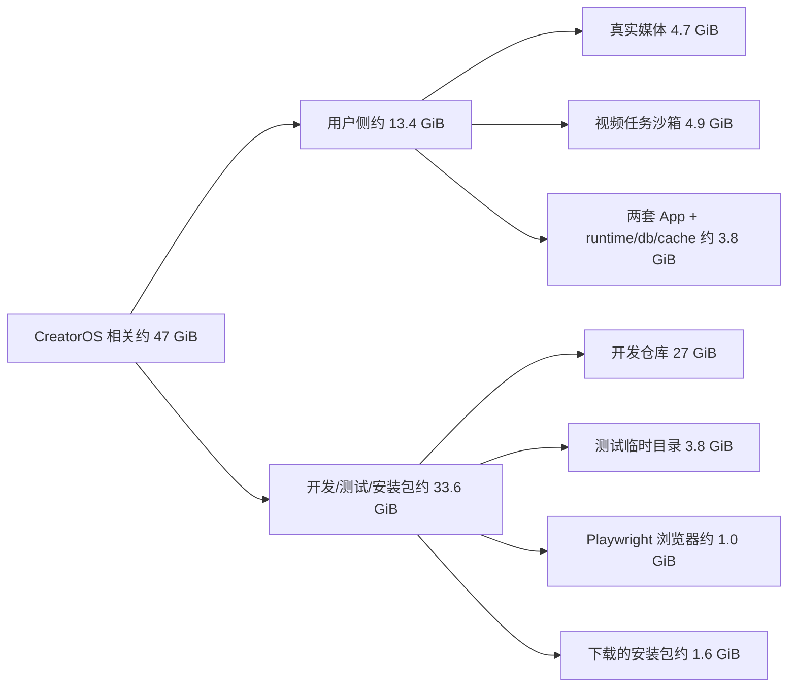

# CreatorOS 本机磁盘占用与异常增长审计

任务：`T-780`  
日期：2026-08-11  
范围：只读统计本机磁盘、CreatorOS/智溯AI安装与用户数据、视频任务沙箱、开发构建产物和测试临时目录；未删除、移动或修改任何用户文件。

## 结论

本机数据卷确实接近满载：总容量约 `460 GiB`，已用约 `403 GiB`，当时可用约 `19 GiB`，数据卷占用率 `96%`。这对视频渲染已经是高风险水位，因为一条大视频会同时产生输入副本、标准化中间文件、帧/网页渲染数据和最终成片。

CreatorOS 产品家族的终端用户侧占用约 `13.4 GiB`；如果把 CreatorOS 开发仓库、构建缓存、测试临时目录、Playwright 浏览器和已下载安装包也计入，CreatorOS 相关总占用约 `47 GiB`。CreatorOS 是明显贡献者，但不是整机唯一原因：本机 `Workbase` 约 `66 GiB`、Docker 容器约 `37 GiB`、微信容器约 `20 GiB`、Google Application Support 约 `14 GiB`。

## 终端用户侧占用

| 类别 | 占用 | 判断 |
| --- | ---: | --- |
| `~/CreatorOS/media` | `4.7 GiB` | 真实项目素材，不是缓存；禁止直接清空 |
| `~/CreatorOS/workspaces` | `4.9 GiB` | 视频执行沙箱，存在明显重复与生命周期堆积 |
| `~/CreatorOS/models` | `240 MiB` | 本地 Whisper 模型，正常 |
| 官方 CreatorOS App | `414 MiB` | 正常应用本体 |
| 官方 appData | `1.3 GiB` | 其中 runtime `1.2 GiB`、DB `104 MiB`、登录态 `37 MiB`、日志 `1.1 MiB` |
| 智溯AI App | `538 MiB` | 渠道身份隔离后的独立应用本体 |
| 智溯AI appData | `1.3 GiB` | 其中独立 runtime `1.2 GiB`、DB `34 MiB`、登录态 `14 MiB` |
| CreatorOS WebKit/cache + 旧 `.creatoros` | 约 `121 MiB` | 体积小，不是主因 |

两套产品各保留一份约 `1.2 GiB` runtime，是官方包与白标包应用身份、数据目录隔离的直接结果，并非单目录无限复制。本次只发现各一份当前 runtime，没有发现同一 appData 内堆积多版本 runtime。

数据库和日志都处于正常量级，因此“磁盘满”不是数据库膨胀或日志爆量导致。

## 异常一：视频任务沙箱在重试期间快速复制大文件

`~/CreatorOS/workspaces` 当前有 9 个任务目录，总计约 `4.9 GiB`：

- `input/`：约 `3.04 GiB`；
- `work/`：约 `1.76 GiB`；
- `out/`：约 `95 MiB`。

同一个 `310,112,367` 字节（约 `296 MiB`）源视频被物化到 7 个任务沙箱，加上媒体库原件共 8 份；仅 7 份沙箱输入就占约 `2.02 GiB`。同一个 `110,845,830` 字节（约 `106 MiB`）中间视频又存在 7 份，除保留一份外的重复量约 `0.62 GiB`。两组可确认重复合计约 `2.64 GiB`。

代码确实有清理机制：

- 执行失败后立即 `cleanupSandbox`；
- 用户采纳或丢弃后立即清理；
- sidecar 启动时调用 `sweepOrphanSandboxes`，默认清理目录 mtime 超过 7 天的孤儿。

但当前策略仍有增长窗口：等待确认的候选不会清理；同一素材每次重试使用新 taskId 并重新物化；7 天清扫只处理超龄目录，不限制磁盘压力或同源重复。本次目录均在 7 天窗口内，所以启动清扫不会回收它们。当前 CreatorOS 正在运行，审计时没有进程打开这些 `workspaces` 文件，但这不能证明候选已无业务价值；必须通过“采纳/丢弃”状态或任务真值清理，禁止在 Finder 直接删除。

## 异常二：开发构建产物占 23 GiB 以上

当前 CreatorOS 仓库约 `27 GiB`，主要为：

- `frontend/src-tauri/target`：约 `14 GiB`，包含 Rust `debug/release/release-fast` 依赖、多个 App/DMG 和 sidecar 包；
- `frontend/.next`：约 `8.9 GiB`，其中 `.next/dev/cache/turbopack` 单独约 `7.5 GiB`；
- 根 `node_modules`：约 `2.0 GiB`；
- `.git` 与 CodeGraph 等其余内容约数百 MiB。

`target` 和 `.next` 都是可再生构建产物，不属于用户项目、数据库、激活信息或媒体素材。它们是本机最快、风险最低的回收候选，但当前另有构建/视频回归进程运行，实际清理前必须停止相关开发任务。

## 异常三：测试临时目录没有闭环删除

系统临时目录发现 `198` 个 `creatoros-*` 目录，总计约 `3.83 GiB`；其中超过 24 小时的有 `103` 个，仍占约 `3.58 GiB`。大量目录来自 `creatoros-playwright-*` 和 `creatoros-smoke-*`。

代码证据：

- `frontend/playwright.config.ts` 使用 `mkdtempSync(..., "creatoros-playwright-")` 创建每次测试的隔离数据库/登录态根，但没有配置进程结束后的全局删除；
- `frontend/scripts/desktop/obfuscate.mjs` 使用 `mkdtempSync(..., "creatoros-smoke-")`，其 `cleanup()` 只结束子进程，没有删除 `smokeDataRoot`。

因此这些目录不是正常长期数据，而是确定性的测试/打包临时目录泄漏。审计时仍有一个 Playwright 浏览器和一个视频审计进程在运行，不能整批直接删除；应先停止相关任务，再只清理无进程占用的旧目录，并在代码层补 `finally`/global teardown。

## 大文件与正常业务数据

媒体库内最大的几个文件包括：

- 一个约 `884 MiB` 的项目 MOV；
- 两个约 `770 MiB`、`598 MiB` 的 ZIP 文档；
- 多个约 `142–704 MiB` 的项目视频目录。

这些是真实上传内容，不应把“文件很大”等同于异常。更值得修的是：视频执行不应在每次重试中永久留下整份输入和中间副本；产品也应在开始渲染前按源文件和预计中间产物检查可用空间。

## 整机其他大项

CreatorOS 并非占满 403 GiB 的唯一来源。已确认的其他大项包括：

- `/Users/zyongzhu/Workbase`：约 `66 GiB`，其中当前 CreatorOS 仓库 `27 GiB`、`Ymb-agent` `9.8 GiB`、另一个 `Thirdspace-creator-t675` 工作副本 `2.2 GiB`；
- Docker 容器：约 `37 GiB`；
- 微信容器：约 `20 GiB`；
- Google Application Support：约 `14 GiB`；
- 系统级 `Library/Caches`：约 `10 GiB`。

APFS 只显示一个系统更新快照且不可清理，没有发现大量 Time Machine 本地快照吞空间。

## 安全回收顺序建议（本次未执行）

1. **先停止开发构建与测试进程**，再清理 CreatorOS 仓库的 `.next` 和 `src-tauri/target`，理论可回收约 `22.9 GiB`。
2. 清理无进程占用的旧 `creatoros-*` 测试临时目录，理论可回收约 `3.6–3.8 GiB`。
3. 确认不再需要后删除 Downloads 中的旧 CreatorOS DMG/Windows 安装包，约 `1.6 GiB`。
4. 在 CreatorOS 里对旧视频候选执行“采纳”或“丢弃”，由产品清理对应沙箱；当前总量约 `4.9 GiB`，其中已确认重复约 `2.64 GiB`。不要手工删除沙箱。
5. 若仍需更多空间，再单独审计 Docker `37 GiB` 与微信 `20 GiB`；它们不属于 CreatorOS，本任务没有动。

仅执行前 3 项的可再生/临时内容，预计可恢复约 `28 GiB`；再正确收口无用视频沙箱，可进一步恢复数 GiB。实际值以执行时进程和文件状态为准。

## T-782 根治结果（2026-08-11）

已将后续任务的两次大文件复制改为“写时复制优先”：

- 项目素材从本地资产库进入 `workspaces/<taskId>/input` 时，macOS/APFS 使用系统 clonefile；
- 视频任务把输入整理到自身 `work/media` 时复用同一机制；
- 副本仍是独立文件，任务修改副本不会污染项目原素材；
- 非 APFS、跨卷、Windows 或远端 S3 不支持时自动回退普通复制，磁盘满等真实错误继续失败。

真实 APFS 探针使用 `256 MiB` 临时源文件：目标副本逻辑大小同为 `256 MiB`，新增物理空间仅
`4 KiB`。这能阻止新任务继续产生审计中约 `2.64 GiB` 的同类重复块，但不会静默改写或删除现有
等待确认任务；旧候选仍应在 CreatorOS 中通过“采纳/丢弃”安全收口。

## 其余产品根治方向（未实施）

- Playwright 与打包冒烟临时根必须在进程退出、失败和中断恢复时删除；下一次启动可补扫明确前缀且无进程占用的旧目录。
- 视频任务创建前按输入大小、预计中间文件和安全余量做磁盘预检，空间不足时在复制前失败并给出可操作提示。
- 如需在不丢候选的前提下回收既有副本，应另建经哈希复核与原子替换保护的存量迁移工具；本轮未直接改写旧任务数据。
- 新重试成功创建后，明确处理同项目已被替代的旧候选沙箱；保留候选与回收空间之间要有用户可见的生命周期。
- 设置页存储统计应分开显示“项目素材、任务临时文件、本地模型、应用运行时”，避免只展示媒体库而让用户误以为系统没有占空间。
