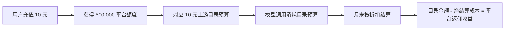

# CreatorOS 模型返佣收益与推荐策略

> 日期：2026-08-11  
> 任务：T-771  
> 目标：在模型质量达到 CreatorOS 使用门槛的前提下，提高额度消费、月末返佣和长期毛利；不把“替用户找最低价”当目标。

## 一句话结论

当前默认 `MiniMax M3` 的报价结算是 `100折`，按本表口径几乎没有返佣收益，不适合继续做经营默认。若真实月末返佣与“目录价折扣”一致，最适合做默认候选的是 `GLM 5.2`：目录结算 6 折，返佣毛利约 40%；GPT 5.6 全家结算 75 折，毛利约 25%，适合做高质量与深度档，推动更快的额度消费和充值。

推荐模型结构：

- 默认推荐：`GLM 5.2`；
- 高质量快速：`GPT 5.6 Luna`；
- 专业创作：`GPT 5.6 Terra`；
- 旗舰深度：`GPT 5.6 Sol`；
- 省额度：`DeepSeek V4 Flash`；
- `MiniMax M3`、`DeepSeek V4 Pro` 暂不推荐，除非上游补返佣或真实质量明显领先。

这不是让系统暗中把用户导向最贵模型。正确做法是：先设质量门槛，只有通过质量门槛的模型才能竞争“推荐”，再在这些模型里优先毛利更高、能稳定带来复购的模型。

## 现在的收益模型

Growth 当前固定 `1 CNY = 50,000 平台 AI 额度`，并把充值金额等额增加到 OmniHi 子 Key 预算。例如用户付 10 元，得到 500,000 额度，对应上游 10 元目录预算。

因此当前没有前置加价，平台收益近似为：

`平台返佣收益 = 用户消耗的上游目录金额 ×（1 - 月末结算折扣）`

只要用户把充值额度用完，平台在这笔充值上的毛利率就近似等于返佣率。模型贵不贵只影响“同样一次任务烧多少额度、多久发生下一次充值”；结算折扣才决定每烧 1 元额度平台留下多少。

## 返佣收益排名

假设报价表“目录价折扣”就是实际月末结算系数；标准调用按 `4K input + 1K output tokens` 计算。

| 模型 | 月末结算 | 返佣毛利率 | 标准调用目录消耗 | 每千次返佣收益 | 10 元额度约可调用 | 经营判断 |
| --- | ---: | ---: | ---: | ---: | ---: | --- |
| GPT 5.6 Sol | 75% | 25% | ¥0.3625 | ¥90.63 | 28 次 | 单次收益最高，只做旗舰深度档 |
| Claude Opus 4.8 | 80% | 20% | ¥0.3263 | ¥65.25 | 31 次 | 收益高但毛利率低于 GPT，同类不主推 |
| GPT 5.6 Terra | 75% | 25% | ¥0.1813 | ¥45.31 | 55 次 | 专业创作档，适合升级消费 |
| Claude Sonnet 4.6 | 80% | 20% | ¥0.1958 | ¥39.15 | 51 次 | 与 Terra 角色重叠，经营上优先 Terra |
| GLM 5.2 | 60% | 40% | ¥0.0600 | ¥24.00 | 167 次 | 毛利率最高，最适合默认候选 |
| Gemini 3.1 Pro Preview | 85% | 15% | ¥0.1450 | ¥21.75 | 69 次 | Preview 且毛利偏低，不默认 |
| GPT 5.6 Luna | 75% | 25% | ¥0.0725 | ¥18.13 | 138 次 | 品质、消耗速度与复购较均衡 |
| Gemini 3.5 Flash | 85% | 15% | ¥0.1088 | ¥16.31 | 92 次 | 只有原生多模态优势真实接通时才主推 |
| Claude Haiku 4.5 | 80% | 20% | ¥0.0653 | ¥13.05 | 153 次 | 被 GLM/Luna 挤压，不主推 |
| Kimi K2.6 | 85% | 15% | ¥0.0530 | ¥7.95 | 189 次 | 返佣偏低，除非中文长文质量胜出 |
| DeepSeek V4 Flash | 80% | 20% | ¥0.0060 | ¥1.20 | 1,667 次 | 用作“省额度”获客与留存档 |
| MiniMax M3 | 100% | 0% | ¥0.0168 | ¥0 | 595 次 | 当前默认但无返佣，应降级或重谈 |
| DeepSeek V4 Pro | 100% | 0% | ¥0.0180 | ¥0 | 556 次 | 上游称目录价已很低，但平台无返佣 |

### 经营上最重要的两点

1. `GLM 5.2` 每 1 元用户目录消耗约留下 0.4 元，是当前最高毛利率；它的单次消耗又不会像 Sol 那么激进，更适合作为长期默认。
2. `GPT 5.6 Sol` 每千次贡献最高，但 10 元只够约 28 次标准调用。把它设成全局默认可能让用户觉得额度掉得太快；把它做成用户明确选择的旗舰档，才是可持续的升级收入。

## 推荐位怎么排

| 展示顺序 | 用户标签 | 模型 | 为什么对收益有利 |
| ---: | --- | --- | --- |
| 1 | 推荐 · 均衡 | GLM 5.2 | 40% 返佣毛利率，消耗速度适中；先通过 CreatorOS 中文创作质量门槛 |
| 2 | 高质量快速 | GPT 5.6 Luna | 25% 毛利，品牌与质量更容易驱动用户主动选择，额度消耗约为 M3 的 4.3 倍 |
| 3 | 专业创作 | GPT 5.6 Terra | 25% 毛利，单次目录消耗约为 Luna 2.5 倍；只在质量确有提升的场景提示升级 |
| 4 | 旗舰深度 | GPT 5.6 Sol | 25% 毛利，单次返佣贡献最高；只由用户主动选择 |
| 5 | 省额度 | DeepSeek V4 Flash | 20% 毛利但消耗很慢；用于价格敏感用户、试用和低风险任务，降低流失 |
| 更多模型 | 高级选项 | 其余模型 | 不占推荐位，避免低返佣模型稀释消费结构 |

不要把“推荐”做成固定死名单。每个任务类型先设质量底线：首轮采纳率、格式成功率、重试率和耗时达到门槛后，再优先返佣毛利率和每次贡献高的模型。若 GLM 在某类写稿上明显输给 Luna，就让 Luna 赢得该类推荐，而不是为了 15 个点毛利伤害用户留存。

## 比模型推荐更大的收益杠杆：额度不要继续完全平价

当前用户付 10 元就获得上游 10 元目录预算，平台只能依赖返佣。若新用户尚未形成价格承诺，建议把标准换算从 `1元=50,000额度` 调整为 `1元=40,000额度`，即 10 元售 400,000 额度；保留一次性的“新用户 10 元得 500,000”作为获客包。

按 `1元=40,000额度`，每 1 元销售只对应 0.8 元上游目录预算，综合毛利率变为：

| 模型返佣档 | 当前平价毛利率 | 40,000 额度/元后的毛利率 |
| --- | ---: | ---: |
| GLM 5.2（40%返佣） | 40% | 52% |
| GPT 5.6（25%返佣） | 25% | 40% |
| Claude / DeepSeek Flash（20%返佣） | 20% | 36% |
| Gemini / Kimi（15%返佣） | 15% | 32% |
| M3 / DeepSeek Pro（0%返佣） | 0% | 20% |

公式为：`毛利率 = 1 - 0.8 × 月末结算折扣`。

如果当前 `10元→500,000` 已经正式售卖，不应偷偷缩水。应保留旧码和旧用户权益，用新的 SKU 版本或“服务版额度包”承接新定价，并明确说明包含受管接入、统一充值、稳定性与服务成本。

## 图片、视频的收益含义

### GPT Image 2

报价表的 OpenAI 图片档结算 8 折，返佣毛利约 20%。当前配置没有显式 `quality`，导致同样 1024×1024 可能落到不同账单 SKU：

| 档位 | 目录消耗/张 | 返佣收益/张 | 建议 |
| --- | ---: | ---: | --- |
| low | 约 ¥0.0435 | 约 ¥0.0087 | 预览和快速试图 |
| medium | 约 ¥0.3843 | 约 ¥0.0769 | 默认成品图，收益和质量更平衡 |
| high | 约 ¥1.5298 | 约 ¥0.3060 | 用户主动选择的高清档 |

应把 low/medium/high 明确做成可对账 SKU。默认成品建议 medium；high 做升级项。不能在产品里不写质量档、账单里却按高档扣费。

### Seedance 2.0 Fast

视频目录结算 9 折，返佣毛利只有约 10%，不是高毛利品类。当前 4 秒 480p 每条目录消耗约 ¥1.488，返佣约 ¥0.149；4 秒 720p 目录消耗约 ¥3.197，返佣约 ¥0.320。

720p 可以作为“正式素材”升级项，但主要理由必须是清晰度，不应仅为加速扣额度。视频毛利率低，优先向上游谈折扣，比单纯推高分辨率更有效。

### ASR

Qwen ASR 不在本报价表中，`chargeUnits: 25000` 只有用户扣额，没有真实上游人民币成本与返佣，无法判断收益。必须补齐实际结算，否则可能出现“前台扣了额度但后台不知道赚还是亏”。

## 建议向上游重谈的顺序

1. `MiniMax M3`：当前是系统默认却 0% 返佣，要么拿到至少 20%，要么退出推荐位。
2. GPT 5.6：当前 25%，红线价暗示理论上还有约 10 个点空间，是最值得谈的高消费族。
3. Claude：当前 20%，红线价与目录结算差约 12 个点；但只有质量场景明确时才值得放量。
4. Kimi：当前 15%，红线价差约 10 个点；不补折扣就不主推。
5. 图片与视频：要求账单返回精确产品 ID、质量/分辨率和返佣明细，避免靠总账猜。

## 上线前需要的数据闭环

按模型、任务类型记录：目录消耗、月末结算、返佣、输入/输出/缓存/推理 tokens、首轮采纳率、重试率、失败率、耗时、退款/客诉和用户充值间隔。

真正要优化的指标是：

`单用户月贡献 = 月目录消耗 × 返佣率 + 额度加价收入 - 退款与支持成本`

以及：

`每个被采纳结果贡献 =（用户扣额 - 上游净结算 - 重试/退款成本）÷ 被采纳结果数`

供应商榜单只用于建立候选层级，不能代替 CreatorOS 自己的采纳与复购数据。

## 外部能力核对

- OpenAI 将 Luna 定位为高吞吐低成本档、Terra 定位为平衡档、Sol 定位为旗舰档；官方目录价格与本报价表一致。来源：[OpenAI GPT‑5.6 发布说明](https://openai.com/index/gpt-5-6/)。
- DeepSeek 官方说明 V4 Flash 面向快速低成本、V4 Pro 面向更强能力，两者支持 1M 上下文和工具调用。来源：[DeepSeek V4 发布说明](https://api-docs.deepseek.com/news/news260424/)、[DeepSeek 模型与价格](https://api-docs.deepseek.com/quick_start/pricing/)。
- GLM 5.2 官方定位为 1M 上下文长任务旗舰；是否适合成为 CreatorOS 默认，仍需通过 CreatorOS 中文创作样例。来源：[GLM 5.2 官方文档](https://docs.bigmodel.cn/cn/guide/models/text/glm-5.2)。
