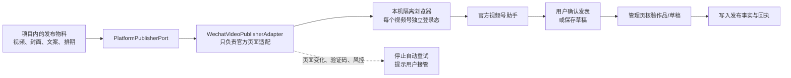

# CreatorOS 接入微信视频号：官方能力与开源方案调研

> 调研日期：2026-08-11
>
> 任务：T-774
> 范围：只做可行性、开源实现与架构适配调研；未登录或操作真实视频号，未修改产品代码。

## 一句话结论

CreatorOS 可以接入视频号，但普通创作者的视频发布目前不应按“稳定公开 API”设计。公开可核验的主入口仍是[视频号助手](https://channels.weixin.qq.com/login.html)网页端；可行方案是 CreatorOS 在用户本机打开官方页面，复用用户扫码后的本地登录态，自动填写视频、标题、描述、封面和排期，并在正式发表前让用户确认。

暂未在微信公开开发文档中找到面向普通视频号创作者、可直接创建日常视频作品的公开发布 API。公开能力更多集中在微信小店、橱窗、直播、电商和小程序跳转。因此，这里“没有公开发布 API”是基于 2026-08-11 可检索公开资料得出的工程判断，不是对微信未来能力的永久断言。

## 用户能得到什么

首个可靠版本可以做到：

- 在 CreatorOS 项目内准备视频、标题、描述、话题、封面和发布时间。
- 用户首次扫码绑定视频号，登录材料只加密保存在本机，并按视频号账号隔离。
- 点击“发布到视频号”后，由本机浏览器进入官方视频号助手，完成上传和填写。
- 最后一步明确展示账号、作品和发布时间，由用户确认“发表”或“保存草稿”。
- CreatorOS 只有在官方作品管理页能确认作品或草稿后，才记录发布事实；不能以“点过按钮”冒充发布成功。

不建议第一版承诺：后台静默发布、批量无人值守发号、稳定读取全量播放互动数据、自动删除或编辑已发布作品。这些能力没有稳定公开契约，网页结构或风控变化都可能使自动化失效。

## 官方边界

| 能力 | 公开可核验状态 | 对 CreatorOS 的含义 |
| --- | --- | --- |
| 视频号登录与作品管理 | 有官方视频号助手网页端 | 可采用本机扫码 + 官方网页自动化 |
| 上传视频、填写文案、封面、定时发布 | 视频号助手页面具备；多个开源实现已验证可操作 | 技术可行，但属于 UI 自动化，不是稳定 API |
| 普通视频作品公开发布 API | 本轮未检索到面向普通创作者的公开接口 | 不按服务端 API 直连设计，不伪造接口稳定性 |
| 小店、橱窗、商品、订单、直播 | 存在公开开发能力和开源 SDK | 与普通视频作品发布是两类能力，不能混为一谈 |
| 播放、点赞、评论等作品数据回收 | 未找到适合普通创作者的稳定公开全量接口 | 第一版采用用户补录链接/作品编号或官方导出；数据回收独立建设 |

腾讯广告的官方合作资料也把合作视频的发布动作指向 PC 端视频号助手，侧面印证当前主路径仍是官方后台，而不是普通创作者发布 API。参考：[腾讯广告视频号合作资料](https://training.tencentads.com/uploads/202406/owOSZqwE_qFRhqg.pdf)。

## 开源项目对比

以下数据是 2026-08-11 的快照，热度会变化。

| 项目 | 视频号能力 | 可借鉴点 | 主要问题 | 结论 |
| --- | --- | --- | --- | --- |
| [dreammis/social-auto-upload](https://github.com/dreammis/social-auto-upload) | 支持视频号扫码登录、视频上传、标题/描述/话题、封面、定时、草稿/发布 | 端到端流程最完整；[`tencent_uploader`](https://github.com/dreammis/social-auto-upload/blob/main/uploader/tencent_uploader/main.py)直接操作官方助手 | 选择器高度依赖页面；README 声称 MIT，但仓库缺少明确 LICENSE 文件，GitHub 元数据也未识别许可证 | 最有价值的工程参考，不建议直接复制代码，先澄清许可证 |
| [gitcoffee-os/postbot](https://github.com/gitcoffee-os/postbot) | 浏览器扩展内填写视频号内容并保存草稿/发表 | 本机浏览器、用户已有登录态、内容脚本进入页面组件的思路 | README 称附加限制的自定义开源许可；浏览器扩展形态与 CreatorOS Tauri 架构不完全一致 | 可参考交互与页面适配，不宜整包引入 |
| [Laihiujin/SynapseAutomation](https://github.com/Laihiujin/SYNAPSEAUTOMATION) | Playwright 视频号上传适配器，带任务队列和外置选择器配置 | 把选择器配置版本化、任务队列、失败后人工接管 | 系统很重；项目规模和视频号实战证据较少；数据回收仍主要支持抖音/B 站 | 可参考“选择器配置 + 任务状态机”，不建议整体嵌入 |
| [zsmhub/wx-channels-sdk](https://github.com/zsmhub/wx-channels-sdk) | 微信小店/橱窗 API | 证明微信确有视频号生态的官方电商 API | 不提供普通视频作品发布 | 仅在未来接小店时使用，不解决当前发布需求 |

开源项目也直接暴露了 UI 自动化的真实维护成本：

- [`social-auto-upload` #252](https://github.com/dreammis/social-auto-upload/issues/252)：2026 年登录页改成 iframe 后，原扫码选择器失效。
- [`social-auto-upload` #262](https://github.com/dreammis/social-auto-upload/issues/262)：封面弹窗隐藏状态导致封面上传失败。
- [`social-auto-upload` #182](https://github.com/dreammis/social-auto-upload/issues/182)：扫码后 Cookie 为空或登录态失效。
- [`SynapseAutomation` #6](https://github.com/Laihiujin/SYNAPSEAUTOMATION/issues/6)：视频号数据回收仍是未完成诉求。

这些不是“某个项目写得不好”，而是说明视频号网页自动化必须被当作可降级、可人工接管的适配器，不能当作永远稳定的官方接口。

## CreatorOS 不是从零开始

当前代码已经有几块可复用基础：

- `contract/src/primitives.ts` 已登记 `wechatVideo` 平台标识。
- `backend/src/modules/platform-account/platform-account.service.ts` 已接受视频号账号类型。
- `backend/src/modules/publishing/platform-publisher.ts` 已提供 `PlatformPublisherPort`，视频号适配器可以藏在端口后面，不污染发布领域。
- CreatorOS 已有本机 Playwright/Chromium、浏览器池和加密保存 `storageState` 的能力。
- 发布中心现有职责是排期与发布事实；视频号上传入口应留在当前项目/发布物料链路，不把发布中心重新做成平台操作后台。

真正缺的是：视频号真实适配器、按账号隔离的登录态、扫码绑定交互、页面能力探测、上传进度、人工确认、可靠发布回执，以及独立的数据回收方案。

## 推荐架构

关键设计约束：

1. **本机执行**：Cookie、localStorage、二维码登录状态不上传云端、不进普通日志。
2. **按账号隔离**：不能继续只按域名共用登录态；同一用户的多个视频号必须有独立 `accountId` 维度。这涉及数据归属变更，正式实现前需要 SPEC 和独立评审。
3. **先协作发布**：首版自动填写和上传，最后发表由用户确认。成熟后再考虑用户主动开启全自动。
4. **失败就交还用户**：页面契约不匹配、验证码、风控或登录过期时立即停下，不无限重试，不重复投稿。
5. **用回执判成功**：只有作品管理页出现对应草稿/作品并取得可核对信息，才记录成功。
6. **选择器可更新**：页面选择器和能力探针独立版本化；一次页面改版不应迫使 CreatorOS 全量发版。
7. **数据回收拆开做**：发布和数据采集不是同一 Gate。先支持用户粘贴作品链接/编号或导入官方数据，再评估经用户授权的页面采集。

## 建议的落地范围

如果后续确认实施，建议一次完整需求只做以下闭环，不同时扩张到评论运营和小店：

- 视频号账号扫码绑定、解绑、登录过期提醒。
- 当前项目的成片、封面、文案、话题、排期发送到官方助手。
- 草稿与正式发表两种明确动作；正式发表前二次确认。
- 上传进度、页面变化检测、人工接管、幂等防重复发布。
- 发布成功后保存作品链接/编号、发布时间和证据截图或结构化回执。
- macOS 与 Windows 各做一次真实账号、真实草稿、真实发布验证；真实发表前单独向用户确认。

暂缓：批量无人值守、多账号轮发、评论自动回复、作品删除、隐藏接口抓数据、视频号小店。它们要么风险更高，要么属于另一套业务能力。

## PoC 验收建议

正式立项前可以先做一个不进主产品的最小验证，验收只看事实：

- macOS、Windows 都能打开官方助手并完成扫码登录。
- 能上传一个测试视频，填写标题、描述、话题和封面，并保存为草稿。
- 第二次启动能恢复正确账号；切换账号不会串 Cookie。
- 故意修改一个页面选择器后，流程会停下并提示接管，不会误点发表。
- 重试同一任务不会生成第二份草稿。
- 不把 Cookie、二维码、账号凭证写入日志或云端。

## 最终建议

值得做，而且 CreatorOS 已经有平台枚举、发布端口和本地浏览器基础，接入成本低于从零开发。但正确定位应是“官方视频号助手的本地协作适配器”，而不是“已获得微信官方发布 API”。

优先采用 `social-auto-upload` 的流程作为事实参考，吸收 `SynapseAutomation` 的选择器外置和任务状态机思路，再按 CreatorOS 自己的安全边界重新实现；不要直接把第三方项目整体嵌入，也不要在许可证不明确时复制其代码。
