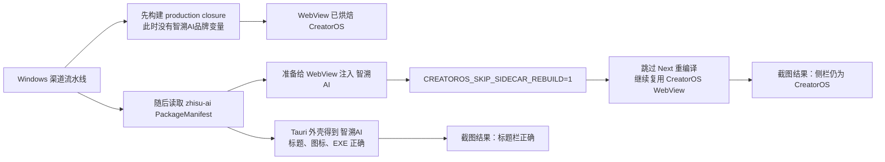

# 智溯AI GitHub 渠道包品牌回归诊断

任务：`T-776`  
日期：2026-08-11  
范围：只读核对 2026-08-10 GitHub Actions、候选提交与当前构建代码；未修改产品代码、未重跑、未发布。

## 一句话结论

不是官方包与渠道包流水线串了，而是 `channel-package` 的 Windows 分支把构建顺序拆错了：它先在不知道“智溯AI”品牌的前提下编译了 WebView/Next 运行时，随后渠道入口虽然注入了品牌，却又被 `CREATOROS_SKIP_SIDECAR_REBUILD=1` 阻止重编译。因此 Windows 原生壳显示“智溯AI”，应用左侧栏仍使用已烘焙的默认值“CreatorOS”。



## 昨天跑的两条流水线

| 用途 | Workflow | 2026-08-10 相关运行 | 结论 |
| --- | --- | --- | --- |
| CreatorOS 官方包 | `desktop-release.yml` | [run 31370130111](https://github.com/zzyong24/Thirdspace-creator/actions/runs/31370130111) 等 | 与渠道包物理分离，没有读取 `zhisu-ai` 清单 |
| 智溯AI渠道包 | `channel-package.yml` | [run 31383743588](https://github.com/zzyong24/Thirdspace-creator/actions/runs/31383743588) | `package_ref=zhisu-ai`，候选提交 `7263a81d6ea3b06cf942d3ba880e2662d0670ddf`，macOS/Windows job 均被判成功 |

成功的渠道运行上传了两个未过期 artifact：

- Windows：`zhisu-ai-windows-x86_64-1.0.0-7263a81d6ea3b06cf942d3ba880e2662d0670ddf`，artifact ID `9061812255`，digest `sha256:b7cafb4c9a210a3b6991c95141b509610c973bfebc32e38e90ce8246c3e608bd`。
- macOS：`zhisu-ai-macos-aarch64-1.0.0-7263a81d6ea3b06cf942d3ba880e2662d0670ddf`，artifact ID `9061786080`，digest `sha256:2a822328e8006f7ad5554329e62f6377aca34ff5c86676ca01b8b5a6c5668927`。

用户截图来自 Windows，且截图中的原生标题栏已是“智溯AI”，应用侧栏仍是“CreatorOS”，与上述分层故障完全一致。

## 物理证据

### 1. 渠道入口本身会正确生成包级品牌变量

`frontend/scripts/desktop/package-channel.mjs:50-68` 从 `PackageManifest` 调用 `compilePackageBrandBuildEnv`，把 `NEXT_PUBLIC_CREATOROS_PACKAGE_BRAND_NAME=智溯AI` 与 ICO data URL 传入真正的桌面构建。这解释了本地渠道包为何正常：本地路径没有在它之前预编译一个官方 WebView。

### 2. Windows CI 在渠道入口之前先编译了一遍 Next

`.github/workflows/channel-package.yml:223-233` 先运行：

`node tools/windows-closure-rat/build-production-closure.mjs --prepare-package`

该步骤的环境只有 verdict、Growth origin 和反馈开关，没有包级品牌名或品牌图标。

`tools/windows-closure-rat/build-production-closure.mjs:14-24` 的首步直接执行 `pnpm -C frontend build`。确定性探针读出的结果为：

```json
{
  "step": "Next adapter production build",
  "brandNameForwarded": false,
  "brandIconForwarded": false,
  "envKeys": [
    "CREATOROS_DESKTOP",
    "NEXT_ADAPTER_PATH",
    "CREATOROS_NEXT_OUTPUT_REPORT"
  ]
}
```

`frontend/src/lib/package-brand.ts:72-92` 会在 Next 构建时读取 `NEXT_PUBLIC_CREATOROS_PACKAGE_BRAND_NAME`；缺失时回退 `CreatorOS`。这是编译期值，不是安装后再自动变化的壳配置。

### 3. 后续渠道构建明确跳过了这次应有的重编译

`.github/workflows/channel-package.yml:235-261` 随后才调用 `desktop:package-channel`，但 Windows 同时设置了：

```text
CREATOROS_SKIP_SIDECAR_REBUILD=1
CREATOROS_PRODUCTION_CLOSURE=1
```

昨天 Windows job 的真实日志进一步确认：

```text
[production-closure] ▶ Next adapter production build
[production-closure]   $ pnpm -C frontend build
...
[desktop:package] ▶ sidecar 二进制化
[build-sidecar] ⏭ CREATOROS_SKIP_SIDECAR_REBUILD=1 且 sidecar 已存在 → 跳过重建
```

对应代码在 `frontend/scripts/desktop/build-sidecar.mjs:2150-2169`。所以渠道入口后来注入的 `NEXT_PUBLIC_*` 品牌变量没有机会进入 WebView 编译产物。

### 4. 为什么标题栏正确、侧栏错误

同一个渠道入口还会生成独立的 Tauri override，里面包含 `productName=智溯AI`、`mainBinaryName=ZhisuAI`、identifier 和图标。这个配置在后续 Tauri 构建时仍然生效，所以 Windows 标题栏、EXE、安装身份正确。

侧栏则由 `frontend/src/components/shell/sidebar.tsx:313-353` 消费 WebView 内的 `PACKAGE_BRAND_NAME`。当已验签 Growth runtime 暂时没有提供品牌名时，它应该回退“当前包品牌”；但本次 Windows WebView 已经提前烘焙成官方默认值，所以错误回退为“CreatorOS”。

## 为什么流水线会全绿

现有 Gate 查了“代码有没有接品牌”和“安装包能不能启动”，没有查“最终安装包内实际烘焙的品牌值”：

- `package-brand-surface.test.mjs` 只静态检查侧栏源码引用了 `resolveVisibleBrandName`，没有读取最终编译产物。
- `channel-package-workflow.test.mjs` 只检查 workflow 形状、双端入口、签名/公证和上传边界，没有约束 production closure 必须接收同一份渠道品牌环境。
- Windows 真机步骤只检查 NSIS、`ZhisuAI.exe`、runtime 指针、主页加载、卸载和未签名边界；`.github/workflows/channel-package.yml:320-365` 没有核对最终 WebView 的品牌常量。
- 本次三个相关契约测试仍为 `3 files / 11 tests passed`，恰好证明这是 Gate 覆盖空洞，而不是已有 Gate 报红被忽略。

## 影响范围

- 已确认：2026-08-10 成功渠道 run 的 Windows artifact 存在该构建顺序缺陷，用户截图即真实表现。
- 高置信判断：macOS job 不执行 Windows production closure，也没有把 `CREATOROS_SKIP_SIDECAR_REBUILD` 设为 `1`，因此不走这条故障路径；本次未下载 artifact、未做额外视觉校验，不能把这条代码推断冒充为 macOS artifact 实测结论。
- 官方 `desktop-release.yml` 与渠道 workflow 没有互相调用；问题不是“下错官方包”，而是渠道 Windows 包内部同时装入了正确渠道壳与错误官方 WebView。
- 当前 `main` 的相关 workflow 与候选提交 `7263a81d` 在这些文件上没有修正差异，问题目前仍存在。

## 最小修复建议（未实施）

1. 让 Windows production closure 的第一次、也是唯一一次 Next 构建发生在渠道清单已经被解析之后，并显式接收由 `compilePackageBrandBuildEnv` 生成的同一份品牌名与图标；不要在 workflow YAML 中手抄“智溯AI”。
2. 保留 production closure 与 `CREATOROS_SKIP_SIDECAR_REBUILD` 的少文件闭包设计，但必须把“被复用的 sidecar 与当前 `packageRef`/品牌输入一致”做成机器校验，失配就失败关闭。
3. 新增一条非视觉、非截图的最终产物契约：从 Windows closure/安装包中的编译产物或构建证明读取包级品牌摘要，断言其等于 `PackageManifest.displayName` 和图标 SHA-256。这样不违反渠道打包已取消截图/像素校验的边界。
4. 修复并通过两端 plan-only、渠道品牌契约和 Windows 安装闭包后，再由用户授权重跑 `channel-package.yml`；不要动官方 `desktop-release.yml`，也不要自动发布或放量。

