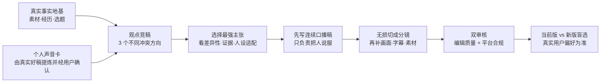

# CreatorOS 文案质量对标诊断

> 任务：T-790
> 日期：2026-08-12
> 对标来源：[《文案三把刀100条爆款文案实战手册》](https://docs.qq.com/doc/DQmxZSlRMb0F3Y2NV)
> 边界：本轮只做只读诊断与优化建议，不复制外部全文，不改提示词、模型配置或生产代码。

## 一句话结论

有办法优化，而且主要矛盾不是“模型太弱”，而是 CreatorOS 当前把成功定义成了**结构合法、事实可溯、能直接分镜、合规可采纳**；用户感受到的“好文案”则更接近**有鲜明观点、有本人经历、有具体冲突、能连续说服人、听起来就是这个人会说的话**。

现有系统已经把安全性和工程可靠性做得很扎实，但“编辑质量”没有成为独立的生成阶段和验收门。因此，只继续往现有提示词里加“更口语、更有钩子”之类的句子，收益会很有限。

## 对标文档到底好在哪里

该文档不是一篇单稿，而是约 11.2 万字、100 条长口播样稿的合集。本轮通过公开只读页面抽看了开头、中段和后段多条，未复制全文。样稿反复使用以下方法：

1. **每篇只打一个主张**：先给一个足够明确、甚至带争议的判断，再围绕它反复推进，而不是平均介绍多个知识点。
2. **作者本人始终在场**：大量使用自己的经历、见过的人、做过的事、犯过的错，观众感受到的是“一个人正在讲判断”，不是资料摘要。
3. **用具体故事承担论证**：房子、电商、创业者、老板、社交、投流等真实情境先出现，道理随后才出现。
4. **冲突很清楚**：投资与投机、聪明与行动、能力与社交、同质产品与差异化等二元张力，能让观众立刻选边。
5. **连续口播感强**：会重复、会追问、会转折，文字不一定精炼，但像人一口气讲出来，不像分镜表里的句子拼接。
6. **细节制造可信度**：步骤、人物关系、动作和数字让内容显得“发生过”。其中部分事实未必可验证，CreatorOS 只能学习其具体化方法，不能照搬未经来源支持的断言。
7. **结尾沿着主张自然收束**：常见做法是给出一句判断、一个行动或关注理由，不突然切成通用“点赞收藏”。

这套样稿也并非每条都值得照抄：它明显偏长、重复较多、部分断言过满，且作者个人销售口吻很强。正确做法是借它的**观点强度、故事密度和连续口播机制**，保留 CreatorOS 已有的事实可溯与不抄袭边界。

## CreatorOS 当前为什么容易“正确但不好看”

### 1. 先写分镜，容易把一段完整说服过程切碎

当前 `script.draft` 直接要求模型输出 `shots[]`，每镜同时填口播、画面、字幕、时长与视觉意图；还要求“一句话只讲一个意思”。这有利于制作，但模型从第一步就同时承担写作、分镜、字幕和素材规划，注意力被工程字段稀释。

结果往往是：每句单看都没错，连起来却没有一股劲，像“钩子一句、痛点一句、价值一句、CTA 一句”的标准答案。

### 2. 系统强调“少论证、多断言”，而对标稿的优势恰恰是会说服

共享的观众心智规则要求“少论证、多断言+演示”。这对极短视频有用，但当选题需要建立新认知时，会让稿子跳过“为什么”。对标稿虽然啰嗦，却持续使用故事、反问、反例和异议回应，让观众被带着走。

应把“少论证”改成按内容类型选择：演示型内容可以少论证；观点型内容必须有最短但完整的因果链。

### 3. 有“定位”，但还没有真正的“个人声音指纹”

现有定位能注入人设、领域、受众、差异化、表达风格和自由文本写稿规则。这些是抽象描述，例如“直接、具体、工程师口吻”；它们无法稳定告诉模型：

- 这个人通常怎样起句、怎样转折、怎样表达不满；
- 他愿意暴露什么经历，不愿意冒充什么身份；
- 他常用故事还是类比，喜欢温和还是锋利；
- 哪些句子一听就是本人，哪些词一听就是 AI。

仓库里已有多条真实历史口播，实际展现出很清楚的个人特征：从具体经历或画面切入、随后给出反常识判断、再解释机制。这些真实成品目前更多作为作品数据存在，还没有被提炼成用户确认过的“声音卡”进入写稿。

### 4. 上游会产论点树和结构，但只产一个方案，容易过早锁死

当前策划默认生成一个核心论点，再生成一个结构方案。模型第一反应如果平庸，后续分镜只会把平庸方案执行得更完整。

真正需要的是先围绕同一事实地基生成少量**不同冲突方向**，由模型按定位、证据和历史表现排序，用户仍只确认最终候选，而不是让用户多做策划工作。

### 5. 现有审核主要审“能不能发”，没有审“值不值得发”

`script.review` 当前负责平台合规、虚假夸大、隐私、导流和资质风险；结构完整性测试主要验证 JSON、分镜数量、角色顺序、可采纳状态和调用稳定性。

目前没有独立门去判断：

- 核心观点是否足够明确；
- 开头是否来自真实冲突而不是模板问句；
- 是否至少有一个可感知的故事或演示；
- 每一段是否推动了观点，而不是换句话重复；
- 是否像该账号本人；
- 结尾是否从主张自然长出来；
- 与现有通用 AI 稿相比，盲选是否真的更好。

这就是“代码看起来全绿，用户还是觉得稿子不行”的根因。

## 建议的新写稿链

### 具体改法

1. **增加“观点竞稿”Skill**
   - 同一事实地基只生成 3 个有明显差异的核心主张；
   - 每个主张必须说明冲突、观众为什么关心、用哪条真实故事或证据支撑；
   - 由模型按当前定位和证据完整度排序，代码只校验范围、来源和结构，不用关键词分数冒充创作判断。

2. **建立用户确认过的“个人声音卡”**
   - 从用户自己 5–20 条认可的真实稿件中，由模型提炼叙事习惯、句子节奏、锋利程度、故事使用方式、常见转折和禁用腔调；
   - 只保存抽象特征与短小示例，不复制外部作者语料；
   - AI 只产候选，用户确认后再作为账号级写稿上下文。

3. **把“连续口播”和“制作分镜”拆成两个语义步骤**
   - 第一步只产一篇能连续念出来的完整稿，重点是主张、故事、冲突和说服；
   - 第二步对已确认口播做无损切分，再补画面、字幕、时长和素材引用；
   - 服务端用原文 hash/片段映射保证切分不偷改稿，延续项目已有的精确保真原则。

4. **新增“编辑质量审核”，与合规审核分开**
   - 质量维度建议为：观点强度、开头具体度、故事/证据密度、因果完整度、人设一致性、口语连贯性、重复度、记忆点、CTA 自然度；
   - 语义判断由可配置模型/Skill 完成，代码只验证引用、版本、schema 与幂等；
   - 审核只给问题定位和最小改法，不直接覆盖用户稿件。

5. **用盲选评测决定是否上线**
   - 固定 10 个真实选题和相同素材，当前链与新链各生成一稿；
   - 隐去来源，让用户或目标观众逐对选择“更想继续看 / 更像本人 / 更可信 / 更愿意行动”的版本；
   - 新链只有在真实偏好显著胜出、事实可溯不回退时才替换默认链。不能用“提示词更长了”当成功证据。

## 一个小示例：差别不是“多几个爆款词”

以仓库已有“AI 装了但产出不好”的真实素材为事实地基，当前常见开头容易写成：

> 为什么你的 AI 装上了，产出效果却不尽人意？

更有人的写法可以是：

> 昨天两个完全不同行业的人，问了我同一个问题：AI 都装好了，为什么活还是干不好？一个做助贷，一个做电商。聊了三个小时，我发现他们缺的根本不是模型，而是一张工作流地图。

后者没有虚构新的成绩，也没有靠“震惊、一定要看”制造假刺激；它只是把已有事实按“人物 → 冲突 → 发现”重新组织，让观点从经历里长出来。

## 推荐实施边界

这不是只改一行提示词的小修。它会改变写稿产物的中间形态、上下游契约和质量 Gate，属于产品实现范围变化，应先补 SPEC 并独立评审，再改代码。

建议确认的完整范围是：

- 新增观点竞稿；
- 新增个人声音卡候选与用户确认；
- 连续口播先生成、再无损分镜；
- 新增编辑质量审核；
- 建立固定样本盲选回归；
- 保留现有事实可溯、外部样稿不照搬、AI 不直接落库和平台合规审核。

## 开工前仍需的最小证据

1. 用户挑 2–3 条“CreatorOS 产出但明显不满意”的原稿，并各写一句最刺眼的问题；
2. 确认仓库现有 5 条历史口播是否能代表希望保留的本人风格；若不能，再提供 5 条本人认可稿；
3. 从本对标合集里指出最喜欢的 3 条编号，避免我们只凭抽样误判用户真正喜欢的是“强观点”“长故事”还是“成交感”。

拿到这三类证据后，可以把本诊断升级为可评审 SPEC，并用同题盲选证明优化是否真的有效。
