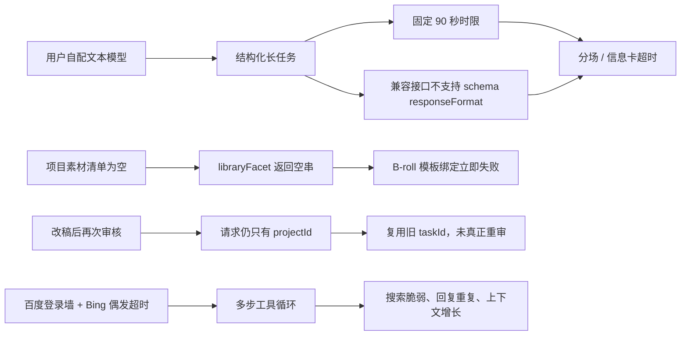

# CreatorOS Windows 自配模型体验异常日志诊断

日期：2026-08-12
任务：T-784
性质：只读诊断，不修改用户配置、用户数据或产品代码

## 结论

本次反馈**与智溯AI渠道配置无因果关系**。用户实际业务调用走的是自己配置的文本模型；日志中即使还存在别的后台同步事件，也不能用来解释本次分场、B-roll、重审、搜索或重复回复问题。

已确认的问题是三类 CreatorOS 自身缺陷，加上一类自配模型适配不足：

1. 自配模型可以调用成功，但结构化长任务常接近或超过 CreatorOS 固定的 90 秒时限，并且所用兼容接口不支持 `responseFormat` schema，导致分场、信息卡和平台适配不稳定；这不是“模型完全不可用”。
2. B-roll 在项目素材清单为空时把 `library` 绑定为空串，而模板又把它声明为必填，模型尚未调用就确定性失败。这是 CreatorOS 代码缺陷。
3. 首次语义审核返回缺少 `category` 的不合格结构，运行态却把任务标为成功；改稿后再次审核又因请求只含 `projectId` 而一直复用旧任务。这是 CreatorOS 审核任务的新鲜度/幂等缺陷。
4. 搜索不是整体不可用：百度持续遇到登录墙，Bing 多数成功，但有一次等待 `networkidle` 超时导致该轮双引擎失败。对话工具循环没有重复文本熔断，前端又把同一回复的所有 text part 原样拼接，因而出现长段重复并增加模型调用和上下文消耗。

## 一、自配模型与视频决策：能用，但不适合当前固定时限与结构化协议

日志明确显示业务请求使用 `creatoros-custom.chat / glm-5-2-260617`，后续切换为 `creatoros-custom.chat / ep-20260805150543-p6lkz`。两者均由用户自行配置，不是智溯AI渠道下发模型。

关键证据：

- `video.scenes` 曾在 33.505 秒、63.064 秒、70.405 秒、77.640 秒内成功，证明模型并非不可用。
- 同一链路的 `video.cards` 多次在约 90.0 秒被固定超时中止；`video.scenes` 也多次正好在约 90 秒失败。
- AI SDK 持续警告该兼容模型不支持 `responseFormat`，只有供应商原生 `structuredOutputs` 才支持 JSON schema。
- 切换到新端点后，分场 45.505 秒成功、信息卡 83.864 秒成功，也进一步证明“配置完全不可用”不是事实。

因此更准确的根因是：CreatorOS 对自配兼容接口只做了基础连通，没有在配置时验证“结构化输出能力 + 典型任务时延”，而运行时又把分场、信息卡、平台适配都套进固定 90 秒硬时限，缺少按步骤的兼容降级和重试策略。

日志中另有用户测试火山 Ark 时填写 `DeepSeek-V4-flash`、`glm-5-2` 等名称后返回 `InvalidEndpointOrModel.NotFound`，以及文本模型接收图片时报 `Model do not support image input`。这些是独立的自配端点/能力填写问题，不能反推为上述 GLM 分场失败的统一根因。

## 二、B-roll：已确认是 CreatorOS 的确定性缺陷

2026-08-12 08:14 起，同一任务先完成：

- `video.scenes`：45.505 秒，成功；
- `video.cards`：83.864 秒，成功；
- 随后 `video.broll` 立即报错：`prompt "video.broll@v4@official" 缺必需 facet: library`。

代码链完全吻合：

- `backend/src/modules/ai-runtime/video-decisions-runner.ts` 的 `libraryFacet([])` 通过 `map().join("\n")` 返回空串；
- 同文件把这个结果传给 B-roll 的 `library` facet；
- `ai-worker/src/prompt/templates/video-decisions.ts` 把 `library` 列为必填；
- `ai-worker/src/prompt/template.ts` 对空字符串直接抛 `PromptBindError`。

模板正文又明确要求“无论清单是否为空，`broll` 都返回 `[]`，但仍可生成 slots”，与必填非空约束自相矛盾。根治应让空清单进入一个诚实的非空占位，或把 `library` 改为可空并补空素材回归测试；不应要求用户先上传无关素材绕过。

## 三、二次审核：首次结构错误 + 改稿后永远复用旧任务

首次审核的真实链路：

- 多次 `review.script` 都得到 `ai-task-850f48c9-2329`；
- L2 语义审核两次结构化尝试均失败，错误是缺少必填字段 `category`；
- 日志随后仍把该任务记录为 `status=succeeded`，用户因而看到一份只有基础规则的残缺报告。

改稿后的真实链路：

- 稿件从版本 3 `artifactversion-850f48c9-2259` 更新到版本 4 `artifactversion-f9b75470-645`；
- 之后每次 `review.script` 仍在 13～14 毫秒内返回旧 `ai-task-850f48c9-2329`；
- 没有新的语义模型调用，说明不是“模型再次审核失败”，而是根本没有创建新审核任务。

当前代码原因明确：`review-gate.service.ts` 创建审核任务时只传 `inputData: { projectId }`；`ai.service.ts` 在未显式提供 `attemptId` 时按用户、账号、任务类型和规范化 `inputData` 生成稳定 attempt。稿件版本没有进入输入，所以同项目每次审核都命中同一旧任务。

根治必须同时做到：

1. L2 结构化审核失败时任务如实失败，不保存或展示为完整成功报告；
2. 审核 attempt 包含当前稿件版本 ID/内容摘要，或使用明确的 retry/new-attempt 语义；
3. 用户改稿后新审核必须产生新 taskId，并以当前版本为真值；
4. 给结构化输出缺字段提供可控的协议纠错或清晰失败，而不是让残缺结果冒充成功。

## 四、搜索：不是全挂，而是双引擎策略脆弱

日志显示：

- 百度在多次查询中约 2.5～3.4 秒即命中登录墙/反爬；
- Bing 随后多数能在约 3.8～4.8 秒返回 10 条结果，`material.gather` 实际成功多次；
- 只有一轮百度失败后，Bing 又因 `page.goto` 等待 `networkidle` 超过 20 秒而失败，导致该轮 `material.gather` 整体失败。

所以页面“本轮浏览器搜索失败”对那一轮是准确的，但把整个会话概括为“完全搜不到”不准确。产品缺口是：已知百度持续命中墙仍每轮先试、Bing 使用容易被长连接拖死的 `networkidle`、缺少搜索引擎熔断和更可靠的官方/学术来源通道。系统没有用模型记忆伪造证据，这个安全边界是正确的。

## 五、重复回复与费用：确有额外消耗，但日志不能给出精确金额

截图中的重复不是单纯的视觉错觉。日志显示一个对话回合可持续 131～139 秒并连续调用多个搜索/阅读工具；上下文一度增长到 41,137 tokens，另一个会话增长到 25,904 tokens，均未触发截断。

当前实现默认允许最多 6 个工具步骤，模型可在步骤之间反复输出文本；没有相邻重复文本检测或循环熔断。前端把同一消息的所有 text part 用 `.join("")` 原样拼接，因此模型在多步工具循环中重复说的进度话术会完整展示。

这会增加模型调用次数与上下文 token，通常也会增加用户自配供应商账号的消耗。日志没有记录这些对话回合的完整输出 token 或供应商单价，所以不能诚实给出具体费用；也不能说它消耗的是智溯AI渠道额度。

## 六、审核规则入口：后端有能力，前端没有真正的管理页面

后端已实现 `reviewRules.list/create/patch/delete`，也有内置规则种子；但当前设置页只有账号、偏好、外观、模型、Skills、存储等页面。`review-rules` 引导目标被映射到 `models` 标签，并没有可编辑审核规则的真实界面。

因此用户找不到不是操作问题，而是产品入口未完成。应在决定开放自定义规则后提供真实的查看、启停、新增、编辑、删除入口；在此之前不要把用户导向模型设置假装那里能管理规则。

## 建议的修复顺序

1. 先修 B-roll 空素材绑定和审核新 attempt/失败诚实性，这两项是确定性产品缺陷。
2. 给自配文本模型增加结构化能力预检、典型长任务时延探测，以及按节点可配置的超时/回退；不要只用一次短对话“测试连接”判定可用于全部智能体任务。
3. 给对话工具循环增加相邻重复文本熔断、同参数工具调用去重和总耗时/上下文预算；前端仅保留一次进度说明。
4. 搜索侧对已命中墙的引擎做会话级熔断，调整 Bing 等待条件，并增加官方/学术来源优先级与声明级证据核验。
5. 若产品确认让用户维护审核规则，再补真实设置入口；否则明确说明当前仅使用内置规则。

## 证据边界

- 结论来自用户提供的六份加密日志解密后只读分析、飞书体验记录中的 11 张截图和当前仓库代码。
- 日志运行目录中的 runtime ID 是安装包 tarball 哈希前缀，不等于 Git commit；仅凭该 ID 无法诚实断言用户安装的是哪一次 GitHub 候选包。
- 本报告不把日志中同时出现但无业务因果的渠道配置同步事件纳入本次根因。
