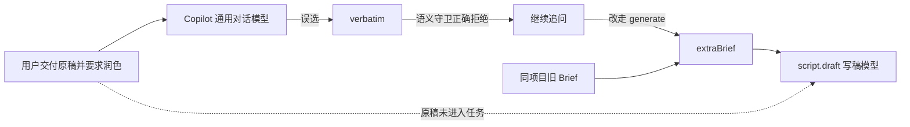

# CreatorOS 资料驱动写稿能力缺口诊断

> 任务：T-791
> 日期：2026-08-12
> 证据：本机真实对话与异步任务 `ai-task-4e0b347d-1293` 只读核对；本报告不修改生产代码、用户稿件或模型配置。

## 一句话结论

当前 `script.draft` 只有“按主题生成”和“逐字保真导入”两条输入路径，没有把用户本轮交付的杂乱资料、文件长文或已有文案可靠送进生成模型的通道。因此通用对话模型能读到原稿，却只能把自己概括出的要求塞进 `extraBrief`；这次它把同项目旧 Brief 当成了新要求，原稿反而没有进入写稿任务。

## 真实证据

1. 用户消息已经包含完整《从聊天框到文件夹》原稿及“基于这个稿子润色一下”，意图与资料同时齐全。
2. Copilot 首先调用 `script.draft(mode=verbatim)`；专用授权守卫识别“润色不是逐字导入”，正确拒绝创建保真候选。
3. 用户再次说“你先写”后，Copilot仍未执行，又要求确认“要不要直接跑”；用户第三次说“跑吧”后才调用 `generate`。
4. 最终任务 `ai-task-4e0b347d-1293.input_data` 只有 `topic/projectId/artifactId/extraBrief`。`extraBrief` 是“4 坑压成 3 坑、400 亿 Token、截图锚点、reviewctl + git diff”等旧项目约束，没有原稿正文、原稿引用、长度或 hash。
5. `script-runner` 普通生成路径只把项目上下文和 `extraBrief` 传给 `runScriptNode`；因此写稿模型不可能忠实执行“基于这份原稿润色”，最终产物只是按旧 Brief 重新创作。

## 根因分层

### 1. 产品能力二分错误

- `verbatim` 能可靠接收原文，但禁止改动；
- `generate` 能创作，但没有受信资料引用；
- “资料驱动创作/基于原稿改写”落在两者之间，无正式契约承接。

### 2. 原文经过错误的中间人

长资料先进入通用对话模型，真正写稿模型只收到通用模型生成的短 `extraBrief`。任何漏项、误读或旧上下文污染都会不可逆地进入成稿。

### 3. 优先级只有提示词，没有执行证据

系统提示虽写着“本轮要求优先于 Brief”，但任务没有记录本轮实际使用了哪些来源，也无法验证旧 Brief 是否盖过本轮资料。

### 4. 缺少真实行为回归

现有测试覆盖“原文不改”的保真路径和提示词文案存在性，未覆盖“完整原稿 + 润色”必须一次直接生成、原稿必须到达 runner、旧 Brief 不得偷渡。

## 产品裁决

`script.draft` 应统一成为资料驱动的写稿工具：用户可以给乱资料、文本文件、长文本、已有文案或多份组合输入，再给调整方向；受信来源由服务端冻结并交给写稿 Skill，Skill 负责资料理解、取舍、结构与表达。`verbatim` 只保留给“一字不改”，不是普通改写的必经路。

详细契约与验收见 [T-791 当前 SPEC](../superpowers/specs/2026-08-12-material-driven-script-draft-tool.md)。
