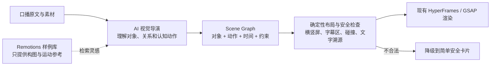

# Remotions 模板项目拆解与 CreatorOS 非固定动效架构建议

**任务**：T-801
**结论**：不要继续为 `cause_effect / sequence / replacement` 各写一套固定画面，也不要把 297 个
Remotion 样例整库搬进 CreatorOS。推荐把这些样例拆成“视觉原语与构图案例”，让 AI 根据每段内容
先生成一个受约束的场景图，再由现有 HyperFrames/GSAP 渲染器确定性执行。

## 一句话大白话

现在的系统像是：AI 判断这是“因果”，代码就拿出固定的纸卷和机器。要改成：AI 判断观众需要看到
什么对象、对象发生什么变化、先后分几拍，再由代码负责把这些对象安全地摆出来、动起来。



## 1. 这个项目实际上是什么

### `templates/`：视觉案例库，不是参数化模板引擎

- 共 297 个 TSX 动效文件和约 283 份修改提示词，覆盖字卡、转场、数据可视化、社交媒体、地图、
  文字特效及 113 个“土拨鼠影片”场景。
- 根索引本身把用途写成“当你有一个动画构思时，在这里找到可复用的模板”。它按进场、出场、
  连续运动、状态转换、强调、进度、布局等“动画要做什么”分类，这套分类值得保留。
- 多数 `prompt.md` 的工作方式是：先人工选中一个组件，再让 AI 修改颜色、文字、数量、速度等常量，
  并返回完整代码。它没有先理解一段口播后自主组织视觉叙事。
- 样例普遍把文字、画布、时间轴和视觉物件写死。静态抽样中 203 个文件含内联中文文字，61 个文件
  出现 `1920`，未发现 Zod 输入契约或 `calculateMetadata`；部分抓取样例甚至包含带连字符的非法
  TypeScript 标识符，不能视为可直接编译的产品组件。
- 例如 `yt-product-overflow` 的价值是“图标从中心向外波浪填满”的运动构思；提示词只允许改图标
  大小、间距、速度和缩放。`yt-narrative-redesign` 的价值是“书本变成网站”的状态转换；其中书、
  网站、文字、颜色和帧数全部写在组件里。

所以它的优势是案例多、视觉动作丰富；弱点是需要人先挑对案例，而且跨主题和横竖屏适配没有形成
产品契约。

### `creative-motion-system/`：已经收敛成固定场景系统

该目录把内容写成 `visual.scenes.json`，再根据 `type` 分派到固定 React 组件。当前可渲染类型主要是
`hook_text / comparison_blueprint / counter_principles / flow_convergence / tool_cards / cta`。

这条链路比 297 个散装文件更工程化，也支持 16:9 与 9:16 的画布尺寸，但本质仍是：`scene.type`
决定一个固定组件。换主题后只替换卡片里的字和数组，长期仍会形成明显的“套版感”。

## 2. CreatorOS 为什么出现同样的问题

CreatorOS 当前 `video.cards` 的 `visualPlan` 只表达两层信息：

```text
relation: cause_effect | sequence | replacement | ...
parts: 原文片段 + role
```

这层语义判断是正确的，也必须保留。但渲染器随后直接用 `switch (relation)` 选择一套具体 DOM 和
GSAP 时间轴：

- `cause_effect` 固定为纸卷 → 机器 → 输出纸张；
- `sequence` 固定为六边形门、路径和回流纸片；
- `replacement` 固定为说明书退出、圆形假设接管。

问题不是“关系枚举太少”，而是把**抽象关系**直接绑定成了**唯一视觉隐喻**。即使再增加 30 个关系，
也只是得到 30 套更大的固定模板库。

## 3. 三种路线判断

| 路线 | 内容适配 | 稳定与安全 | 横竖屏 | 维护成本 | 判断 |
| --- | --- | --- | --- | --- | --- |
| 持续增加完整模板 | 中；必须先匹配到合适模板 | 高 | 每套单独适配 | 极高，数量会持续膨胀 | 只适合作为降级与少量品牌场景 |
| AI 每次直接生成 TSX/HTML/JS | 高 | 低；代码、依赖、性能不可控 | 依赖模型临场发挥 | 高，难以回归测试 | 不作为默认生产链 |
| AI 生成 Scene Graph，代码执行视觉原语 | 高；对象和动作由内容决定 | 高；协议和执行器受控 | 可由统一约束解决 | 中；原语可组合复用 | **推荐作为主链** |

“受约束”不等于“固定模板”。固定模板规定整张画面长什么样；Scene Graph 只规定允许出现哪些对象、
动作和安全边界。对象、数量、层级、位置关系、动作组合和时间节奏由内容共同决定，组合空间远大于
整套模板数量。

## 4. 推荐的四层架构

### A. AI 视觉导演层：回答“这段内容要让人看见什么”

`relation` 继续作为认知标签，但不再充当 renderer 的模板 ID。模型还要产出：

- `cognitiveGoal`：这张画面让观众新增什么理解；
- `entities`：来自口播或已确认素材的可见对象，例如消息、功能块、道路、闹钟、漏斗、档案；
- `beats`：每一拍对象发生什么变化；
- `focus`：当前观众只应注意哪个对象或变化；
- `textAnchors`：需要上屏的原文片段，继续保持可溯源；
- `aspectStrategy`：横竖屏是重排、缩放还是裁剪，不能只改画布尺寸；
- `fallbackIntent`：复杂方案失败时应保留的最低认知动作。

例如“功能越堆越多，用户完成任务反而更难”，不需要命中固定的 `cause_effect` 机器。模型可以选择
“功能块持续挤入，主路径被堵住；非关键功能折叠后，路径重新亮起”。同样是因果，视觉对象来自内容。

### B. 可组合视觉原语层：提供积木，不提供成品答案

建议第一版只开放有限且通用的原语：

- 对象：`text / shape / icon / image / document / device / node / path / chart / container`；
- 状态：位置、尺寸、层级、透明度、颜色、进度、拥挤度、连接状态；
- 动作：`enter / exit / move / grow / shrink / overflow / compress / split / merge / filter /
  replace / trace / reveal / focus`；
- 关系约束：锚点、对齐、跟随、避让、包含、连接、舞台安全区；
- 时间：beat 顺序、持续时间、重叠窗口、强调时刻。

Remotions 的 297 个样例在这一层的价值，是帮助我们提炼“波浪填充、同心收束、翻页、形变、路径
描摹、瀑布流、漏斗、桑基流、轮播”等原语组合与时间曲线，不是直接变成 297 个 `templateId`。

### C. 确定性编排与渲染层：代码只守边界

继续使用现有 HyperFrames/GSAP，不引入第二套视频引擎。执行器负责：

- 将 Scene Graph 编译为安全 DOM/SVG 与 GSAP 时间轴；
- 根据 16:9 / 9:16 和人物是否存在求布局，而不是用固定像素坐标；
- 测量文字、字幕安全区和运动轨迹，阻止静态及中间帧碰撞；
- 只允许已注册原语和属性，不执行模型生成的任意脚本；
- 复杂计划校验失败时降级为简单但正确的视觉句子，不伪造成功。

这符合项目边界：语义和创作选择由 AI 做，代码只做类型、范围、溯源、布局和安全落实。

### D. Pattern Gallery：案例是参考，不是硬路由

可以从 Remotions 清洗出一批“模式卡”，每张只保存：

- 它擅长表达的可见变化；
- 使用了哪些视觉原语和动作；
- 适用的对象数量、时长与画幅；
- 禁用条件和已知碰撞风险；
- 一张预览图或短视频。

AI 可以检索这些案例作为构图参考，也可以混合多个案例的原语；不能规定“因果就必须检索机器模板”。
品牌片头、CTA、字幕、Logo 等确实高度固定的场景，仍可保留少量完整模板。

## 5. 建议的内部 Scene Graph 形状

下面只说明方向，不是已确认产品契约：

```json
{
  "cognitiveGoal": "看见功能堆积如何堵塞用户路径",
  "relation": "cause_effect",
  "entities": [
    { "id": "path", "kind": "path", "semantic": "用户完成任务的主路径" },
    { "id": "features", "kind": "node_collection", "semantic": "不断增加的功能" },
    { "id": "outcome", "kind": "target", "semantic": "完成任务" }
  ],
  "beats": [
    { "action": "trace", "target": "path" },
    { "action": "overflow", "target": "features", "affects": "path" },
    { "action": "compress", "target": "path" },
    { "action": "filter", "target": "features" },
    { "action": "reveal", "target": "outcome" }
  ],
  "textAnchors": ["功能越堆越多", "用户完成任务反而更难"],
  "constraints": { "avoidSubtitles": true, "avoidPresenter": true, "maxTextLines": 2 },
  "fallbackIntent": "用功能块挤压路径，至少保留拥堵结果"
}
```

同一个 `cause_effect`，换成熬夜主题时可以是通知把睡眠时间条逐段吃掉；换成内容生产主题时可以是
素材涌入但发布轨道保持为空。它们共享 `overflow / compress / reveal` 原语，不共享固定机器画面。

## 6. 自动生成 Loop

每张重要动效不应只生成一个答案：

1. AI 基于同一内容生成 2–3 个不同 Scene Graph 候选，强制候选使用不同视觉对象或变化机制；
2. 确定性预检先淘汰原文不可溯源、属性越界、元素过多、横竖屏无策略的候选；
3. 低清预渲染关键帧与 3–5 秒短样；
4. 自动评尺分别打分：内容相关性、认知增量、静音可读、非套版感、文字安全、横竖屏适配、渲染稳定；
5. 选择总分最高且无硬失败的候选；全部失败就降级，不勉强上线复杂动画；
6. 用户实际选择、替换和放弃记录为后续评尺数据，不把一次审美偏好硬编码成业务词表。

硬失败至少包括：编造原文没有的对象结论、文字/人物/字幕碰撞、运动轨迹穿字、关键关系只能靠文字
解释、画幅切换后主体出界、执行器不认识的原语或属性。

## 7. 建议的落地顺序与确认门

这是产品内部契约与渲染编排方向的变化，不能直接在 T-794 上继续堆代码。建议用户确认方向后新建
SPEC，一次完成以下闭环：

1. 把 `visualPlan` 从“关系 + 原文片段”升级为兼容旧数据的 Scene Graph v2；
2. 先提炼 10–15 个通用对象/动作原语，而不是迁入完整 Remotion 组件；
3. 做 3 个跨主题、横竖双版、每题 3 候选的真实生成 Loop；
4. 旧 `visualPlan` 继续由现有 renderer 渲染，作为兼容与失败降级；
5. 用实际样片验收后，再决定是否增加原语或清洗更多 Remotions 案例；
6. 任意 AI 代码生成模式留到后续独立安全评审，不进入默认本地包。

## 8. 本轮边界

本轮只完成只读拆解和方向判断，没有复制或修改 `/Users/zyongzhu/Workbase/remotions`，也没有修改
CreatorOS 的 `video.cards` 契约、渲染器和已安装 Skill。待用户确认“Scene Graph + 视觉原语 + 案例检索”
方向后，再进入 SPEC 与实现。
