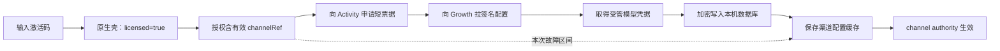

# Windows 渠道激活后获取不到渠道配置诊断

日期：2026-08-12（飞书提交时间按 Asia/Shanghai；日志原始时间为 UTC）

## 结论

这不是“激活码没激活成功”，也不是智溯AI Windows 包漏写渠道名或渠道配置开关。

用户在 2026-08-12 16:26:42（北京时间）重启后，原生壳已经判定 `licensed=true / status=active`；
随后本地渠道配置同步连续五次进入 `unexpected_failure`。代码只有在异常不是已分类的
`ClientConfigPullError` 时才记录这个结果，因此已经可以排除下列已知分支：未启用配置同步、缺构建
验签参数、没有有效授权、签名授权缺 `channelRef`、普通网络不可达、Activity/Growth 已分类拒绝、
bundle 签名或格式校验失败。

真实断点位于“读取到有效渠道授权”之后、“配置完整落盘并成为 channel authority”之前。仍需在
Activity ticket、Growth bundle/受管凭据、本机受管凭据写库、本机渠道配置缓存落盘四个子步骤中
精确区分；当前 1.0.0 日志把这四类未知异常合并成同一个 `unexpected_failure`，没有记录安全阶段码、
Growth correlation ID 或异常类别，因此仅凭本次附件不能诚实断言是哪一行抛错。

结合代码路径，最高风险点是 Growth 已返回配置后，本机把 `omnihi-main` 受管凭据加密写入
`channel_model_credentials`，以及随后保存 `.channel-model-config`；这两处文件系统、PGlite、磁盘空间
或密钥写入异常都会原样冒泡并被压成当前日志。它是“优先核验项”，不是已经证明的唯一根因。



## 飞书反馈与日志事实

- 多维表格：`CreatorOS 官方问题反馈 / 问题反馈`。
- 记录：`rec27Yin0l8iJV`，2026-08-12 16:30:41（北京时间）。
- 摘要与描述均为“获取不到渠道配置”，应用版本 `1.0.0`。
- 附件为两份 Windows sidecar 加密日志；诊断过程只在本地临时目录解密，没有把激活码、ticket、
  token 或完整机器标识写入报告。
- 16:24:48 首次启动为 `licensed=false / activation-only`，启动配置同步被阻断符合预期。
- 16:26:42 激活后重启为 `licensed=true / active`，sidecar 以 licensed 模式启动且启动哨兵通过。
- 16:26:47–16:27:02，`startup/bootstrap` 配置同步连续五次为
  `reason=unexpected_failure,status=retryable`。
- 同期的 `AccountRequiredError` 来自 `projects.list`、`ingestion.douyin.status`、
  `pages.positioning.get` 等按抖音账号隔离的页面读取；它说明尚未绑定/选择抖音账号，但受管渠道凭据
  按 `userId + channel scope + serviceId` 保存，不依赖 `accountId`，不能把它当作本次渠道同步根因。

## 包与流水线核对

- 用户反馈包对应 GitHub Actions `channel-package` run `31573517536`，Windows job
  `94040606124`，候选提交 `cb9f5a81227fb893cb0731e1ad61a95a98d98173`。
- 渠道清单固定 `packageRef=zhisu-ai`、`projectKey=creatoros`、
  `expectedChannelRef=partner-p501444c`。
- 最终“构建渠道正式安装包”步骤实际注入：
  `CREATOROS_CLIENT_CONFIG_PULL_ENABLED=1`、
  `CREATOROS_GROWTH_CLIENT_CONFIG_ORIGIN=https://growth.aitongban.cloud`、
  Growth 配置公钥与 `growth-client-config-20260805-01` key ID。
- Rust 壳会把上述编译期值再次注入 Windows sidecar；并非只在 GitHub job 环境里存在。
- 候选提交含 `backend/drizzle/0067_channel_model_credentials.sql`，Windows 闭包策略保留
  `backend/drizzle` 运行资源。因此“完全没把建表迁移提交进候选”也可排除；仍不能仅靠构建日志证明
  用户机器上的迁移/写入在运行时成功。

## 为什么现有日志不能继续定位

本地 route 只对 `ClientConfigPullError` 保留稳定分类；任何其他异常都只记录：

```text
phase=config_sync reason=unexpected_failure status=retryable
```

实际未知异常来源至少包括：响应体读取异常、本地配置缓存文件读写/rename/fsync 异常、
`channel_model_credentials` 加密写入异常、数据库/磁盘异常。route 没有输出安全的 `failureStage`、
`errorName/errorCode`，也没有保留 Growth `X-Correlation-ID`。Growth 已具备按 correlation ID 反查生产
日志的能力，但客户端这次把该编号丢掉，无法将 16:26 的请求与服务端事件一一对应。

跨仓发布流程也留下了明确证据缺口：Activity v3 与 Growth 生产能力已上线，但 `J-142` 仍没有绑定
真实渠道激活码、已部署 CreatorOS 包和生产 URL 的非 fixture 回执。安装包构建/启动通过，只证明
应用能安装和打开，不证明“真实激活 → ticket → bundle → credential → 本机落盘”主链完成。

## 最小根治建议（未实施）

1. 给渠道同步增加安全阶段码：`license_ready`、`ticket_issued`、`bundle_verified`、
   `credential_received`、`credential_stored`、`cache_stored`；只记录阶段、稳定错误类别和参考编号，
   不记录 code、machineId、ticket、token、channelRef 或配置正文。
2. 将本机凭据/缓存写入错误收敛为明确的 `CLIENT_CONFIG_STORAGE_UNAVAILABLE`；区分
   `ENOSPC/EDQUOT`、权限、数据库迁移、主密钥与未知写入错误，并给用户可执行提示，禁止继续显示
   含糊的“稍后重试”。
3. 把 Growth 成功响应的 `X-Correlation-ID` 安全带入本地诊断日志；Activity ticket 路径也补同等级
   参考编号，支持服务端反查。
4. 增加真实 Windows 安装闭包回归：全新本机数据库和存量数据库各跑一次
   `activation → config ticket v3 → signed bundle → managed credential → encrypted DB → restart readback`。
5. 在下一次渠道包对外分发前补齐 `J-142` 非 fixture 生产回执；未闭环时不能用 NSIS 安装/启动 PASS
   代替渠道模型可用性 PASS。

## 当前判断分级

| 判断 | 置信度 | 证据 |
| --- | --- | --- |
| 激活成功 | 已证实 | 壳日志 `licensed=true,status=active` |
| 包含配置同步开关和验签参数 | 已证实 | GitHub job 最终构建环境 + Rust sidecar 注入代码 |
| 授权快照含 `channelRef` | 已证实 | 缺失时会记录 `activation_scope/signed_channel_ref_missing`，本次没有 |
| 未绑定抖音账号是同步根因 | 已排除 | AccountRequired 位于其他按账号读取；凭据存储不要求 `accountId` |
| 失败发生在本机凭据/缓存写入 | 优先怀疑，未证实 | 这是主要未分类异常来源；现有日志没有阶段码 |
| Activity 或 Growth 返回已知业务拒绝 | 低概率 | 已知拒绝均会映射为 `ClientConfigPullError`，不会出现当前日志 |
