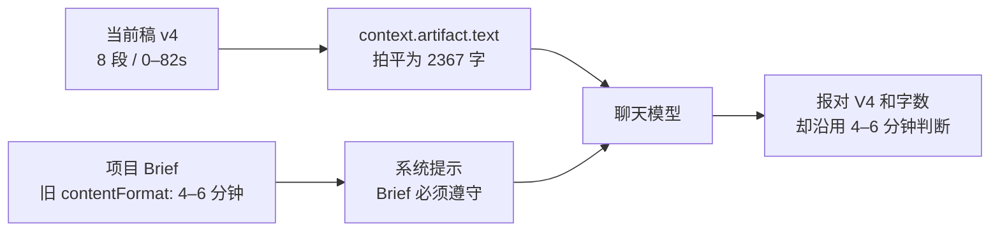

# 当前稿读取后仍按旧约束判断的诊断

> 日期：2026-08-13（America/Los_Angeles）
> 任务：T-817
> 范围：只读核对用户截图、当前项目服务端稿面、最近安全日志与源码；未修改业务代码、正式数据库、模型配置或发布包。

## 一句话结论

用户感受到的“它又拿旧稿说事”是成立的，但这张截图对应的技术事实更精确：**编导已经成功读到了当前 v4 正文，却没有让当前稿成为最高内容真相；它被项目 Brief 里遗留的“4–6 分钟”旧约束压住，并把这个旧约束伪装成了“按文案本身判定”。**

所以不能只修成“回答前再读一次当前稿”。本轮已经读了，再读一次仍会复现。必须同时解决版本可审计、字段语义、冲突优先级和旧 Brief 降权。

## 这一次到底读到了哪一版

当前项目：`project-016270fc-622`。服务端稿面显示：

- 脚本 artifact：`artifact-016270fc-707`
- 当前版本：`artifactversion-016270fc-1199`
- 版本号：v4
- v4 摘要：`收口句换成架构设计剖析(优点+代价+照搬建议更新)`
- 当前稿：8 段，标题时间码从 `0–12s` 连续到 `72–82s`
- 第 7 段：508 字，与用户截图左侧内容一致

最近安全日志同时显示，本轮对话确实调用了两个读工具：

| 日志时间（UTC） | 调用 | 结果 |
| --- | --- | --- |
| 15:45:49 | `context.artifacts` | `ok` |
| 15:45:51 | `context.artifact.text` | `ok` |
| 15:46:09 | 对话完成 | 正常返回 |

最关键的交叉验证是字数：当前 v4 的 8 个标题共 270 字、8 段正文共 2075 字，加上当前纯文本拼接使用的 22 个换行分隔符，**正好是 2367 字**。右侧编导报出的也是“V4，2367 字”。

因此，这一例可以排除：

- 没调用当前稿读取工具；
- 读成 v2 或 v3 正文；
- 项目绑定到了别的作品；
- 当前正文在传给模型前被截断。

## 它为什么仍像在读旧稿

当前项目 Brief 的 `contentFormat` 仍是：

> 口播 + 全程屏幕录制……适合中长视频（4–6 分钟）……

但当前 v4 的 8 个段落标题已经明确标成总长 `0–82s`。编导最后仍断言“按文案本身判定，是 4–6 分钟”，这句话混淆了两个来源：

1. `4–6 分钟` 来自旧项目 Brief；
2. `V4、2367 字、第 7 段内容` 来自当前稿。

源码中的提示词正好会放大这个冲突：项目 Brief 被渲染成“本条内容立项硬约束——必须遵守”，而“先调 `context.artifact.text` 读当前版本”只要求模型读取，并没有规定**当前已确认稿与旧 Brief 冲突时谁优先**。模型于是既读了 v4，又继续服从旧 Brief。

另外，2367 是“标题 + 口播 + 画面 + 字幕”的总字符数，不是口播字数。当前 8 段真正标为“口播”的内容约 934 个非空白字符。现有全文工具把这些字段拍平成一段普通文本，没有返回结构化的段型、起止时间、口播、画面和字幕，模型很容易拿总字数估口播时长。

这里还有一个应该被诚实指出的稿件内部矛盾：934 个口播字符要塞进 82 秒，节奏明显偏紧。正确行为不是偷偷退回旧 Brief 的 4–6 分钟，也不是盲信任一个字段，而是明确告诉用户：**当前稿的正式时间码定义为 82 秒，但口播量与时间码不相称，请以当前稿为第一真相并把这个冲突标出来。**

## 当前链路

大白话说：最新稿已经送到编导桌上了，但桌上还压着一张写有“4–6 分钟、必须遵守”的旧便签；系统没有告诉它最新稿与旧便签冲突时应以最新稿为准。

## 代码与可观测性缺口

### 1. 全文结果没有版本身份证

`context.artifact.text` 当前只返回：

- `artifactType`
- `text`
- `offset`
- `totalChars`
- `hasMore`

它不返回 `artifactId`、`currentVersionId`、`versionNumber`、`updatedAt` 或正文 hash。模型和日志都无法证明“这段文字属于哪一版”。本次只能靠 2367 字和页面内容做外部交叉验证。

### 2. 产物索引和正文不是同一个版本快照

`context.artifacts` 的版本号取“最大 `versionNumber`”，正文和字数却取 artifact 的 `currentVersionId`。当前项目恰好两者都是 v4，所以不是本次直接原因；一旦用户恢复到较旧版本，索引可能报最大版本号，正文却读恢复后的 current，形成确定性的元数据错配。

### 3. 稿面与全文工具的正文优先级不一致

稿面优先渲染当前版本的 `contentData.sections`；全文工具则优先 `contentData.transcript`，再取 `contentText`，最后才拼 `sections`。如果同一版本同时保留了旧 transcript 和新 sections，页面会显示新段落，编导却可能读到旧 transcript。

本项目这次 2367 字与稿面完全吻合，说明这个潜在分叉没有在本轮触发，但它是同类问题的真实复发入口。

### 4. 日志只记“工具成功”，不记返回版本

安全日志能证明工具调用 `ok`，不能看到该次返回的 artifact/version/hash、总字数和窗口范围。因此遇到用户说“你读的是旧稿”时，系统无法直接区分：

- reader 真读错版本；
- reader 读对，但模型被旧 Brief 或历史对话覆盖；
- 同一版本里的 transcript 与 sections 已经分叉。

### 5. “读取当前稿”不是“当前稿优先”

当前系统只建立了动作约束：评价稿件前要调用读取工具。它没有建立内容优先级：

1. 用户本轮明确要求；
2. 当前项目中用户最后确认并正在使用的稿件版本；
3. 当前稿绑定的分镜/段落；
4. 当前稿引用的事实证据与项目素材；
5. 项目 Brief、定位和历史调研；
6. 历史对话、旧版本、未采纳候选。

这正是“能力明明有、上下文也读了，但最终没起作用”的根因。

## 修复边界（并入 T-816，待 SPEC 评审）

1. 把“用户最后确认并正在使用的当前稿”设为配图、封面、审核和稿件问答的第一内容真相；“最后生成但未采纳”的候选不能自动夺权。
2. 当前稿与 Brief/定位/历史调研冲突时，明确列出冲突并以当前稿执行；只有用户本轮要求、安全、事实和版权边界可以覆盖它。
3. 给当前稿快照返回并保存 `projectId + artifactId + currentVersionId + versionNumber + updatedAt + contentHash`，让对话、生成任务和日志都能审计。
4. `context.artifacts` 与 `context.artifact.text` 必须绑定同一份 current-version snapshot，不能一个取最大版本、一个取 current 指针。
5. 对脚本返回结构化字段：段型、标题、起止时间、口播、画面、字幕、素材引用；时长优先读正式时间码，字数估算只用于发现冲突，不能覆盖时间码。
6. 统一稿面和 AI reader 的正文选择规则；若 transcript、contentText、sections/hash 不一致，显式报冲突，不能静默选一份。
7. 运行日志至少记录脱敏后的 artifact/version/hash/字数/窗口，不记录正文；这样才能定位“读错”和“用错”。
8. 增加真实回归：先生成 v3，再局部采纳成 v4，同时保留旧 Brief；询问当前时长、结构和配图，必须引用 v4 的版本号与时间码，并指出口播量冲突，绝不能回答旧 Brief 的 4–6 分钟。

## 诊断边界

本次可以确定：编导调用了当前稿读取工具，当前项目绑定正确，返回字数与 v4 完全一致，旧的“4–6 分钟”来自项目 Brief，而不是旧脚本正文。

本次没有直接读取过去那次工具返回的完整 payload，因为现有日志未记录它；“2367 字完全相等”是强交叉证据，不是日志中的正文转储。本次也没有修改当前 Brief 或稿件，避免诊断动作改变用户真实创作状态。
