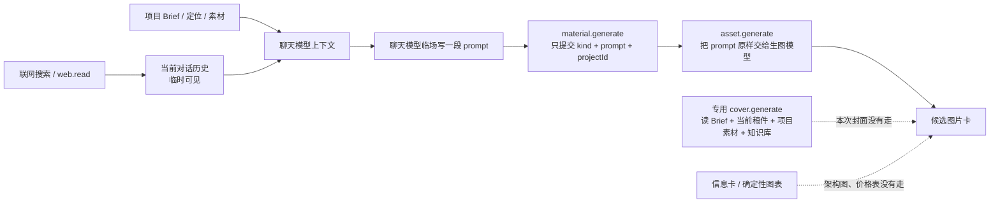

# 文生图上下文与任务状态误报诊断

> 日期：2026-08-13（America/Los_Angeles）
> 任务：T-815
> 范围：只读解密本机最新安全日志、核对用户截图与当前源码/安装包；未修改业务代码、正式数据库、模型配置或发布包。

## 一句话结论

这次不是“生图没成功”，也不是“整段上下文都被截掉”。真实情况是：**3 张图在提交后约 27–28 秒已经全部生成候选，但编导仍拿提交瞬间的 `queued` 快照回答；研究、稿件和项目信息虽然部分进入了聊天模型，却没有成为通用生图任务的结构化、可追溯输入，模型又把架构图、数据表和封面全部误路由到同一个自由文本生图工具。**

因此用户感受到的“上下文割裂”是成立的，但要拆成两类问题：

1. 状态真值割裂：卡片已经有结果，对话仍按旧工具回执说“还在跑”。
2. 创作上下文割裂：资料能影响聊天模型的临场措辞，却没有被固定成“这张图服务哪一句、用哪份证据、该走哪种媒介、最终消费了哪些上下文”的任务快照。

## 真实时间线

日志来源：本机最新 `sidecar-2026-08-13-8.log.enc`，只在内存/标准输出中解密筛选，没有把明文日志写进仓库。

| 时间（日志 UTC） | 真实事件 | 结论 |
| --- | --- | --- |
| 15:22:04 | `web.read` 成功 | 生成前同一项目对话确实读过网页正文 |
| 15:27:22 | `context.materials` 成功 | 编导主动查过当前素材上下文 |
| 15:27:26 | 两次 `material.gather` 成功 | 生成前又做了两轮联网搜索 |
| 15:27:53 | 对话装配约 30,776 tokens，`cleared=0`、`truncated=0` | 本轮没有因上下文压缩把历史清空或截断 |
| 15:28:08 | 三次 `material.generate` 返回任务 `1228/1229/1230` | 工具回执只代表“已排队”，不是之后的持续真值 |
| 15:28:35–36 | 三个 `asset.generate` 全部变为 `awaiting_confirmation`，各有 1 个候选 | 截图里“图明明已生成”与日志完全一致 |
| 15:29:01 | 下一轮对话开始装配 | 此时三张图已经完成约 25 秒 |
| 15:32:08 | 该轮因模型 HTTP 529 重试耗尽失败 | 失败与生图任务无关 |
| 15:33:21–30 | 用户重试后对话成功返回 | 此时三张图已完成约 4 分 45 秒，仍回答 `queued` 明显错误 |

日志已经足以排除“图片仍在后台生成”这一解释。正确用户状态应是：**候选已生成，等待查看或采纳进素材库。**

## 现在的真实链路

大白话说：系统把很多资料摆在编导桌上，但通用生图任务真正带走的只有编导临场写出的那一段提示词。资料来源、稿件版本、对应分镜、事实证据和“为什么值得画”都没有随任务一起保存。

## 三张图分别错在哪里

### 第 1 张：四层架构图

它确实消费了稿件第 3–6 段的 Cordis、组件、模式、事件流等信息，所以不能说上下文完全没作用。

但媒介选错了。稿件原本要求“屏幕录制，在绘图工具里逐层画架构图”；实际却让生图模型一次性烧入 14 组中英文标签。用户截图已经看到文字模糊、错拼和结构难读。这类精确层级、精确标签的内容应由 SVG/画板/信息卡确定性绘制，生图只适合无文字的机制类比画面。

### 第 2 张：价格表

它消费了调研中的价格数字，但没有对齐最终稿件的画面职责。当前稿件只在 0–12 秒提到“API 要涨价，涨幅还挺大”，后续主体转向 Harness 架构；单独做一张详细价格表并没有对应的主要分镜段。

更严重的是，这是一张要求数字逐字准确的数据图，却走了文生图。截图已经出现 `0.02 → 0.2`、标签乱码和列关系不清。现有 T-792 评尺明确规定 `info_card` 交给信息卡/图表，不让生图模型画数据卡；本次实时路由违反了这条边界。

### 第 3 张：信息流封面

它抓到了“一切皆插件”“Harness”“28K star”等内容钩子，但错误调用了 `material.generate`。当前产品已经有专用 `cover.generate`：会服务端读取项目 Brief、当前稿件、项目素材和知识库，先产结构化封面方案，再做事实校验和生图；通用生图工具的说明也明确写着“生成封面请改用 `cover.generate`”。

本次绕过专用封面链，导致封面只靠聊天模型临场组织的自由文本，没有结构化方案、稿件版本锚点或数字出处快照。即便图片能看，系统也无法证明 `28K` 来自哪次读取、是否仍与当前稿件一致。

另外，当前专用封面链仍要求生图模型直接烧入指定中文标题。对于必须逐字准确的中文封面，最稳的方式应是“生图只产无字主视觉 + 本地确定性排版文字”；这是后续修复需要评审的范围，本次只记录缺口，不修改实现。

## 根因

### 根因 1：`material.generate` 的任务契约太薄

当前工具最终只把以下字段写进 `asset.generate`：

- `kind`
- `prompt`
- `projectId`（有项目时）

没有保存：

- 对应稿件版本/分镜段；
- `visualPurpose`、`visualClaim`、`reason`；
- 联网来源或项目素材引用；
- 事实/信息卡/类比/封面的媒介选择；
- 实际消费的上下文字段与覆盖度；
- 生成前后的 prompt 方案版本。

因此现有 T-792 的“内容辅助规则”主要存在于工具说明中，是给聊天模型看的建议，不是任务执行层的硬契约。模型一旦忽略说明，后端仍会照常生成。

### 根因 2：实时路由没有把内容职责变成确定性边界

当前源码和安装包都已包含 T-792 的提示词纪律，但本次仍出现：

- `info_card` 架构/价格图走文生图；
- 封面绕过 `cover.generate`；
- 精确文字和数字直接交给图像模型。

这说明之前的评估主要证明“新版 prompt 文本写得更好”，没有覆盖“真实对话是否选对工具、是否拒绝不适合生图的媒介、是否真的带上当前稿件和证据”。现有测试能检查工具描述里有没有这些规则，不能证明运行中的模型会服从。

### 根因 3：联网资料仍主要是会话临时上下文

同一对话里 `web.read` 与搜索结果没有被截断，所以这次不是上下文窗口丢失。但网页正文是否成为后续项目长期上下文，仍取决于是否保存、关联并被后续 reader 读取；当前 T-813 正在修“读全文 → 临时上下文 → 保存项目 → 长期上下文 → 全文预览”闭环。

因此：

- 同一轮里，模型可能记得网页内容；
- 换会话、重开项目、走专用 runner 时，未保存资料不会自动成为项目证据；
- 即使同轮记得，通用生图任务也只保存最终 prompt，无法审计到底用了哪份资料。

### 根因 4：任务状态有新旧两份互相冲突的上下文

`material.generate` 工具提交瞬间固定返回 `status: "queued"`，这条旧回执会留在对话历史；真实后台任务随后变成 `awaiting_confirmation`。

当前代码虽已有“每轮注入近期任务真值”的补丁，但它仍是 best-effort 的提示词：读取异常会被静默吞掉，成功读取后也仍靠模型在约 32k 上下文中覆盖紧邻任务卡的旧 `queued` 回执。本次结果说明这个保护不是确定性的。

这里缺少两件硬机制：

1. 按 taskId 把历史工具结果的旧状态投影成当前状态，或在回答任务状态问题时走确定性查询；
2. 记录本轮到底注入了哪些 task truth，避免读取失败与模型忽略无法区分。

## 与现有任务的关系

- **T-813**：解决联网正文从临时阅读到项目长期素材的闭环；必要，但不会自动解决生图工具选错、任务只存自由 prompt。
- **T-814**：解决多页面助手和会话作用域割裂；必要，但统一会话后若仍把状态和上下文只交给模型自由理解，问题仍会复现。
- **T-792**：方向正确，已经提升了静态提示词方法，但这次证明验收范围缺少真实对话路由、结构化上下文快照和成图媒介纪律。

## 建议的修复边界（待用户确认后另开实现任务）

1. 先做生成前的“视觉任务单”：绑定项目、稿件版本、分镜段、内容职责、视觉主张、证据引用、媒介选择和画幅；用户可看见这张图为什么生成。
2. 硬分流：真实证据走截图/网页；数据和精确架构走信息卡/确定性图表；封面走 `cover.generate`；只有类比、机制、对比、后果和氛围才走通用生图。
3. 通用生图任务保存结构化上下文快照和来源引用，而不是只保存最后一段 prompt；后端校验不允许 `info_card/fact_evidence/cover` 偷渡到裸生图。
4. 中文封面采用“无字主视觉 + 确定性文字排版”，不再要求图像模型承担逐字准确的标题、数字和命令行。
5. 任务状态问答按 taskId 实时查询并确定性渲染；模型只能解释状态，不能决定状态。旧 `queued` 工具回执必须被新状态覆盖。
6. 增加真实回归：同一项目先联网阅读全文、再写稿、再生成架构图/价格图/封面，验收每一步的来源、路由、提示词快照、成图和任务状态，而不是只比较静态 prompt 文本。

## 诊断边界

本次可以确定：任务真实终态、对话未发生上下文截断、三张图的错误工具路径、通用任务只消费自由 prompt，以及专用封面链被绕过。

本次无法仅凭现有日志区分“任务真值 reader 当轮读取失败”与“真值已注入但模型忽略”，因为 reader 失败被静默吞掉，日志没有记录注入的 taskId/status。两种情况都由同一个设计缺口造成：任务状态仍靠提示词而不是确定性读回。
