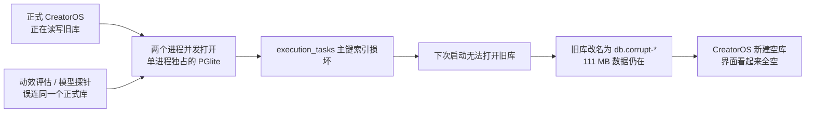

# 本机 CreatorOS 数据“都掉了”诊断报告

> 日期：2026-08-13（America/Los_Angeles）
> 范围：T-809，只读诊断与风险止血；未关闭 CreatorOS，未启动迁移，未修复、复制、移动、替换或删除任何用户数据库。

## 结论（大白话）

数据没有被删除。原来的 CreatorOS 本地数据库目录和文件仍保留在：

`~/Library/Application Support/cloud.aitongban.creatoros/db.corrupt-1786622723008`

旧库约 **111 MB**。CreatorOS 在 2026-08-13 05:05:23 无法打开它，于是按现有保护逻辑把旧目录改名隔离，并新建了一个约 **32 MB** 的空库。当前应用读取的是这个新库，所以界面看起来像“数据全掉了”。旧库文件尚在不等于数据库已经通过完整性校验；具体可恢复记录数必须在备份副本上离线核验，不能为拿一个数字冒险直接打开原件。

导致旧库损坏的高度可信根因，是昨晚用于 T-800 动效评估和模型探测的本地脚本误用了正式 CreatorOS 的 `appDataDir`。这些进程与当时正在运行的 CreatorOS 同时打开同一个 file-PGlite 目录，而项目代码本身已经明确规定该目录只能由单个进程独占。测试进程又在模型调用卡住后没有走到关闭数据库的代码，持续存活约 8.5 小时。

这组测试是本次开发调试产生的，不是用户操作导致。诊断期间已仅停止这些明确识别出的测试/探测进程；正式 CreatorOS 和它的 sidecar 没有被关闭。



## 证据链

### 1. 当前安装包没有读错目录

- 正式应用：`/Applications/CreatorOS.app`
- bundle id：`cloud.aitongban.creatoros`
- 当前实际数据根：`~/Library/Application Support/cloud.aitongban.creatoros`
- 当前 CreatorOS 及 sidecar 正常运行，当前库只由 sidecar 持有。
- 另一个渠道包 `智溯AI.app` 使用 `com.zhisunet.zhisuai` 独立目录；它不是当前正式 CreatorOS 的数据源。

因此可排除“打开了另一个渠道包目录”这一解释。

### 2. 旧数据仍在，当前库是事故后新建的

| 数据目录 | 大小 | 创建/来源 | 当前状态 |
| --- | ---: | --- | --- |
| `cloud.aitongban.creatoros/db.corrupt-1786622723008` | 111 MB | 2026-08-04 起使用的原库 | 已隔离，当前无人持有，未删除 |
| `cloud.aitongban.creatoros/db` | 32 MB | 2026-08-13 05:05:23 新建 | 当前 CreatorOS 正在使用 |
| `com.zhisunet.zhisuai/db` | 34 MB | 智溯AI 渠道包独立库 | 与当前问题无关 |

正式数据根下没有 `db.archived-*` 和 `reset-pending.json`，所以不是用户执行“重置工作区”后的归档恢复问题。

### 3. 数据库先出现明确的索引损坏

脱密日志从 2026-08-12 22:30（本地时间）开始，每 15 分钟反复出现：

```text
right sibling's left-link doesn't match ... in index "execution_tasks_pkey"
```

这是 PostgreSQL/PGlite B-tree 索引链损坏，不是普通模型错误、账号过滤或界面加载失败。错误一直持续到旧进程退出。

### 4. 05:05 的启动明确执行了“隔离旧库 + 新建空库”

脱密日志记录：

```text
PGlite 落盘目录损坏打不开(RuntimeError: Aborted());
移至 .../db.corrupt-1786622723008 并全新初始化。原数据保留可人工恢复。
```

这与 `backend/src/db.ts` 的 `quarantineAndRebuild()` 路径完全一致：打开探针抛出没有文件系统错误码的 `RuntimeError: Aborted()` 后，代码会把旧目录改名并初始化新库。

### 5. 测试进程与首次损坏在时间和文件占用上吻合

- 22:22–22:25：两个 T-800 动效评估和一个模型探测进程启动。
- 22:30：正式日志第一次出现 `execution_tasks_pkey` 索引损坏。
- 这些进程在 06:45 后仍存活，累计约 8.5 小时。
- 诊断时的文件占用检查证明，其中的评估进程仍同时持有当前 `db` 和已经改名的 `db.corrupt-*` 文件。
- `orchestrator/process/t800-cross-theme-motion-eval.ts` 直接导入 `frontend/src/server/persistence-client`，但没有给评估设置独立临时 `PGLITE_DATA_DIR`；只有脚本正常跑到末尾时才调用全局 dispose。模型调用卡住时，正式库一直不释放。
- 项目 `backend/src/db.ts` 已明确写明：file-PGlite 同一落盘目录只能由单进程独占。

时间先后、代码路径和实际文件句柄三项证据一致。因此，“测试进程误连正式库并发打开”是高度可信根因。

## 已做的止血

1. 仅终止了可明确归属到 T-800 的动效评估和模型探测进程。
2. 没有关闭当前 CreatorOS，也没有触碰数据库内容。
3. 再次检查确认：
   - `db.corrupt-*` 当前没有任何打开句柄；
   - 当前 `db` 只由 CreatorOS sidecar 使用；
   - 同类 T-800 评估/探测进程已不存在。

## 安全恢复方案（待用户授权）

恢复不能直接拿旧库覆盖当前库。建议严格按下面顺序做：

1. 正常退出 CreatorOS，确认所有数据库句柄都已释放。
2. 对当前 32 MB 新库和 111 MB 旧库分别做完整只读备份，并记录校验值；原件不修。
3. 只在旧库副本上启动离线恢复：先检查控制文件、WAL 和全库对象，再尝试重建损坏的 `execution_tasks_pkey`；不能只假定一个索引损坏。
4. 从修复副本读取关键表数量和关联完整性，抽查项目、作品、素材、定位、账号、模型配置等数据。
5. 恢复结果通过后，再把当前空库保留为回滚副本，并切换到已验证的恢复库。
6. 启动 CreatorOS 做界面复核；如任何校验失败，立即回退，不碰旧库原件。

恢复会退出应用、创建备份并最终替换当前数据库，属于有状态操作，必须另行得到用户明确授权。

## 必须补的防复发项

1. 所有评估、模型探针、样片和本地测试脚本必须使用 `mkdtemp` 创建独立数据库，禁止默认落到正式 `appDataDir`。
2. 脚本用 `try/finally`、超时与进程信号统一关闭数据库；失败路径也必须释放句柄。
3. 在非桌面 sidecar 的脚本进程里，如果解析到正式 CreatorOS 数据根，应直接拒绝启动。
4. file-PGlite 增加明确的跨进程独占锁。检测到占用时应 fail-closed 并告诉用户“数据库正被另一个进程使用”，不能把通用 `Aborted()` 自动当成损坏并新建空库。
5. `db.corrupt-*` 存在时，产品应显示“检测到隔离数据，可安全恢复”的明确入口，不能只呈现空白数据。

以上防复发属于代码修复范围，不在本次只读诊断内。
