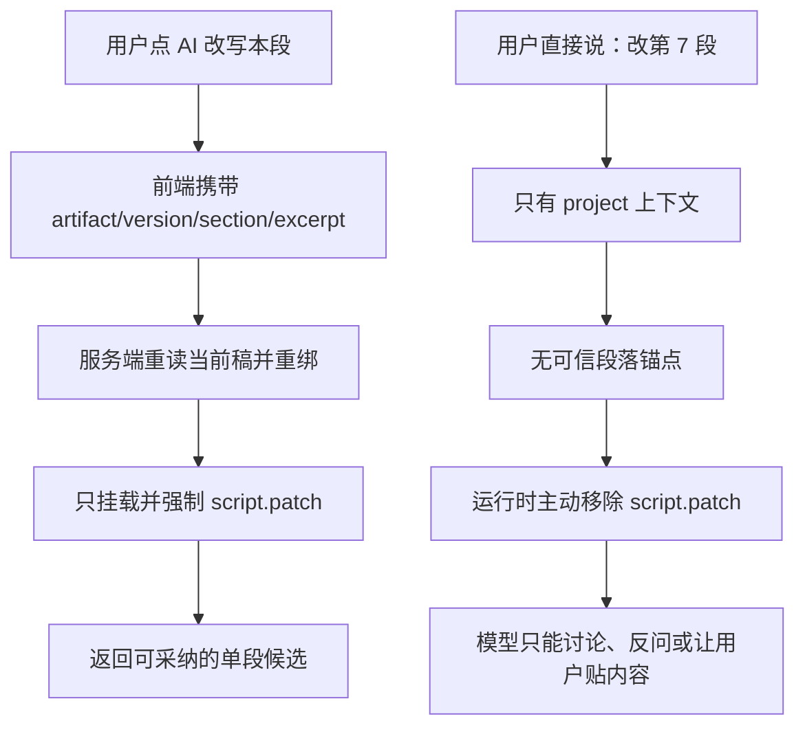

# 自然语言单段改写无法进入局部补丁链诊断

> 日期：2026-08-13（America/Los_Angeles）
> 任务：T-818
> 范围：只读核对用户截图、当前安装版安全日志、现有 T-716/T-732 规格及源码；未修改业务代码、正式数据库、模型配置或发布包。

## 一句话结论

用户说“改第 7 段”时编导识别不到，不是偶发模型理解差，而是当前产品契约决定的：**`script.patch` 只有在用户先点稿面上的“AI 改写本段”、前端随消息携带完整段落锚点时才会挂载；普通项目对话即使自然语言明确指向某一段，运行时也会主动移除这个工具。**

所以当前实际能力是“按钮驱动的单段改写”，不是“编导理解自然语言后定位并改写单段”。截图里编导退化为“你改后的内容决定怎么录 / 等你贴改后的内容”，正是缺少可执行局部改稿通道后的表现。

## 截图与日志对齐

截图创建于本地时间 08:55:29。截图左侧当前稿第 7 段可见，并有“AI 改写本段”按钮；右侧编导表格把第 7 段标成“你改后的内容决定怎么录”，没有出现“原文 / 建议稿 / 修改说明”局部候选卡。

相邻的最新普通对话轮日志显示：

- 15:53:23 UTC：普通 `chat-context` 装配；
- 15:53:39 UTC：`chat-turn` 正常完成；
- 中间没有 `[T-716][script.patch] rebound to current script truth`；
- 中间没有 `[chat-tool] name=script.patch`。

这说明该轮没有进入局部改稿专用回合。作为对照，同一项目此前真正从段落按钮发起的局部改稿会连续记录：

1. `script.patch` 重新绑定当前稿面真值；
2. `script.patch ok`；
3. 对话完成。

例如 15:24:41 UTC 的按钮链已经真实走通过。由此可以排除“当前安装包完全没有局部改稿能力”，并把问题收敛到入口与路由。

## 当前产品真实行为



大白话说：左边按钮不是一个快捷入口，而是当前唯一能给编导“发改稿许可证”的入口。用户在右边把目标说得再清楚，编导也拿不到这张许可证。

## 代码证据

### 1. 稿面按钮会构造完整锚点

`script-structure-view.tsx` 的“AI 改写本段”会：

- 必要时先保存当前稿；
- 设置 `functionKey: "script.patch"`；
- 携带 `artifactId`、`versionId`、`sectionId`、`sectionIndex` 和该段原文；
- 预填“请只改写我选中的这一段……”供用户补充要求后发送。

这条链路是完整的，日志也证明它在当前安装版走通过。

### 2. 普通输入默认只有项目选择，没有段落选择

稿面右侧 `DraftChatRail` 常驻注入的是：

```text
selection = { kind: "project", id: 当前项目 }
```

用户只在输入框里说“第 7 段”“项目对照那段”或引用一句原文，不会自动把 selection 升级为 `script_section`。

### 3. 路由明确禁止根据自然语言推断局部改稿

聊天路由源码写明：

> `functionKey` 来自可信 UI 动作；自然语言任务语义不在 route 用关键词猜。

这个安全方向本身是对的：代码不能靠“第几段”“改写”等关键词硬猜创作意图。但当前实现只完成了“不猜”，没有补上“让模型语义定位、再由服务端确定性校验”的安全通道。

### 4. 没有完整锚点时，运行时主动删除工具

`chat-runner.ts` 只有同时具备以下条件才认为段落锚点可信：

- `selection.kind === "script_section"`
- `artifactId`
- `versionId`
- `sectionId`
- `excerpt`

缺任意一项，就从本轮白名单中删除 `script.patch`。现有单测还明确锁定了这一行为：普通项目对话的 `tools["script.patch"]` 必须是 `undefined`，系统提示中也不得出现它。

本次重新执行 `backend/src/modules/ai-runtime/chat-runner.test.ts`，134 个用例全部通过；其中“无可信段落锚点时不挂载 `script.patch`”和“按钮携带完整锚点时只开放 `script.patch`”均为当前绿测行为。

因此模型不是“没选对工具”，而是这一轮根本看不到可选工具。

### 5. 当前稿全文工具不足以安全补锚点

即使模型主动调用 `context.artifact.text`，拿到的也是拍平后的全文窗口，没有结构化段落数组、稳定段落引用或与 current version 绑定的安全选择句柄。模型最多能读懂“第 7 段在说什么”，无法把它转换为服务端认可的可执行补丁目标。

## 与现有 T-716/T-732 的关系

现有 T-716 规格只承诺：

- 从结构稿段落点击“AI 改写本段”；
- 系统绑定技术锚点；
- 模型不向用户索要 ID；
- 用户采纳后只改这一段。

T-732 又进一步保证旧锚点失效后不能阻断普通对话。两者都没有承诺“用户在普通对话中自然语言点名一个段落，也能建立新的可信锚点”。

所以这不是已经承诺能力的随机回归，而是用户真实使用方式暴露出的产品缺口：**对话型编导却要求用户先理解并点击一个特殊按钮，语言本身不能成为入口。**

## 应有的修复边界

后续实现不能用关键词正则把“第 7 段”直接翻译成数据库 ID，也不能把模型自报的 artifact/version/section ID 当真。安全且符合通用智能体边界的闭环应是：

1. 保留“AI 改写本段”作为最快、最确定的按钮入口。
2. 普通项目对话允许模型先读取**结构化当前稿**：current artifact/version/hash，以及每段的序号、标题、正文、段型和时间码。
3. 模型根据用户完整语义解析目标，例如“第 7 段”“项目对照那段”“从‘先说优点’开始的那段”；代码不做业务关键词判断。
4. 模型只提交一个服务端签发的短期 `sectionRef` 或可验证的段落序号/引用；服务端按当前 RequestContext 重新读取 current version 并唯一重绑。
5. 唯一命中就产 `script.patch` 候选；多段或零段命中才请用户澄清，不能默认整稿改写，也不能让用户复制粘贴系统已有正文。
6. 候选卡明确显示目标段标题与“只影响这一段”；采纳时再次做版本、段落和原文并发校验。
7. 自然语言入口与按钮入口最终汇入同一 `script.patch` 候选和采纳服务，不建第二套改稿系统。
8. 与 T-812 一并增加 no-op 防线：替换文与原文相同不能冒充成功候选。

## 必须覆盖的真实回归

- 在项目对话直接说“把第 7 段缩短一半”，不点按钮，也能命中当前 v4 第 7 段并返回局部候选。
- 说“把项目对照那段改得更具体”，模型根据结构化当前稿语义唯一命中。
- 同一描述命中两段时只问一个必要澄清问题，不擅自挑一段。
- 用户说“重写整稿”时不能被历史段落锚点劫持。
- 生成候选前稿面切到新版本时重新绑定；无法唯一绑定则明确冲突，不拿旧正文继续。
- 采纳后只有目标段变化，其余段落字节级不变；刷新后新版本与候选一致。

## 诊断边界

本次可以确定：截图相邻对话没有进入 `script.patch`；当前按钮链曾真实成功；普通项目对话在没有按钮锚点时按代码和测试都会物理移除局部改稿工具。

本次无法从安全日志还原用户当轮完整自然语言原文，因为日志按隐私规则不记录消息正文；截图已经足以证明界面没有局部候选卡。后续真实回归应记录脱敏的路由模式、currentVersionId/hash 和 sectionIndex，而不记录正文。
