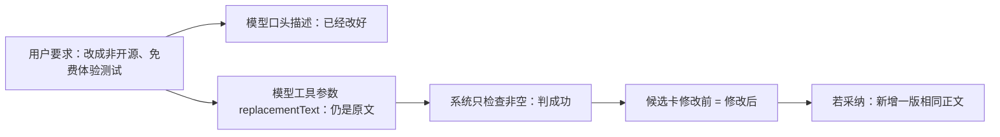

# 局部改稿“声称已修改但候选正文完全未变”诊断

> 日期：2026-08-13（America/Los_Angeles）
>
> 任务：T-812
> 范围：只读核对用户截图、安装版加密日志、当前源码、契约与测试；未点击采纳，未修改业务代码、正式数据库、模型配置或发布包。

## 结论

这不是稿面缓存，也不是选错段。真实情况是：**模型调用了局部改稿工具，但把原段原样填进了 `replacementText`；系统只检查“替换文非空”，没有检查“替换文是否真的不同于原文”，因此把一份零改动结果渲成了可采纳候选。随后模型又用自然语言描述了它本来想做、但实际没有写进候选的改动。**

用户截图中的“修改前”和“修改后”逐字一致，均仍包含“全是 GitHub 开源 + 本地部署”等原句；右侧没有出现对话所声称的“不开源、但可以免费体验测试”。因此当前卡片才是可执行真值，对话说明不是已落入候选的事实。

**当前不要点击“采纳这处修改”。** 如果点击，后端会追加一个正文不变的新版本，并给出“已写入稿面”的成功反馈，仍不会得到对话承诺的改写。



## 证据链

### 1. 选区与版本绑定正常

安装版最新加密日志中，本轮局部改稿发生在 2026-08-13 14:44–14:46 UTC：

- 14:44:39：`script.patch` 重新绑定到当前稿面真值，`matchStrategy=id`、`requestedSectionIndex=15`；
- 14:44:41：`script.patch ok`；
- 后续 14:45:29、14:45:47、14:46:00、14:46:19 的连续请求仍都稳定绑定同一段，并成功执行工具。

这排除了选区锚点失效、读错版本或绑定到别段。日志不记录正文与工具参数明文，因此“原文等于替换文”由用户眼前的候选卡直接证明。

### 2. 候选卡没有第二份缓存，会直接显示工具结果

`frontend/src/features/copilot/chat-script-patch-card.tsx`：

- 左栏直接渲染 `candidate.originalText`；
- 右栏直接渲染 `candidate.replacementText`；
- 只要两者均非空，按钮就保持可点击；
- 点击后又把同一 `replacementText` 原样发给 `artifacts.scriptPatches.apply`。

所以截图中左右相同，不是前端把新文缓存成旧文，而是候选对象本身就是零改动。

### 3. 工具边界只做 `trim()`，没有“实际发生变化”校验

`backend/src/modules/ai-runtime/chat-tools.ts` 的 `script.patch` 工具把模型参数做 `trim()` 后直接返回：

```ts
originalText: trustedScriptPatchAnchor.originalText,
replacementText: replacementText.trim(),
```

这里没有比较 `replacementText` 与 `originalText`，原文原样返回也会得到 `kind: "script.patch"` 的成功候选。

专用回合提示只要求模型“必须调用 `script.patch`”，没有确定性规则验证调用结果是否满足用户要求，也没有要求最终自然语言必须从实际差异生成。因此“工具结果没改、口头却说改了”可以同时发生。

### 4. 采纳服务同样只拒绝空字符串

`backend/src/modules/artifacts/artifacts.service.ts` 的应用命令会校验当前版本、段落 ID 和原文并发一致性，但对替换正文只做：

```ts
const replacementText = input.replacementText.trim();
if (!replacementText) throw ...;
```

随后无条件创建新版本。它没有拒绝“替换文与当前正文相同”的 no-op，因此前端即使漏过，后端也不会兜底。

### 5. 现有测试覆盖了锚点安全，漏了零改动

当前测试覆盖：

- 只改目标段并新增版本；
- 历史无 ID 段落锚点恢复；
- 旧版本冲突；
- 原文不一致冲突；
- 工具技术 ID 不能由模型伪造。

没有任何用例要求：

- `replacementText === originalText` 时不生成候选；
- 仅首尾空白不同也应视为无实际修改；
- no-op 候选不能点击采纳；
- no-op 不能创建新版本；
- 对话不得在无真实差异时声称“已经修改”。

## 根因分层

| 层 | 真实表现 | 判断 |
| --- | --- | --- |
| 用户意图 | 明确要求把“开源”改为“非开源、免费体验测试” | 正常 |
| 当前稿面锚点 | 稳定命中第 16 段当前版本 | 正常 |
| 模型工具参数 | `replacementText` 实际仍为原文 | 首个直接故障 |
| 工具候选封装 | 非空即返回成功候选 | 防线缺失 |
| 候选卡 | 如实显示了原文 = 替换文，但仍给“采纳”按钮 | 防线缺失、交互误导 |
| 后端采纳 | 相同正文仍可新增版本 | 最终防线缺失 |
| 对话说明 | 描述了候选中不存在的改动 | 事实约束缺失 |

## 修复边界建议

后续若授权修复，应一次闭环，而不是只改一句提示词：

1. 工具执行边界比较规范化后的原文与替换文；相同则返回明确 no-op 错误，不产生可采纳候选。
2. `artifacts.scriptPatches.apply` 再做同一校验，保证任何客户端都无法写入无变化版本。
3. 候选卡对历史/异常 no-op 数据禁用采纳并显示“这次没有生成实际修改，请重试”。
4. 局部改稿后的成功说明从真实候选差异派生；不能让模型自由声称自己改了哪些内容。
5. 增加原样返回、仅空白变化、真实变化、并发冲突、无新版本、刷新后回显与连续改稿回归。

这些校验只判断“是否发生了字符级变化”，不判断创作语义，不需要也不应加入“开源”等业务关键词分支。
