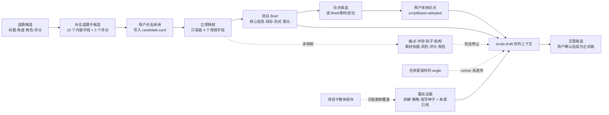

# “选题→补全选题卡→项目→论点→文案”数据血缘审计

> 日期：2026-08-13（America/Los_Angeles）
> 任务：T-811
> 范围：只读审计当前源码、契约和恢复数据库冻结副本；未修改业务代码、正式数据库、模型配置或发布包。

## 一句话结论

当前链路**不是完全断的**：选题标题/角度能参与补卡，选题卡中的“一句话、目标受众、内容形式、立项建议”会进入项目 Brief，项目 Brief 的核心信息、内容目标、内容形式、目标受众和成功标准会进入写稿提示词，用户明确采纳的论点也会进入写稿。

但它也不是一条完整的数据管道：**完整选题卡在立项时被压缩，痛点、冲突、钩子、结构、素材依据、风险、评分和内容定位不进入项目；写稿任务虽然存了 angle，实际 runner 却没有传给提示词；项目卡普通保存还会整体覆盖并删除隐藏的内容雷达证据。** 因此用户在选题阶段认真补过的信息，到了文案阶段很大一部分实际上已经不在上下文里。

## 当前真实链路

## 分段审计

### 1. 选题 → 补全选题卡：基本连通，但必须采纳才落库

“补全选题卡”按钮会把当前候选的 `candidateId` 和标题作为确定性选择锚点打开 Copilot；补卡模型读取：

- 当前选题的标题、角度；
- 创作者定位；
- 历史复盘经验；
- 受众信号；
- 知识库；
- 当前会话可选的联网核实材料。

模型会生成 10 个内容字段：`oneLiner`、`targetAudience`、`audiencePain`、`coreConflict`、`hook`、`contentStructure`、`format`、`materialBasis`、`riskNote`、`proposal`；另有 `audiencePainScore`、`materialScore`、`productionDifficulty` 3 个评估字段。

这一步的 AI 输出只是候选。用户点击“采纳”后才会 patch 到 `candidate.card`。这是正确的人机确认门，不属于断层。

### 2. 补全选题卡 → 项目：主断层，10 个内容字段只常规保留 4 个

立项时当前代码的常规映射只有：

| 选题数据 | 项目数据 | 后续是否参与写稿 |
| --- | --- | --- |
| `candidate.title` | `project.title` | 间接参与；写稿并不在服务端强制重读标题，而是依赖对话选择/工具入参 |
| `candidate.angle` | `project.brief` 文本；无 `oneLiner` 时兜底 `coreMessage` | `project.brief` 本身不进标准写稿硬约束；兜底成 `coreMessage` 时才真正生效 |
| `card.oneLiner` | `briefDetail.coreMessage` | **真实生效**，作为“钦定主张”进入写稿 |
| `card.targetAudience` | `briefDetail.targetAudience` | **真实生效**，作为目标观众进入写稿 |
| `card.format` | `briefDetail.contentFormat` | **真实生效**，作为形式定调进入写稿 |
| `card.proposal` | `briefDetail.contentGoal` | **真实生效**，作为内容目标进入写稿 |
| `card.teardown` | 隐藏的 `briefDetail.benchmarkRef` | 有条件生效，但不在公开 Project Brief 契约/UI 内，后续保存容易丢 |
| 雷达来源/拆解/策略/改写种子 | `briefDetail.contentRadarEvidence` + `project_intelligence_references` | 两半同时存在时真实生效 |

以下信息**没有进入普通项目 Brief，也没有进入后续标准写稿上下文**：

- `audiencePain` 受众痛点；
- `coreConflict` 核心冲突；
- `hook` 开头钩子；
- `contentStructure` 内容结构；
- `materialBasis` 素材依据；
- `riskNote` 风险点；
- `audiencePainScore`、`materialScore`、`productionDifficulty`；
- `contentRole`、`productAnchorId`、`positioningFit`、`predictedScore`、`demandCount`。

后三组定位/评分字段目前真实作用在**候选池的排序、筛选、标签和立项前判断**，不是写作上下文；选题卡的 3 个评分也只是展示/编辑信息。它们有上游产品价值，但不能说“影响了当前生成的文案”。

此外，立项调用没有传 `source: "topic"`，而项目服务默认 `manual`。`topic_promotions` 仍保留了候选与项目关系，但项目来源字段被误标为“手动”，会影响来源展示或后续分析。

立项的三次写入——创建项目、候选改为已立项、创建 promotion 关系——也没有事务包裹。中间失败时理论上可能留下“项目已建，但候选/关系未完成”的半状态。

### 3. 项目 Brief：有 5 个字段真正进入写稿，但隐藏证据可能被普通保存抹掉

标准 `script.draft` 会把这些项目字段渲成“必须遵守”的硬约束：

- `coreMessage`：钦定主张；
- `contentGoal`：内容目标，其中“避免/不要”作为负向硬约束；
- `contentFormat`：内容形式定调；
- `targetAudience`：目标观众；
- `successCriteria`：成功标准。

`orientation` 也会作为横屏/竖屏提示进入写稿。`targetPlatforms` 当前不进入写稿；这是“发布平台后置”的既定产品选择。`durationEstimate` 虽然能在项目卡中保存，但 `renderProjectBriefHard` 不读取它；文案时长只认写稿工具显式传入的 `targetDurationSeconds`，所以项目卡里的预估时长目前**存了但不生效**。

更严重的是，项目卡的普通“保存”会发送一个重新组装的完整 `briefDetail` 并整体替换，只包含界面上的常规字段，不包含 `contentRadarEvidence` 和 `benchmarkRef`。因此：

- 雷达项目原本携带的来源、拆解、策略和改写种子可能被一次普通保存静默删除；
- 对标项目的隐藏 `benchmarkRef` 也可能被删除；
- 公开契约本身甚至没有 `benchmarkRef`，前端无法显示、核对或稳定回传它。

聊天里的“补 Brief”卡会以当前详情为底合并，通常能保留运行时未知字段；但类型契约并不承认这些隐藏字段，一旦当前读取为空或经过公开 DTO 裁剪，仍可能丢失。根因是扩展证据被塞进一个“整体替换”的可编辑 JSON 对象，而不是独立、稳定的来源快照。

### 4. 项目 → 论点：能读 Brief，但不读完整选题卡和内容雷达证据

论点骨架是可选步骤。生成论点时会读取：

- 主题（来自对话工具参数或当前选择标题）；
- 定位；
- 历史复盘；
- 项目 Brief；
- 项目素材；
- 产物来源标记。

它不会读取：

- 立项时已丢失的痛点、冲突、钩子、结构、素材依据、风险；
- `projectIntelligence` 内容雷达来源、原文、拆解和改写策略；
- 知识库（当前 `planning.thesis` 的声明式上下文中没有 `knowledge`）。

论点生成完成后也只是候选。只有用户点击“采纳并用于写稿”，当前版本写入 `scriptBasis.status="adopted"`，`script.draft` 才读取论点节点。历史无标记或未采纳论点仍可展示，但不会影响写稿。这是明确的确认门，产品上需要把“当前是否生效”展示清楚，不能把它误判为系统丢数据。

### 5. 项目/论点 → 文案：大部分硬约束真进了 prompt，但 angle 在最后一跳被丢

标准写稿最终会真实装配：

- 定位、历史复盘、知识库；
- 项目 Brief 的 5 个硬约束和画幅；
- 已采纳的论点；
- 项目用户素材（高优先/参考分层）；
- 项目素材库清单；
- 有效的对标拆解；
- 两半均完整的内容雷达证据；
- 当前对话的额外要求；
- T-791 冻结的用户指定资料快照和指令（最高优先级）；
- 写稿工具显式传入的时长。

但这里有一个确定性 bug：`buildScriptDraftTaskInput` 会把 `angle` 写进 `ai_tasks.input_data`，而 `runScriptDraftTask` 调用 `assembleCreativeContext` 时只传 `{ projectId, topic }`，没有传 `angle`。后面虽然把 `context.topic.angle` 传给模型，但它已经是空值。也就是说：**数据库里看得到 angle，不代表当前文案真的用到了 angle。**

项目标题也没有在写稿 runner 里按 `projectId` 重新读取作为真值；它依赖 Copilot 当前选择标题或模型工具参数生成 `topic` 快照。项目 Brief 的 `coreMessage` 能兜住核心主张，但“这次到底在写哪个题”仍过度依赖对话层传参。

`verbatim` 完整原稿导入模式会故意绕过模型、Brief、论点和上述上下文，逐字保存来源正文。这是保真模式的设计，不是断层。

## 内容雷达：目前是一条“有条件连通、容易分叉”的双链

雷达立项需要同时保存：

1. `briefDetail.contentRadarEvidence`：来源引用、拆解、策略、改写种子；
2. `project_intelligence_references`：项目到真实来源内容的不可变引用。

标准写稿只有在第 1 项存在时才会去读取第 2 项。如果第 1 项存在、第 2 项缺失，系统会阻断生成，避免退化成只按定位瞎写，这是正确的安全门；但如果第 2 项仍在、第 1 项被项目卡保存抹掉，系统不会反向报错，而是静默把它当普通项目，雷达来源不再进入写稿。

稿面加载另有一个兼容回退：当 Brief 证据缺失时，会从 intelligence reference 找回 `adaptedDraft` 展示。因此会出现一种“分裂体验”：**稿面还能看到雷达改写种子，但重新生成文案时模型已经没有读雷达证据。**

## 恢复数据冻结副本的实证

为避免影响正在使用的正式数据库，本次只在 T-810 的 `repaired-final-candidate` 冻结副本之副本上执行只读统计。它反映恢复完成时的数据，不包含此后新写入。

| 实测项 | 结果 | 说明 |
| --- | ---: | --- |
| 候选总数 | 58 | 当前候选池 |
| 含完整常规选题卡的候选 | 7 | 10 个内容字段各有 7 条非空；不是所有候选都补过卡 |
| 已立项关系 | 7 | `topic_promotions` 真实存在 |
| 被立项项目标为 `source=topic` | 0 | 7 个全部落成 `manual`，证实来源误标 |
| 来源候选有 hook | 5 | 已立项候选中 5 条有钩子 |
| hook 在项目 Brief 任意位置存活 | 0 | 证实常规立项不透传钩子 |
| 来源候选有 contentStructure | 5 | 已立项候选中 5 条有结构 |
| 项目含 contentStructure 键 | 0 | 证实结构在立项边界停止 |
| 当前论点产物 | 29 | 历史可展示 |
| 当前明确 `adopted` 的论点 | 2 | 只有这 2 份真实进入写稿；其余 27 份无采用标记 |
| `script.draft` 任务 | 29 | 历史写稿任务 |
| 任务中存有 `topic` | 28 | 但只有 3 个等于当前项目标题，说明主题快照依赖会话/可能被后续改名影响 |
| 任务中存有 `angle` | 15 | runner 仍会统一丢弃，存了不等于用了 |
| 雷达项目引用 | 2 | 两条来源关系仍在 |
| Project Brief 仍有雷达证据 | 1 | 2 条中只有 1 条还能触发标准写稿加载雷达证据 |

这组数据不能证明每一次字段缺失都是同一个 UI 保存动作造成的，也可能包含旧版本数据或用户后续编辑；但源码已经证明普通保存会整体覆盖隐藏字段，而“2 条引用、仅 1 条 Brief 证据”的现状与该缺口完全一致。

## 字段作用总表

| 类别 | 字段/数据 | 当前真实作用 |
| --- | --- | --- |
| 真正进入写稿 | `coreMessage`、`contentGoal`、`contentFormat`、`targetAudience`、`successCriteria`、`orientation` | 作为项目硬约束或画幅提示 |
| 条件进入写稿 | 已采纳 thesis、完整雷达双链、`benchmarkRef`、用户素材、知识库、T-791 指定资料 | 满足采用/完整性/存在条件后进入 |
| 只影响选题决策 | `contentRole`、`productAnchorId`、`positioningFit`、`predictedScore`、`demandCount`、三项卡片评分 | 排序、标签、判断，不参与文案生成 |
| 立项时丢失 | `audiencePain`、`coreConflict`、`hook`、`contentStructure`、`materialBasis`、`riskNote` | 补卡可见，普通立项后标准写稿读不到 |
| 存了但未用 | `ai_tasks.input_data.angle`、Project `durationEstimate` | angle 在 runner 最后一跳漏传；时长只认显式秒数 |
| 容易被覆盖 | `contentRadarEvidence`、`benchmarkRef` | 项目卡整体保存不回传隐藏字段 |
| 有意不生效 | 未采纳论点、未采纳 AI 选题卡/稿件候选、verbatim 模式的创作上下文 | 人机确认或保真边界 |

## 建议的修复顺序

### 1. 先修“确定性丢字段”

- 写稿 runner 把 `inputData.angle` 传给 `assembleCreativeContext`；
- 项目卡保存改为字段级合并，或者由后端强制保留证据字段；
- 立项显式写 `source: "topic"`；
- 立项的项目、候选状态、promotion 关系改成一个事务。

### 2. 建一个统一的创作 Brief，而不是让各阶段各挑一部分

让项目拥有一个公开、可编辑、带来源标记的 `creativeBrief`，至少明确承接：主张、受众、痛点、冲突、钩子方向、结构、素材依据、风险、形式、目标。选题卡立项时生成快照，用户在项目中可看、可改；论点和文案都读取同一个对象，避免两套字段映射各自漂移。

评分、内容角色、定位契合仍可以只用于选题决策，不建议未经设计直接塞进写稿；但应在血缘界面明确标注“仅用于选择，不参与生成”。

### 3. 让论点与写稿共用同一份证据上下文

`planning.thesis` 应显式声明并读取 `knowledge`、`projectIntelligence` 和统一 creative Brief。否则论点先在较贫乏的上下文中定型，写稿再拿更丰富证据补救，容易出现论点和事实不一致。

### 4. 为每次生成保存可审计的上下文快照

在 `ai_task` 保存字段级 lineage，例如：

- 字段值的 hash；
- 来源实体/版本；
- 是否被 prompt renderer 实际消费；
- 因何未消费（空值、未采纳、模式绕过、契约裁剪）；
- 最终 prompt 段落清单。

这样用户问“这张选题卡到底有没有作用”时，系统可以直接给出本次生成证据，而不是靠查源码和猜测。

## 审计边界

- 本报告证明的是当前源码路径与恢复冻结数据中的事实，不把历史缺字段一律归因于当前版本；
- 本次没有调用模型重新生成，不评价模型本身的文案质量；
- 本次没有修改业务代码或正式数据，建议修复需另立实现任务并通过测试与真机链路验收。
