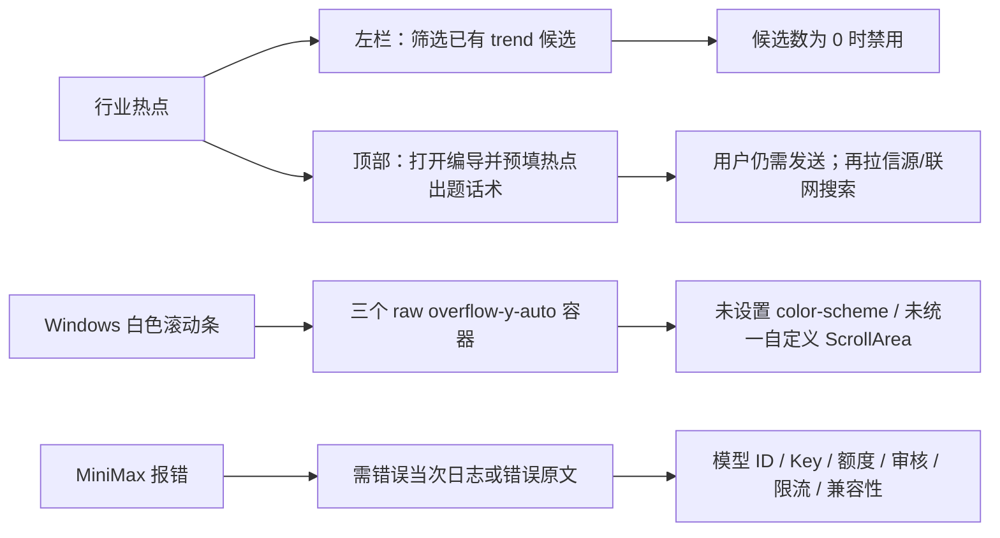

# Windows 行业热点、滚动条与 MiniMax 调用诊断（2026-08-13）

> 任务：T-828
> 范围：只读诊断，不修改用户项目、模型配置、正式数据或发布包。
> 现场证据：用户 Windows 真机截图；`sidecar-2026-08-08.log.enc`（仅内存解密查看，未落明文）。

## 一句话结论

三个现象不是同一个故障：选题页把“热点候选筛选”和“基于热点生成”做成了两套含义不同但名字相近的控件；Windows 白色粗滚动条是应用没有统一暗色原生滚动条且同时使用多个独立滚动容器；MiniMax 的端点预设与当前官方文档一致，但模型 ID 允许自由输入且本次日志不包含报错现场，因此尚不能在没有当次原始响应的情况下判定是模型名、审核、额度还是限流。

## 1. “行业热点”为什么看起来不能用

### 已确认的产品语义错位

选题页存在两个容易被当成同一件事的入口：

1. 左侧“行业热点”是**筛选器**，只筛候选池中已经存在的 `source=trend` 选题。代码明确在该来源候选数为 0 时禁用，所以它不是“点击后去抓热点”。证据：`frontend/src/features/topics/topics-interactive-region.tsx:945-1024`。
2. 顶部“基于热点出题”是 **Copilot 深链**。它只打开编导并预填“结合当下热点……”这句话，设计上“预填不自动发”，用户仍需发送。证据：`frontend/src/features/topics/topic-generate-island.tsx:3-9,32,57-62,89-95`。

这会造成两个直观误解：

- 左栏看起来像来源入口，实际没有候选时完全点不了；
- 顶部看起来像执行按钮，实际只把话放进输入框，不会立即开始生成。

### 热点生成的真实依赖

用户发送后，`topic.generate(basis=trend)` 会并行读取：

- 内容雷达中已登记的网页/RSS 信源；
- web 联网搜索。

没有登记来源、来源需要登录但登录态失效、抓取失败且搜索也无命中时，系统会拒绝伪造“实时热点”，并引导去内容雷达登记来源或网站登录保管库重新登录。这个行为本身是诚实门，不是按钮失效；但当前 UI 没在点击前说明依赖，所以用户只会感知为“用不了”。证据：`backend/src/modules/ai-runtime/chat-runner.ts:1548-1590`。

## 2. Windows 滚动条为什么是白色粗条

### 已确认根因

截图中同时出现的三根滚动条来自三个独立的原生滚动容器：

- 左侧栏：`frontend/src/components/shell/sidebar.tsx:254-257`；
- 稿件区：`frontend/src/features/draft-workbench/draft-resizable-layout.tsx:171-175`；
- 编导消息区：`frontend/src/features/copilot/ai-copilot-content.tsx:2252-2258`。

三个位置都直接使用 `overflow-y-auto`。全局暗色主题只替换应用颜色变量，`frontend/src/app/globals.css` 没有声明 `color-scheme: dark`，也没有 `::-webkit-scrollbar` / `scrollbar-color` 规则。因此 Windows WebView2 使用浅色系统原生滚动条；macOS 默认覆盖式滚动条不明显，所以问题主要在 Windows 暴露。

仓库已经有统一的 Radix `ScrollArea`（`frontend/src/components/ui/scroll-area.tsx`），但上述三个区域没有使用它。结论：这是跨平台 UI 适配缺口，不是 Windows 安装损坏，也不是用户系统主题异常。

## 3. MiniMax 为什么报错

### 已确认

- CreatorOS 的 MiniMax 预设是 Anthropic 兼容协议，基础地址为 `https://api.minimaxi.com/anthropic`；运行时会规范成 `https://api.minimaxi.com/anthropic/v1/messages`。这与 MiniMax 官方当前接口一致。
- 当前官方 Anthropic 兼容接口只接受明确的模型 ID，例如 `MiniMax-M2.7`、`MiniMax-M2.7-highspeed`、`MiniMax-M2.5` 等；不能填写“Max”“MiniMax Max”之类显示名或口语名。
- CreatorOS 当前把模型 ID 设计成自由输入，预设不会提供或校验当前模型列表；设置手册仍以 `MiniMax-M2.5` 为例。因此错误模型名可以先保存，直到真实调用时才收到上游 `model_not_found` / 4xx。
- 用户截图中同一页面明确显示“脚本初稿 已完成”，说明至少这次脚本生成的文本调用成功。若使用的是同一配置，统一的端点不可达或 Key 完全无效不是首要怀疑对象。

### 本次不能确认的部分

用户提供的 `sidecar-2026-08-08.log.enc` 只有 16 行，内容为：应用启动、`activation-only`、sidecar ready、随后正常关闭（退出码 0）。日志内没有任何 `topic.generate`、provider、model、HTTP 状态、MiniMax 平台码或任务失败记录。它既不是截图现场的模型调用日志，也不能支持“模型名错误”“内容审核”“额度不足”等任一具体归因。

要锁定唯一原因，需要在 Windows 上复现报错后立即导出当天最新诊断日志，或提供错误气泡原文。重点匹配：

| 原始信号 | 含义 |
| --- | --- |
| `model_not_found` / `invalid_model` / HTTP 404 | 模型 ID 不存在或拼写不对 |
| 401 / 403 / `invalid_api_key` | Key 无效、过期或无权限 |
| `1008` / insufficient balance | MiniMax 余额或额度不足 |
| `1026` / `new_sensitive` | 输入触发 MiniMax 内容审核 |
| `1027` / output sensitive | 输出触发 MiniMax 内容审核 |
| 429 / `1002` / `1039` | 模型方限流 |
| timeout / cancelled / 5xx | 上游临时故障、网络或超时 |

## 下一步修复边界

本报告只完成根因分层，不直接改代码。建议后续修复任务一次覆盖：

1. 把左栏“行业热点”明确标成“热点候选筛选”，0 条时给出原因和“去生成/去内容雷达”动作；顶部按钮明确“打开编导”，或在产品确认后改为真实的一键执行。
2. Windows 三个滚动容器统一暗色、宽度和 hover 视觉，并用 Windows 真机验证高 DPI、滚轮、拖拽和嵌套滚动。
3. MiniMax 保存/测试时校验真实模型 ID，并把上游错误码完整进入脱敏诊断日志；模型调用失败时显示稳定的人话和对应动作。
