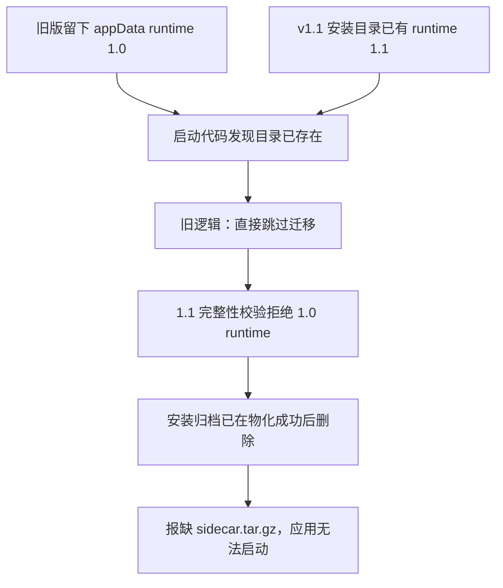

# CreatorOS v1.1 Windows 新安装包无法启动：用户真机日志诊断

> 任务：T-826
> 日期：2026-08-13
> 输入：用户提供的加密 sidecar 日志与本地留存的同一 v1.1 Windows 安装包。日志只在本机临时目录解密，明文未写入仓库。

## 结论

安装包不是没带运行资源，而是升级时选错了运行资源：旧版已经在 Windows 用户目录留下了一份
`runtime-images`；新版安装器又在安装目录物化了一份当前版本。启动代码只要看见用户目录已经存在，
就直接跳过新版迁移。随后当前版本完整性校验拒绝旧 runtime，而安装器成功物化后已经删除原始
`sidecar.tar.gz`，所以最后看到的是“安装目录缺归档”，应用无法进入主页面。

## 证据链

- 用户最新一条 sidecar 日志在桌面壳解析 runtime 时立即失败，落点为安装目录缺
  `sidecar.tar.gz`；没有进入 sidecar health 或主页面加载。
- 对用户所用 v1.1 安装包做只读展开，安装器内明确存在 `sidecar.tar.gz`，大小约 438 MB；因此
  “打包漏带归档”被排除。
- 较早日志显示该机器用户目录已有 `runtime-images/1.0.0-*`。这与代码中“只要目标目录存在就不迁移”
  的分支完全吻合。
- 同一安装包的干净 Windows CI 能启动，只能证明全新用户目录路径；CI 没有模拟旧 runtime 残留，
  因而没有覆盖真实升级路径。

## 修复原则

1. 用户目录没有当前版本可用 runtime 时，必须考虑安装目录的新 runtime，不能因目录存在而跳过。
2. 新 runtime 要先复制到临时目录并完成当前版本 hash 与入口文件校验。
3. 校验通过后才把旧 runtime 暂存并原子切换；提交失败则恢复旧 runtime。
4. 切换成功后的旧 runtime 清理失败只记录日志，不再反向阻断已可用的新版本。
5. 只替换可再生的 `runtime-images`，不删除项目、数据库、密钥、日志或其他用户数据。

## 尚未验收

本地 Rust 与打包工作流测试能证明迁移算法和 CI 契约，但不能证明 Windows 安装包真机已经恢复。
最终 Gate 仍是新的 Windows 验收包在旧版升级状态下完成：真安装、启动 `CreatorOS.exe`、sidecar
health ready、主页面加载可交互，以及卸载清理。
